# Backend — Biblioteca de Conceptos

Apuntes de referencia de la materia **Desarrollo de Sistemas Web - BackEnd**, IFTS N°11. Profesor: Zammataro Gustavo.

> Este archivo se organiza por concepto, no por orden cronológico de clases. El orden real en que se dio cada tema queda registrado en `bitacora.md` y en el historial de commits.

## Índice

- [Backend — Biblioteca de Conceptos](#backend--biblioteca-de-conceptos)
  - [Índice](#índice)
  - [Unidad 1 — Repositorios: Administración de proyectos y código](#unidad-1--repositorios-administración-de-proyectos-y-código)
    - [1. Sistemas de Control de Versiones (VCS)](#1-sistemas-de-control-de-versiones-vcs)
      - [1.1 ¿Qué es un VCS?](#11-qué-es-un-vcs)
      - [1.2 Tipos de sistemas de control de versiones](#12-tipos-de-sistemas-de-control-de-versiones)
      - [1.3 Ejemplos de VCS y repositorios online](#13-ejemplos-de-vcs-y-repositorios-online)
    - [2. Git](#2-git)
      - [2.1 ¿Qué es Git?](#21-qué-es-git)
      - [2.2 Conceptos clave](#22-conceptos-clave)
      - [2.3 Áreas de trabajo y flujo local](#23-áreas-de-trabajo-y-flujo-local)
      - [2.4 Estados de los archivos](#24-estados-de-los-archivos)
      - [2.5 Configuración inicial de Git](#25-configuración-inicial-de-git)
      - [2.6 Comandos de consola / sistema operativo (no son de Git)](#26-comandos-de-consola--sistema-operativo-no-son-de-git)
    - [3. Comandos de Git](#3-comandos-de-git)
      - [3.1 Tabla general de comandos](#31-tabla-general-de-comandos)
      - [3.2 git init / git clone](#32-git-init--git-clone)
      - [3.3 git add / git status](#33-git-add--git-status)
      - [3.4 git commit / git push / git pull / git fetch](#34-git-commit--git-push--git-pull--git-fetch)
      - [3.5 git restore](#35-git-restore)
      - [3.6 git stash](#36-git-stash)
      - [3.7 git branch, git checkout y git switch](#37-git-branch-git-checkout-y-git-switch)
      - [3.8 git merge, squash y rebase](#38-git-merge-squash-y-rebase)
      - [3.9 Resolución de conflictos de merge](#39-resolución-de-conflictos-de-merge)
    - [4. Flujo de trabajo completo (Git Workflow)](#4-flujo-de-trabajo-completo-git-workflow)
      - [4.1 Working Directory](#41-working-directory)
      - [4.2 Staging Area o Index](#42-staging-area-o-index)
      - [4.3 Repositorio local](#43-repositorio-local)
      - [4.4 Repositorio remoto](#44-repositorio-remoto)
      - [4.5 Flujo mental completo](#45-flujo-mental-completo)
    - [5. .gitignore](#5-gitignore)
    - [6. GitFlow](#6-gitflow)
    - [7. Repositorios remotos y SSH](#7-repositorios-remotos-y-ssh)
      - [7.1 ¿Por qué usar SSH para Git?](#71-por-qué-usar-ssh-para-git)
      - [7.2 Generar una clave SSH](#72-generar-una-clave-ssh)
      - [7.3 Cargar la clave pública en GitHub](#73-cargar-la-clave-pública-en-github)
      - [7.4 Clonar un repositorio con SSH y diagnosticar autenticación](#74-clonar-un-repositorio-con-ssh-y-diagnosticar-autenticación)
      - [7.5 Crear un repositorio remoto en GitHub](#75-crear-un-repositorio-remoto-en-github)
      - [7.6 Colaboradores](#76-colaboradores)
    - [8. Seguridad y reglas de protección de ramas (GitHub)](#8-seguridad-y-reglas-de-protección-de-ramas-github)
      - [8.1 Pull Request (PR / MR)](#81-pull-request-pr--mr)
      - [8.2 Branch protection rules](#82-branch-protection-rules)
      - [8.3 Eliminación automática de ramas al mergear](#83-eliminación-automática-de-ramas-al-mergear)
    - [9. Herramientas complementarias](#9-herramientas-complementarias)
      - [9.1 Git Graph (extensión de VS Code)](#91-git-graph-extensión-de-vs-code)
    - [10. Entorno mínimo de desarrollo](#10-entorno-mínimo-de-desarrollo)
    - [Ejemplo práctico — Sesión de consola: SSH, ramas y stash](#ejemplo-práctico--sesión-de-consola-ssh-ramas-y-stash)
  - [Unidad 2 — JavaScript](#unidad-2--javascript)
    - [11. Compilación, interpretación y ejecución de un lenguaje](#11-compilación-interpretación-y-ejecución-de-un-lenguaje)
      - [11.1 Compilación](#111-compilación)
      - [11.2 Interpretación](#112-interpretación)
      - [11.3 JIT: compilar durante la ejecución](#113-jit-compilar-durante-la-ejecución)
    - [12. Scripts y lenguajes de scripting](#12-scripts-y-lenguajes-de-scripting)
    - [13. ECMAScript, motor y entorno host](#13-ecmascript-motor-y-entorno-host)
      - [13.1 ECMAScript](#131-ecmascript)
      - [13.2 Motor JavaScript](#132-motor-javascript)
      - [13.3 Entorno host](#133-entorno-host)
    - [14. TypeScript: tipado estático sobre JavaScript](#14-typescript-tipado-estático-sobre-javascript)
      - [14.1 JavaScript sigue siendo el runtime conceptual](#141-javascript-sigue-siendo-el-runtime-conceptual)
      - [14.2 Qué agrega TypeScript y qué no](#142-qué-agrega-typescript-y-qué-no)
      - [14.3 El beneficio aparece al crecer el sistema](#143-el-beneficio-aparece-al-crecer-el-sistema)
    - [15. Sintaxis básica de uso frecuente](#15-sintaxis-básica-de-uso-frecuente)
    - [16. Variables en JavaScript](#16-variables-en-javascript)
    - [17. Tipos de datos y modelo de valores](#17-tipos-de-datos-y-modelo-de-valores)
      - [17.1 Tipos primitivos](#171-tipos-primitivos)
      - [17.2 Objetos](#172-objetos)
      - [17.3 `typeof` no refleja perfectamente la taxonomía del lenguaje](#173-typeof-no-refleja-perfectamente-la-taxonomía-del-lenguaje)
      - [17.4 Por qué importa distinguir primitivos y objetos](#174-por-qué-importa-distinguir-primitivos-y-objetos)
    - [18. Igualdad, coerción, `null` y `undefined`](#18-igualdad-coerción-null-y-undefined)
      - [18.1 Igualdad estricta `===`](#181-igualdad-estricta-)
      - [18.2 Igualdad débil `==`](#182-igualdad-débil-)
      - [18.3 `undefined`](#183-undefined)
      - [18.4 `null`](#184-null)
      - [18.5 `typeof null`](#185-typeof-null)
      - [18.6 Relación especial entre `null` y `undefined`](#186-relación-especial-entre-null-y-undefined)
    - [19. Condicionales](#19-condicionales)
    - [20. Objetos](#20-objetos)
      - [20.1 Sintaxis: creación e inicialización](#201-sintaxis-creación-e-inicialización)
      - [20.2 Propiedades: lectura y asignación](#202-propiedades-lectura-y-asignación)
      - [20.3 Objetos declarados con `const`: qué se puede modificar y qué no](#203-objetos-declarados-con-const-qué-se-puede-modificar-y-qué-no)
      - [20.4 Paso por valor, identidad y referencias a objetos](#204-paso-por-valor-identidad-y-referencias-a-objetos)
      - [20.5 Mutabilidad, aliasing y condiciones de carrera](#205-mutabilidad-aliasing-y-condiciones-de-carrera)
      - [Cuándo aparece una condición de carrera](#cuándo-aparece-una-condición-de-carrera)
      - [20.6 Objetos incorporados en JavaScript](#206-objetos-incorporados-en-javascript)
      - [20.7 JSON: `JSON.stringify` y `JSON.parse`](#207-json-jsonstringify-y-jsonparse)
      - [20.8 Reglas prácticas de JSON](#208-reglas-prácticas-de-json)
      - [20.9 Estructuras compuestas: objetos con arrays de objetos](#209-estructuras-compuestas-objetos-con-arrays-de-objetos)
        - [Acceso progresivo a una estructura anidada](#acceso-progresivo-a-una-estructura-anidada)
        - [Por qué esta estructura se vuelve útil al construir una API](#por-qué-esta-estructura-se-vuelve-útil-al-construir-una-api)
    - [21. Funciones](#21-funciones)
      - [21.1 Formas de definir una función](#211-formas-de-definir-una-función)
      - [21.2 Parámetro vs. argumento](#212-parámetro-vs-argumento)
      - [21.3 Funciones como objetos y callbacks (introducción)](#213-funciones-como-objetos-y-callbacks-introducción)
      - [21.4 Ejemplo: callback en una función calculadora](#214-ejemplo-callback-en-una-función-calculadora)
      - [21.5 Firma de una función (*function signature*)](#215-firma-de-una-función-function-signature)
      - [21.6 *Hoisting* y disponibilidad de declaraciones](#216-hoisting-y-disponibilidad-de-declaraciones)
      - [Expresiones de función y Temporal Dead Zone](#expresiones-de-función-y-temporal-dead-zone)
      - [Declaraciones duplicadas](#declaraciones-duplicadas)
      - [21.7 Alcance (*scope*) de una variable declarada dentro de una función](#217-alcance-scope-de-una-variable-declarada-dentro-de-una-función)
    - [22. Profundización de funciones callback](#22-profundización-de-funciones-callback)
      - [22.1 Función de orden superior (*higher-order function*)](#221-función-de-orden-superior-higher-order-function)
      - [22.2 Recibir una callback no implica ejecutarla automáticamente](#222-recibir-una-callback-no-implica-ejecutarla-automáticamente)
      - [22.3 Pasar la función, no su ejecución](#223-pasar-la-función-no-su-ejecución)
      - [22.4 Posición de callbacks: convención según la API](#224-posición-de-callbacks-convención-según-la-api)
      - [22.5 Múltiples callbacks](#225-múltiples-callbacks)
      - [22.6 Orden de ejecución: una función no termina hasta que termina lo que invoca](#226-orden-de-ejecución-una-función-no-termina-hasta-que-termina-lo-que-invoca)
    - [23. Arrays](#23-arrays)
      - [23.1 Elementos e índices](#231-elementos-e-índices)
      - [23.2 Heterogeneidad de valores en arrays JavaScript](#232-heterogeneidad-de-valores-en-arrays-javascript)
      - [23.3 Formas de crear un array](#233-formas-de-crear-un-array)
      - [23.4 Los arrays son objetos: acceso a sus métodos](#234-los-arrays-son-objetos-acceso-a-sus-métodos)
      - [23.5 Métodos que modifican el array original](#235-métodos-que-modifican-el-array-original)
      - [23.6 `forEach`: iteración con una callback](#236-foreach-iteración-con-una-callback)
      - [23.7 `filter`: filtrar elementos según una condición](#237-filter-filtrar-elementos-según-una-condición)
      - [23.8 `map`: transformar cada elemento en un array nuevo](#238-map-transformar-cada-elemento-en-un-array-nuevo)
      - [23.9 `find` y `findIndex`: buscar un elemento puntual](#239-find-y-findindex-buscar-un-elemento-puntual)
      - [23.10 `some` y `every`: verificar una condición sobre el array](#2310-some-y-every-verificar-una-condición-sobre-el-array)
      - [23.11 `fill`: rellenar o reemplazar elementos por posición](#2311-fill-rellenar-o-reemplazar-elementos-por-posición)
      - [23.12 `splice`: agregar, eliminar y reemplazar en un mismo método](#2312-splice-agregar-eliminar-y-reemplazar-en-un-mismo-método)
      - [23.13 `slice`: copiar una porción del array](#2313-slice-copiar-una-porción-del-array)
      - [23.14 `concat`: unir arrays](#2314-concat-unir-arrays)
      - [23.15 `sort`: ordenar el array](#2315-sort-ordenar-el-array)
      - [23.16 Los arrays no son "listas": una aclaración de vocabulario](#2316-los-arrays-no-son-listas-una-aclaración-de-vocabulario)
      - [23.17 Desestructuración (*destructuring*) de arrays y objetos](#2317-desestructuración-destructuring-de-arrays-y-objetos)
    - [Ejemplo práctico — Tipos de funciones en JavaScript](#ejemplo-práctico--tipos-de-funciones-en-javascript)
    - [Ejemplo práctico — Identidad y referencias compartidas entre objetos](#ejemplo-práctico--identidad-y-referencias-compartidas-entre-objetos)
    - [Ejemplo práctico — Función con múltiples callbacks condicionales](#ejemplo-práctico--función-con-múltiples-callbacks-condicionales)
    - [Ejemplo práctico — Arrays: creación, mutación e iteración](#ejemplo-práctico--arrays-creación-mutación-e-iteración)
    - [Ejemplo práctico — Objeto con métodos, validación y scope](#ejemplo-práctico--objeto-con-métodos-validación-y-scope)
  - [Unidad 3 — Node.js](#unidad-3--nodejs)
    - [24. Node.js: runtime de JavaScript fuera del navegador](#24-nodejs-runtime-de-javascript-fuera-del-navegador)
      - [24.1 El problema que resuelve Node](#241-el-problema-que-resuelve-node)
      - [24.2 Runtime, motor y framework no son sinónimos](#242-runtime-motor-y-framework-no-son-sinónimos)
    - [25. Concurrencia, Event Loop y modelo de ejecución en Node.js](#25-concurrencia-event-loop-y-modelo-de-ejecución-en-nodejs)
      - [25.1 ¿Cómo puede atender muchas operaciones si JavaScript ejecuta una a la vez?](#251-cómo-puede-atender-muchas-operaciones-si-javascript-ejecuta-una-a-la-vez)
      - [25.2 No bloqueante no significa “imposible de bloquear”](#252-no-bloqueante-no-significa-imposible-de-bloquear)
      - [25.3 I/O-bound vs. CPU-bound](#253-io-bound-vs-cpu-bound)
      - [25.4 Arquitectura orientada a eventos](#254-arquitectura-orientada-a-eventos)
    - [26. Módulos, paquetes y dependencias](#26-módulos-paquetes-y-dependencias)
      - [26.1 Tipos de módulos](#261-tipos-de-módulos)
      - [26.2 Tipos de dependencias](#262-tipos-de-dependencias)
      - [26.3 Caso real: el incidente de *left-pad*](#263-caso-real-el-incidente-de-left-pad)
      - [26.4 Sistemas de módulos: CommonJS vs. ES Modules](#264-sistemas-de-módulos-commonjs-vs-es-modules)
      - [Cómo decide Node el formato](#cómo-decide-node-el-formato)
      - [Interoperabilidad](#interoperabilidad)
    - [27. NPM (*Node Package Manager*)](#27-npm-node-package-manager)
      - [27.1 Comandos más usados](#271-comandos-más-usados)
        - [Verificar el estado del proyecto desde `package.json`](#verificar-el-estado-del-proyecto-desde-packagejson)
      - [27.2 Scripts de NPM](#272-scripts-de-npm)
      - [27.3 Cómo leer la página de un paquete en npmjs.com](#273-cómo-leer-la-página-de-un-paquete-en-npmjscom)
    - [28. Módulos locales: crear y exportar código propio](#28-módulos-locales-crear-y-exportar-código-propio)
      - [28.1 Importar solo lo necesario, con el nombre que se quiera](#281-importar-solo-lo-necesario-con-el-nombre-que-se-quiera)
      - [28.2 Alias al exportar: nombre interno vs. nombre expuesto](#282-alias-al-exportar-nombre-interno-vs-nombre-expuesto)
      - [28.3 Por qué conviene modularizar: un cambio, un solo lugar](#283-por-qué-conviene-modularizar-un-cambio-un-solo-lugar)
      - [28.4 Errores comunes al exportar y efectos al cargar un módulo](#284-errores-comunes-al-exportar-y-efectos-al-cargar-un-módulo)
        - [Código con efectos secundarios dentro de un módulo](#código-con-efectos-secundarios-dentro-de-un-módulo)
      - [28.5 `module.exports`, `exports` y el valor que recibe `require`](#285-moduleexports-exports-y-el-valor-que-recibe-require)
      - [28.6 Diagnóstico de importaciones y exportaciones](#286-diagnóstico-de-importaciones-y-exportaciones)
        - [La extensión `.js`](#la-extensión-js)
        - [Una comprobación simple antes de buscar errores más profundos](#una-comprobación-simple-antes-de-buscar-errores-más-profundos)
      - [28.7 Cache de módulos CommonJS: por qué varios `require()` suelen ver el mismo objeto](#287-cache-de-módulos-commonjs-por-qué-varios-require-suelen-ver-el-mismo-objeto)
    - [29. Pila (*Stack*) y Cola (*Queue*): estructuras para razonar sobre ejecución](#29-pila-stack-y-cola-queue-estructuras-para-razonar-sobre-ejecución)
      - [Stack — LIFO](#stack--lifo)
      - [Queue — FIFO](#queue--fifo)
    - [30. Programación sincrónica y Call Stack](#30-programación-sincrónica-y-call-stack)
    - [31. Programación asincrónica y Event Loop](#31-programación-asincrónica-y-event-loop)
      - [31.1 Motor y host cooperan](#311-motor-y-host-cooperan)
      - [31.2 Una callback pendiente no interrumpe el código actual](#312-una-callback-pendiente-no-interrumpe-el-código-actual)
      - [31.3 Promesas agregan otra cola de trabajo](#313-promesas-agregan-otra-cola-de-trabajo)
    - [32. Timers en Node.js](#32-timers-en-nodejs)
      - [32.1 El tiempo no es una garantía exacta](#321-el-tiempo-no-es-una-garantía-exacta)
      - [32.2 `setTimeout(..., 0)` y `setImmediate(...)`](#322-settimeout-0-y-setimmediate)
      - [32.3 `setInterval` y acumulación de trabajo](#323-setinterval-y-acumulación-de-trabajo)
    - [33. Módulo `fs` (*File System*): trabajar con archivos y carpetas](#33-módulo-fs-file-system-trabajar-con-archivos-y-carpetas)
    - [34. Promesas (*Promises*)](#34-promesas-promises)
      - [34.1 Los tres estados de una promesa](#341-los-tres-estados-de-una-promesa)
      - [34.2 Crear una promesa](#342-crear-una-promesa)
      - [34.3 Consumir una promesa: `.then()`, `.catch()` y `.finally()`](#343-consumir-una-promesa-then-catch-y-finally)
      - [34.4 Las promesas también son asincrónicas](#344-las-promesas-también-son-asincrónicas)
      - [34.5 `resolve` y `reject` solo trabajan con un único valor](#345-resolve-y-reject-solo-trabajan-con-un-único-valor)
    - [Ejemplo práctico — Promesa completa: comprar la crema](#ejemplo-práctico--promesa-completa-comprar-la-crema)
    - [Ejemplo práctico — Promesa con dos valores, depurada paso a paso](#ejemplo-práctico--promesa-con-dos-valores-depurada-paso-a-paso)
    - [35. Promesas encadenadas (anidadas)](#35-promesas-encadenadas-anidadas)
      - [35.1 Por qué hace falta encadenar](#351-por-qué-hace-falta-encadenar)
      - [35.2 La regla más importante: `return` dentro del `.then`](#352-la-regla-más-importante-return-dentro-del-then)
      - [35.3 Un único `.catch` para toda la cadena](#353-un-único-catch-para-toda-la-cadena)
      - [35.4 Separar operaciones asincrónicas de la función que las coordina](#354-separar-operaciones-asincrónicas-de-la-función-que-las-coordina)
    - [Ejemplo práctico — Promesas encadenadas: validar stock antes de vender](#ejemplo-práctico--promesas-encadenadas-validar-stock-antes-de-vender)
    - [36. `async`/`await`: azúcar sintáctico para trabajar con promesas](#36-asyncawait-azúcar-sintáctico-para-trabajar-con-promesas)
      - [36.1 Sintaxis básica](#361-sintaxis-básica)
      - [36.2 `await` suspende la función async; no bloquea el Event Loop](#362-await-suspende-la-función-async-no-bloquea-el-event-loop)
      - [36.3 Manejo de errores: `try`/`catch` en vez de `.catch`](#363-manejo-de-errores-trycatch-en-vez-de-catch)
      - [36.4 Tres errores comunes con `async`/`await`](#364-tres-errores-comunes-con-asyncawait)
      - [36.5 Cuando una dependencia se vuelve asincrónica, cambia su contrato](#365-cuando-una-dependencia-se-vuelve-asincrónica-cambia-su-contrato)
      - [36.6 Una función intermedia no siempre necesita `async` + `await`](#366-una-función-intermedia-no-siempre-necesita-async--await)
      - [36.7 Capturar un error y propagar un error son decisiones diferentes](#367-capturar-un-error-y-propagar-un-error-son-decisiones-diferentes)
      - [36.8 `catch` vacío: el error silencioso](#368-catch-vacío-el-error-silencioso)
      - [36.9 `new Error(...)` crea; `throw` interrumpe y propaga](#369-new-error-crea-throw-interrumpe-y-propaga)
      - [36.10 Express y errores de handlers `async`](#3610-express-y-errores-de-handlers-async)
    - [37. Eventos y `EventEmitter`](#37-eventos-y-eventemitter)
      - [37.1 `.on()` registra; `.emit()` dispara](#371-on-registra-emit-dispara)
      - [37.2 EventEmitter y Event Loop están relacionados, pero no son lo mismo](#372-eventemitter-y-event-loop-están-relacionados-pero-no-son-lo-mismo)
      - [37.3 Desacoplar productor y consumidores](#373-desacoplar-productor-y-consumidores)
    - [38. Arquitectura cliente-servidor](#38-arquitectura-cliente-servidor)
      - [38.1 Request/response](#381-requestresponse)
    - [39. HTTP y HTTPS](#39-http-y-https)
      - [39.1 Códigos de estado básicos](#391-códigos-de-estado-básicos)
      - [39.2 Anatomía de una HTTP request](#392-anatomía-de-una-http-request)
      - [39.3 Anatomía de una HTTP response](#393-anatomía-de-una-http-response)
      - [39.4 Métodos HTTP y la operación que representan](#394-métodos-http-y-la-operación-que-representan)
        - [Identificar el recurso y enviar datos son problemas distintos](#identificar-el-recurso-y-enviar-datos-son-problemas-distintos)
    - [40. Dirección de un servicio: host, IP y puerto](#40-dirección-de-un-servicio-host-ip-y-puerto)
      - [40.1 IP](#401-ip)
      - [40.2 Hostname](#402-hostname)
      - [40.3 Puerto](#403-puerto)
      - [40.4 Escuchar no equivale a tener una ruta](#404-escuchar-no-equivale-a-tener-una-ruta)
    - [41. URL, DNS, rutas y parámetros](#41-url-dns-rutas-y-parámetros)
      - [41.1 Parámetros de ruta (*path params*)](#411-parámetros-de-ruta-path-params)
      - [41.2 Parámetros de consulta (*query params*)](#412-parámetros-de-consulta-query-params)
        - [Query params como modificadores de una consulta](#query-params-como-modificadores-de-una-consulta)
        - [`req.query` es entrada no confiable](#reqquery-es-entrada-no-confiable)
        - [Ordenar el resultado sin mezclar responsabilidades](#ordenar-el-resultado-sin-mezclar-responsabilidades)
    - [42. Servidor HTTP básico con `node:http`](#42-servidor-http-básico-con-nodehttp)
      - [42.1 Qué problema resuelve cada parte](#421-qué-problema-resuelve-cada-parte)
      - [42.2 `req` y `res` son objetos del protocolo](#422-req-y-res-son-objetos-del-protocolo)
      - [42.3 ¿Por qué aparece Express si Node ya puede hacer esto?](#423-por-qué-aparece-express-si-node-ya-puede-hacer-esto)
    - [43. Express.js](#43-expressjs)
      - [43.1 Routing](#431-routing)
      - [43.2 Objetos `req` y `res`](#432-objetos-req-y-res)
      - [43.3 Respuestas JSON con Express](#433-respuestas-json-con-express)
        - [No serializar dos veces](#no-serializar-dos-veces)
        - [Un array también es JSON válido](#un-array-también-es-json-válido)
      - [43.4 Rutas parametrizadas y filtrado de datos](#434-rutas-parametrizadas-y-filtrado-de-datos)
      - [43.5 Cerrar siempre el ciclo request/response](#435-cerrar-siempre-el-ciclo-requestresponse)
      - [43.6 Diagnóstico básico de rutas y errores](#436-diagnóstico-básico-de-rutas-y-errores)
        - [Asignar sin declarar no crea un `let`](#asignar-sin-declarar-no-crea-un-let)
      - [43.7 Rutas de colección y rutas de recurso](#437-rutas-de-colección-y-rutas-de-recurso)
        - [Path parameter y criterio de búsqueda no son lo mismo](#path-parameter-y-criterio-de-búsqueda-no-son-lo-mismo)
      - [43.8 La respuesta HTTP como contrato](#438-la-respuesta-http-como-contrato)
        - [El navegador como cliente de prueba](#el-navegador-como-cliente-de-prueba)
      - [43.9 Middleware: funciones dentro del ciclo request/response](#439-middleware-funciones-dentro-del-ciclo-requestresponse)
      - [43.10 Parseo del body JSON con `express.json()`](#4310-parseo-del-body-json-con-expressjson)
        - [El orden de registro importa](#el-orden-de-registro-importa)
        - [`Content-Type` y parser deben coincidir](#content-type-y-parser-deben-coincidir)
        - [Parsear no equivale a validar](#parsear-no-equivale-a-validar)
    - [44. Reinicio automático durante el desarrollo: Nodemon y `node --watch`](#44-reinicio-automático-durante-el-desarrollo-nodemon-y-node---watch)
      - [44.1 Nodemon](#441-nodemon)
      - [44.2 `node --watch`](#442-node---watch)
    - [45. Servir archivos HTML desde Node/Express](#45-servir-archivos-html-desde-nodeexpress)
    - [46. Ejemplo integrado — Primer servidor Express](#46-ejemplo-integrado--primer-servidor-express)
      - [46.1 De una ruta fija a una API consultable](#461-de-una-ruta-fija-a-una-api-consultable)
      - [46.2 Estructura mínima del ejemplo de API de lenguajes](#462-estructura-mínima-del-ejemplo-de-api-de-lenguajes)
      - [46.3 Recorrido completo de una petición](#463-recorrido-completo-de-una-petición)
      - [46.4 Secuencia segura para armar y comprobar un servidor desde cero](#464-secuencia-segura-para-armar-y-comprobar-un-servidor-desde-cero)
    - [47. Integración — De un parámetro de ruta a una operación asincrónica](#47-integración--de-un-parámetro-de-ruta-a-una-operación-asincrónica)
      - [47.1 El parámetro de ruta es entrada, no lógica de búsqueda](#471-el-parámetro-de-ruta-es-entrada-no-lógica-de-búsqueda)
      - [47.2 Validar la existencia antes de ejecutar la operación dependiente](#472-validar-la-existencia-antes-de-ejecutar-la-operación-dependiente)
      - [47.3 Conectar la promesa con la respuesta HTTP](#473-conectar-la-promesa-con-la-respuesta-http)
      - [47.4 Puente conceptual completo](#474-puente-conceptual-completo)
    - [48. APIs: interfaz entre sistemas](#48-apis-interfaz-entre-sistemas)
      - [48.1 Endpoint, recurso y contrato](#481-endpoint-recurso-y-contrato)
      - [48.2 Clasificación por exposición](#482-clasificación-por-exposición)
      - [48.3 REST: estilo arquitectónico, no protocolo](#483-rest-estilo-arquitectónico-no-protocolo)
      - [48.4 Otros estilos y tecnologías de API](#484-otros-estilos-y-tecnologías-de-api)
      - [48.5 Clientes HTTP para probar una API](#485-clientes-http-para-probar-una-api)
    - [49. De un servidor monolítico a una arquitectura por capas](#49-de-un-servidor-monolítico-a-una-arquitectura-por-capas)
      - [49.1 Patrón de diseño vs. patrón de arquitectura](#491-patrón-de-diseño-vs-patrón-de-arquitectura)
      - [49.2 MVC: Model — View — Controller](#492-mvc-model--view--controller)
      - [49.3 Arquitectura utilizada en el backend: Router → Controller → Service → Repository](#493-arquitectura-utilizada-en-el-backend-router--controller--service--repository)
        - [Router: decidir qué operación recibe la request](#router-decidir-qué-operación-recibe-la-request)
        - [Controller: traducir HTTP hacia la aplicación y viceversa](#controller-traducir-http-hacia-la-aplicación-y-viceversa)
        - [Service: aplicar las reglas que hacen que el sistema sea ese sistema](#service-aplicar-las-reglas-que-hacen-que-el-sistema-sea-ese-sistema)
        - [Repository: aislar el mecanismo de acceso a datos](#repository-aislar-el-mecanismo-de-acceso-a-datos)
        - [Las carpetas son una consecuencia, no el objetivo](#las-carpetas-son-una-consecuencia-no-el-objetivo)
        - [El flujo de ida no es el mismo que el flujo de dependencias](#el-flujo-de-ida-no-es-el-mismo-que-el-flujo-de-dependencias)
      - [49.4 La regla de dependencias: no saltear capas](#494-la-regla-de-dependencias-no-saltear-capas)
      - [49.5 Por qué separar el Repository de la lógica de negocio](#495-por-qué-separar-el-repository-de-la-lógica-de-negocio)
      - [49.6 Lógica de negocio, validación de entrada y frontera HTTP](#496-lógica-de-negocio-validación-de-entrada-y-frontera-http)
      - [49.7 La request no tiene que viajar completa por todas las capas](#497-la-request-no-tiene-que-viajar-completa-por-todas-las-capas)
      - [49.8 Dependencia entre capas y conocimiento mínimo](#498-dependencia-entre-capas-y-conocimiento-mínimo)
      - [49.9 ¿Por qué no hacer directamente el `push()` cuando llega la request?](#499-por-qué-no-hacer-directamente-el-push-cuando-llega-la-request)
        - [Ejemplo de cambio: array → SQL](#ejemplo-de-cambio-array--sql)
        - [Ejemplo de cambio: aparece una regla de negocio](#ejemplo-de-cambio-aparece-una-regla-de-negocio)
        - [Ejemplo de cambio: aparece otro cliente](#ejemplo-de-cambio-aparece-otro-cliente)
      - [49.10 Cuándo una arquitectura por capas puede ser excesiva](#4910-cuándo-una-arquitectura-por-capas-puede-ser-excesiva)
      - [49.11 Cortes horizontales y funcionalidades verticales](#4911-cortes-horizontales-y-funcionalidades-verticales)
    - [50. Routing modular con `express.Router`](#50-routing-modular-con-expressrouter)
      - [50.1 Un `Router` es un componente de routing montable](#501-un-router-es-un-componente-de-routing-montable)
      - [50.2 `app.use(prefijo, router)`: montar un router](#502-appuseprefijo-router-montar-un-router)
      - [50.3 La ruta efectiva se compone por prefijo + ruta local](#503-la-ruta-efectiva-se-compone-por-prefijo--ruta-local)
      - [50.4 La `/` de un router es la raíz de ese router, no necesariamente la del servidor](#504-la--de-un-router-es-la-raíz-de-ese-router-no-necesariamente-la-del-servidor)
      - [50.5 `app.use` y `router.get` cumplen funciones diferentes](#505-appuse-y-routerget-cumplen-funciones-diferentes)
      - [50.6 El servidor principal se convierte en punto de composición](#506-el-servidor-principal-se-convierte-en-punto-de-composición)
      - [50.7 Un módulo de router no necesita crear otra aplicación Express](#507-un-módulo-de-router-no-necesita-crear-otra-aplicación-express)
      - [50.8 Exportar e importar routers con CommonJS](#508-exportar-e-importar-routers-con-commonjs)
      - [50.9 Refactorizar no significa cambiar el contrato externo](#509-refactorizar-no-significa-cambiar-el-contrato-externo)
      - [50.10 Mover código cambia las rutas relativas de `require`](#5010-mover-código-cambia-las-rutas-relativas-de-require)
      - [50.11 El orden de las rutas importa cuando varias pueden coincidir](#5011-el-orden-de-las-rutas-importa-cuando-varias-pueden-coincidir)
      - [50.12 Rutas duplicadas y ambigüedad](#5012-rutas-duplicadas-y-ambigüedad)
      - [50.13 Elegir agrupaciones de routers por cohesión, no solo por texto repetido](#5013-elegir-agrupaciones-de-routers-por-cohesión-no-solo-por-texto-repetido)
      - [50.14 Del Router al Controller: el siguiente límite arquitectónico](#5014-del-router-al-controller-el-siguiente-límite-arquitectónico)
      - [50.15 Diagnóstico práctico después de modularizar](#5015-diagnóstico-práctico-después-de-modularizar)
      - [50.16 `node_modules` es reconstruible: el manifiesto es la fuente](#5016-node_modules-es-reconstruible-el-manifiesto-es-la-fuente)
    - [51. Ejemplo integrado — Servidor modularizado por routers](#51-ejemplo-integrado--servidor-modularizado-por-routers)
    - [52. CRUD: operaciones de datos y su relación con HTTP](#52-crud-operaciones-de-datos-y-su-relación-con-http)
      - [52.1 CRUD, ABM y operaciones reales](#521-crud-abm-y-operaciones-reales)
      - [52.2 Persistencia: CRUD no implica automáticamente guardar para siempre](#522-persistencia-crud-no-implica-automáticamente-guardar-para-siempre)
      - [52.3 La creación y el status HTTP](#523-la-creación-y-el-status-http)
    - [53. Implementación de la arquitectura completa: Router → Controller → Service → Repository](#53-implementación-de-la-arquitectura-completa-router--controller--service--repository)
      - [53.1 Repository: encapsular la fuente de datos](#531-repository-encapsular-la-fuente-de-datos)
      - [53.2 Service: trabajar con datos y reglas, no con HTTP](#532-service-trabajar-con-datos-y-reglas-no-con-http)
      - [53.3 Controller: traducir HTTP ↔ aplicación](#533-controller-traducir-http--aplicación)
      - [53.4 Router: método + path → controller](#534-router-método--path--controller)
      - [53.5 `exports.nombre = función`: módulos con varias operaciones](#535-exportsnombre--función-módulos-con-varias-operaciones)
      - [53.6 El beneficio aparece cuando cambian requisitos](#536-el-beneficio-aparece-cuando-cambian-requisitos)
      - [53.7 Cómo decidir en qué capa colocar una línea de código](#537-cómo-decidir-en-qué-capa-colocar-una-línea-de-código)
      - [53.8 El Controller no es “el lugar de todos los `if`”](#538-el-controller-no-es-el-lugar-de-todos-los-if)
      - [53.9 El Service no es “una carpeta para funciones”](#539-el-service-no-es-una-carpeta-para-funciones)
      - [53.10 El Repository no es la base de datos](#5310-el-repository-no-es-la-base-de-datos)
      - [53.11 Los nombres de las funciones forman contratos entre capas](#5311-los-nombres-de-las-funciones-forman-contratos-entre-capas)
      - [53.12 Una capa pasamanos puede ser válida, pero debe tener una razón](#5312-una-capa-pasamanos-puede-ser-válida-pero-debe-tener-una-razón)
      - [53.13 Fuente de datos no significa solamente base de datos](#5313-fuente-de-datos-no-significa-solamente-base-de-datos)
      - [53.14 Cachear datos introduce una política de frescura](#5314-cachear-datos-introduce-una-política-de-frescura)
      - [53.15 Dos repositories son intercambiables solo si respetan el mismo contrato](#5315-dos-repositories-son-intercambiables-solo-si-respetan-el-mismo-contrato)
      - [53.16 Cambiar implementación demuestra el valor de la separación](#5316-cambiar-implementación-demuestra-el-valor-de-la-separación)
    - [54. Crear recursos con `POST`: del body al Repository](#54-crear-recursos-con-post-del-body-al-repository)
      - [54.1 Una misma URI puede atender métodos distintos](#541-una-misma-uri-puede-atender-métodos-distintos)
      - [54.2 El Controller extrae el body](#542-el-controller-extrae-el-body)
      - [54.3 El Service recibe datos, no `req.body`](#543-el-service-recibe-datos-no-reqbody)
      - [54.4 El Repository modifica la fuente de datos actual](#544-el-repository-modifica-la-fuente-de-datos-actual)
      - [54.5 Por qué el primer `POST` puede terminar insertando `undefined`](#545-por-qué-el-primer-post-puede-terminar-insertando-undefined)
      - [54.6 No confiar en el frontend](#546-no-confiar-en-el-frontend)
    - [55. Depuración por capas: localizar dónde se rompe el contrato](#55-depuración-por-capas-localizar-dónde-se-rompe-el-contrato)
      - [55.1 Diagnóstico desde la frontera hacia adentro](#551-diagnóstico-desde-la-frontera-hacia-adentro)
      - [55.2 Si ya está roto arriba, no investigar abajo](#552-si-ya-está-roto-arriba-no-investigar-abajo)
      - [55.3 Error de routing vs. request sin respuesta](#553-error-de-routing-vs-request-sin-respuesta)
      - [55.4 Los archivos `.http` convierten requests en casos reproducibles](#554-los-archivos-http-convierten-requests-en-casos-reproducibles)
      - [55.5 Código comentado no es control de versiones](#555-código-comentado-no-es-control-de-versiones)
    - [56. Completar CRUD: `DELETE` y `PUT`](#56-completar-crud-delete-y-put)
      - [56.1 Identificar un recurso para eliminarlo](#561-identificar-un-recurso-para-eliminarlo)
      - [56.2 Los parámetros de ruta llegan como strings](#562-los-parámetros-de-ruta-llegan-como-strings)
      - [56.3 Encontrar la posición: `findIndex()`](#563-encontrar-la-posición-findindex)
      - [56.4 Eliminar con `splice()`](#564-eliminar-con-splice)
      - [56.5 Repository de eliminación: operar sobre la fuente, no decidir HTTP](#565-repository-de-eliminación-operar-sobre-la-fuente-no-decidir-http)
      - [56.6 `DELETE` exitoso: el body de respuesta es una decisión de contrato](#566-delete-exitoso-el-body-de-respuesta-es-una-decisión-de-contrato)
    - [57. Actualización de recursos: reemplazo, modificación parcial y estado](#57-actualización-de-recursos-reemplazo-modificación-parcial-y-estado)
      - [57.1 `PUT`: reemplazar la representación del recurso](#571-put-reemplazar-la-representación-del-recurso)
      - [57.2 `PATCH`: aplicar una modificación parcial](#572-patch-aplicar-una-modificación-parcial)
      - [57.3 `PUT` es idempotente](#573-put-es-idempotente)
      - [57.4 Update por capas](#574-update-por-capas)
    - [58. Handlers de Express como callbacks](#58-handlers-de-express-como-callbacks)
      - [58.1 No se invoca la función al registrarla](#581-no-se-invoca-la-función-al-registrarla)
      - [58.2 Express proporciona `req`, `res` y `next`](#582-express-proporciona-req-res-y-next)
      - [58.3 Cuándo el wrapper sí puede tener sentido](#583-cuándo-el-wrapper-sí-puede-tener-sentido)
    - [59. Seguridad del transporte: HTTP, HTTPS y ubicación de datos sensibles](#59-seguridad-del-transporte-http-https-y-ubicación-de-datos-sensibles)
      - [59.1 HTTP sin TLS no ofrece confidencialidad](#591-http-sin-tls-no-ofrece-confidencialidad)
      - [59.2 Con HTTPS, headers y body se protegen en tránsito](#592-con-https-headers-y-body-se-protegen-en-tránsito)
      - [59.3 Evitar secretos en la URL](#593-evitar-secretos-en-la-url)
      - [59.4 JWT: firmado no significa cifrado](#594-jwt-firmado-no-significa-cifrado)
    - [60. `localStorage`, persistencia del navegador y datos sensibles](#60-localstorage-persistencia-del-navegador-y-datos-sensibles)
      - [60.1 El riesgo de secretos en Web Storage](#601-el-riesgo-de-secretos-en-web-storage)
    - [61. Archivos `.http`: reproducibilidad de pruebas y manejo de secretos](#61-archivos-http-reproducibilidad-de-pruebas-y-manejo-de-secretos)
      - [61.1 La línea en blanco separa headers y body](#611-la-línea-en-blanco-separa-headers-y-body)
      - [61.2 El archivo no es secreto por contener rutas](#612-el-archivo-no-es-secreto-por-contener-rutas)
    - [62. Código de diagnóstico y logging](#62-código-de-diagnóstico-y-logging)
      - [62.1 No imprimir indiscriminadamente objetos completos](#621-no-imprimir-indiscriminadamente-objetos-completos)
      - [62.2 Logging estructurado](#622-logging-estructurado)
    - [63. CRUD completo sobre memoria: qué se aprendió y qué falta](#63-crud-completo-sobre-memoria-qué-se-aprendió-y-qué-falta)
    - [64. De memoria a SQL Server: persistencia real](#64-de-memoria-a-sql-server-persistencia-real)
      - [64.1 Persistencia cambia la duración y autoridad del estado](#641-persistencia-cambia-la-duración-y-autoridad-del-estado)
      - [64.2 Un esquema relacional distribuye la información entre tablas](#642-un-esquema-relacional-distribuye-la-información-entre-tablas)
      - [64.3 SQL Server es otro proceso con su propio endpoint de red](#643-sql-server-es-otro-proceso-con-su-propio-endpoint-de-red)
      - [64.4 Instancia, protocolo, host y puerto](#644-instancia-protocolo-host-y-puerto)
      - [64.5 Firewall, red local e Internet son fronteras diferentes](#645-firewall-red-local-e-internet-son-fronteras-diferentes)
    - [65. Conectar Node.js a SQL Server con `mssql`](#65-conectar-nodejs-a-sql-server-con-mssql)
      - [65.1 `mssql` no es un ORM](#651-mssql-no-es-un-orm)
      - [65.2 Dependencia de producción](#652-dependencia-de-producción)
      - [65.3 Separar conexión, configuración y consultas](#653-separar-conexión-configuración-y-consultas)
    - [66. Variables de entorno y configuración](#66-variables-de-entorno-y-configuración)
      - [66.1 `.env` es un mecanismo de desarrollo, no la definición de variable de entorno](#661-env-es-un-mecanismo-de-desarrollo-no-la-definición-de-variable-de-entorno)
      - [66.2 `process.env` entrega strings](#662-processenv-entrega-strings)
      - [66.3 Fallar temprano ante configuración ausente](#663-fallar-temprano-ante-configuración-ausente)
      - [66.4 `.env` no debe versionar secretos reales](#664-env-no-debe-versionar-secretos-reales)
      - [66.5 No imprimir objetos de configuración completos](#665-no-imprimir-objetos-de-configuración-completos)
      - [66.6 Usuario administrador vs. usuario de aplicación](#666-usuario-administrador-vs-usuario-de-aplicación)
    - [67. Connection Pool: reutilizar conexiones](#67-connection-pool-reutilizar-conexiones)
      - [67.1 Adquirir, usar y devolver](#671-adquirir-usar-y-devolver)
      - [67.2 Pool no significa una única conexión global](#672-pool-no-significa-una-única-conexión-global)
      - [67.3 Reutilizar el pool](#673-reutilizar-el-pool)
    - [68. Ejecutar una consulta y entender el resultado de `mssql`](#68-ejecutar-una-consulta-y-entender-el-resultado-de-mssql)
      - [68.1 `recordset` como colección de objetos JavaScript](#681-recordset-como-colección-de-objetos-javascript)
      - [68.2 `console.table()` como herramienta de inspección](#682-consoletable-como-herramienta-de-inspección)
    - [69. Primer Repository SQL: lectura completa](#69-primer-repository-sql-lectura-completa)
      - [69.1 El Service no debería saber qué query se ejecutó](#691-el-service-no-debería-saber-qué-query-se-ejecutó)
      - [69.2 No hace falta `USE` si la conexión ya selecciona la base](#692-no-hace-falta-use-si-la-conexión-ya-selecciona-la-base)
    - [70. Repository intercambiable: la arquitectura puesta a prueba](#70-repository-intercambiable-la-arquitectura-puesta-a-prueba)
      - [70.1 Qué demuestra realmente este cambio](#701-qué-demuestra-realmente-este-cambio)
      - [70.2 Contrato estable, implementación variable](#702-contrato-estable-implementación-variable)
      - [70.3 Esto se aproxima a depender de una abstracción](#703-esto-se-aproxima-a-depender-de-una-abstracción)
    - [71. Queries dinámicas y SQL injection](#71-queries-dinámicas-y-sql-injection)
    - [72. Depurar una conexión SQL por capas](#72-depurar-una-conexión-sql-por-capas)
      - [72.1 Error de tipo en configuración](#721-error-de-tipo-en-configuración)
      - [72.2 Login failed](#722-login-failed)
      - [72.3 Fallo de conexión host/puerto](#723-fallo-de-conexión-hostpuerto)
    - [73. Ejemplo integrado — `GET` desde HTTP hasta SQL Server](#73-ejemplo-integrado--get-desde-http-hasta-sql-server)
  - [Referencias técnicas](#referencias-técnicas)
    - [Git y GitHub](#git-y-github)
    - [JavaScript y TypeScript](#javascript-y-typescript)
    - [Node.js y módulos](#nodejs-y-módulos)
    - [SQL Server, `mssql` y configuración](#sql-server-mssql-y-configuración)
    - [HTTP, Express y seguridad](#http-express-y-seguridad)

---

## Unidad 1 — Repositorios: Administración de proyectos y código

### 1. Sistemas de Control de Versiones (VCS)

#### 1.1 ¿Qué es un VCS?

Un sistema de control de versiones (**VCS**, *Version Control System*) es un sistema que registra los cambios realizados en un archivo o conjunto de archivos a lo largo del tiempo, de modo que se puedan recuperar versiones específicas más adelante.

En otras palabras: permite viajar a versiones pasadas de un archivo y volver al presente — una especie de "máquina del tiempo" para el código.

**El problema que resuelve:** antes de usar un VCS, es común terminar con archivos como este por no tener una forma ordenada de versionar el trabajo:

```
Trabajo_Final.docx
Trabajo_Final_1.docx
Trabajo_Final_2.docx
Trabajo_Final_3.docx
Trabajo_Final_Final.docx
Trabajo_Final_Final_EsteEsElQueVa.docx
Trabajo_Final_Final_ParaEntregar.docx
Trabajo_Final_Final_ParaEntregar.pdf
```

Un VCS reemplaza este método manual por un historial real de versiones, con la posibilidad de volver a cualquier punto anterior sin duplicar archivos.

#### 1.2 Tipos de sistemas de control de versiones

**Sistemas locales:** el historial de versiones se guarda únicamente en la computadora local. No hay forma de colaborar con otras personas sin copiar archivos manualmente.

```
Local Computer
┌───────────────────────────────┐
│  File ── Version Database     │
│           ├── Version 1       │
│           ├── Version 2       │
│           └── Version 3       │
└───────────────────────────────┘
```

**Sistemas centralizados:** existe un único servidor central que guarda todo el historial de versiones. Cada persona tiene una copia de trabajo, pero el historial "real" vive solo en el servidor. Si el servidor cae, se pierde el acceso al historial.

```
Computer A                     Central VCS Server
┌──────────┐                  ┌───────────────────┐
│  File    │◄─────────────────│  Version Database  │
└──────────┘                  │   ├── Version 1     │
                               │   ├── Version 2     │
Computer B                     │   └── Version 3     │
┌──────────┐                  │                     │
│  File    │◄─────────────────┘                     │
└──────────┘                                        │
                                                     │
                                └────────────────────┘
```

**Sistemas distribuidos (el modelo de Git):** cada persona que clona el repositorio tiene una copia completa del historial de versiones en su propia máquina, no solo del archivo. Esto permite trabajar sin conexión y sincronizar los cambios con un servidor remoto cuando se necesite.

```
                    Server Computer
                 ┌────────────────────┐
                 │  Version Database   │
                 │   V1 ─ V2 ─ V3       │
                 └─────────┬──────────┘
                     ▲             ▲
                     │             │
       Computer A    │             │   Computer B
   ┌─────────────────┴──┐    ┌─────┴─────────────┐
   │ File                │    │ File               │
   │ Version Database    │◄──►│ Version Database   │
   │  V1 ─ V2 ─ V3        │    │  V1 ─ V2 ─ V3       │
   └─────────────────────┘    └────────────────────┘
```

#### 1.3 Ejemplos de VCS y repositorios online

- **VCS distribuidos/centralizados:** Git, Subversion (SVN), Mercurial, CVS, TFS (Team Foundation Server).
- **Plataformas de repositorios online** (hosting de repos + colaboración): GitHub, GitLab, Bitbucket.

> Un detalle a tener claro: **Git** es el sistema de control de versiones en sí; **GitHub** (o GitLab, Bitbucket) es un servicio online que aloja repositorios Git y agrega funcionalidades de colaboración (Pull Requests, gestión de colaboradores, reglas de seguridad, etc.).

---

### 2. Git

#### 2.1 ¿Qué es Git?

Git es un sistema de control de versiones **distribuido**, creado por **Linus Torvalds** y lanzado en 2005.

Entre sus características principales:
- Sistema distribuido (cada clon tiene el historial completo).
- Confirmaciones de cambios (commits).
- Ramificaciones (branches) y fusiones (merges).
- Comparación con versiones anteriores.
- Seguridad e integridad de los archivos (cada commit se identifica con un hash único).

#### 2.2 Conceptos clave

**Repositorio:** conjunto de confirmaciones (commits), ramas y etiquetas que identifican esas confirmaciones. Es todo proyecto que está siendo rastreado por Git. Permite guardar versiones del código a las que se puede volver cuando se necesite.

**Ramas (branches):** son las diferentes bifurcaciones que se van creando dentro de un repositorio. La rama principal suele llamarse `main` (antes era más común `master`). Sobre las ramas se puede:
- Crear
- Fusionar (mergear)
- Subir al repositorio remoto
- Eliminar

**HEAD:** es la forma en que Git hace referencia a la instantánea (snapshot) actual — es decir, "dónde estoy parado" dentro del historial. El HEAD se actualiza para apuntar a la rama o el commit especificado. Cuando HEAD apunta directamente a un commit puntual en vez de a una rama, se dice que está en estado **"detached HEAD"**.

```
        HEAD
         │
         ▼
       master
         │
         ▼
C0 ── C1 ── C2 ── C3 ── C4
```
*HEAD apunta a la rama `master`, y `master` apunta al último commit (`C4`).*

**Origin:** es el nombre predeterminado que recibe el repositorio remoto principal contra el que se trabaja. Cuando se clona un repositorio por primera vez desde cualquier sistema remoto, el nombre que se le da a ese repositorio remoto es `origin`. Es solo un alias — se podría renombrar, pero por convención casi nadie lo hace.

#### 2.3 Áreas de trabajo y flujo local

Git organiza el trabajo en tres áreas locales, más el repositorio remoto:

```
Working Directory        Staging Area          .git directory        Remote Repository
   (archivos que        (área de preparación    (Repositorio local:    (GitHub, GitLab,
   estás editando)        antes del commit)       historial real)        Bitbucket, etc.)

┌────────────┐  git add  ┌────────────┐ git commit ┌────────────┐  git push  ┌────────────┐
│   working  │ ────────► │  staging   │ ─────────► │    local   │ ─────────► │   remote   │
│  directory │           │    area    │            │ repository │            │    repo    │
└────────────┘ ◄──────── └────────────┘            └────────────┘ ◄───────── └────────────┘
     git checkout / restore                                            git pull / git fetch
```

Resumen del flujo:
1. Modificás archivos → quedan en el **working directory**.
2. `git add` → mueve esos cambios al **staging area** (zona de preparación).
3. `git commit` → toma una "foto" (instantánea) de lo que está en staging y la guarda en el **repositorio local**.
4. `git push` → sube esos commits del repositorio local al **repositorio remoto**.
5. `git pull` / `git fetch` → traen cambios del repositorio remoto hacia el repositorio y/o working directory local.

#### 2.4 Estados de los archivos

Cada archivo dentro de un repositorio Git pasa por distintos estados:

```
Untracked ──add the file──► Staged
    ▲                          │
    │                     commit
 remove                        │
  the file                     ▼
    │                     Unmodified
    │                          │
    └──── edit the file ───────┤
                                ▼
                            Modified ──stage the file──► Staged
```

- **Untracked:** el archivo existe en el working directory pero Git todavía no lo está rastreando (recién creado, nunca se hizo `git add`).
- **Unmodified:** el archivo ya está siendo rastreado y no tiene cambios respecto al último commit.
- **Modified:** el archivo está siendo rastreado y tiene cambios sin confirmar.
- **Staged:** el archivo tiene cambios que ya pasaron por `git add` y están listos para el próximo `git commit`.

#### 2.5 Configuración inicial de Git

La primera vez que se instala Git hay que configurar el usuario y el mail con los que va a identificar los commits (esta información queda asociada a cada commit que se haga):

```bash
git config --global user.name "Nombre y Apellido"
git config --global user.email "miemail@ejemplo.com"

git config --list   # Lista todas las configuraciones actuales
```

También se puede consultar o cambiar cuál es la rama por defecto que Git crea al inicializar un repositorio (históricamente era `master`, hoy la convención más usada es `main`):

```bash
git config --global --get init.defaultBranch   # Consulta la rama por defecto
git config --global init.defaultBranch main    # La cambia a "main"
```

#### 2.6 Comandos de consola / sistema operativo (no son de Git)

Antes de la tabla de comandos de Git, vale la pena aclarar un grupo de comandos que **no son de Git** — son comandos de la terminal (shell/bash) para moverse por el sistema de archivos. Se usan todo el tiempo junto con Git, pero son de un nivel distinto: le hablan al sistema operativo, no al repositorio.

| Comando | Nombre completo / significado | Qué hace |
|---|---|---|
| `cd` | ***c**hange **d**irectory* (cambiar directorio) | Cambia de carpeta actual. Ej: `cd .ssh` entra a la carpeta `.ssh`. |
| `cd ~` | — | Te mueve directamente a la carpeta *home* del usuario (`~` es un atajo que representa esa ruta). |
| `ls` | ***l**i**s**t* (listar) | Lista el contenido (archivos y carpetas) de la carpeta en la que estás parado. |
| `ls -a` | *list **a**ll* (listar todo) | Igual que `ls`, pero incluyendo los archivos y carpetas **ocultos** (los que empiezan con `.`, como `.ssh` o `.git`). |
| `mkdir` | ***m**a**k**e **dir**ectory* (crear directorio) | Crea una carpeta nueva. Ej: `mkdir .ssh` crea la carpeta `.ssh`. |
| `cat` | ***cat**enate* (concatenar) | Muestra el contenido de un archivo de texto plano directamente en la consola, sin abrir un editor. |
| `pwd` | *print **w**orking **d**irectory* (imprimir directorio actual) | Muestra la ruta completa de la carpeta en la que estás parado en este momento. |

> ⚠️ Aclaración importante porque se presta a confusión: **`cd` no crea nada** — solo te mueve entre carpetas que ya existen. La que **crea** una carpeta nueva es `mkdir`. Por eso el flujo típico es: `mkdir carpeta` (la creás) → `cd carpeta` (entrás a ella).

Atajos de consola ya mencionados en la sección 9, que también aplican acá: **Tab** autocompleta nombres de comandos, archivos y ramas; **Ctrl + L** limpia la pantalla de la consola; las flechas ↑ / ↓ navegan por el historial de comandos ya escritos.

---

### 3. Comandos de Git

#### 3.1 Tabla general de comandos

| Comando | Acción |
|---|---|
| `init` | Inicializa un nuevo repositorio de Git |
| `clone` | Descarga una copia de un repositorio remoto |
| `status` | Muestra el estado del directorio de trabajo (working directory) |
| `add` | Mueve los cambios del working directory al staging area |
| `commit` | Confirma los cambios: captura una instantánea de lo que está en staging |
| `push` | Sube los cambios del repositorio local al repositorio remoto |
| `pull` | Descarga cambios del repositorio remoto y los fusiona al repositorio local (equivale a `fetch` + `merge`) |
| `fetch` | Baja los cambios de la rama remota indicada y los coloca en una "rama espejo" local (sin fusionarlos), para poder revisarlos antes de hacer merge |
| `revert` | Revierte a un estado anterior inmediato, deshaciendo cambios del historial de confirmaciones |
| `reset` | Restablece el estado actual a un estado específico anterior |
| `branch` | Crea, lista o elimina ramas |
| `checkout` | Cambia de rama (uso histórico; también sirve para otras cosas) |
| `switch` | Cambia de rama — comando más moderno y específico que `checkout` |
| `merge` | Fusiona ramas |
| `log` | Muestra el historial de commits |
| `stash` | Guarda cambios de forma temporal sin commitearlos |
| `diff` | Muestra diferencias entre archivos o versiones |
| `config` | Configura Git a nivel usuario o proyecto |
| `restore` | Descarta cambios del working directory o los saca del staging area |

#### 3.2 git init / git clone

```bash
git init                # Inicializa un repositorio Git nuevo en la carpeta actual
git clone <url>          # Clona (descarga) un repositorio remoto existente
```

`git init` crea una carpeta oculta `.git` dentro del directorio — ahí es donde vive todo el historial del repositorio. Para verla en el explorador de Windows hay que habilitar "elementos ocultos" en el menú Vista.

#### 3.3 git add / git status

```bash
git add archivo.txt      # Agrega un archivo puntual al staging area
git add .                # Agrega TODOS los archivos modificados/nuevos al staging area
git status                # Muestra el estado actual: qué está modificado, en staging, etc.
```

`git status` no solo informa el estado — también sugiere, en su propia salida, qué comando conviene usar a continuación (por ejemplo, si hay que hacer `add` o `restore`). Es una buena práctica prestarle atención al mensaje en vez de tipear comandos de memoria.

Con `git add .` hay que tener cuidado: agrega todos los archivos nuevos o modificados de una sola vez. Si se agregó algo por error, se puede sacar del staging con `git restore --staged`.

#### 3.4 git commit / git push / git pull / git fetch

```bash
git commit -m "mensaje del commit"    # Confirma lo que está en staging
git push                               # Sube los commits locales al remoto
git push --set-upstream origin <rama>  # Primer push de una rama nueva: vincula la rama local con su versión remota
git pull                               # Trae cambios del remoto y los fusiona automáticamente
git fetch                              # Trae cambios del remoto SIN fusionarlos automáticamente
```

**`git pull` vs `git fetch`:** `git pull` en realidad ejecuta dos comandos en uno: primero un `git fetch` (trae las instantáneas nuevas del remoto y actualiza el repositorio local) y después un `merge` automático contra la rama en la que estás parado. Si no se quiere que los cambios remotos se fusionen automáticamente con el trabajo local, conviene usar `git fetch` y revisar antes de mergear manualmente.

Cuando se crea una rama nueva localmente y se quiere subir por primera vez, Git pide vincularla explícitamente con el remoto:

```bash
git push --set-upstream origin develop
```

Esto crea la rama en el remoto y deja la rama local "trackeada" contra `origin/develop`, de modo que los siguientes `push`/`pull` ya no necesitan repetir esa opción.

#### 3.5 git restore

```bash
git restore <archivo>                  # Descarta cambios del working directory (vuelve al último commit)
git restore --staged <archivo>         # Saca un archivo del staging area (sin perder los cambios, solo lo "des-preparás")
git restore --staged <a1> <a2> <a3>    # Se pueden sacar varios archivos en un mismo comando
```

Es el comando que reemplaza casos de uso que antes se resolvían (de forma menos clara) con `git checkout`. Si por error se agregó un archivo al staging con `git add .`, no hace falta borrar la carpeta y clonar todo de nuevo — alcanza con `git restore --staged nombre_del_archivo`.

> Nota práctica: si el nombre del archivo tiene espacios, hay que ponerlo entre comillas: `git restore --staged "nombre con espacios.txt"`.

#### 3.6 git stash

`git stash` sirve para **guardar temporalmente cambios que todavía no están listos para comitear**, sin perderlos, para poder cambiar de rama (u otra tarea) con el working directory limpio. Es como una "estantería" o pila (stack) de cambios pendientes, a la que se puede volver más tarde.

Caso de uso típico: existen cambios sin commitear en la rama `develop` y hace falta cambiar temporalmente a otra rama (`uat`, por ejemplo) para revisar algo. Si esos cambios no están commiteados, Git puede arrastrarlos al cambiar de rama y "ensuciar" el working directory de la otra rama. `git stash` evita eso.

```bash
git stash               # Guarda los cambios actuales del working directory en la "estantería"
git stash push           # Es el mismo comando anterior, forma explícita
git stash list            # Lista todos los stashes guardados (stash@{0}, stash@{1}, ...)
git stash pop             # Aplica el último stash guardado Y lo elimina de la lista
```

```
Working Directory                    Stash (pila de cambios)
┌──────────────────┐   git stash    ┌───────────────────────┐
│  cambios sin      │ ─────────────►│ stash@{0}  (el último)  │
│  commitear        │                │ stash@{1}               │
└──────────────────┘                │ stash@{2}  (el más viejo)│
       ▲                             └───────────────────────┘
       │         git stash pop
       └──────── (trae stash@{0} y lo borra de la pila) ───────
```

Puntos importantes:
- El stash es **del repositorio**, no de una rama en particular: se puede guardar un cambio parado en `develop` y recuperarlo estando parado en otra rama.
- `stash@{0}` siempre es el más reciente; cada nuevo `stash` corre a los anteriores un número más abajo en la pila.
- Por defecto, `git stash` no incluye todos los archivos *untracked*. Si se necesita guardarlos también, puede usarse `git stash -u` / `git stash --include-untracked`. Agregarlos primero al index también cambia cómo Git los considera, pero no es la única forma de preservarlos en un stash.

**Diferencia entre `pop`, `apply`, `drop` y `clear`:**

Una buena forma de pensarlo (analogía usada en clase): el stash es como una estantería de la que sacás un documento para trabajar.

| Comando | Qué hace | Analogía |
|---|---|---|
| `git stash pop` | Aplica el stash **y lo borra** de la pila. | Sacás el original de la estantería — la estantería se queda vacía en ese lugar. |
| `git stash apply` | Aplica el stash pero **lo deja también en la pila** (no lo borra). | Sacás una fotocopia y la dejás en la mesa — el original sigue en la estantería. |
| `git stash drop` | Elimina **un stash puntual** de la pila, sin aplicarlo. | Tirás un documento puntual de la estantería. |
| `git stash clear` | Elimina **todos** los stashes de una — no se puede deshacer. | Vaciás toda la estantería. Usar con mucho cuidado. |

```bash
git stash apply           # Aplica el último stash, pero lo mantiene en la lista
git stash apply stash@{2} # Aplica un stash puntual (no el último) por su índice
git stash drop stash@{1}  # Elimina un stash puntual sin aplicarlo
git stash clear           # Elimina TODOS los stashes — irreversible
```

**Comportamiento ante conflictos:** si al hacer `git stash pop` los cambios guardados chocan con cambios que llegaron mientras tanto a la rama (por ejemplo, después de un `git pull` alguien más modificó las mismas líneas), Git **no borra el stash automáticamente** — avisa que hubo conflicto y deja el stash guardado "por las dudas", para no perder ese respaldo hasta que el conflicto se resuelva a mano. Recién ahí conviene borrarlo manualmente si ya no hace falta.

Se puede hacer todo esto también desde una interfaz gráfica (por ejemplo, clic derecho sobre un stash en Git Graph → *Drop*), que además suele pedir una confirmación antes de borrar.

#### 3.7 git branch, git checkout y git switch

```bash
git branch                    # Lista las ramas locales (la actual aparece marcada, ej. con *)
git branch <nombre>           # Crea una rama nueva sin moverse a ella
git checkout <rama>           # Cambia el HEAD a la rama indicada
git checkout -b <rama>        # Crea una rama nueva Y se mueve a ella en un solo paso
git switch <rama>             # Forma moderna de cambiar de rama (reemplaza a checkout para este uso)
git switch -c <rama>          # Forma moderna de crear + cambiar a una rama nueva
```

`git checkout` históricamente servía para varias tareas distintas a la vez (cambiar de rama, descartar cambios de archivos, etc.), lo cual generaba confusión. A partir de **Git 2.23**, se introdujeron dos comandos nuevos para separar responsabilidades de forma más clara:
- `git switch` → específicamente para cambiar o crear ramas.
- `git restore` → específicamente para descartar cambios en archivos o sacarlos del staging.

`git checkout` sigue funcionando y es válido conocerlo (es más "histórico" y todavía muy usado), pero para trabajo nuevo se recomienda `switch` y `restore` por ser más explícitos sobre qué hace cada uno.

#### 3.8 git merge, squash y rebase

Son tres estrategias distintas para unir el historial de dos ramas (por ejemplo, cuando termina el trabajo en una feature branch y hay que incorporarlo a `develop`):

- **Merge:** une el historial de ambas ramas manteniendo todos los commits individuales, en paralelo. Es la estrategia más simple y la recomendada para empezar a trabajar con Git.
- **Squash:** combina (aplasta) todos los commits de la rama que se está fusionando en **uno solo**, antes de unirlo con la rama destino. Sirve para mantener un historial más limpio cuando no importa ver cada commit intermedio de una feature.
- **Rebase:** reescribe el historial: en vez de unificar los commits en uno nuevo, toma los commits de la rama y los "reaplica" sobre la otra rama, generándoles identificadores nuevos.

```
MERGE                          SQUASH                         REBASE
main:  A─B────────M            main: A─B──────S                main: A─B──C1'─C2'─C3'
            \     /            (C1+C2+C3                             (mismos cambios,
feature:      C1─C2─C3          se combinan en S)                     nuevos hashes)
```

> ⚠️ **Rebase reescribe el historial.** Si se está trabajando en equipo y alguien ya tiene clonada la rama sobre la que se hace rebase, esa reescritura puede generar conflictos graves para el resto — porque los commits "viejos" y los "reescritos" no coinciden. Si se usa rebase en equipo, hay que avisar antes a todos los que están trabajando sobre esa rama (en muchos casos, lo más simple es que vuelvan a clonar el repo para evitar conflictos).

**Recomendación para empezar:** usar `merge`. Es la estrategia más simple y menos riesgosa. Recién cuando se tiene soltura con Git conviene animarse a usar `rebase`, y siempre avisando al equipo.

#### 3.9 Resolución de conflictos de merge

Un **conflicto** ocurre cuando dos ramas modificaron **la misma línea del mismo archivo** de forma distinta, y Git no puede decidir por sí solo cuál versión priorizar al fusionarlas. Si dos ramas tocan archivos distintos, o líneas distintas del mismo archivo, Git generalmente resuelve el merge automáticamente sin pedir intervención.

**Estado del working tree antes de mergear.** Conviene integrar con un working tree limpio porque reduce ambigüedad y facilita recuperar el estado anterior. Git puede permitir un merge aun con determinados cambios locales si no interfieren con los archivos que necesita actualizar; si existe riesgo de sobrescribir cambios locales, aborta la operación. Por eso `commit` o `stash` son prácticas seguras antes de una integración importante, pero no una precondición sintáctica universal de `git merge`.

**Cuando sí hay conflicto real:**

```
main:     ...──C7 (modificó línea X de archivo.js)
                    \
feature:             C8 (modificó la misma línea X de archivo.js)
```

1. Al intentar `git merge feature`, Git detiene el proceso y marca el/los archivo(s) en conflicto.
2. En VS Code, el archivo aparece con un ícono de advertencia (⚠️), y **dentro** del archivo Git inserta marcadores especiales delimitando ambas versiones en conflicto (la propia y la entrante).
3. VS Code ofrece botones visuales sobre cada bloque en conflicto:
   - **Aceptar cambios actuales** (*current*): mantiene la versión que ya existía en la rama actual.
   - **Aceptar cambios entrantes** (*incoming*): toma la versión que viene de la otra rama.
   - **Aceptar ambos cambios**: combina las dos versiones, una después de la otra.
   - **Comparar cambios**: muestra ambas versiones lado a lado para decidir con más detalle.
4. Una vez resuelto el contenido del archivo, hay que agregarlo al staging (`git add`) para marcarlo como "conflicto resuelto".
5. Se completa el merge con un commit (a veces Git ya deja armado el mensaje del merge, solo hay que confirmarlo).

También se puede resolver íntegramente por consola: Git va guiando con mensajes explícitos sobre qué archivos están en conflicto y qué falta hacer. La recomendación práctica es usar la consola para operaciones simples (clonar, traer ramas) y una interfaz visual como VS Code cuando hay que resolver conflictos en varios archivos a la vez — ahí ayuda mucho más ver el conflicto resaltado.

**Si te arrepentís en medio de la resolución** y preferís cancelar todo el intento de merge para volver al estado anterior (sin conflicto), el comando estándar de Git para esto es:

```bash
git merge --abort
```

**Recomendaciones para reducir conflictos en equipo:**
- Cada persona debería trabajar sobre **su propia rama** (una rama por feature/ficha), evitando que dos personas trabajen a la vez sobre la misma rama.
- Si dos personas sí trabajan sobre el mismo archivo en ramas distintas, la probabilidad de conflicto al fusionar aumenta — es esperable y no significa que algo esté mal, simplemente hay que resolverlo a mano.
- Muchos errores de trabajo local pueden recuperarse (`git merge --abort`, `git restore`, `git reflog`, etc.), por lo que borrar y volver a clonar el repositorio rara vez debería ser la primera reacción. Sin embargo, no todo cambio es universalmente reversible: reescribir historial, eliminar referencias y perder objetos ya no recuperables puede destruir información. Antes de usar operaciones destructivas conviene comprender qué referencia se está modificando.

---

### 4. Flujo de trabajo completo (Git Workflow)

Git separa deliberadamente el trabajo en varias áreas. Esa separación no existe para obligar a ejecutar más comandos, sino para permitir **decidir qué cambios forman parte de cada snapshot** antes de incorporarlos al historial.


La idea importante es que **editar un archivo no equivale a versionarlo**.

Un mismo directorio de trabajo puede contener cambios de naturalezas diferentes:

```text
archivo A
→ corrección de un bug

archivo B
→ nueva funcionalidad

archivo C
→ cambio experimental que todavía no debería entrar
```

La *staging area* permite seleccionar únicamente:

```text
A + B
```

para formar un commit coherente, dejando `C` afuera aunque exista físicamente en el proyecto.

Por eso el flujo no debe memorizarse solamente como:

```text
add → commit → push
```

sino como:

```text
modificar
→ seleccionar qué integra el próximo snapshot
→ crear un punto del historial local
→ compartir ese historial
```

#### 4.1 Working Directory

Es la versión editable de los archivos sobre la que se trabaja normalmente.

Cambiar una línea modifica el **working tree**, pero todavía no modifica ningún commit anterior.

Esto permite experimentar sin que cada pulsación de teclado se vuelva parte del historial.

#### 4.2 Staging Area o Index

Es la preparación del **próximo commit**.

```bash
git add archivo.js
```

no significa:

> “subir `archivo.js`”.

Significa:

> “tomar el estado actual de este archivo y prepararlo para que forme parte del próximo snapshot”.

Si el archivo vuelve a modificarse después del `git add`, pueden coexistir:

```text
versión staged
+
cambios posteriores todavía no staged
```

Esta diferencia explica por qué `git status` es tan importante: muestra qué contenido está preparado y qué contenido todavía permanece solamente en el working tree.

#### 4.3 Repositorio local

```bash
git commit -m "..."
```

crea un nuevo objeto en el historial local utilizando lo que estaba preparado en staging.

Un commit no es simplemente “guardar archivos”: representa un **snapshot identificable del proyecto**, acompañado por metadatos e historial de parentesco.

Por eso un commit debería representar una unidad lógica comprensible:

```text
Agregar validación de usuario
```

es preferible a:

```text
cosas
```

o a mezclar múltiples cambios inconexos en el mismo snapshot.

#### 4.4 Repositorio remoto

El remoto permite compartir historial entre distintas copias del repositorio.

```bash
git push origin feature/login
```

publica commits locales que todavía no estaban en ese remoto.

En sentido inverso:

```bash
git fetch
```

actualiza las referencias remotas conocidas por la copia local **sin integrar automáticamente esos cambios en la rama actual**.

`git pull` agrega un paso:

```text
fetch
+
integración de los cambios recibidos
```

La forma concreta de integración depende de la configuración y del comando utilizado —por ejemplo, merge o rebase—, por lo que conviene no reducir `pull` a “descargar archivos”.

#### 4.5 Flujo mental completo

```text
Working Directory
¿Qué cambié?

        ↓ git add

Staging Area
¿Qué quiero que forme parte del próximo commit?

        ↓ git commit

Repositorio local
¿Qué snapshots forman mi historial?

        ↓ git push

Repositorio remoto
¿Qué parte de ese historial comparto con el equipo?
```

Secuencia típica:

```bash
git status
git add src/usuario.js
git status
git commit -m "Validar correo del usuario"
git push origin feature/validacion-usuario
```

El segundo `git status` no es redundante: permite comprobar que el commit va a contener exactamente lo esperado antes de crearlo.

---

### 5. .gitignore

`.gitignore` es un archivo de texto plano que le indica a Git qué archivos y carpetas de un proyecto **debe ignorar** (no rastrear ni subir al repositorio). Se coloca normalmente en la raíz del proyecto.

Sintaxis básica:
- `*` se usa para encontrar coincidencias (comodín).
- `/` se usa para referirse a rutas relacionadas con la ubicación del propio archivo `.gitignore`.
- `#` se usa para agregar comentarios dentro del archivo.

Ejemplo:

```gitignore
# Ignorar archivos del sistema de Mac
.DS_store

# Ignorar carpeta node_modules
node_modules

# Ignorar todos los archivos de texto
*.txt

# Ignorar archivos relacionados con claves de una API
.env

# Ignorar archivos de configuración SASS
.sass-cache
```

Casos de uso típicos: dependencias descargadas (`node_modules`), archivos de configuración con credenciales (`.env`), archivos temporales o de caché del sistema operativo.

**Importante:** el archivo `.gitignore` en sí mismo **también hay que subirlo** (pushearlo) al repositorio remoto — no queda excluido por sí solo, es un archivo más del proyecto que define qué ignora Git a partir de ahí.

GitHub ofrece plantillas de `.gitignore` preconfiguradas según el tipo de proyecto (Node, Android, etc.) al momento de crear un repositorio nuevo, con las exclusiones típicas ya cargadas.


Un punto importante es que `.gitignore` está pensado principalmente para archivos **no trackeados**. Si un archivo ya fue incorporado al historial, agregar después su nombre al `.gitignore` no hace que Git deje automáticamente de seguirlo.

Por ejemplo:

```bash
git rm --cached .env
```

puede quitar un archivo del índice manteniéndolo en el disco local; a partir de ahí, una regla apropiada de `.gitignore` evita que vuelva a agregarse por accidente.

Esto explica por qué conviene crear las reglas de exclusión **antes del primer commit importante**, especialmente para:

```text
.env
node_modules/
archivos de build
logs
credenciales locales
```

> ⚠️ Agregar una credencial a `.gitignore` después de haberla commiteado **no elimina el secreto del historial anterior**. Si una clave real fue publicada, debe considerarse comprometida y rotarse/revocarse; borrar solamente el archivo del commit siguiente no vuelve secreto el valor anterior.

---

### 6. GitFlow

**GitFlow** es una forma de trabajo en equipo basada en Git, que organiza el desarrollo mediante la creación de distintas ramas con propósitos definidos. Ayuda a mantener consistencia y facilita despliegues entre distintos entornos de forma ordenada.

Estructura típica:

```
main (o master)  ── rama de producción, código estable
   │
develop          ── rama de integración, donde se junta el trabajo de todos
   │
   ├── feature/login       ── rama para una funcionalidad puntual
   ├── feature/carrito     ── rama para otra funcionalidad
   └── uat                 ── rama opcional para pruebas de aceptación de usuario
```

- `main` (o `master`): rama principal, generalmente refleja el estado estable/en producción del proyecto.
- `develop`: rama de integración donde se van uniendo las distintas features antes de pasar a producción.
- `feature/<nombre-de-la-tarea>`: una rama por cada funcionalidad o ticket en el que se está trabajando, creada a partir de `develop`.
- `uat` (*User Acceptance Testing*): rama opcional usada en algunos flujos para pruebas antes de pasar a producción.

Flujo de trabajo recomendado: cada persona crea su propia feature branch a partir de `develop`, trabaja ahí, sube sus propios commits, y una vez terminada la tarea la fusiona (generalmente vía Pull Request) contra `develop`. No se recomienda que una sola persona centralice todas las subidas del equipo — cada integrante debe generar sus propias ramas y sus propios commits, entre otras cosas porque permite revisar después, mirando el historial, qué trabajó cada uno.

---

### 7. Repositorios remotos y SSH

#### 7.1 ¿Por qué usar SSH para Git?

GitHub dejó de aceptar la contraseña de la cuenta como mecanismo de autenticación para operaciones Git por HTTPS. Eso no significa que SSH sea la única alternativa: una conexión remota puede utilizar, entre otras opciones, **HTTPS con mecanismos de autenticación admitidos por la plataforma** o **SSH**.

SSH resulta especialmente cómodo porque permite autenticar la máquina mediante criptografía de clave pública sin escribir una credencial reutilizable en cada `push`.

Un par SSH contiene:

```text
clave privada
→ permanece en el equipo y demuestra la identidad

clave pública
→ puede registrarse en GitHub
```

Durante la autenticación, el servidor puede comprobar que el cliente posee la clave privada correspondiente **sin que esa clave privada se transmita**.

La clave pública no funciona simplemente como “un candado con el que GitHub cifra todos los datos para que la privada los descifre”. SSH utiliza criptografía asimétrica como parte de un protocolo más amplio que negocia una conexión autenticada y cifrada.

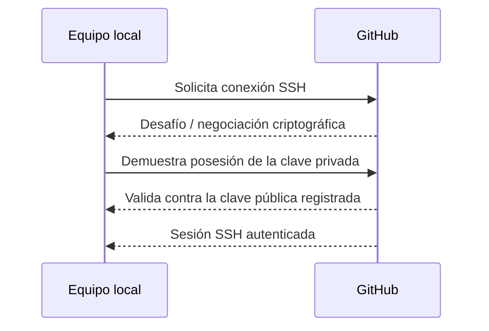

- **Clave pública** (`.pub`): se registra en GitHub y puede compartirse.
- **Clave privada**: permanece en el equipo y no debe compartirse.
- **Passphrase:** puede proteger la clave privada almacenada en disco si alguien obtiene acceso al archivo.

Cada integrante debería utilizar sus propias credenciales. Compartir una misma clave privada entre varias personas elimina trazabilidad y aumenta el impacto de una filtración.

#### 7.2 Generar una clave SSH

Requisitos previos: tener instalada la consola de Git (Git Bash) y contar con una cuenta en GitHub.

Paso a paso:

```bash
# 1. Abrir Git Bash (clic derecho en el escritorio o en una carpeta → "Open Git Bash here")

# 2. Ir a la carpeta raíz del usuario
cd ~

# 3. Verificar si ya existe la carpeta .ssh
ls -a

# 4. Si NO aparece la carpeta .ssh en el listado, crearla
mkdir .ssh

# 5. Entrar a la carpeta .ssh
cd .ssh

# 6. Generar el par de claves
ssh-keygen -t ed25519 -C "tu_email@ejemplo.com"
```

En el paso 6, reemplazar `"tu_email@ejemplo.com"` por el mail asociado a la cuenta de GitHub.

**Desglose del comando `ssh-keygen -t ed25519 -C "tu_email@ejemplo.com"`:**

| Parte | Qué es | Qué significa |
|---|---|---|
| `ssh-keygen` | El programa | Genera pares de claves (pública + privada) para autenticación SSH. |
| `-t ed25519` | Opción **t**ype (tipo/algoritmo) | Indica **qué algoritmo criptográfico** usar para generar el par de claves. `ed25519` es el nombre de ese algoritmo — una curva elíptica (*Edwards-curve Digital Signature Algorithm*) moderna, rápida y considerada muy segura. Es la que recomienda GitHub hoy en día por sobre alternativas más viejas como `rsa`. |
| `-C "tu_email@ejemplo.com"` | Opción **C**omment (comentario) | Agrega una **etiqueta descriptiva** a la clave pública generada, para poder identificar a simple vista de quién es o para qué cuenta se creó. Es solo informativo — **no participa del cifrado**, es como un nombre de archivo pegado al final de la clave. Por convención se usa el mail de la cuenta de GitHub, pero podría ser cualquier texto (por ejemplo, el nombre de la compu). |

En términos simples: el comando solicita generar un par de claves Ed25519 y asociarle una etiqueta descriptiva.

El comando pide dos cosas, en este orden:
1. Un **nombre identificativo** para el archivo de la clave (por ejemplo, `gz_notebook`). Ese nombre solo sirve para identificar el archivo dentro de la carpeta `.ssh` — conviene recordarlo porque se vuelve a usar más adelante.
2. Una **passphrase** opcional para proteger la clave. No es obligatoria: si se prefiere no ponerla, se deja en blanco y se presiona "Enter" dos veces.

Si todo salió bien, la consola muestra un dibujo ASCII (*randomart*) de la huella de la clave, y quedan generados dos archivos dentro de `.ssh` — por ejemplo `gz_notebook` (clave **privada**) y `gz_notebook.pub` (clave **pública**).

Para ver el contenido de la clave pública y copiarlo:

```bash
cat gz_notebook.pub
```

`cat` es un comando que muestra el contenido de un archivo de texto plano directamente en la consola, sin necesidad de abrirlo con un editor.

> ⚠️ **Atención con esto:** al usar `cat`, hay que agregar siempre el `.pub` al final del nombre. Si se omite, el comando abre el contenido de la clave **privada** — que por ningún motivo se debe exponer o compartir.

El contenido que se muestra en consola empieza con `ssh-` y termina con el mail usado al generarla — ese es el texto completo que hay que copiar y pegar en GitHub.

#### 7.3 Cargar la clave pública en GitHub

1. Estar registrado y logueado en GitHub.
2. Clic en el ícono de perfil (esquina superior derecha) → **Settings**.
3. En el menú lateral izquierdo → **SSH and GPG keys**.
4. **New SSH key** → se abre un formulario con dos campos:
   - **Title:** un nombre para identificar la clave dentro de la plataforma (por ejemplo, el nombre de la computadora).
   - **Key:** pegar ahí el contenido completo de la clave pública copiado con `cat`.
5. **Add SSH key**.

Si el contenido pegado está incompleto o corrupto, GitHub va a rechazarlo con un error del tipo *"Key is invalid. You must supply a key in OpenSSH public key format"* — en ese caso hay que repetir el `cat` y verificar que se copió la clave entera, sin cortes.

Se puede tener más de una clave SSH cargada en la misma cuenta (por ejemplo, una por cada computadora que se use), y también se pueden usar claves distintas para cuentas de GitHub distintas.

#### 7.4 Clonar un repositorio con SSH y diagnosticar autenticación

Un repositorio puede clonarse mediante una URL SSH:

```bash
git clone git@github.com:usuario/repositorio.git
```

Para utilizar este mecanismo, la conexión SSH debe poder autenticarse contra GitHub. En un repositorio privado también hace falta que la cuenta autenticada posea permisos sobre ese repositorio.

Un repositorio público puede clonarse sin permisos de escritura; la diferencia entre **leer** y **hacer push** depende de los permisos de la cuenta, no de que la URL sea SSH o HTTPS.

Un error habitual es:

```text
Permission denied (publickey).
```

Ese mensaje indica un problema de autenticación SSH. Algunas comprobaciones útiles son:

```bash
ssh -T git@github.com
```

y:

```bash
ssh-add -l
```

cuando se utiliza `ssh-agent`.

El `ssh-agent` es un proceso que puede mantener claves privadas desbloqueadas en memoria y ofrecerlas al cliente SSH. Es muy útil cuando la clave tiene passphrase, pero no es correcto pensar que **toda** conexión SSH necesita obligatoriamente que la clave haya sido agregada manualmente al agente: el cliente también puede encontrar claves por ubicaciones/configuración conocidas.

Una configuración explícita en `~/.ssh/config` puede asociar host y archivo:

```sshconfig
Host github.com
  HostName github.com
  User git
  IdentityFile ~/.ssh/id_ed25519
```

La idea diagnóstica es separar tres problemas distintos:

```text
¿SSH encuentra una identidad?
¿GitHub reconoce esa identidad?
¿esa cuenta tiene permiso para la operación sobre ese repositorio?
```

Un fallo en cualquiera de esos niveles puede producir síntomas parecidos, pero no se resuelve necesariamente con la misma acción.

#### 7.5 Crear un repositorio remoto en GitHub

Al crear un repositorio nuevo desde GitHub, las opciones principales son:

- **Owner** y **nombre del repositorio**.
- **Visibilidad:**
  - *Público*: cualquiera puede verlo. Es la opción que se usa para entregas de trabajos prácticos, de forma que quien corrige pueda acceder sin necesidad de ser agregado como colaborador.
  - *Privado*: solo lo ven quienes tengan permiso explícito.
- **Agregar `.gitignore`:** GitHub ofrece plantillas según tecnología (Node, Android, etc.) con las exclusiones típicas ya preconfiguradas.
- **Licencia** (opcional): define bajo qué términos se puede usar/reutilizar el código.

#### 7.6 Colaboradores

Para que otra persona pueda hacer `push` a un repositorio, primero hay que agregarla como colaboradora:

**Settings del repositorio → Collaborators → Add people** (buscar por nombre de usuario o mail de GitHub).

La persona invitada recibe un mail de invitación que debe aceptar. Una vez aceptada, tiene permiso para trabajar sobre el proyecto — pero igual necesita tener su propia clave SSH configurada en su cuenta para poder clonar y pushear.

> Importante: la configuración de la clave SSH es **por cuenta de usuario**, no por repositorio — una vez configurada, sirve para todos los repos a los que esa cuenta tenga acceso. Las reglas de seguridad (branch protection, PRs, etc.), en cambio, se configuran **por repositorio**.

**Fuentes del tutorial de SSH:**
- [Generating a new SSH key and adding it to the ssh-agent — GitHub Docs](https://docs.github.com/es/authentication/connecting-to-github-with-ssh/generating-a-new-ssh-key-and-adding-it-to-the-ssh-agent)
- [Git SSH tutorial — Atlassian](https://www.atlassian.com/git/tutorials/git-ssh)

---

### 8. Seguridad y reglas de protección de ramas (GitHub)

#### 8.1 Pull Request (PR / MR)

Un **Pull Request** (PR) — también llamado **Merge Request** (MR) en otras plataformas como GitLab — es una solicitud de incorporación de cambios: se indica desde qué rama y hacia qué rama se quiere fusionar el trabajo. A diferencia de un merge local, el PR no fusiona el código automáticamente al crearse — abre un espacio de revisión donde el equipo puede comentar, pedir cambios y aprobar antes de que el merge efectivamente se concrete.

**Creación práctica de un PR en GitHub**, con las opciones más usadas al armarlo:
- **Reviewer:** se le puede asignar a una o más personas del equipo para que revisen específicamente ese PR antes de aprobarlo.
- **Etiquetas (labels):** por ejemplo, una etiqueta `feature` para indicar que el PR corresponde a una funcionalidad nueva (también existen convenciones como `bug`, `docs`, `hotfix`, etc., aunque no vienen predefinidas — las crea cada equipo según su necesidad).
- **Asignado (assignee):** quién es responsable de ese PR — generalmente quien lo abrió se asigna a sí mismo.
- **Project:** se puede vincular el PR a un tablero de proyecto de GitHub, si el equipo usa esa función para seguimiento.

Una vez creado, el PR queda en estado **abierto**, mostrando qué archivos modifica, quién lo abrió, la etiqueta asignada y a quién está asignado. A partir de ahí, el equipo puede seguir comentando o subiendo más commits a esa misma rama (que se van a reflejar automáticamente en el PR) hasta que se apruebe y se mergee.


El valor de un PR/MR no es únicamente “pedir permiso para mergear”. También crea un **espacio explícito de revisión de código**.

En una revisión, otra persona puede analizar:

```text
qué comportamiento se agregó
qué se eliminó
si el cambio cumple el requerimiento
si introduce errores
si rompe contratos existentes
si hay duplicación
si una responsabilidad quedó en la capa equivocada
si los nombres explican la intención
si faltan pruebas
```

Por eso las aprobaciones no garantizan que no existan conflictos de merge. Son un control distinto:

```text
merge conflict
→ problema de compatibilidad entre cambios

code review
→ evaluación humana/técnica de calidad, diseño y corrección
```

Las plataformas pueden exigir una o más aprobaciones antes de habilitar la integración.

En equipos reales también puede requerirse la aprobación de responsables concretos, por ejemplo un *Tech Lead* o propietario de un área del código.

La revisión tiene además valor pedagógico: leer código escrito por otra persona obliga a reconstruir su intención y detectar decisiones que al autor pueden haberle parecido obvias.

#### 8.2 Branch protection rules

Desde **Settings → Branches → Add rule** en GitHub, se pueden configurar reglas de protección sobre ramas específicas (por ejemplo, `main`). Algunas de las más relevantes:

- **Impedir push directo** a la rama protegida: obliga a que todo cambio pase por un Pull Request, en vez de poder mergear localmente y pushear directo.
- **Requerir revisores (reviewers):** se puede exigir una cantidad mínima de aprobaciones (por ejemplo, 2 personas) antes de habilitar el merge del PR.
- **Requerir aprobación de usuarios específicos:** por ejemplo, exigir que un integrante senior del equipo apruebe sí o sí, además de las aprobaciones generales — aunque ya se hayan juntado las aprobaciones mínimas de otros, si falta la de esa persona en particular, el botón de merge queda bloqueado.
- **Requerir nueva aprobación tras nuevos pushes:** si alguien sigue subiendo cambios a un PR después de haber sido aprobado, se le puede exigir que ese PR vuelva a ser aprobado antes de poder mergearlo — para evitar que se cuelen cambios no revisados después de la aprobación.
- **Restringir quién puede mergear.**
- **Patrones de nombre de rama:** se pueden definir reglas que apliquen solo a ramas que cumplan cierto patrón (por ejemplo, que empiecen con `release/`).

Estas reglas se configuran por repositorio y pueden limitarse a una rama puntual o aplicarse por patrón de nombre.

#### 8.3 Eliminación automática de ramas al mergear

GitHub ofrece una opción (en **Settings**, en la parte general del repositorio) para que, al cerrar un Pull Request mergeado, la rama de origen se elimine automáticamente del repositorio remoto.

Esto evita acumular ramas "basura": en un proyecto real, cada feature branch que se mergea y no se borra queda dando vueltas en el historial de ramas del remoto, dificultando la lectura del estado del proyecto con el tiempo. Al activar esta opción, la eliminación es automática **en el remoto** — la copia local de esa rama, si existía, sigue estando en la máquina de quien la creó hasta que se borre manualmente ahí.

---

### 9. Herramientas complementarias

#### 9.1 Git Graph (extensión de VS Code)

**Git Graph** es una extensión de Visual Studio Code que muestra de forma gráfica el árbol de commits y ramas de un repositorio: quién hizo cada commit, cuándo, en qué rama, y permite ejecutar acciones de Git (crear rama, cambiar de rama, etc.) desde la interfaz en vez de la consola.

Permite filtrar la visualización — por ejemplo, ver solo los commits de una rama puntual, o solo ramas locales vs. remotas.

> Recomendación de seguridad general al instalar cualquier extensión de VS Code: revisar la cantidad de descargas, las reseñas/calificaciones y la fecha de la última actualización antes de instalarla, ya que una extensión tiene acceso a los archivos del proyecto y del sistema.

> Para aprender Git conviene comprender primero los estados, referencias y comandos fundamentales antes de depender exclusivamente de una interfaz gráfica. La consola hace visibles los comandos ejecutados y los mensajes de diagnóstico, lo que facilita construir el modelo mental del sistema en lugar de memorizar botones.

Atajos útiles de consola mencionados:
- **Tab:** autocompleta comandos y nombres de archivo/rama.
- **Ctrl + L:** limpia la consola.
- **Flecha arriba / abajo:** navega por el historial de comandos ya escritos.

---

### 10. Entorno mínimo de desarrollo

Un entorno de backend básico necesita herramientas con responsabilidades diferentes:

| Herramienta | Responsabilidad |
|---|---|
| **Editor/IDE** (por ejemplo, Visual Studio Code) | Escribir, navegar, refactorizar y depurar el código fuente |
| **Node.js** | Ejecutar JavaScript fuera del navegador y proporcionar APIs del runtime |
| **Git** | Versionar el proyecto y gestionar su historial |

No son sustitutos entre sí. El editor modifica archivos; Node ejecuta el programa; Git registra la evolución del conjunto de archivos.

Una terminal completa el flujo operativo porque permite ejecutar:

```text
node
npm
git
comandos del sistema
```

sin depender de una interfaz gráfica específica.

El objetivo conceptual no es aprender una lista de programas, sino reconocer qué responsabilidad cubre cada herramienta dentro del ciclo de desarrollo.

---

### Ejemplo práctico — Sesión de consola: SSH, ramas y stash

Secuencia de comandos demostrada en clase, desde la generación de la clave SSH hasta el flujo completo de trabajo con ramas y `stash`. Sirve como referencia rápida del orden real en que se encadenan los comandos vistos arriba.

```bash
# 1. Generar clave SSH y cargarla en GitHub (una sola vez por computadora)
mkdir ~/.ssh
cd ~/.ssh
ssh-keygen -t ed25519 -C "tu_email@ejemplo.com"
cat ~/.ssh/mi_notebook_2026.pub          # copiar el resultado en GitHub → Settings → SSH and GPG keys

# 2. Activar el agente SSH y agregar la clave privada
eval $(ssh-agent -s)
ssh-add ~/.ssh/mi_notebook_2026

# 3. Clonar el repositorio ya creado en GitHub
git clone git@github.com:usuario/practica_git_2026.git
cd practica_git_2026

# 4. Configurar usuario para los commits (si no está configurado globalmente)
git config --list

# 5. Crear ramas de trabajo a partir de main
git branch                 # main
git checkout -b uat
git checkout main
git checkout -b develop
git branch                 # develop, main, uat

# 6. Primer push de cada rama nueva (vincula con el remoto)
git push --set-upstream origin develop
git checkout uat
git push --set-upstream origin uat

# 7. Trabajar en develop: crear archivos, agregarlos y commitearlos
git checkout develop
git add .
git status
git commit -m "primer commit de prueba"
git push

# 8. Ejemplo de uso de stash para cambiar de rama sin perder cambios pendientes
git status                 # hay cambios sin commitear en develop
git add archivo_nuevo.txt  # stash necesita que el archivo esté trackeado (al menos en staging)
git stash                  # guarda los cambios pendientes
git checkout uat           # ahora sí, cambio de rama con el working directory limpio
git checkout develop       # vuelvo a develop
git stash list              # veo los stashes guardados: stash@{0}
git stash pop                # recupero los cambios guardados
```

**Conceptos nuevos que aplica este ejemplo:** generación y registro de clave SSH, clonado por SSH, creación y push inicial de ramas (`--set-upstream`), y uso de `git stash` para preservar cambios sin commitear al cambiar de rama.

---

## Unidad 2 — JavaScript

### 11. Compilación, interpretación y ejecución de un lenguaje

Clasificar lenguajes completos como si fueran intrínsecamente “compilados” o “interpretados” resulta útil como primera aproximación, pero es una simplificación.

La distinción más precisa se aplica a **cómo una implementación ejecuta un programa**.

```text
Código fuente
     ↓
análisis / parsing
     ↓
posibles transformaciones
     ↓
ejecución
```

Entre esas transformaciones pueden aparecer:

```text
compilación a código máquina
compilación a bytecode
interpretación
compilación Just-In-Time (JIT)
combinaciones de varias estrategias
```

Por ejemplo, JavaScript moderno no debería imaginarse simplemente como un intérprete que “lee una línea y la ejecuta”. Motores como V8 analizan el código y utilizan técnicas de compilación/JIT y optimización durante la ejecución.

Del mismo modo, un lenguaje como Python suele ejecutarse mediante implementaciones que generan una representación intermedia antes de que una máquina virtual la procese.

Por eso conviene separar:

```text
lenguaje
→ reglas y semántica definidas por una especificación

implementación/runtime
→ programa concreto que analiza y ejecuta ese lenguaje
```

Esta separación prepara un concepto que será central con JavaScript:

```text
ECMAScript
→ especificación del lenguaje

V8
→ motor que implementa esa especificación

Node.js / navegador
→ entorno host que incorpora un motor y agrega APIs propias
```

#### 11.1 Compilación

En términos generales, compilar significa transformar un programa desde una representación a otra antes o durante su ejecución.

Un compilador puede producir:

```text
código máquina
bytecode
otro lenguaje
representaciones intermedias
```

Por eso “compilar” no significa necesariamente “convertir todo una sola vez a un `.exe`”.

#### 11.2 Interpretación

Un intérprete ejecuta o evalúa una representación del programa sin requerir que exista previamente un binario nativo completo generado como producto final.

Los runtimes modernos pueden mezclar interpretación y compilación dinámica.

#### 11.3 JIT: compilar durante la ejecución

La compilación *Just-In-Time* permite generar código optimizado mientras el programa está ejecutándose.

La motivación es combinar ventajas:

```text
inicio flexible / información disponible en runtime
+
código nativo optimizado para partes frecuentes
```

Por eso el modelo mental:

```text
JavaScript = interpretado línea por línea
```

es insuficiente para describir motores actuales.

### 12. Scripts y lenguajes de scripting

Un **script** es un programa que normalmente automatiza o coordina tareas dentro de un entorno existente.

Ejemplos:

```text
automatizar archivos
ejecutar tareas de build
procesar datos
responder una request
administrar un sistema
manipular una página web
```

La palabra *script* describe sobre todo **el uso y el contexto**, no una propiedad rígida de ejecución.

Un lenguaje llamado “de scripting” no tiene por qué cumplir universalmente:

```text
tipado dinámico
interpretación pura
código pequeño
ausencia de compilación
```

Esas características aparecen con frecuencia en lenguajes históricamente asociados a scripting, pero no constituyen una definición técnica suficiente.

JavaScript comenzó estrechamente vinculado al scripting en navegadores, pero hoy también se utiliza para:

```text
backend
herramientas de desarrollo
aplicaciones de escritorio
automatización
servicios
CLI
```

La aparición de Node.js es justamente importante porque separa JavaScript del único host que originalmente resultaba familiar: el navegador.

### 13. ECMAScript, motor y entorno host

Para entender JavaScript resulta útil separar tres capas.

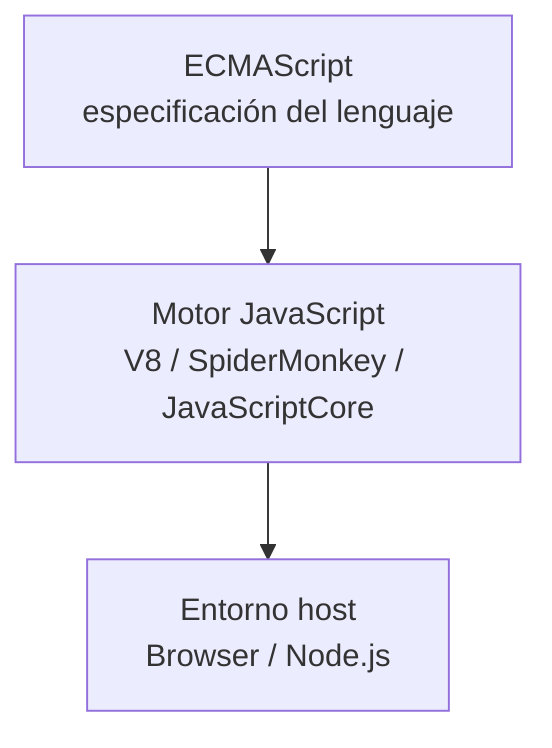

#### 13.1 ECMAScript

**ECMAScript** es la especificación estandarizada por Ecma International que define el lenguaje sobre el que se basa JavaScript.

Entre otras cosas define:

```text
sintaxis
tipos
operadores
objetos estándar
semántica de funciones
promesas
módulos
```

No define por sí sola todas las APIs que aparecen al programar en un navegador o en Node.

Por ejemplo:

```javascript
Array
Promise
Map
```

pertenecen al lenguaje/ecosistema ECMAScript.

En cambio:

```javascript
document
fetch
```

dependen del host donde se ejecuta el código —aunque algunas APIs puedan existir hoy en más de un host.

#### 13.2 Motor JavaScript

Un motor implementa la semántica de ECMAScript.

Ejemplos conocidos:

| Motor | Entornos asociados |
|---|---|
| **V8** | Chrome, Node.js y otros runtimes |
| **SpiderMonkey** | Firefox |
| **JavaScriptCore** | Safari |

Un motor moderno realiza tareas como:

```text
tokenizar/parsear código
crear representaciones internas
ejecutar código
optimizar partes frecuentes
gestionar memoria y garbage collection
```

Reducirlo simplemente a “un intérprete” oculta una parte importante del modelo real.

#### 13.3 Entorno host

El host agrega las capacidades para interactuar con el mundo exterior.

Un navegador aporta, por ejemplo:

```text
DOM
eventos de interfaz
almacenamiento web
red
timers
```

Node.js aporta:

```text
sistema de archivos
procesos
red
módulos del runtime
servidores
streams
```

El mismo lenguaje puede ejecutarse en hosts diferentes porque:

```text
ECMAScript define el núcleo del lenguaje
+
cada host agrega sus APIs
```

Esta distinción explica por qué un código puede ser JavaScript válido y, aun así, fallar por intentar utilizar una API que no existe en ese entorno.

### 14. TypeScript: tipado estático sobre JavaScript

**TypeScript** extiende la sintaxis de JavaScript con un sistema de tipos estáticos y herramientas de análisis.

Su objetivo central no es reemplazar el runtime de JavaScript, sino detectar una clase de errores **antes de ejecutar** el programa.

```typescript
function sumar(a: number, b: number): number {
  return a + b;
}

sumar("5", 2);
// error de tipos durante el análisis
```

JavaScript permite realizar esa llamada; TypeScript puede señalar que no satisface el contrato declarado.

#### 14.1 JavaScript sigue siendo el runtime conceptual

Tradicionalmente, el compilador de TypeScript (`tsc`) elimina información de tipos y emite JavaScript:

```text
archivo .ts
→ análisis de tipos
→ transformación/emisión
→ JavaScript
```

Las anotaciones como:

```typescript
: number
interface Usuario { ... }
```

no forman parte del JavaScript que ejecuta el navegador.

Actualmente algunos runtimes —incluido Node.js moderno para un subconjunto de sintaxis— pueden ejecutar archivos TypeScript eliminando tipos durante la carga. Esto no convierte a TypeScript en un runtime independiente ni reemplaza necesariamente el chequeo estático completo de `tsc` o de otras herramientas.

#### 14.2 Qué agrega TypeScript y qué no

JavaScript moderno ya posee:

```text
clases
módulos
funciones async
objetos
herencia
```

TypeScript no “agrega clases y módulos” como si JavaScript careciera de ellos.

Lo que aporta principalmente es información y análisis estático:

```text
anotaciones de tipo
interfaces
tipos unión/intersección
genéricos
inferencia de tipos
chequeo de contratos antes de ejecutar
mejor soporte de tooling
```

#### 14.3 El beneficio aparece al crecer el sistema

En un ejemplo pequeño:

```javascript
function buscar(id) { ... }
```

puede parecer obvio qué recibe y qué retorna.

En un backend grande, un contrato explícito reduce ambigüedad:

```typescript
function buscar(id: number): Usuario | null
```

El tipo documenta y permite verificar automáticamente parte del contrato entre módulos.

TypeScript no elimina la necesidad de validar datos externos. Un body HTTP puede afirmar cualquier cosa en runtime; los tipos estáticos describen lo que el programa **espera**, no vuelven confiable automáticamente la entrada del cliente.

### 15. Sintaxis básica de uso frecuente

Antes de entrar en variables y funciones, una referencia rápida de elementos de sintaxis que van a aparecer todo el tiempo en el código de la materia, para no asumir que ya se conocen:

| Elemento | Qué es / qué hace | Ejemplo |
|---|---|---|
| `console.log(valor)` | Escribe (imprime) un valor por la consola del navegador o de Node.js. Es la forma más básica de "ver" qué está pasando en el código mientras se ejecuta — no le muestra nada al usuario final de una página, es una herramienta de depuración para quien programa. | `console.log("Hola");` → imprime `Hola` |
| `typeof valor` | Operador que devuelve, como texto, el tipo de dato de lo que se le pase (`"number"`, `"string"`, `"boolean"`, `"function"`, `"object"`, `"undefined"`, etc.). Se usa mucho para inspeccionar o depurar qué tipo tiene una variable en un momento dado. | `typeof "hola"` → `'string'` |
| `//` | Comentario de una sola línea. Todo lo que sigue después de `//` en esa línea, Git y el motor de JS lo ignoran al ejecutar — sirve para dejar notas en el código. | `// esto es un comentario` |
| `/* ... */` | Comentario de varias líneas (todo lo que quede entre `/*` y `*/`). | `/* esto  también es un comentario */` |
| `;` | Separa instrucciones (el "punto y final" de una línea de código). En JavaScript es opcional en la mayoría de los casos, pero se usa por convención y prolijidad. | `let x = 5;` |
| `+` (entre strings) | El operador `+` entre dos textos (`string`) los **concatena** (los une en uno solo) en vez de sumarlos matemáticamente. | `"Hola " + "mundo"` → `'Hola mundo'` |
| `{ }` | Delimitan un **bloque de código** — el cuerpo de una función, de un `if`, de un objeto, etc. Todo lo que está entre llaves pertenece a ese bloque. | `if (true) { /* bloque */ }` |
| `( )` | Después de un nombre de función, indican que se está **ejecutando/invocando** esa función (y ahí adentro van los argumentos, si los recibe). Sin paréntesis, el nombre solo hace referencia a la función en sí, sin ejecutarla. | `saludar()` ejecuta; `saludar` no ejecuta |

### 16. Variables en JavaScript

Una **variable** es un espacio en memoria donde se puede guardar un dato; a ese espacio se le asigna un nombre, y se puede guardar cualquier tipo de información que el programa necesite.

```
Variable
Name → num
Value → 5
```

Existen tres formas de declarar variables en JavaScript:

| Palabra clave | Se puede reasignar | Alcance (scope) |
|---|---|---|
| `var` | Sí | De función (*function scope*) — histórica, hoy se evita salvo casos puntuales |
| `let` | Sí | De bloque (*block scope*) — la recomendada por defecto |
| `const` | No (el *binding* no se puede reasignar) | De bloque (*block scope*) |

**Sintaxis:** `TipoDeVariable Nombre = Valor;`

```javascript
let edad = 17;                          // Número
const pi = 3.14;                        // Número
const nombre = "José María";            // Texto (string)
let fecha = "09/07/1816";               // Texto (string)
let me_gusta_programar = true;          // Booleano
```

**Diferencia de alcance entre `var` y `let`:** es uno de los motivos por los que hoy se prefiere `let` (y `const`) por sobre `var`.

```javascript
function miFuncion() {
  console.log(miVar);       // con var: undefined (no da error) | con let: error (no está definida todavía)
  if (true) {
    var miVar = "Hola mundo";   // con var: la variable "escapa" del bloque if
    // let miVar = "Hola mundo"; // con let: la variable queda encerrada dentro del bloque if
  }
  console.log(miVar);       // con var: "Hola mundo" (la ve, aunque se declaró dentro del if)
                             // con let: error, fuera del bloque {} no existe
}
```

Con `var`, la variable queda "visible" para toda la función aunque se haya declarado dentro de un bloque `if` — esto puede generar comportamientos confusos. Con `let`, la variable solo existe dentro del bloque `{ }` donde se declaró (*block scope*), que es un comportamiento más predecible. Por eso, en código moderno, suele preferirse **`const` cuando el binding no debe reasignarse y `let` cuando sí debe cambiar**. `var` queda principalmente para código legado o casos donde se desea deliberadamente su semántica de scope/hoisting.

**Tipado dinámico:** en JavaScript el tipo pertenece al **valor**, no queda fijado permanentemente en la variable. Una misma variable declarada con `let` puede referenciar valores de tipos distintos en momentos diferentes:

```javascript
let dato = 10;       // number
dato = "diez";       // string
```

JavaScript también realiza **coerciones implícitas** en determinadas operaciones. Por ejemplo, `"5" + 2` produce `"52"` porque el operador `+` participa en reglas de conversión. En lugar de usar “débilmente tipado” como explicación suficiente, conviene estudiar las reglas concretas de coerción: son esas reglas —no una ausencia total de tipos— las que producen comportamientos que pueden sorprender.

TypeScript agrega análisis estático sobre esos contratos, pero la ejecución final sigue teniendo la semántica de valores de JavaScript.

**Declarar sin asignar un valor inicial:** con `let` se puede declarar una variable sin darle un valor todavía — JavaScript la crea y le asigna automáticamente `undefined` mientras tanto.

```javascript
let miNumero;
console.log(miNumero);       // undefined (no da error)
console.log(typeof miNumero); // 'undefined'
```

Con `const` esto **no se puede hacer**: una constante debe inicializarse en la misma declaración y su *binding* no puede reasignarse después. Eso no significa que un objeto o array declarado con `const` sea inmutable: sus propiedades o elementos pueden modificarse mientras la variable siga apuntando al mismo objeto. Si se intenta declarar una `const` vacía, se produce un error de sintaxis (*"Missing initializer in const declaration"*).

**Concatenación clásica vs. template literals:** para armar un texto combinando strings fijos con variables, la forma clásica es concatenar con `+`:

```javascript
console.log("Bienvenido a la mejor materia después de Front, " + nombre);
```

Esto es engorroso a medida que se combinan más variables (hay que estar pendiente de comillas y espacios en cada corte). JavaScript ofrece una alternativa más prolija: los **template literals** (también llamados *template strings* o "plantillas de string"), que se escriben entre **comillas invertidas** (`` ` ``, *backtick* — no confundir con la comilla simple `'` ni con el acento `´`) y permiten insertar variables directamente dentro del texto con la sintaxis `${variable}`:

```javascript
const nombre = "Linus";
const apellido = "Torvalds";

// Concatenación clásica:
console.log("Bienvenido " + nombre + " " + apellido);

// Template literal (equivalente, mucho más legible):
console.log(`Bienvenido ${nombre} ${apellido}`);
```

En el teclado en español, el backtick generalmente está en la tecla ubicada arriba de "Enter" (la misma tecla física que tiene el cierre de llaves `}` como segundo símbolo) — se escribe con `Alt Gr` (o `Alt` derecho) presionando la tecla dos veces.

### 17. Tipos de datos y modelo de valores

JavaScript distingue entre **valores primitivos** y **objetos**.

#### 17.1 Tipos primitivos

Los tipos primitivos definidos por ECMAScript son:

| Tipo | Ejemplo | Idea principal |
|---|---|---|
| `undefined` | `undefined` | ausencia de un valor asignado |
| `null` | `null` | ausencia intencional representada explícitamente |
| `boolean` | `true` | valor lógico |
| `number` | `42`, `3.14`, `NaN`, `Infinity` | números IEEE-754 de doble precisión |
| `bigint` | `123n` | enteros de precisión arbitraria |
| `string` | `"hola"` | texto |
| `symbol` | `Symbol("id")` | valor único, útil como identificador de propiedades |

Los primitivos son **inmutables**: una operación no modifica internamente el valor primitivo existente; produce otro valor.

```javascript
let texto = "hola";
texto.toUpperCase();

console.log(texto); // "hola"
```

Para conservar el resultado hay que asignarlo:

```javascript
texto = texto.toUpperCase();
```

#### 17.2 Objetos

Todo valor que no es primitivo pertenece al tipo Object en el modelo del lenguaje.

Dentro de esta familia aparecen:

```text
objetos comunes
arrays
funciones
fechas
mapas
sets
errores
promesas
```

Una función tiene un tratamiento especial en `typeof`:

```javascript
typeof function () {}; // "function"
```

pero sigue siendo un objeto invocable, no un octavo “tipo primitivo Function”.

Un array:

```javascript
typeof []; // "object"
```

por lo que para comprobar específicamente arrays se utiliza:

```javascript
Array.isArray([]);
```

#### 17.3 `typeof` no refleja perfectamente la taxonomía del lenguaje

`typeof` es un operador útil, pero sus strings de salida no forman una tabla exacta de los tipos de ECMAScript.

El caso clásico:

```javascript
typeof null; // "object"
```

es una incompatibilidad histórica mantenida por compatibilidad.

`null` sigue siendo un **valor primitivo**, aunque `typeof null` devuelva `"object"`.

#### 17.4 Por qué importa distinguir primitivos y objetos

La diferencia se vuelve visible al asignar, comparar y mutar valores.

```javascript
let a = 10;
let b = a;

b = 20;

console.log(a); // 10
```

Cada variable contiene su propio valor primitivo.

En cambio:

```javascript
const usuarioA = { nombre: "Ada" };
const usuarioB = usuarioA;

usuarioB.nombre = "Grace";

console.log(usuarioA.nombre); // "Grace"
```

Ambas variables contienen valores de referencia que permiten acceder al mismo objeto.

Esta diferencia prepara los conceptos de identidad, mutabilidad y paso de argumentos desarrollados en la sección 20.4.

### 18. Igualdad, coerción, `null` y `undefined`

JavaScript ofrece varios algoritmos de comparación. Los dos operadores que aparecen con mayor frecuencia son:

```text
===  Strict Equality
==   Loose Equality
```

#### 18.1 Igualdad estricta `===`

`===` compara sin aplicar coerción de tipos entre operandos.

```javascript
5 === 5;       // true
5 === "5";     // false
```

Con objetos compara identidad:

```javascript
{} === {}; // false

const a = {};
const b = a;

a === b; // true
```

Dos objetos con propiedades idénticas no son estrictamente iguales si son objetos diferentes.

#### 18.2 Igualdad débil `==`

`==` aplica un algoritmo de coerción cuando los operandos poseen tipos diferentes.

No debe resumirse como:

> “compara solo el contenido”.

Ejemplos:

```javascript
5 == "5";           // true
false == 0;         // true
null == undefined;  // true
```

Esos resultados aparecen por reglas específicas de conversión.

Para código general, `===` suele resultar más fácil de razonar porque evita una gran parte de esas conversiones implícitas.

#### 18.3 `undefined`

`undefined` es un valor primitivo que aparece, entre otros casos, cuando:

```javascript
let dato;
console.log(dato); // undefined
```

o al acceder a una propiedad inexistente:

```javascript
const usuario = {};
console.log(usuario.nombre); // undefined
```

El segundo caso no ocurre porque JavaScript sea “interpretado”; es simplemente la semántica definida para el acceso a una propiedad que no existe.

#### 18.4 `null`

`null` es otro valor primitivo y se utiliza habitualmente para expresar de forma explícita la ausencia intencional de un valor.

```javascript
const usuarioSeleccionado = null;
```

No existe una regla general que obligue a inicializar todas las variables vacías con `null`. La elección depende del contrato de la aplicación.

Por ejemplo:

```text
undefined
→ el valor no fue provisto / no existe la propiedad

null
→ el sistema representa explícitamente "sin valor"
```

puede ser una convención útil si se mantiene de manera consistente.

#### 18.5 `typeof null`

```javascript
typeof null; // "object"
```

Ese resultado es una anomalía histórica.

No significa que `null` sea un objeto.

Tampoco significa que:

```javascript
null === null
```

sea verdadero “porque ambos tienen `typeof "object"`”.

La igualdad estricta utiliza el tipo interno del lenguaje, y `null` es el único valor del tipo Null.

#### 18.6 Relación especial entre `null` y `undefined`

```javascript
null == undefined;   // true
null === undefined;  // false
```

La primera expresión es un caso explícitamente contemplado por el algoritmo de igualdad débil.

La segunda es falsa porque son valores de tipos diferentes y `===` no los convierte.

Esto produce una técnica que a veces se utiliza deliberadamente:

```javascript
if (valor == null) {
  // entra tanto para null como para undefined
}
```

pero debe emplearse con intención clara. En el resto de los casos, una comparación estricta comunica mejor qué estado se espera.

> ⚠️ Un solo `=` representa asignación. Las comparaciones utilizan operadores como `===`, `!==`, `==`, `!=`, `<`, `>`, etc.

### 19. Condicionales

```javascript
if (<primera condición>) {
  // código que se ejecuta si <primera condición> se cumple
} else if (<segunda condición>) {
  // código si <primera condición> NO se cumple, pero <segunda condición> sí
} else if (<tercera condición>) {
  // código si las dos anteriores NO se cumplen, pero <tercera condición> sí
} else {
  // código si ninguna condición se cumple
}
```

**Operador ternario:** es el único operador de JavaScript con **tres operandos**. Se usa frecuentemente como atajo para un `if` simple:

```
condición ? expr1 : expr2
```

Si `condición` es `true`, la expresión completa devuelve el valor de `expr1`; si es `false`, devuelve el valor de `expr2`.

```javascript
"La Cuota es de: " + (isMember ? "$2.00" : "$10.00");

let stop = false;
let age = 16;
age > 18 ? console.log("puede ingresar") : (stop = true);
```

**Operadores lógicos: `&&` (Y) y `||` (O).** Permiten combinar dos o más condiciones en una sola expresión booleana.

- **`&&` (AND, "Y"):** el resultado es `true` únicamente si **todas** las condiciones que conecta son verdaderas. Alcanza con que una sola sea falsa para que toda la expresión dé `false`.
- **`||` (OR, "O"):** el resultado es `true` si **al menos una** de las condiciones que conecta es verdadera. Solo da `false` si todas lo son.

```javascript
let edad = 20;
let tieneEntrada = true;

edad > 18 && tieneEntrada;   // true solo si CUMPLE LAS DOS: ser mayor de 18 Y tener la entrada
edad > 18 || tieneEntrada;   // true si se cumple CUALQUIERA de las dos (o ambas)
```

Un cambio de `&&` a `||` en la misma condición puede alterar completamente el resultado, porque cambia la exigencia de "se tienen que cumplir todas" a "alcanza con que se cumpla una":

```javascript
let elemento = 1;

elemento > 2 && elemento < 7;   // false → 1 no es mayor a 2, y con && ALCANZA con que una falle para que dé false
elemento > 2 || elemento < 7;   // true  → 1 sí es menor a 7, y con || alcanza con que UNA se cumpla
```

**Concepto de veracidad (*truthiness*).** Dentro de una condición (`if`, operador ternario, `&&`, `||`), JavaScript no exige que el valor evaluado sea literalmente `true` o `false` — cualquier valor se puede evaluar en ese contexto, y el motor lo trata como uno de los dos según a qué grupo pertenezca. La mayoría de los valores se comportan como verdaderos; existe un grupo específico y acotado de valores que se comportan como falsos, llamados ***falsy***:

| Valor *falsy* | Ejemplo |
|---|---|
| `false` | el booleano en sí |
| `0` | el número cero |
| `""` | un string vacío (con comillas simples, dobles o backticks) |
| `null` | |
| `undefined` | |
| `NaN` | *Not a Number* |

Cualquier valor que no esté en esta lista se comporta como verdadero dentro de una condición — incluyendo casos que podrían parecer "vacíos" pero no lo son, como un objeto vacío `{}` o un array vacío `[]`: ninguno de los dos es *falsy*.

```javascript
if (0) { }              // no entra: 0 es falsy
if ("") { }              // no entra: string vacío es falsy
if (null) { }            // no entra: null es falsy
if ({}) { console.log("entra"); }   // SÍ entra: un objeto vacío no es falsy
if ([]) { console.log("entra"); }   // SÍ entra: un array vacío no es falsy
```

Esto permite simplificar comparaciones: en vez de escribir explícitamente `if (array.length > 0)`, alcanza con `if (array.length)` — si `length` vale `0`, ya se comporta como falso sin necesidad de forzar la comparación con `> 0`. El resultado es el mismo, pero se evita una comparación adicional; en un ciclo que se repite una gran cantidad de veces (por ejemplo, iterando un array de millones de elementos), evitar esa comparación de más en cada vuelta también suma en términos de rendimiento.

```javascript
let numeros = [];

if (numeros.length) {
  console.log("el array tiene elementos");
} else {
  console.log("el array está vacío");   // esto es lo que se imprime: length es 0, y 0 es falsy
}
```

### 20. Objetos

Además de las variables simples, JavaScript provee los **objetos** (`Object`): una estructura que permite reunir varios valores relacionados dentro de una misma variable. Los objetos tienen **propiedades**, que se llaman así porque a través de ellas se puede tanto **setear** (asignar) como **acceder** (leer) sus valores.

#### 20.1 Sintaxis: creación e inicialización

Un objeto se define entre llaves `{ }`. Dentro de las llaves, cada propiedad separa su nombre (clave) de su valor con **dos puntos** (`:`) — nunca con un igual (`=`); usar `=` ahí tira un error de sintaxis.

```javascript
let miAuto = {
  marca: "DeLorean",
  cantidadPuertas: 2,
  color: "gris",
  timeMachine: true
};
```

También se puede inicializar un objeto **vacío**, sin ninguna propiedad, y agregarle propiedades después:

```javascript
let miAuto = {};        // objeto vacío, válido
console.log(miAuto);    // {}

miAuto.marca = "DeLorean";
miAuto.cantidadPuertas = 2;
```

#### 20.2 Propiedades: lectura y asignación

Se accede al valor de una propiedad, tanto para leerlo como para modificarlo, con la notación **objeto.propiedad**:

```javascript
console.log(miAuto.marca);    // lectura → "DeLorean"
miAuto.precio = 5000000;       // asignación → crea la propiedad si no existía, o la modifica si ya existía
```

**Leer una propiedad que no existe devuelve `undefined`.** Es una regla propia del modelo de objetos de JavaScript, no una consecuencia de que el lenguaje sea “interpretado”.

```javascript
console.log(miAuto.duracion);   // undefined
```

El objeto sigue siendo válido: simplemente no posee una propiedad con esa clave en su cadena de resolución correspondiente.

Esto es distinto de acceder a una **variable que nunca fue declarada**:

```javascript
console.log(variableInexistente); // ReferenceError
```

La diferencia resulta importante para depurar:

```text
objeto.propiedadInexistente
→ undefined

identificadorNuncaDeclarado
→ ReferenceError
```

Un sistema de tipos estático puede advertir ciertos accesos dudosos antes de ejecutar, pero la semántica runtime de JavaScript para una propiedad ausente sigue siendo `undefined`.

#### 20.3 Objetos declarados con `const`: qué se puede modificar y qué no

Un objeto se puede declarar tanto con `let` como con `const`. La diferencia entre ambos, para objetos, **no pasa por si se puede modificar el contenido** — pasa por si se puede **reasignar la variable a un objeto distinto**.

| Se puede hacer con `const` | No se puede hacer con `const` |
|---|---|
| Modificar el valor de una propiedad existente | Reasignar la constante a un objeto nuevo (`miObjeto = { ... }`) |
| Agregar una propiedad nueva | |

```javascript
const miPeli = {
  nombre: "Terminator: la resistencia",
  categoria: "Ciencia ficción"
};

miPeli.categoria = "Acción";      // ✅ funciona: modifica una propiedad existente
miPeli.duracion = 5400;            // ✅ funciona: agrega una propiedad nueva
miPeli = { nombre: "Otra" };       // ❌ TypeError: Assignment to constant variable.
```

La razón se explica en la sección 20.4: lo que la constante fija es la **referencia** a la "caja" de memoria del objeto, no el contenido de esa caja. Modificar o agregar propiedades cambia el contenido de la caja, pero la caja sigue siendo la misma — por eso `const` lo permite. Reasignar el objeto completo intentaría hacer que la constante apunte a otra caja distinta, y eso sí está prohibido.

#### 20.4 Paso por valor, identidad y referencias a objetos

Uno de los conceptos más importantes para entender el comportamiento de los objetos en JavaScript — y una fuente muy común de errores difíciles de detectar cuando no está claro.

**Precisión terminológica:** en JavaScript las asignaciones y los argumentos de función se transmiten **por valor**. La diferencia es qué clase de valor se copia. Para un primitivo se copia el valor primitivo; para un objeto se copia un **valor de referencia** que identifica al mismo objeto. Por eso suele decirse informalmente “los objetos se pasan por referencia”, aunque la formulación técnica más precisa es “se copia la referencia por valor”.

**Tipos primitivos.** Al asignar una variable de tipo primitivo (`string`, `number`, `boolean`, `undefined`, `null`, etc.) a otra, JavaScript copia ese valor. A partir de ese momento las dos variables son completamente independientes: modificar una no afecta a la otra.

```javascript
let mes = "febrero";
let mes2 = mes;       // se copia el valor "febrero" a mes2

mes2 = "diciembre";   // esto solo modifica mes2

console.log(mes);     // "febrero"   → no cambió
console.log(mes2);    // "diciembre"
```

**Objetos: se copia un valor de referencia.** Al crear un objeto, puede pensarse de forma pedagógica que vive en una “caja” de memoria y que la variable contiene un valor que permite referenciar esa caja. Al asignar un objeto ya existente a otra variable (`objeto2 = objeto1`), **no se clona el contenido del objeto: se copia el valor de referencia**. Las dos variables terminan observando el mismo objeto.

```javascript
let objeto1 = { id: 1 };
let objeto2 = objeto1;   // objeto2 NO es una copia: apunta a la misma caja que objeto1
```

Como consecuencia directa, modificar el objeto desde cualquiera de las dos variables se refleja en la otra, porque en el fondo es **el mismo objeto** visto desde dos nombres distintos:

```javascript
objeto1.id = 10;
console.log(objeto2.id);   // 10 → cambió también, porque apunta a la misma caja
```

Esta diferencia aparece entre **valores primitivos** y **valores objeto**. Al copiar un primitivo, cada variable conserva un valor independiente. Al copiar el valor asociado a un objeto, ambas variables pueden seguir permitiendo acceder al mismo objeto; por eso una mutación realizada a través de una referencia se observa desde la otra.

**Dos objetos con el mismo contenido no son lo mismo que dos referencias al mismo objeto.** Si en vez de asignar una variable existente se crea un objeto **nuevo** con el mismo contenido, ese objeto vive en una caja distinta, aunque los valores sean idénticos:

```javascript
let objeto1 = { id: 1 };
let objeto2 = objeto1;        // misma referencia que objeto1
let objeto3 = { id: 1 };      // objeto NUEVO, mismo contenido, pero otra caja

console.log(objeto1 === objeto2);   // true  → misma caja (misma referencia)
console.log(objeto1 === objeto3);   // false → cajas distintas, aunque el contenido sea igual
```

El operador `===` sobre objetos no compara el contenido de las propiedades: compara si ambas variables **apuntan a la misma caja de memoria**.

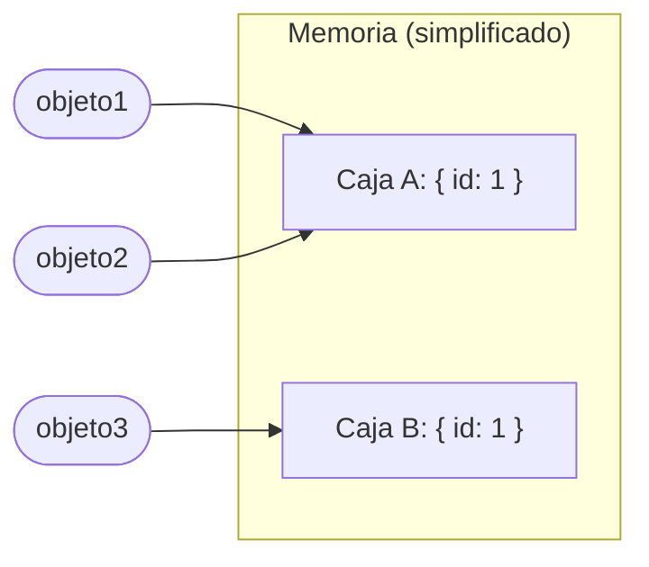

**Cadenas de referencias.** Si una variable que ya apunta a un objeto se asigna a su vez a una tercera, y esta a una cuarta, todas terminan apuntando a la misma caja original — modificarla desde cualquiera de ellas afecta a todas las demás.

```javascript
let objeto1 = { id: 1 };
let objeto2 = objeto1;       // apunta a la caja de objeto1
let objeto4 = objeto2;       // apunta a la misma caja
const objeto5 = objeto4;     // también apunta a la misma caja

objeto1.id = 10;
console.log(objeto5.id);     // 10 → objeto5 apunta a la misma caja que objeto1, aunque nunca se lo tocó directamente

objeto5.id = 300;            // ✅ funciona: modifica una propiedad de la caja compartida
objeto5 = { id: 400 };       // ❌ TypeError: objeto5 es const, no se puede reasignar a otra caja
```

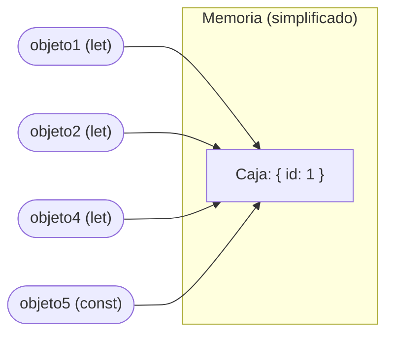

La idea de "cajas" es una simplificación para entender este comportamiento (referencia vs. valor), no una representación literal de cómo el motor implementa la memoria por dentro. A diferencia de lenguajes como C o C#, en JavaScript el manejo de memoria lo administra el motor y el desarrollador no tiene control directo sobre direcciones de memoria ni punteros.

La idea de **identidad de objetos y aliasing** aparece en muchos lenguajes, aunque cada lenguaje define su propio modelo de valores, referencias y mutabilidad. No conviene trasladar mecánicamente las categorías de JavaScript a Java, Python o C# como si sus sistemas de tipos fueran idénticos.

TypeScript tampoco cambia esta semántica runtime: su sistema de tipos analiza el programa, pero los objetos que finalmente manipula el código JavaScript mantienen las reglas de identidad y mutación de JavaScript.

#### 20.5 Mutabilidad, aliasing y condiciones de carrera

Cuando dos variables permiten acceder al mismo objeto existe **aliasing**: distintos nombres observan una misma entidad mutable.

```javascript
const pedidoA = { estado: "pendiente" };
const pedidoB = pedidoA;

pedidoB.estado = "procesado";

console.log(pedidoA.estado); // "procesado"
```

El problema aquí no es todavía una *race condition*. Es **estado mutable compartido**: una parte del programa puede modificar algo que otra parte también observa.

Esto crea acoplamiento temporal:

```javascript
function procesarPedido(pedido) {
  pedido.estado = "procesado";
}

function facturar(pedido) {
  if (pedido.estado === "pendiente") {
    console.log("Generando factura...");
  }
}

const pedido = { estado: "pendiente" };

procesarPedido(pedido);
facturar(pedido);
```

El resultado depende del orden explícito de esas llamadas, pero sigue siendo determinista.

#### Cuándo aparece una condición de carrera

Una **race condition** aparece cuando varias operaciones pueden intercalarse de formas diferentes y el resultado correcto depende de cuál completa primero o de qué estado observó cada una.

Ejemplo conceptual:

```text
Operación A lee saldo = 100
Operación B lee saldo = 100
A descuenta 80 → escribe 20
B descuenta 50 → escribe 50
```

Si ambas operaciones deberían haberse coordinado, el estado final puede resultar incorrecto.

En JavaScript/Node no hace falta imaginar dos líneas JavaScript ejecutándose literalmente en paralelo en el mismo Event Loop para sufrir carreras lógicas. Dos operaciones asincrónicas pueden:

```text
leer estado
→ esperar I/O
→ reanudarse en distinto orden
→ escribir basándose en una lectura ya obsoleta
```

La inmutabilidad ayuda a reducir algunos efectos laterales porque evita modificar un objeto compartido directamente:

```javascript
const actualizado = {
  ...pedido,
  estado: "procesado",
};
```

pero no elimina por sí sola problemas de concurrencia sobre bases de datos, archivos o servicios externos. Para esos casos hacen falta mecanismos apropiados al recurso: transacciones, locks, control optimista, operaciones atómicas, etc.

#### 20.6 Objetos incorporados en JavaScript

No todos los objetos con los que se trabaja los crea el propio programador — JavaScript ya trae varios objetos incorporados, disponibles para usar desde cualquier parte del código sin necesidad de definirlos. `console`, usado desde la primera clase, es uno de ellos: es un objeto que ya viene creado por el motor de JavaScript, y a través de él se accede a varios métodos, entre ellos `log` (el más usado), pero también `error`, `warn` e `info`, que imprimen mensajes en consola con distinto formato según el tipo.

```javascript
console.log("mensaje normal");
console.error("mensaje de error");
console.warn("mensaje de advertencia");
console.info("mensaje informativo");
```

`JSON` es otro ejemplo de objeto incorporado, con varios métodos propios — se desarrolla en profundidad en la sección 20.7.

Un patrón frecuente es **valor.propiedad**. Si la propiedad obtenida contiene una función y luego se invoca con `()`, suele hablarse de un método en ese contexto.

```javascript
console.log("hola".toUpperCase());
```

Incluso los primitivos pueden participar en acceso a propiedades mediante las reglas del lenguaje, por lo que no conviene interpretar literalmente que “antes de cada punto siempre hay un objeto almacenado en una variable”. El modelo útil es: el operador `.` realiza acceso a una propiedad sobre un valor compatible.

#### 20.7 JSON: `JSON.stringify` y `JSON.parse`

**JSON no es un tipo de dato: es una notación** — una convención sobre cómo representar información como texto plano, para que cualquier sistema o lenguaje de programación (más allá de si trabaja con objetos como JavaScript o no) pueda leerla e interpretarla de la misma manera. El nombre es un acrónimo de *JavaScript Object Notation*, aunque hoy se usa como estándar de intercambio de datos entre sistemas mucho más allá de JavaScript — es, por ejemplo, el formato en el que suele viajar la información entre un cliente y un servidor a través de una API.

**`JSON.stringify(valor)`** convierte un valor compatible de JavaScript a un `string` con formato JSON. Puede serializar objetos, arrays y valores primitivos compatibles; en un objeto recorre sus propiedades y construye una representación textual con la sintaxis propia de JSON.

```javascript
let persona = { nombre: "Ada", edad: 30 };

let personaComoJSON = JSON.stringify(persona);

console.log(personaComoJSON);        // '{"nombre":"Ada","edad":30}'  → esto es un string, no un objeto
console.log(typeof personaComoJSON);  // "string"
```

Esto es distinto de lo que hacían los template literals al insertar un objeto (sección 20.2): un template literal usa la conversión a texto por defecto de JavaScript, que solo indica el tipo general del valor (`[object Object]`); `JSON.stringify`, en cambio, convierte el objeto completo a una cadena de texto con formato JSON, respetando cada una de sus propiedades y valores.

**`JSON.parse(string)`** hace el camino inverso: toma un `string` con formato JSON y lo convierte de nuevo en un objeto de JavaScript.

```javascript
let personaRecuperada = JSON.parse(personaComoJSON);

console.log(personaRecuperada);         // { nombre: "Ada", edad: 30 }
console.log(typeof personaRecuperada);  // "object"
```

Este par de métodos es central para el trabajo con APIs: JSON define una representación textual interoperable de datos estructurados. En JavaScript, `JSON.stringify` serializa valores compatibles a texto JSON y `JSON.parse` transforma texto JSON válido en valores de JavaScript. En una API HTTP, el transporte efectivo son bytes; el encabezado `Content-Type: application/json` informa cómo interpretar esos bytes. Frameworks como Express suelen encargarse de buena parte de esta serialización y del encabezado cuando se usa `res.json(...)`.

> ⚠️ **JSON no cifra ni protege información.** Es solo un formato de representación. La confidencialidad del tránsito se obtiene mediante mecanismos como HTTPS/TLS; además, los datos sensibles requieren controles de autenticación, autorización y almacenamiento adecuados.

#### 20.8 Reglas prácticas de JSON

Un documento JSON puede representar objetos, arrays, strings, números, booleanos y `null`. En los objetos, los nombres de las propiedades deben ir entre comillas dobles; los pares clave-valor se separan con comas y **no se admite una coma final** después del último elemento.

```json
{
  "id": 15,
  "nombre": "Ada",
  "activo": true,
  "roles": ["admin", "editor"],
  "perfil": {
    "idioma": "es"
  }
}
```

JSON tampoco posee valores propios para `undefined`, funciones, `Symbol` o `BigInt`. Por eso no todo valor de JavaScript puede serializarse de manera directa o conservar exactamente el mismo significado al pasar por JSON.


#### 20.9 Estructuras compuestas: objetos con arrays de objetos

Los objetos y los arrays no se utilizan únicamente de forma aislada. Una aplicación real suele construir **estructuras compuestas**, donde una propiedad de un objeto contiene un array y cada elemento de ese array vuelve a ser un objeto.

```javascript
const infoLenguajes = {
  frontend: [
    {
      id: 1,
      nombre: "JavaScript",
      turno: "noche",
      comision: "B",
      cantidadAlumnos: 55,
    },
    {
      id: 2,
      nombre: "HTML",
      turno: "noche",
      comision: "A",
      cantidadAlumnos: 25,
    },
    {
      id: 3,
      nombre: "CSS",
      turno: "mañana",
      comision: "A",
      cantidadAlumnos: 30,
    },
  ],

  backend: [
    {
      id: 1,
      nombre: "JavaScript",
      turno: "noche",
      comision: "B",
      cantidadAlumnos: 40,
    },
    {
      id: 2,
      nombre: "PHP",
      turno: "mañana",
      comision: "A",
      cantidadAlumnos: 25,
    },
    {
      id: 3,
      nombre: "Python",
      turno: "noche",
      comision: "B",
      cantidadAlumnos: 35,
    },
  ],
};
```

La lectura correcta se hace por niveles:

```text
infoLenguajes
└── objeto
    ├── frontend
    │   └── array
    │       ├── objeto
    │       ├── objeto
    │       └── objeto
    └── backend
        └── array
            ├── objeto
            ├── objeto
            └── objeto
```

Por lo tanto:

```javascript
typeof infoLenguajes;                    // "object"
Array.isArray(infoLenguajes.frontend);   // true
typeof infoLenguajes.frontend[0];        // "object"
infoLenguajes.frontend[0].nombre;        // "JavaScript"
```

Este modelo permite agrupar información relacionada sin perder estructura. El objeto externo representa el conjunto completo de datos; `frontend` y `backend` representan categorías; cada array representa una colección; y cada objeto interno representa un elemento individual de esa colección.

##### Acceso progresivo a una estructura anidada

Cada operador de acceso reduce un nivel:

```javascript
infoLenguajes
infoLenguajes.frontend
infoLenguajes.frontend[0]
infoLenguajes.frontend[0].nombre
```

Puede leerse como:

1. obtener el objeto `infoLenguajes`;
2. entrar en su propiedad `frontend`;
3. tomar el elemento de índice `0` del array;
4. leer la propiedad `nombre` de ese objeto.

Este modo de lectura resulta especialmente importante en backend porque los datos que llegan desde una base de datos, un archivo o una API suelen tener varios niveles de anidamiento.

##### Por qué esta estructura se vuelve útil al construir una API

Hasta este punto, objetos y arrays podían parecer temas independientes de JavaScript. Al comenzar a exponer datos mediante HTTP aparece su conexión práctica:

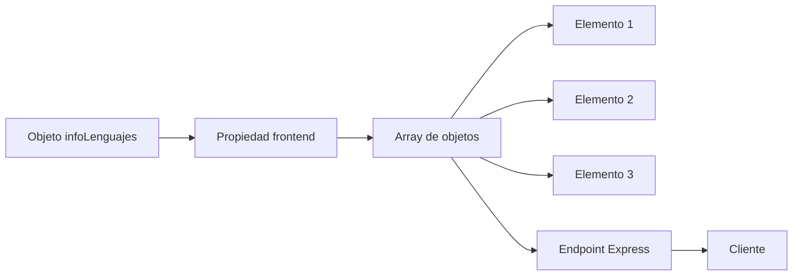

El backend necesita:

- almacenar u obtener una estructura de datos;
- seleccionar una parte de ella;
- eventualmente filtrarla;
- convertir el resultado en una representación transportable;
- enviarlo al cliente.

Por eso los métodos de arrays vistos anteriormente (`filter`, `find`, `map`) dejan de ser ejercicios aislados y pasan a formar parte de la lógica de una API.


### 21. Funciones

Una función se declara una sola vez y se puede invocar todas las veces que haga falta a lo largo del programa — es la herramienta central para reutilizar código en vez de repetirlo. Como consecuencia directa, si en algún momento se modifica la definición de una función, ese cambio impacta en todos los lugares del código donde se la esté invocando, sin necesidad de tocar cada uno de esos lugares por separado.

#### 21.1 Formas de definir una función

| Forma | Sintaxis | Descripción |
|---|---|---|
| **Declaración** | `function nombre(p1, p2...) { }` | La forma clásica: usa la palabra reservada `function` seguida de un nombre. |
| **Expresión** | `var nombre = function(p1, p2...) { }` | Se guarda una función (con o sin nombre) dentro de una variable. |
| **Constructor de función** | `new Function(p1, p2..., code)` | Crea una función mediante el constructor de objeto `Function` (uso poco frecuente en la práctica). |

```javascript
// Declaración
function saludar() {
  return "Hola";
}
saludar();        // 'Hola'
typeof saludar;    // 'function'

// Función por expresión
const saludo = function saludar() {
  return "Hola";
};
saludo();          // 'Hola'

// Función anónima (lambda): una expresión de función sin nombre
const saludoLambda = function () {
  return "Hola";
};
saludoLambda;       // f() { return 'Hola'; }  → esto es la función en sí
saludoLambda();     // 'Hola'                  → esto es EJECUTAR la función

// Función flecha (arrow): forma más compacta de escribir una función anónima
const func = () => {
  return "Función flecha.";
};
```

**`typeof` sobre una función vs. invocarla:** una confusión común es la diferencia entre nombrar una función y ejecutarla.
```javascript
typeof saludoLambda    // 'function'  → estoy preguntando por el tipo de la variable en sí (la función)
typeof saludoLambda()  // 'string'    → los paréntesis EJECUTAN la función, y typeof evalúa lo que ESA ejecución retorna
```

**Por qué el nombre interno de una función por expresión no sirve para invocarla:** es un punto que suele generar confusión. Al declarar una función por expresión con nombre, ese nombre queda **"encerrado" dentro de la función** — el intérprete no lo registra como una referencia utilizable desde afuera. Lo único accesible desde afuera es el nombre de la **constante/variable** donde se guardó.

```javascript
const bienvenida = function darBienvenida(nombre) {
  console.log(`Bienvenido ${nombre}`);
};

darBienvenida("Dante");   // ❌ Error de referencia: darBienvenida no existe para el intérprete
bienvenida("Dante");      // ✅ Funciona: la función se guardó en la constante "bienvenida"
```

En una **named function expression**, el nombre interno no queda disponible en el scope exterior mediante ese identificador, pero sí puede ser útil dentro del propio cuerpo —por ejemplo para recursión— y también mejora determinados stack traces.

```javascript
const factorial = function calcular(n) {
  return n <= 1 ? 1 : n * calcular(n - 1);
};
```

Una función anónima es apropiada cuando no hace falta ese identificador interno; no es una regla que toda función por expresión deba ser anónima.

#### 21.2 Parámetro vs. argumento

Son dos conceptos que suelen confundirse:
- **Parámetro:** es el nombre que se define **al momento de declarar** la función — es un "placeholder" para el valor que va a recibir.
- **Argumento:** es el valor real que se pasa **al momento de invocar/ejecutar** la función.

```javascript
function saludar(nombre, materia) {   // nombre y materia son PARÁMETROS
  console.log("Hola " + nombre + ", bienvenido a " + materia);
}

saludar("Gustavo", "Backend");         // "Gustavo" y "Backend" son ARGUMENTOS
```

Los parámetros, al momento de ejecutarse la función, se comportan como variables locales dentro de ella, que toman el valor de los argumentos recibidos.

#### 21.3 Funciones como objetos y callbacks (introducción)

En JavaScript, **las funciones son objetos**. Esto tiene una consecuencia importante: se pueden guardar en variables o constantes, y también se pueden **pasar como argumento a otra función**.

La función que **se pasa** como argumento para que otra la invoque se denomina **callback** (retrollamada). La función que la **recibe** —o que retorna otra función— es una **función de orden superior** (*higher-order function*). Esta distinción se vuelve especialmente útil al leer Express: el *handler* que se entrega a `app.get(...)` es una callback, mientras que `app.get(...)` cumple el rol de función de orden superior al recibirla.

```javascript
// fB = Función B
const fB = function () {
  console.log("Función B ejecutada.");
};

// fA = Función A, que recibe una función como parámetro (callback)
const fA = function (callback) {
  callback();   // invoca la función que le pasaron por parámetro
};

fA(fB);   // fA ejecuta internamente a fB → "Función B ejecutada."
```

Combinando "recibe o no parámetros" con "retorna o no valor", una función puede ser de 4 combinaciones posibles: sin parámetros y sin retorno, sin parámetros y con retorno, con parámetros y sin retorno, con parámetros y con retorno — las cuatro son válidas y se usan según lo que se necesite en cada caso.

> Nota de la cátedra: entender bien las callbacks es una base importante para el resto de la materia (asincronía, promesas, etc. se van a apoyar en este concepto).

#### 21.4 Ejemplo: callback en una función calculadora

Un ejemplo más elaborado, que muestra por qué las callbacks hacen que una función sea mucho más reutilizable/flexible. La idea: una única función `calculadora` que recibe dos números y una **función que define qué operación hacer con ellos** — así, la misma función `calculadora` puede sumar, restar, multiplicar, etc., según qué callback se le pase.

```javascript
// Función que recibe dos números y una función (callback) que decide qué hacer con ellos
const calculadora = (numero1, numero2, callback) => {
  return callback(numero1, numero2);
};

// Funciones que se van a usar como callback
const suma = (num1, num2) => {
  return num1 + num2;
};

const resta = (num1, num2) => {
  return num1 - num2;
};

// Uso 1: pasando una función ya declarada como argumento (sin ejecutarla, SIN paréntesis)
let resultadoCalculadora = calculadora(2, 5, suma);
console.log(resultadoCalculadora);   // 7

// Uso 2: pasando directamente una función anónima/arrow como callback, definida en el momento
console.log(calculadora(10, 5, (num1, num2) => num1 - num2));   // 5

// La misma función "calculadora", con distinto callback, se comporta distinto:
console.log(calculadora(10, 5, resta));                          // 5
console.log(calculadora(10, 5, (num1, num2) => num1 * num2));    // 50
```

**Cuidado con mezclar argumento evaluado y callback en el mismo llamado.** Es un caso real que suele confundir:

```javascript
let resultado = calculadora(2, suma(2, 3), suma);
console.log(resultado); // 7
```

Acá hay dos usos distintos de `suma` en la misma línea, y es clave distinguirlos:
- `suma(2, 3)` **con paréntesis**: se ejecuta *ahí mismo*, antes de que `calculadora` reciba nada. Su resultado (`5`) es lo que efectivamente llega como segundo argumento — un número común, no una función.
- `suma` **sin paréntesis** (el tercer argumento): esta sí se pasa como **callback**, sin ejecutar — recién se ejecuta *adentro* de `calculadora`.

Entonces la llamada equivale a `calculadora(2, 5, suma)`, que adentro ejecuta `suma(2, 5)` → `7`. El error común es pensar que como se usó `suma` dos veces, el comportamiento es el mismo en ambos casos — pero los paréntesis cambian completamente qué se está pasando (un valor ya calculado vs. una función pendiente de ejecutar).

**Puntos clave de este ejemplo:**
- Al pasar `suma` como argumento (sin paréntesis), se está pasando **la función en sí** — no su resultado. Si se escribiera `calculadora(2, 5, suma())`, JavaScript intentaría ejecutar `suma()` inmediatamente sin argumentos, lo cual es un error distinto (habría que pasarle los argumentos ahí mismo, y de todas formas ya no sería "pasar la función", sino pasar el resultado de haberla ejecutado).
- El callback se puede declarar **antes** y pasarlo por su nombre (`suma`, `resta`), o se puede escribir **directamente en el lugar del argumento**, sin necesidad de nombrarlo ni guardarlo en una constante — este es el uso más común de las arrow functions en la práctica.
- `calculadora` no sabe (ni le importa) qué operación matemática va a hacer — solo sabe que va a recibir una función y la va a ejecutar con los dos números que le llegaron. Eso es lo que la hace reutilizable: para agregar una operación nueva (por ejemplo, dividir), no hace falta tocar `calculadora` en absoluto, alcanza con pasarle un callback distinto.

---

#### 21.5 Firma de una función (*function signature*)

La **firma** de una función es la información que describe cómo se la tiene que invocar, sin mirar su implementación interna: su **nombre**, la **cantidad de parámetros de entrada** (y, en lenguajes tipados, el tipo de cada uno) y, en esos mismos lenguajes, el **tipo del valor que retorna**. Mirando solo la firma alcanza para saber cómo llamar a la función y qué hay que pasarle — sin necesidad de leer el cuerpo (todo lo que está entre llaves), que es lo que define su comportamiento.

```javascript
function saludar(nombre, materia) {
  const salida = `Hola ${nombre}, bienvenido a la materia ${materia}`;
  return salida;
}
```

De esta firma se lee: se llama `saludar`, recibe dos parámetros (`nombre` y `materia`) y — mirando el cuerpo — se sabe que retorna un `string`. En un lenguaje tipado (a diferencia de JavaScript), la firma incluye también el tipo de cada parámetro y el tipo de retorno de forma explícita, generalmente después de dos puntos — esto se ve en profundidad al llegar a TypeScript:

```typescript
function saludar(nombre: string, materia: string): string {
  return `Hola ${nombre}, bienvenido a la materia ${materia}`;
}
```

**Sobrecarga de funciones o métodos (*overloading*):** algunos lenguajes permiten declarar varias operaciones con el mismo nombre y resolver cuál corresponde a partir de su firma u otras reglas del lenguaje. No es una propiedad de “todo lenguaje tipado”. JavaScript no ofrece sobrecarga de declaraciones de función con despacho automático por firma de la misma manera que Java o C#; normalmente se implementa una sola función que inspecciona sus argumentos o se usan nombres distintos.

```typescript
// Dos firmas distintas para el mismo nombre "saludar"
function saludar(nombre: string): string;
function saludar(nombre: string, materia: string): string;

// Una única implementación que cubre ambos casos
function saludar(nombre: string, materia?: string): string {
  return materia ? `Hola ${nombre}, bienvenido a ${materia}` : `Hola ${nombre}`;
}

saludar("Grace");                // usa la primera firma → "Hola Grace"
saludar("Grace", "Backend");     // usa la segunda firma → "Hola Grace, bienvenido a Backend"
```

JavaScript, al ser de tipado dinámico, no tiene sobrecarga de funciones en este sentido: solo puede existir una definición activa con un nombre dado, y declarar una función con un nombre repetido no genera dos versiones invocables — la última definición pisa directamente a la anterior.

```javascript
function saludar(nombre) {
  return `Hola ${nombre}`;
}

function saludar(nombre, materia) {
  return `Hola ${nombre}, bienvenido a ${materia}`;
}

console.log(saludar("Grace"));   // "Hola Grace, bienvenido a undefined"
// La primera definición de "saludar" queda completamente pisada por la segunda.
// No hay dos versiones conviviendo: solo existe la última, y "materia" queda sin valor.
```

El concepto de firma con tipos explícitos, y la sobrecarga de funciones, se aplican de lleno recién en TypeScript — sus variables son de tipado dinámico (sección 16) y pueden cambiar de tipo a lo largo de la ejecución, así que JavaScript no tiene forma de distinguir "versiones" de una función por su firma.

#### 21.6 *Hoisting* y disponibilidad de declaraciones

*Hoisting* es una forma pedagógica de describir que ciertas declaraciones quedan disponibles durante la fase de creación/instanciación del entorno antes de que empiece la evaluación secuencial del cuerpo.

No significa que el motor mueva físicamente líneas de código hacia arriba.

Una **function declaration** puede invocarse antes de la línea donde aparece textualmente:

```javascript
saludar("Ada");

function saludar(nombre) {
  console.log(`Hola ${nombre}`);
}
```

El binding de `saludar` ya fue creado e inicializado con la función cuando comienza la ejecución del cuerpo correspondiente.

#### Expresiones de función y Temporal Dead Zone

```javascript
saludar(); // ReferenceError

const saludar = function () {
  console.log("Hola");
};
```

La declaración léxica `const saludar` también pertenece al entorno desde el comienzo de su scope, pero permanece en la **Temporal Dead Zone** hasta que la ejecución alcanza su inicialización.

Por eso no es preciso decir simplemente:

> “las function declarations se hoistean y las const no”.

Ambas participan de la creación del entorno, pero **quedan inicializadas de manera diferente**.

#### Declaraciones duplicadas

Declarar varias funciones con el mismo nombre dentro del mismo ámbito puede producir reglas dependientes del tipo de código y del contexto sintáctico. En ejemplos simples puede observarse que una declaración posterior termina siendo la que se obtiene bajo ese nombre, pero depender de declaraciones duplicadas es una mala base de diseño.

La práctica mantenible es que cada binding tenga una intención única y no utilizar duplicación de nombres como mecanismo de sobrecarga.

#### 21.7 Alcance (*scope*) de una variable declarada dentro de una función

Una variable declarada con `let` o `const` dentro de una función pertenece al **alcance léxico** de ese bloque/función. Cada invocación crea un nuevo entorno de ejecución para sus bindings locales.

En el caso simple, cuando la función termina y ningún valor conserva referencias a ese entorno, sus datos dejan de ser alcanzables y pueden ser recuperados por el garbage collector. Sin embargo, una **closure** puede mantener vivo ese entorno después de que la llamada original terminó; por eso scope y tiempo de vida no son exactamente la misma idea.

```javascript
function frenar() {
  let velocidad = 100;
  velocidad -= 10;
  console.log(velocidad);
}

frenar();   // 90
frenar();   // 90 de nuevo — no 80
frenar();   // sigue dando 90
```

Por más veces que se invoque `frenar`, siempre imprime `90`: cada invocación crea un binding local nuevo, lo inicializa en `100`, resta `10` y termina. Como nada conserva una closure que referencie ese entorno, los objetos/entornos que queden inalcanzables pueden ser recuperados posteriormente por el garbage collector.

Si en cambio la variable se declara **fuera** de la función, pero la función la usa dentro de su cuerpo, esa variable sigue viva entre una invocación y la siguiente — porque nunca se vuelve a crear, es siempre la misma:

```javascript
let velocidad = 100;

function frenar() {
  velocidad -= 10;
  console.log(velocidad);
}

frenar();   // 90
frenar();   // 80
frenar();   // 70
```

Acá `velocidad` no vive dentro de `frenar`: vive en un alcance más amplio, y `frenar` simplemente tiene acceso a ella y la modifica cada vez que se ejecuta. Por eso el valor se conserva entre invocaciones, en vez de reiniciarse.

Un error común es declarar la variable fuera de la función, pero **seguir inicializándola con un valor fijo dentro de la función** — el resultado termina siendo el mismo que si estuviera declarada adentro, porque ese valor fijo pisa lo que hubiera quedado de la ejecución anterior:

```javascript
let velocidad = 100;

function frenar() {
  velocidad = 100;   // esto pisa el valor cada vez, aunque la variable esté afuera
  velocidad -= 10;
  console.log(velocidad);
}

frenar();   // 90
frenar();   // 90 de nuevo — el = 100 de arriba anula el efecto de tenerla afuera
```

---

### 22. Profundización de funciones callback

Ya se había introducido el concepto de callback (ver sección 21.3): una función que se pasa como argumento a otra función. Acá se profundiza en las reglas de comportamiento que hacen que una callback sirva para algo.

#### 22.1 Función de orden superior (*higher-order function*)

Se llama **función de orden superior** (*high order function*, en inglés) a toda función que cumple al menos una de estas dos condiciones:

- Recibe una o más funciones como parámetro de entrada, o
- Retorna una función como resultado.

Toda función que reciba una callback como parámetro es, por definición, una función de orden superior, porque cumple la primera condición:

```javascript
function calculadora(numero1, numero2, callback) {
  return callback(numero1, numero2);
}
```

`calculadora` es una función de orden superior: recibe `callback` como parámetro de entrada. Una función que no recibe ni retorna ninguna función, en cambio, no lo es:

```javascript
function sumar(numero1, numero2) {
  return numero1 + numero2;
}
```

`sumar` recibe dos números (no funciones) y retorna directamente un número — no es una función de orden superior.

Varios métodos que ya vienen incorporados en JavaScript para trabajar con arrays (`forEach`, `map`, entre otros, que se ven en profundidad más adelante) son también funciones de orden superior: reciben como argumento una función que define qué hacer con cada elemento del array.

#### 22.2 Recibir una callback no implica ejecutarla automáticamente

Las callbacks pueden escribirse como declaraciones, expresiones o funciones flecha. En ejemplos cortos es frecuente utilizar expresiones/flechas porque permiten definir el comportamiento cerca del lugar donde se registra:

```javascript
const funcionB = function () {                    // función por expresión, con función anónima
  console.log("Entrando a función B");
  console.log("Se ejecuta función B");
  console.log("Saliendo de función B");
};

const funcionA = function (callback) {             // función por expresión, con función anónima
  console.log("Entrando a función A");
  // si nunca se hace callback(), lo que se pasó como argumento no llega a usarse
  console.log("Saliendo de función A");
};

funcionA(funcionB);   // se le pasa funcionB, pero como funcionA nunca hace callback(), NUNCA se ejecuta funcionB
```

Pasar una función como argumento no la ejecuta automáticamente. La función receptora decide si la invoca, cuándo y cuántas veces.

En un contrato donde el propósito del parámetro es “ejecutar esta callback”, no invocarla haría que ese contrato no se cumpla. Pero una API también puede recibir una función para almacenarla, registrarla, devolverla o invocarla solamente bajo ciertas condiciones.

Para que la callback tenga efecto, la función que la recibe la tiene que invocar en algún punto de su cuerpo:

```javascript
const funcionA = function (callback) {
  console.log("Entrando a función A");
  callback();                          // acá sí se ejecuta lo que se le pasó
  console.log("Saliendo de función A");
};

funcionA(funcionB);   // ahora sí: el log de funcionB aparece entre los dos logs de funcionA
```

La invocación puede ocurrir inmediatamente, más tarde, repetirse o no ocurrir en determinada ejecución. Ese comportamiento forma parte del contrato de la función de orden superior y debe ser comprensible para quien la utiliza.

#### 22.3 Pasar la función, no su ejecución

Un error común es escribir el nombre de la callback **con paréntesis** al pasarla como argumento. Eso no pasa la función: pasa el **resultado de haberla ejecutado en ese momento**, que en general no es lo que se busca.

```javascript
funcionA(funcionB);     // ✅ correcto: se pasa la función en sí, sin ejecutar
funcionA(funcionB());   // ❌ esto ejecuta funcionB ahí mismo y le pasa a funcionA lo que funcionB haya retornado (no una función)
```

Si a la función que espera una callback se le pasa cualquier otro valor que no sea una función (un string, un número, un objeto, `undefined`), va a fallar en el momento en que intente invocarlo, con un error del tipo `TypeError: callback is not a function` — porque JavaScript no puede "ejecutar" un valor que no es una función.

```javascript
funcionA("cualquier cosa");   // TypeError: callback is not a function
funcionA({ id: 1 });          // TypeError: callback is not a function
funcionA();                   // TypeError: callback is not a function → callback vale undefined
```

#### 22.4 Posición de callbacks: convención según la API

Muchas APIs históricas de Node colocan la callback al final porque primero reciben los datos/opciones de la operación y luego la función a ejecutar cuando exista un resultado.

```javascript
fs.readFile(ruta, opciones, callback);
```

Sin embargo, JavaScript no establece una regla universal que obligue a ubicar toda callback como último parámetro. APIs distintas pueden diseñar firmas distintas.

Lo importante es que la firma sea consistente y haga evidente qué representa cada argumento.

Nombrar un parámetro `callback` puede ser útil en ejemplos genéricos; en código de aplicación suele ser todavía más expresivo usar nombres semánticos:

```javascript
function procesar(datos, onSuccess, onError) { /* ... */ }
```

En la práctica, muchas veces la callback se pasa directamente como una **función flecha**, definida ahí mismo en el lugar del argumento, sin necesidad de declararla y nombrarla antes:

```javascript
calculadora(4, 5, (numero1, numero2) => numero1 + numero2);   // callback flecha, definida en el momento
```

#### 22.5 Múltiples callbacks

Una función puede recibir más de una callback como parámetro, y decidir cuál ejecutar (o si ejecutar ambas) según una condición:

```javascript
function funcionC(numero, primeraCallback, segundaCallback) {
  console.log("Entrando a función C");

  if (numero > 10) {
    primeraCallback();
    primeraCallback();
    primeraCallback();
  } else {
    segundaCallback();
  }

  console.log("Saliendo de función C");
}
```

Con esta definición, según el valor que se le pase como `numero`, `funcionC` ejecuta una u otra callback — y puede ejecutar la misma callback más de una vez, tantas veces como se la invoque dentro del cuerpo.

#### 22.6 Orden de ejecución: una función no termina hasta que termina lo que invoca

Cuando una función invoca a otra (una callback) dentro de su cuerpo, la ejecución "entra" a esa función invocada y no vuelve a la función original hasta que la invocada termine por completo. Esto se cumple sin importar cuántos niveles de anidamiento haya.

Siguiendo el ejemplo de `funcionA(funcionB)` de 22.2, la secuencia real de ejecución es:

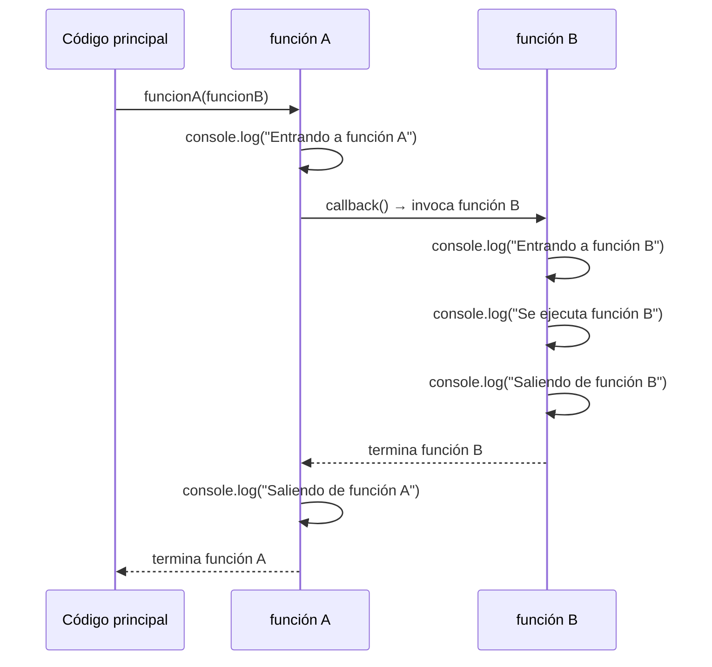

Función A no imprime *"Saliendo de función A"* hasta que función B termina de ejecutarse por completo — aunque función B haya sido "pasada como argumento" desde afuera, en la práctica quien decide cuándo (y si) se ejecuta es la función que la recibe.

---

### 23. Arrays

Un **array** es un objeto especializado para trabajar con una secuencia indexada de valores.

Los elementos se acceden mediante índices enteros no negativos y el objeto mantiene una propiedad `length` relacionada con el mayor índice utilizado.

La imagen de “cajitas consecutivas” puede servir para visualizar posiciones, pero no debe interpretarse como una garantía sobre memoria física contigua: la especificación de JavaScript define comportamiento observable, no una representación concreta de memoria interna del motor.

#### 23.1 Elementos e índices

No hay que confundir el **elemento** (el valor guardado en una cajita) con el **índice** (la posición de esa cajita dentro del array). La numeración de los índices arranca en **cero**, no en uno — esto es así en la gran mayoría de los lenguajes de programación, no solo en JavaScript.

En un array denso común, el primer elemento está en el índice `0`, el quinto en el índice `4`, etc. La propiedad `length` suele coincidir con “último índice usado + 1”, pero JavaScript también permite arrays dispersos y modificar `length` explícitamente, por lo que no debe entenderse como un conteo garantizado de posiciones realmente ocupadas.

```javascript
let frutas = ["manzana", "banana", "pera", "tomate", "ananá"];

frutas[0];   // "manzana" → primer elemento, índice 0
frutas[2];   // "pera"    → tercer elemento, índice 2
frutas.length;   // 5 → cantidad total de elementos
```

#### 23.2 Heterogeneidad de valores en arrays JavaScript

JavaScript no impone que todos los elementos de un `Array` pertenezcan al mismo tipo:

```javascript
const mezclado = [1, "dos", { id: 3 }, true];
```

Esto se debe al modelo dinámico de valores del lenguaje, **no** a que el motor “lea cada posición línea por línea”.

Otros lenguajes y sistemas de tipos pueden imponer o expresar restricciones distintas:

```text
array de Number
lista genérica de Usuario
unión de varios tipos
colección de una interfaz común
```

Por eso “lenguaje fuertemente tipado = un array solo admite un tipo exacto” también es una simplificación demasiado fuerte.

En una aplicación JavaScript suele ser útil mantener colecciones conceptualmente homogéneas:

```javascript
const usuarios = [usuario1, usuario2, usuario3];
```

no porque el runtime lo exija, sino porque un contrato predecible simplifica:

```text
iteración
validación
mantenimiento
autocompletado
tipado estático posterior
```

Una colección heterogénea puede ser completamente válida cuando el dominio realmente lo requiere.

#### 23.3 Formas de crear un array

Al igual que los objetos (sección 20), un array se puede crear de más de una manera:

```javascript
// Array literal: la forma más común, entre corchetes
let frutas = ["manzana", "banana", "pera"];
let vacio = [];

// Con el operador `new`, invocando el constructor de Array
let frutas2 = new Array("manzana", "banana", "pera");
let vacio2 = new Array();
```

Un array es un **objeto Array**. `Array` es una función constructora incorporada y puede invocarse con `new`, aunque la sintaxis literal `[]` suele ser más clara.

```javascript
const a = [];
const b = new Array();
```

Ambas expresiones producen arrays, pero existe una diferencia que vuelve confuso al constructor con un único número:

```javascript
new Array(3); // array con length 3 y posiciones vacías
[3];          // array con un único elemento: 3
```

Por eso los literales son normalmente la forma preferida.

#### 23.4 Los arrays son objetos: acceso a sus métodos

Como un array es un objeto, tiene **propiedades** — y muchas de esas propiedades son funciones (métodos) que sirven para operar sobre sus elementos. Se accede a ellas de la misma forma que a cualquier propiedad de un objeto: con la notación de punto (sección 20.2).

```javascript
frutas.push("kiwi");   // frutas es el objeto, push es el método (una propiedad de tipo función)
```

Reconocer esto no requiere memorizar cada método de antemano: el patrón **valor.propiedad(...)** indica que se obtiene una propiedad y se invoca el valor función resultante como parte de esa expresión.

#### 23.5 Métodos que modifican el array original

Los siguientes métodos **mutan** (modifican) el array sobre el que se invocan — no generan una copia, alteran directamente el original:

| Método | Qué hace | Qué retorna |
|---|---|---|
| `push(valor)` | Agrega uno o más elementos al **final** del array | La nueva longitud del array |
| `pop()` | Elimina el **último** elemento del array | El elemento eliminado |
| `unshift(valor)` | Agrega uno o más elementos al **principio** del array | La nueva longitud del array |
| `shift()` | Elimina el **primer** elemento del array | El elemento eliminado |

```javascript
let numeros = [10, 20, 30];

numeros.push(40);      // numeros ahora es [10, 20, 30, 40] → retorna 4 (nueva longitud)
numeros.pop();          // numeros ahora es [10, 20, 30]     → retorna 40 (el elemento eliminado)
numeros.unshift(5);     // numeros ahora es [5, 10, 20, 30]  → retorna 4 (nueva longitud)
numeros.shift();        // numeros ahora es [10, 20, 30]     → retorna 5 (el elemento eliminado)
```

Agregar o quitar un elemento al **principio** del array (`unshift`/`shift`) es más costoso que hacerlo al **final** (`push`/`pop`): como los índices tienen que mantenerse consecutivos, insertar o eliminar al principio obliga a correr de posición a todos los demás elementos. Por eso, salvo que haya una necesidad puntual de trabajar sobre el principio del array, en general conviene preferir operar sobre el final.

Esto se puede comprobar mirando cómo cambia el elemento que está en el índice `0` después de un `shift`:

```javascript
let numeros = [10, 20, 30];

console.log(numeros[0]);   // 10

numeros.shift();           // elimina el 10

console.log(numeros[0]);   // 20 → lo que estaba en el índice 1 ahora está en el índice 0
```

Si `shift` solo borrara el valor sin desplazar el resto, el índice `0` debería quedar vacío (`undefined`) después de eliminar el primer elemento. Que en cambio aparezca `20` confirma que todos los elementos posteriores se corrieron una posición hacia el principio — el trabajo real que hace `shift` (y, en la dirección opuesta, `unshift`) por cada elemento que agrega o quita.

**Si `pop` o `shift` se invocan sobre un array vacío, no hay nada para eliminar:** el array queda igual (vacío) y el método retorna `undefined`, en vez de lanzar un error.

```javascript
let vacio = [];

let resultado = vacio.pop();

console.log(resultado);   // undefined → no había nada para eliminar
console.log(vacio);       // []         → el array sigue vacío, no se rompió nada
```

**`length` es una propiedad, no un método:** a diferencia de `push`, `pop`, `forEach`, etc., `length` no se invoca con paréntesis — es un valor (un número), no una función.

```javascript
numeros.length;     // ✅ correcto: es una propiedad
numeros.length();   // ❌ TypeError: numeros.length is not a function
```

#### 23.6 `forEach`: iteración con una callback

`forEach` es un **método de iteración**: recorre un array de punta a punta, ejecutando una callback una vez por cada elemento. Como recibe una función (la callback) como argumento y es la responsable de invocarla internamente, `forEach` es, por definición, una **función de orden superior** (sección 22.1).

```javascript
let frutas = ["manzana", "banana", "pera", "tomate", "ananá"];

frutas.forEach(function (elemento, indice) {
  console.log(`La fruta ${elemento} se encuentra en la posición ${indice}`);
});

// La fruta manzana se encuentra en la posición 0
// La fruta banana se encuentra en la posición 1
// La fruta pera se encuentra en la posición 2
// La fruta tomate se encuentra en la posición 3
// La fruta ananá se encuentra en la posición 4
```

Quien define la callback que se le pasa a `forEach` **no elige** qué valores va a recibir esa callback en cada parámetro — eso ya lo decidió quien definió `forEach`: siempre va a invocar la callback pasándole, como primer argumento, el **elemento actual** de esa vuelta, como segundo argumento su **índice**, y como tercer argumento (menos usado, pero disponible) **el array completo** que se está recorriendo. Lo único que se define al escribir la callback son los **nombres** de esos parámetros (`elemento`, `indice` y `array` en el ejemplo, pero podrían llamarse de cualquier otra forma) y qué hacer con esos valores en cada vuelta. Este mismo patrón de tres parámetros (elemento, índice, array) se repite en varios de los métodos de iteración que siguen (`filter`, `map`, `find`, entre otros).

`forEach` no retorna ningún valor (retorna `undefined`) — solo sirve para *hacer algo* con cada elemento (como imprimirlo), no para construir un array nuevo a partir de ellos. Para eso existen `filter` y `map`.

#### 23.7 `filter`: filtrar elementos según una condición

`filter` recorre el array y devuelve un **array nuevo**, con únicamente los elementos para los que la callback haya devuelto `true` — no modifica el array original. También es una función de orden superior: recibe una callback y es responsable de ejecutarla por cada elemento.

```javascript
let numeros = [0, 1, 2, 3, 4, 5, 6, 7, 8];

let filtrados = numeros.filter(function (elemento) {
  return elemento > 2 && elemento < 7;
});

console.log(filtrados);   // [3, 4, 5, 6]
console.log(numeros);     // [0, 1, 2, 3, 4, 5, 6, 7, 8]  → el original no cambia
```

La condición que decide si un elemento se incluye o no puede combinar varias comparaciones con los operadores lógicos de la sección 19: cambiar el `&&` de este ejemplo por un `||` altera completamente el resultado, porque pasa de exigir "las dos condiciones a la vez" a alcanzar con que se cumpla "cualquiera de las dos":

```javascript
numeros.filter(function (elemento) {
  return elemento > 2 || elemento < 7;
});
// con || casi todos los elementos entran, porque alcanza con cumplir una de las dos condiciones
```

#### 23.8 `map`: transformar cada elemento en un array nuevo

`map` recorre el array y devuelve un **array nuevo, de la misma longitud**, con el resultado de aplicar la callback a cada elemento. Al igual que `filter`, es una función de orden superior, y **no modifica el array original**.

```javascript
let numeros = [0, 3, 6, 4];

let sumados = numeros.map(function (elemento) {
  return elemento + 10;
});

console.log(sumados);   // [10, 13, 16, 14]
console.log(numeros);   // [0, 3, 6, 4]   → el original no cambia
```

**Diferencia clave entre `forEach` y `map`:** `forEach` itera sobre el array original sin generar ninguna copia — solo ejecuta la callback por cada elemento, no arma un array de resultados. `map`, en cambio, genera una **copia nueva** del array y va completando esa copia con el resultado de la callback en cada posición, dejando el original intacto. Esta es una de las razones por las que se prefiere `map` por sobre `forEach` cuando el objetivo es transformar los datos de un array: respeta el principio de **inmutabilidad** (sección 20.5), evitando modificar por accidente el array original desde otra parte del código que todavía lo necesite tal cual estaba.

Cuando la callback recibe un único parámetro y su cuerpo es una sola expresión que se retorna, se puede escribir como función flecha con **retorno implícito** (sin `{ }` ni la palabra `return`, y sin paréntesis alrededor del único parámetro):

```javascript
let sumados = numeros.map(elemento => elemento + 10);   // mismo resultado que la versión anterior, más corto
```

#### 23.9 `find` y `findIndex`: buscar un elemento puntual

`find` recorre el array y devuelve el **primer elemento** para el que la callback devuelva `true` — no un array con todas las coincidencias, un único valor. Si ninguno cumple la condición, devuelve `undefined`. `findIndex` hace exactamente lo mismo, pero en vez de devolver el elemento devuelve su **índice** (y, si no encuentra nada, devuelve `-1` en vez de `undefined`).

```javascript
let frutas = ["manzana", "banana", "pera", "banana", "ananá"];

let encontrada = frutas.find(function (elemento) {
  return elemento === "banana";
});
console.log(encontrada);   // "banana" → la primera que encuentra, aunque haya otra más adelante

let indice = frutas.findIndex(function (elemento) {
  return elemento === "banana";
});
console.log(indice);   // 1 → el índice de esa primera coincidencia
```

**Diferencia clave entre `find` y `filter`:** ambos reciben una condición, pero `filter` sigue recorriendo el array completo y devuelve **todas** las coincidencias en un array nuevo, mientras que `find` se detiene apenas encuentra la primera y devuelve un único valor. En un array muy grande, si el elemento buscado está cerca del principio, `find` termina mucho antes que `filter` — que de todas formas va a recorrer el array entero, incluso aunque solo pueda existir una coincidencia. Por eso, cuando alcanza con un solo resultado, conviene usar `find` (o `some`, `every`, `findIndex`) antes que `filter`: son más eficientes porque pueden cortar la iteración apenas tienen la respuesta.

#### 23.10 `some` y `every`: verificar una condición sobre el array

Ambos devuelven un booleano (`true`/`false`), nunca un array:

- **`some`** devuelve `true` si **al menos un** elemento cumple la condición (y corta la iteración apenas encuentra uno).
- **`every`** devuelve `true` solo si **todos** los elementos cumplen la condición (y corta apenas encuentra uno que no la cumple).

```javascript
let numeros = [2, 4, 6, 8];

numeros.some(function (elemento) { return elemento % 2 !== 0; });    // false → ninguno es impar
numeros.every(function (elemento) { return elemento % 2 === 0; });   // true  → todos son pares
```

#### 23.11 `fill`: rellenar o reemplazar elementos por posición

`fill` **modifica el array original**: reemplaza sus elementos por el valor indicado, entre un índice de inicio (incluido) y uno de fin (no incluido) — si no se indican los índices, rellena el array completo.

```javascript
let frutas = ["manzana", "banana", "pera", "tomate", "ananá", "kiwi"];

frutas.fill("naranja", 2, 5);
console.log(frutas);   // ["manzana", "banana", "naranja", "naranja", "naranja", "kiwi"]
```

Reemplaza desde el índice `2` (incluido) hasta el índice `5` (no incluido) — la misma convención de "desde incluido, hasta no incluido" que se repite en varios de los métodos siguientes.

#### 23.12 `splice`: agregar, eliminar y reemplazar en un mismo método

`splice` **modifica el array original**, y es el método más versátil de todos: según los argumentos que reciba, puede eliminar elementos, insertar elementos nuevos, o reemplazar unos por otros — todo con la misma sintaxis. El orden de sus argumentos es siempre: **índice de inicio, cantidad de elementos a eliminar, y (opcionalmente) los elementos a insertar en su lugar**.

```javascript
let numeros = [1, 2, 3, 4, 5];

// Eliminar: índice 2, elimina 1 elemento, no inserta nada
numeros.splice(2, 1);
console.log(numeros);   // [1, 2, 4, 5] → se eliminó el 3
```

```javascript
let numeros2 = [1, 2, 3, 4, 5];

// Insertar: índice 2, elimina 0 elementos, inserta dos nuevos
numeros2.splice(2, 0, "melón", "sandía");
console.log(numeros2);   // [1, 2, "melón", "sandía", 3, 4, 5] → nada se eliminó, se insertó en el medio
```

```javascript
let numeros3 = [1, 2, 3, 4, 5];

// Reemplazar: índice 2, elimina 2 elementos, inserta dos nuevos en su lugar
numeros3.splice(2, 2, 99, 100);
console.log(numeros3);   // [1, 2, 99, 100, 5] → el 3 y el 4 fueron reemplazados por 99 y 100
```

`splice` además **retorna un array con los elementos que eliminó** (vacío si no eliminó ninguno) — si ese array no se guarda en una variable, esos elementos se pierden para siempre, ya que el array original ya quedó modificado.

```javascript
let numeros4 = [1, 2, 3, 4, 5];

let eliminados = numeros4.splice(2, 2, 99, 100);
console.log(numeros4);     // [1, 2, 99, 100, 5]
console.log(eliminados);   // [3, 4] → lo que splice sacó, disponible por si hace falta
```

Como `splice` modifica el array original, conviene usarlo cuando esa mutación sea realmente parte de la intención. En otros casos, `slice`, `filter`, `map` o las nuevas alternativas no mutantes pueden hacer más explícito que se desea producir otra colección. La elección depende del contrato y del costo de cada operación, no de una prohibición general de mutar.

#### 23.13 `slice`: copiar una porción del array

`slice` **no modifica el array original**: devuelve un array **nuevo** con los elementos comprendidos entre un índice de inicio (incluido) y uno de fin (no incluido).

```javascript
let frutas = ["manzana", "banana", "pera", "tomate", "ananá", "kiwi"];

let porcion = frutas.slice(2, 5);
console.log(porcion);   // ["pera", "tomate", "ananá"]  → índices 2, 3 y 4
console.log(frutas);    // el original no cambia
```

Es fácil confundir `slice` con `splice` porque se escriben parecido y ambos trabajan con índices — la diferencia central es que `slice` **no muta** el array original (genera una copia de una porción), mientras que `splice` **sí lo muta** (y además puede insertar o reemplazar, no solo extraer).

#### 23.14 `concat`: unir arrays

`concat` devuelve un **array nuevo**, resultado de unir el array original con uno o más arrays adicionales — no modifica ninguno de los arrays originales.

```javascript
let frutas = ["manzana", "banana"];
let verduras = ["lechuga", "tomate"];

let combinado = frutas.concat(verduras);
console.log(combinado);   // ["manzana", "banana", "lechuga", "tomate"]
```

#### 23.15 `sort`: ordenar el array

`sort` **modifica el array original**. Sin argumentos, ordena los elementos **como si fueran texto** (orden alfabético/Unicode), comparando carácter por carácter — lo cual da resultados inesperados con números, porque compara el primer dígito de cada uno en vez de su valor numérico completo:

```javascript
let numeros = [3, 9, 8, 5, 7, 1, 4, 10, 22, 30, 15];

numeros.sort();
console.log(numeros);
// [1, 10, 15, 22, 3, 30, 4, 5, 7, 8, 9]  → ordenado como texto: "10" queda antes que "3"
```

Para ordenar por valor numérico real (o con cualquier otro criterio propio), `sort` acepta una **función de comparación** como argumento, que recibe dos elementos a la vez (por convención llamados `a` y `b`):

```javascript
numeros.sort(function (a, b) {
  return a - b;
});
console.log(numeros);   // [1, 3, 4, 5, 7, 8, 9, 10, 15, 22, 30]  → ahora sí, orden numérico ascendente
```

La lógica de la función de comparación: si `a - b` da un resultado **positivo**, quiere decir que `a` es mayor que `b`, y `sort` los invierte de posición; si da **negativo**, `a` ya está antes de `b` y los deja como están. `sort` no hace esto en una sola pasada: va comparando pares de elementos repetidamente hasta terminar de ordenar todo el array — en un array muy grande, esto puede impactar en el rendimiento, así que vale la pena tenerlo en cuenta antes de ordenar estructuras con una gran cantidad de elementos.

#### 23.16 Los arrays no son "listas": una aclaración de vocabulario

JavaScript **no tiene un tipo de dato "lista"** como estructura propia (a diferencia de otros lenguajes, como las *Lists* de Java). Lo que existe es el array, que es un **objeto incorporado** (sección 20.6) que implementa el concepto de una colección ordenada de elementos. A nivel conceptual, cumple una función parecida a la de una lista en otros lenguajes, pero no es lo mismo: no hay en JavaScript un tipo `List` que se pueda usar como tal.

Esto también explica por qué `typeof` no sirve para distinguir un array de un objeto común — para ambos devuelve `"object"` (sección 20.4 tiene el mismo comportamiento con `null`, por otro motivo). Para saber específicamente si un valor es un array, existe el método `Array.isArray()`:

```javascript
let miArray = [1, 2, 3];
let miObjeto = { id: 1 };

console.log(typeof miArray);        // "object" → no alcanza para saber si es un array
console.log(typeof miObjeto);       // "object" → mismo resultado, aunque no sea un array

console.log(Array.isArray(miArray));    // true
console.log(Array.isArray(miObjeto));   // false
```

#### 23.17 Desestructuración (*destructuring*) de arrays y objetos

La **desestructuración** es una sintaxis de JavaScript que permite extraer valores de arrays o propiedades de objetos y asignarlos a variables de forma compacta. No modifica por sí misma la estructura original: crea o asigna variables a partir de los valores encontrados.

**Arrays: la correspondencia se realiza por posición.**

```javascript
const colores = ["rojo", "amarillo", "verde"];
const [primero, segundo, tercero] = colores;

console.log(primero); // "rojo"
console.log(segundo); // "amarillo"
console.log(tercero); // "verde"
```

Si se intenta extraer una posición inexistente, la variable recibe `undefined`:

```javascript
const [a, b, c] = [10, 20];
console.log(c); // undefined
```

También puede utilizarse para intercambiar dos variables sin una variable auxiliar:

```javascript
let a = 5;
let b = 10;

[a, b] = [b, a];

console.log(a); // 10
console.log(b); // 5
```

> ⚠️ Cuando una asignación que empieza con `[` aparece inmediatamente después de otra expresión y se omiten puntos y coma, el mecanismo de inserción automática de punto y coma (*ASI*) puede interpretar ambas líneas como una sola expresión. Por eso en casos como el intercambio anterior conviene mantener una separación sintáctica inequívoca.

**Objetos: la correspondencia se realiza por nombre de propiedad, no por posición.**

```javascript
const usuario = {
  id: 42,
  nombre: "Ada",
  verificado: true,
};

const { id, verificado } = usuario;

console.log(id);         // 42
console.log(verificado); // true
```

Si la propiedad no existe, la variable recibe `undefined`. También se puede renombrar la variable durante la extracción:

```javascript
const { nombre: nombreUsuario } = usuario;
console.log(nombreUsuario); // "Ada"
```

Esta sintaxis aparece con frecuencia al importar únicamente partes concretas de un módulo CommonJS:

```javascript
const { createServer } = require("node:http");
```

`require("node:http")` devuelve el valor exportado por el módulo y `{ createServer }` extrae la propiedad `createServer` en una constante del mismo nombre.

La misma sintaxis se utiliza con módulos locales CommonJS:

```javascript
// src/inscripcion.js
function ejecutarInscripcion(alumno, materia) {
  // ...
}

module.exports = { ejecutarInscripcion };
```

```javascript
const { ejecutarInscripcion } = require("./src/inscripcion");
```

Conceptualmente ocurren **dos pasos distintos**:

1. `require("./src/inscripcion")` resuelve y carga el módulo, y devuelve su `module.exports`;
2. `{ ejecutarInscripcion }` desestructura ese valor y asigna la propiedad a una constante local.

Las llaves del lado izquierdo **no crean un objeto nuevo para exportar**: forman parte de la sintaxis de destructuring.

> ⚠️ Desestructurar un `require(...)` **no hace que CommonJS cargue solo esa propiedad**. El módulo se resuelve y ejecuta normalmente; la desestructuración únicamente selecciona qué propiedad del valor devuelto se guarda en una variable local.

> 📌 **Para el examen:** distinguir `const modulo = require("./modulo")` de `const { propiedad } = require("./modulo")`, y recordar que la propiedad desestructurada debe existir en la forma real de `module.exports`.

---

### Ejemplo práctico — Tipos de funciones en JavaScript

Ejemplo completo con las cuatro combinaciones de funciones (con/sin parámetros, con/sin retorno) y su forma de invocación:

```javascript
// TIPOS DE FUNCIONES

// --- DECLARACIÓN ---

// Recibe parámetros - No retorna valor
function saludar(nombre) {
  console.log("Bienvenido a JavaScript: " + nombre);
}

// Recibe parámetros - Retorna valor
function saludarConRetorno(nombre) {
  return "Bienvenido a JavaScript: " + nombre;
}

// No recibe parámetros - No retorna valor
function saludarAClase() {
  console.log("Bienvenido a la mejor clase después de Frontend");
}

// No recibe parámetros - Retorna valor
function saludarAClaseApurada() {
  return "Están apurados, pero cuando aceleremos no les va a gustar tanto :O";
}

// --- EJECUCIÓN ---

saludar("Ada");                                     // imprime directo, no guarda nada

let retornoSaludar = saludarConRetorno("Dantz");     // guarda el string retornado en una variable
console.log(retornoSaludar);

saludarAClase("un valor");                            // el argumento se ignora: la función no declaró parámetros

console.log(saludarAClaseApurada());                  // ejecuta la función y muestra lo que retorna
console.log(saludarAClaseApurada);                    // muestra la función en sí (su definición), no la ejecuta
```

**Puntos que conviene observar:**
- `saludarAClase("un valor")`: el argumento `"un valor"` se pasa pero la función no lo usa porque se declaró sin parámetros. JavaScript no exige que la cantidad de argumentos coincida exactamente con la cantidad de parámetros declarados.
- `console.log(saludarAClaseApurada)` muestra la función como valor; `console.log(saludarAClaseApurada())` la invoca y muestra su retorno.

**Conceptos que integra este ejemplo:** los 4 tipos de función según reciban parámetros y/o retornen valor, diferencia entre definir e invocar una función, y qué pasa cuando se le pasan argumentos de más a una función que no los declaró.

---

### Ejemplo práctico — Identidad y referencias compartidas entre objetos

Ejemplo completo de identidad y referencias compartidas entre objetos:

```javascript
// Dos variables apuntando al mismo objeto (misma referencia)
let objeto1 = { id: 1 };
let objeto2 = objeto1;

console.log(objeto1, objeto2);   // { id: 1 } { id: 1 }

objeto1.id = 10;
console.log(objeto1, objeto2);   // { id: 10 } { id: 10 }  → objeto2 cambió sin haberlo tocado directamente

// Un tercer objeto, con el mismo contenido, pero en una caja distinta
let objeto3 = { id: 1 };
console.log(objeto1 === objeto3);   // false → mismo contenido, distinta referencia

// Si objeto3 se reasigna a la referencia de objeto2, los tres terminan apuntando a la misma caja
objeto3 = objeto2;
objeto3.id = 15;
console.log(objeto1, objeto2, objeto3);   // los tres quedan en { id: 15 }

// Encadenando más variables sobre la misma referencia
let objeto4 = objeto2;
const objeto5 = objeto4;

console.log(objeto5);        // { id: 15 } → objeto5 ya nace apuntando a la caja compartida

objeto5.id = 300;            // ✅ permitido: modifica una propiedad de la caja
console.log(objeto1.id);     // 300 → se refleja en todas las variables que comparten la referencia

objeto5 = { id: 400 };       // ❌ TypeError: Assignment to constant variable.
                              //    (objeto5 es const: no se puede reasignar a una caja distinta,
                              //     pero sí modificar el contenido de la caja a la que ya apunta)
```

**Puntos clave de este ejemplo:**
- `objeto2 = objeto1` no crea una copia: hace que `objeto2` apunte a la misma caja de memoria que `objeto1`. Cualquier modificación de una se ve reflejada en la otra.
- Crear un objeto nuevo con `{ }` (como `objeto3` al principio) genera una caja distinta, aunque el contenido sea idéntico — por eso la comparación con `===` da `false`.
- Reasignar una variable existente a la referencia de otra (`objeto3 = objeto2`) hace que, de ahí en adelante, ambas compartan la misma caja — sin importar que antes apuntaran a cajas distintas.
- Declarar con `const` (como `objeto5`) no impide modificar el contenido de la caja a la que apunta (agregar o cambiar propiedades) — solo impide reasignar esa variable a una caja distinta.

---

### Ejemplo práctico — Función con múltiples callbacks condicionales

Ejemplo que combina condicionales con múltiples callbacks:

```javascript
function saludar(nombre) {
  console.log("Entrando a función saludar");
  console.log(`Hola ${nombre}`);
  console.log("Saliendo de función saludar");
}

function funcionB() {
  console.log("Entrando a función B");
  console.log("Se ejecuta función B");
  console.log("Saliendo de función B");
}

function funcionC(numero, primeraCallback, segundaCallback) {
  console.log("Entrando a función C");
  console.log(`El valor del primer parámetro es ${numero}`);

  if (numero > 10) {
    primeraCallback();
    primeraCallback();
    primeraCallback();
  } else {
    segundaCallback();
  }

  console.log("Saliendo de función C");
}

// Caso 1: numero > 10 → ejecuta la primera callback (saludar) tres veces
funcionC(25, saludar, funcionB);

// Caso 2: numero <= 10 → ejecuta la segunda callback (funcionB) una vez
funcionC(5, saludar, funcionB);
```

**Flujo del Caso 1** (`funcionC(25, saludar, funcionB)`): como `25 > 10`, entra al `if` y ejecuta `primeraCallback` (en este llamado, `saludar`) tres veces seguidas — cada ejecución completa de `saludar` (entrando → `Hola 25` → saliendo) termina antes de que arranque la siguiente. Recién cuando terminan las tres, `funcionC` imprime su mensaje de salida.

**Flujo del Caso 2** (`funcionC(5, saludar, funcionB)`): como `5` no es mayor a `10`, entra al `else` y ejecuta `segundaCallback` (en este llamado, `funcionB`) una única vez.

**Puntos clave de este ejemplo:**
- Los nombres `primeraCallback` y `segundaCallback` son solo los nombres de los **parámetros** — qué función se ejecuta en cada rama depende exclusivamente del **orden de los argumentos** con los que se invoca `funcionC` en cada llamado. Invertir el orden de los argumentos (`funcionC(25, funcionB, saludar)`) invierte cuál función se ejecuta en cada caso.
- Si a `funcionC` se le pasa un valor que no sea una función en la posición de alguna de las dos callbacks (por ejemplo, si por error faltara un argumento y quedara `undefined`), el código falla exactamente en el punto donde se intenta invocar esa callback — con `TypeError: primeraCallback is not a function` (o el nombre que corresponda) — no antes.

---

### Ejemplo práctico — Arrays: creación, mutación e iteración

Código que recorre los distintos puntos vistos sobre arrays, de punta a punta:

```javascript
// --- Creación ---
let frutas = ["manzana", "banana", "pera", "tomate", "ananá"];

console.log(frutas.length);   // 5
console.log(frutas[0]);       // "manzana" → índice 0, primer elemento

// --- Métodos que mutan el array original ---
frutas.push("kiwi");     // ["manzana", "banana", "pera", "tomate", "ananá", "kiwi"]
frutas.pop();             // ["manzana", "banana", "pera", "tomate", "ananá"]
frutas.unshift("uva");    // ["uva", "manzana", "banana", "pera", "tomate", "ananá"]
frutas.shift();           // ["manzana", "banana", "pera", "tomate", "ananá"]

// --- forEach: recorrer e imprimir, sin generar un array nuevo ---
frutas.forEach(function (elemento, indice) {
  console.log(`La fruta ${elemento} se encuentra en la posición ${indice}`);
});

// --- filter: array nuevo, solo con los elementos que cumplen la condición ---
let numeros = [0, 1, 2, 3, 4, 5, 6, 7, 8];

let numerosFiltrados = numeros.filter(function (elemento) {
  return elemento > 2 && elemento < 7;
});
console.log(numerosFiltrados);   // [3, 4, 5, 6]

// --- map: array nuevo, de la misma longitud, con cada elemento transformado ---
let numerosSumados = numeros.map(function (elemento) {
  return elemento + 10;
});
console.log(numerosSumados);   // [10, 11, 12, 13, 14, 15, 16, 17, 18]

console.log(numeros);   // [0, 1, 2, 3, 4, 5, 6, 7, 8] → el original sigue intacto después de filter y map
```

**Puntos clave de este ejemplo:**
- `push`/`pop`/`unshift`/`shift` modifican `frutas` directamente: no hace falta (ni se puede) guardar su resultado en una variable nueva para "quedarse con el array modificado" — el array original ya cambió.
- `forEach` sirve para *hacer algo* con cada elemento (en este caso, imprimirlo) — no arma ningún array nuevo, y su valor de retorno (`undefined`) no se usa nunca.
- `filter` y `map` sí retornan un array nuevo, y ese valor de retorno es lo que hay que guardar en una variable para poder usarlo — `numeros` nunca se modifica, sin importar cuántas veces se lo pase por `filter` o `map`.

---

### Ejemplo práctico — Objeto con métodos, validación y scope

Ejemplo integrado: un objeto `auto` con acciones guardadas como funciones flecha en sus propiedades (secciones 20.1 y 21.1), parámetros configurables, validación con `if`/`else` y una propiedad (`velocidad`) cuyo estado se conserva entre invocaciones mientras el objeto siga existiendo.

```javascript
let velocidad = 100;

const auto = {
  marca: "DeLorean",
  acciones: {
    arrancar: () => {
      velocidad = 0;
      console.log(`Velocidad: ${velocidad}`);
    },
    acelerar: (cantidadAceleracion) => {
      velocidad += cantidadAceleracion;
      console.log(`Acelerando: ${velocidad}`);
    },
    frenar: (cantidadFrenado) => {
      if (cantidadFrenado >= 0 && cantidadFrenado <= velocidad) {
        velocidad -= cantidadFrenado;
        console.log(`Frenando: ${velocidad}`);
      } else {
        console.log("El valor que recibe el frenado tiene que ser un número entre 0 y la velocidad actual");
      }
    },
  },
};

auto.acciones.arrancar();      // Velocidad: 0
auto.acciones.acelerar(10);    // Acelerando: 10
auto.acciones.acelerar(20);    // Acelerando: 30
auto.acciones.frenar(15);      // Frenando: 15
auto.acciones.frenar(9999);    // El valor que recibe el frenado tiene que ser un número entre 0 y la velocidad actual
```

**Puntos clave de este ejemplo:**
- `acciones` es un objeto anidado dentro de `auto` (sección 20.1); cada una de sus propiedades (`arrancar`, `acelerar`, `frenar`) guarda una función flecha — por eso se accede y se invoca encadenando puntos: `auto.acciones.arrancar()`.
- `velocidad` está declarada **fuera** del objeto, no como una propiedad de `auto`. Como las funciones de `acciones` la usan dentro de su cuerpo, tienen acceso a ella por alcance (sección 21.7) y la modifican directamente — por eso el valor se mantiene entre una llamada y la siguiente, en vez de reiniciarse. (Lo más prolijo sería que `velocidad` fuera una propiedad más de `auto`, pero eso implica un tema — el valor de `this` dentro de una función flecha — que todavía no se vio.)
- `frenar` valida su parámetro con una condición doble (sección 19: operadores lógicos): el valor tiene que ser mayor o igual a `0` **y** menor o igual a la `velocidad` actual — evita tanto un frenado negativo como uno mayor a la velocidad real, sin necesidad de romper la ejecución del programa (el `else` solo imprime un mensaje, no detiene nada).
- Si a `frenar` se le pasa un valor no numérico (por ejemplo `undefined`, por no pasarle ningún argumento), la resta contra `velocidad` da como resultado `NaN` (sección "Concepto de veracidad") — la validación con `if` evita que ese caso llegue a ejecutar la resta.

## Unidad 3 — Node.js

### 24. Node.js: runtime de JavaScript fuera del navegador

**Node.js es un entorno de ejecución de JavaScript**.

No es:

```text
un lenguaje
un framework web
un gestor de paquetes
```

Su función principal es proporcionar un host donde pueda ejecutarse JavaScript fuera de un navegador.

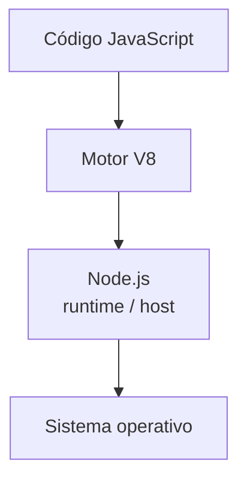

Node incorpora V8 para ejecutar el lenguaje y agrega APIs que permiten interactuar con capacidades propias de una aplicación de sistema/servidor:

```text
archivos
red
procesos
streams
timers
variables de entorno
módulos
```

Esto permite escribir:

```javascript
const fs = require("node:fs");
```

algo que no pertenece al núcleo de ECMAScript sino al host Node.

#### 24.1 El problema que resuelve Node

JavaScript se popularizó inicialmente dentro del navegador.

El navegador ya proporcionaba:

```text
un motor JavaScript
+
APIs del entorno web
```

pero un backend necesita otras capacidades:

```text
escuchar conexiones
abrir sockets
leer archivos del servidor
trabajar con procesos
interactuar con el sistema operativo
```

Node combina un motor JavaScript con APIs y librerías orientadas a ese entorno.

La idea no es que “un navegador administre mal los recursos”. Navegador y Node son **hosts distintos, diseñados para responsabilidades diferentes**.

#### 24.2 Runtime, motor y framework no son sinónimos

```text
V8
→ ejecuta el lenguaje

Node.js
→ host/runtime que incluye V8 y APIs

Express
→ framework/librería web ejecutada dentro de Node

NPM
→ gestor/registro de paquetes del ecosistema
```

Esta separación evita confundir capas de la plataforma.

Por ejemplo:

```javascript
const express = require("express");
```

Express necesita un runtime donde ejecutarse; en este proyecto ese runtime es Node.

### 25. Concurrencia, Event Loop y modelo de ejecución en Node.js

La frase “Node es single-threaded” necesita precisión.

El **código JavaScript principal** de una instancia de Node normalmente se ejecuta sobre el hilo asociado al Event Loop, una operación JavaScript a la vez.

Pero el proceso Node no está compuesto literalmente por un único hilo.

Puede involucrar:

```text
Event Loop
Worker Pool de libuv
trabajo realizado por el sistema operativo
worker_threads explícitos
otros componentes internos
```

#### 25.1 ¿Cómo puede atender muchas operaciones si JavaScript ejecuta una a la vez?

La clave es evitar que el hilo que ejecuta callbacks JavaScript quede esperando pasivamente operaciones de entrada/salida.

Ejemplo conceptual:

```text
request A → inicia consulta de red ─────────────┐
                                               │
request B → se procesa mientras A espera       │
                                               │
request C → se procesa mientras A espera       │
                                               │
consulta A termina → callback vuelve al loop ◄─┘
```

Esto funciona bien cuando el tiempo se consume principalmente esperando:

```text
red
base de datos
archivos
servicios externos
```

y cada callback JavaScript realiza trabajo relativamente breve.

#### 25.2 No bloqueante no significa “imposible de bloquear”

Este código bloquea el Event Loop mientras el ciclo se ejecuta:

```javascript
while (true) {
  // trabajo sin fin
}
```

Mientras tanto, otros callbacks JavaScript de esa instancia no pueden avanzar.

También pueden resultar problemáticas operaciones sincrónicas costosas:

```javascript
fs.readFileSync(...)
```

dentro del camino de atención de muchas requests.

La ventaja de Node depende de una condición:

> el trabajo ejecutado en el Event Loop debe mantenerse razonablemente pequeño y las operaciones costosas deben diseñarse para no monopolizarlo.

#### 25.3 I/O-bound vs. CPU-bound

Node resulta especialmente natural para cargas **I/O-bound**:

```text
recibir request
consultar servicio
consultar DB
leer/escribir red
esperar respuesta
```

Una carga **CPU-bound** intensa:

```text
procesar millones de cálculos
comprimir grandes volúmenes
transformaciones criptográficas pesadas
```

puede bloquear el hilo de JavaScript si se ejecuta directamente allí.

Según el problema pueden utilizarse:

```text
Worker Pool
worker_threads
procesos separados
servicios especializados
```

Por eso “Node es rápido y escalable” no es una propiedad mágica independiente del diseño. Su arquitectura facilita manejar mucha concurrencia de I/O con pocos hilos, pero un callback costoso puede degradar el throughput de todo el servidor.

#### 25.4 Arquitectura orientada a eventos

Node organiza gran parte de su trabajo alrededor de eventos y callbacks:

```text
ocurre un evento
→ queda disponible trabajo asociado
→ el Event Loop ejecuta el callback correspondiente
```

Este modelo conecta directamente con:

```text
callbacks
timers
promesas
async/await
servidores HTTP
streams
EventEmitter
```

Los conceptos posteriores no son temas aislados: son distintas formas de programar sobre el mismo modelo de ejecución.

### 26. Módulos, paquetes y dependencias

Antes de hablar de NPM hace falta distinguir tres conceptos relacionados, que suelen confundirse entre sí:

- **Módulo:** una funcionalidad organizada en uno o varios archivos, pensada para ser reutilizada dentro de la aplicación. Es, en esencia, el mismo problema que resuelven las funciones (evitar copiar y pegar el mismo código en varios archivos), pero a una escala mayor.
- **Paquete:** un módulo que además tiene un archivo `package.json` describiéndolo, lo cual lo deja en condiciones de publicarse (por ejemplo, en el registro de NPM) para que otras personas lo puedan reutilizar. No hace falta que un paquete tenga dependencias para ser considerado paquete — alcanza con que tenga su `package.json`.
- **Dependencia:** un paquete que otro paquete necesita para funcionar correctamente. Si el módulo A necesita al módulo B para funcionar, A tiene una dependencia directa de B.

#### 26.1 Tipos de módulos

| Tipo | Qué es | Se sube al repositorio |
|---|---|---|
| **Incorporados** (*built-in*) | Vienen ya incluidos en Node (por ejemplo `http`, `fs`, `os`, `path`, `console`) — para actualizarlos hay que actualizar la versión de Node | No aplica: vienen con el propio Node |
| **Locales** | Los escribe el propio equipo de desarrollo, viven dentro del proyecto | Sí |
| **Externos** | Paquetes de terceros instalados con NPM (`Express`, etc.) | **No** — se declaran en `package.json` y NPM los reinstala con `npm install` |

Con un módulo **local** el equipo controla directamente su implementación. Con un módulo **externo**, el proyecto pasa a depender de código mantenido por terceros.

El riesgo de cadena de suministro no existe porque JavaScript sea “interpretado” ni desaparece por compilar un lenguaje. El problema es de **confianza y procedencia del código**: si una dependencia o una versión publicada queda comprometida y el proyecto la instala/ejecuta, ese código obtiene las capacidades que le permita el entorno.

Por eso agregar una dependencia implica evaluar, según el contexto:

```text
mantenimiento
licencia
versiones
dependencias transitivas
vulnerabilidades conocidas
procedencia
necesidad real del paquete
```

Una dependencia pequeña también agrega superficie de mantenimiento y seguridad.

**Ejemplo de un módulo incorporado: `os`.** Da acceso a información del sistema operativo sobre el que corre Node — algo que un código corriendo dentro de un navegador no podría hacer, y que es posible acá justamente porque Node corre directamente sobre el sistema operativo (sección 24).

```javascript
const os = require("node:os");

console.log(os.platform());    // el sistema operativo (ej: "linux", "darwin", "win32")
console.log(os.release());     // la versión del sistema operativo
console.log(os.cpus());        // información de los procesadores disponibles
console.log(os.freemem() / 1024 / 1024);   // memoria libre, convertida de bytes a megabytes
```

El prefijo `node:` antes del nombre del módulo (`require("node:os")`) es una buena práctica al importar un módulo **incorporado**: le indica directamente al sistema de módulos que vaya a buscarlo entre los módulos nativos, sin necesidad de buscar primero entre los locales o externos — una carga más rápida. Sin ese prefijo (`require("os")`), Node igual lo encuentra, pero primero revisa si existe un módulo local o externo con ese nombre antes de recurrir a los incorporados.

#### 26.2 Tipos de dependencias

| Tipo | Se declara en `package.json` como | Se instala en producción |
|---|---|---|
| **Directas** (de producción) | `dependencies` | Sí — el código las necesita para funcionar |
| **De desarrollo** | `devDependencies` | No — herramientas de compilación, testing o control de calidad, solo necesarias mientras se desarrolla |
| **Opcionales** | `optionalDependencies` | No aplica directamente — el proyecto funciona con o sin ellas |

Instalar un paquete como dependencia de desarrollo se hace agregando `--save-dev` (o su forma abreviada `-D`) al comando de instalación — se retoma en la sección 27.1.

#### 26.3 Caso real: el incidente de *left-pad*

Este caso, ocurrido en marzo de 2016, ilustra por qué hay que ser consciente de cada dependencia que se agrega a un proyecto (sección 26.1). Un desarrollador de software, Azer Koçulu, había publicado en NPM más de 250 módulos, entre ellos uno llamado `left-pad`: un archivo de apenas once líneas de código, con una única función que agregaba caracteres de relleno a la izquierda de un string hasta completar una longitud determinada (por ejemplo, para convertir `"5"` en `"005"`).

Por una disputa de nombres con NPM (otra empresa reclamó el nombre de otro de sus paquetes), Koçulu decidió eliminar de NPM **todos** sus módulos publicados, incluido `left-pad`. El problema fue que una enorme cantidad de proyectos —entre ellos herramientas muy usadas como Node y Babel— tenían una dependencia directa o indirecta de ese paquete de once líneas. De un día para el otro, todos esos proyectos empezaron a fallar al intentar instalar sus dependencias, con un error de NPM indicando que el paquete ya no existía en el registro.

Lo que este caso deja como lección: **una dependencia externa, por más pequeña o trivial que parezca, deja el funcionamiento del propio proyecto atado a una decisión que no está bajo su control.** A raíz de este incidente, NPM cambió su política: hoy, si un paquete tiene al menos otro paquete publicado que depende de él, ya no se puede eliminar por completo (sigue perteneciendo a quien lo publicó, y se le pueden subir actualizaciones, pero no borrarlo) — precisamente para que un caso así no se pueda repetir.

#### 26.4 Sistemas de módulos: CommonJS vs. ES Modules

Node.js soporta dos formatos principales de módulos:

| Característica | CommonJS | ECMAScript Modules (ESM) |
|---|---|---|
| Importación típica | `require(...)` | `import ... from ...` |
| Exportación típica | `module.exports` / `exports` | `export` |
| Extensión explícita | `.cjs` | `.mjs` |
| Configuración para `.js` | `"type": "commonjs"` | `"type": "module"` |
| Origen | formato histórico de Node | estándar oficial de ECMAScript |

Ejemplo CommonJS:

```javascript
const { readFile } = require("node:fs");
module.exports = { miFuncion };
```

Ejemplo ESM:

```javascript
import { readFile } from "node:fs";
export { miFuncion };
```

La diferencia **no debe reducirse a**:

```text
CommonJS = sincrónico
ESM = asincrónico
```

Los sistemas poseen diferencias de resolución, evaluación, sintaxis e interoperabilidad. Además, Node moderno permite determinados cruces entre ambos formatos bajo condiciones específicas.

#### Cómo decide Node el formato

La forma más clara es declararlo explícitamente:

```text
.cjs
→ CommonJS

.mjs
→ ESM
```

o mediante `package.json`:

```json
{
  "type": "module"
}
```

o:

```json
{
  "type": "commonjs"
}
```

En archivos `.js` sin una marca explícita, versiones modernas de Node también pueden aplicar detección de sintaxis. Por mantenibilidad conviene evitar depender accidentalmente de esa ambigüedad y declarar el formato del proyecto.

#### Interoperabilidad

Node ofrece interoperabilidad entre ambos sistemas, pero no conviene asumir que cualquier combinación funciona idénticamente.

Por ejemplo:

```text
importar CommonJS desde ESM
requerir determinados ESM desde CommonJS
```

está sujeto a reglas específicas del loader y de la estructura del módulo.

Para aprender el proyecto de la materia, lo importante es mantener consistente el formato elegido y comprender que:

```text
forma del export
→ determina qué valor recibe quien importa
```

Los detalles de `module.exports`, `exports` y `require` se desarrollan en la sección 28.

### 27. NPM (*Node Package Manager*)

**NPM es el gestor de paquetes de Node.js** — viene instalado por defecto junto con el entorno de ejecución de Node. Es la herramienta de gestión de dependencias predeterminada de los proyectos de Node: no solo instala las dependencias que un proyecto declara directamente, sino que también resuelve, en cadena, todas las dependencias que esas dependencias necesitan a su vez (si un paquete necesita a otros diez paquetes internamente, NPM se encarga de instalarlos a todos).

- **`package.json`:** el archivo de configuración de un proyecto de Node — describe, entre otras cosas, sus dependencias, sus scripts, y dónde vive su repositorio. Cuando se ejecuta `npm install`, NPM lee este archivo para saber qué paquetes tiene que descargar.
- **`node_modules`:** la carpeta donde NPM descarga y guarda todos los paquetes instalados (las dependencias declaradas, y las dependencias de esas dependencias). Por su tamaño, esta carpeta no se sube al repositorio: alcanza con subir `package.json`, ya que contiene toda la información necesaria para que cualquier otra persona pueda regenerar `node_modules` corriendo `npm install`.

Node.js también incluye **módulos built-in/core** (`node:fs`, `node:http`, `node:path`, etc.). No se instalan mediante NPM: forman parte del runtime y cambian con la versión de Node.

Existen alternativas como **pnpm** y **Yarn**. Comparten la responsabilidad general de gestionar paquetes y dependencias, pero difieren en estrategias de instalación, almacenamiento, resolución y experiencia de uso. No corresponde asumir que un gestor sea globalmente “más seguro” solamente por su estrategia de instalación; la seguridad también depende de procedencia, configuración, versiones, scripts y políticas de la cadena de suministro.

#### 27.1 Comandos más usados

| Comando | Qué hace |
|---|---|
| `npm install` (sin argumentos) | Lee `package.json` e instala todas las dependencias declaradas — es lo que se corre después de clonar un proyecto |
| `npm install <paquete>` | Instala un paquete puntual y lo agrega a `dependencies` |
| `npm install <paquete>@<versión>` | Instala una versión específica del paquete |
| `npm install <paquete> --save-dev` (o `-D`) | Instala el paquete como dependencia de desarrollo (`devDependencies`, sección 26.2) |
| `npm uninstall <paquete>` | Desinstala el paquete **y** las dependencias propias de ese paquete que ya no use ningún otro (evita dejar paquetes huérfanos) |
| `npm prune --production` | Elimina del proyecto instalado las dependencias de desarrollo, dejando solo las necesarias para producción |
| `npm update <paquete>` | Actualiza el paquete a su última versión disponible |
| `npm install -g <paquete>` (o `--global`) | Instala el paquete de forma global en el sistema, no solo dentro del proyecto actual |
| `npm cache clean --force` | Limpia la caché local de NPM |
| `npm init` | Inicializa un paquete nuevo: genera `package.json`, preguntando nombre, versión, descripción, punto de entrada, autor, licencia, etc. |
| `npm init -y` | Igual que `npm init`, pero acepta automáticamente todos los valores por defecto sin preguntar |
| `npm -v` | Muestra la versión de NPM instalada |

Como convención de la terminal (no específica de NPM): los flags de una sola letra se escriben con un solo guión (`-D`, `-g`), y los flags de palabra completa con doble guión (`--save-dev`, `--global`) — por eso `-D` y `--save-dev` son equivalentes, al igual que `-g` y `--global`.

Al instalar o desinstalar un paquete, NPM además **audita** el resto de las dependencias ya instaladas en el proyecto, revisando si hay actualizaciones o vulnerabilidades reportadas en alguna de ellas — no solo evalúa el paquete que se está por instalar.

##### Verificar el estado del proyecto desde `package.json`

Durante el armado inicial de un backend conviene mirar `package.json` después de instalar cada dependencia. El archivo funciona como **manifiesto del paquete/proyecto**: registra metadatos, scripts y las dependencias declaradas que permiten reconstruir el entorno.

Ejemplo mínimo:

```json
{
  "dependencies": {
    "express": "^5.0.0"
  },
  "devDependencies": {
    "nodemon": "^3.0.0"
  }
}
```

La distinción expresa una intención:

- `express` forma parte del código que la aplicación necesita para funcionar;
- `nodemon` es una herramienta utilizada durante el desarrollo y por eso corresponde a `devDependencies`.

Si un paquete se instaló en la categoría equivocada, no hace falta borrar `node_modules` a mano para “arreglarlo”. Se puede desinstalar y volver a instalar con el flag adecuado:

```bash
npm uninstall nodemon
npm install -D nodemon
```

Después se verifica nuevamente `package.json`.

Eliminar `node_modules` tampoco elimina la declaración de dependencias del proyecto. Mientras se conserven `package.json` —y normalmente `package-lock.json`— las dependencias se pueden reinstalar con:

```bash
npm install
```

Por eso `node_modules` es regenerable, mientras que `package.json` forma parte de la definición del proyecto y debe conservarse.

> 📌 **Para el examen:** `npm init` / `npm init -y` generan el paquete, `package.json` es el archivo central donde se declara su configuración y sus dependencias, y debe distinguirse `dependencies` de `devDependencies`.

#### 27.2 Scripts de NPM

Dentro de `package.json`, la propiedad `scripts` permite definir comandos cortos y reutilizables para tareas frecuentes del proyecto (compilar, correr tests, levantar el servidor, etc.), en vez de tener que escribir el comando completo cada vez.

```json
{
  "scripts": {
    "start": "node index.js",
    "test": "echo \"Error: no test specified\" && exit 1"
  }
}
```

Se ejecutan con `npm run <nombre-del-script>` — con dos excepciones que tienen un atajo propio, sin necesidad de escribir `run`: `npm start` (ejecuta el script `start`) y `npm test` (ejecuta el script `test`). El **punto de entrada** de un paquete (qué archivo se ejecuta primero) se declara en la propiedad `main` de `package.json`; si no se declara explícitamente, por convención se asume `index.js`.

#### 27.3 Cómo leer la página de un paquete en npmjs.com

Antes de agregar una dependencia a un proyecto (recordando el caso de la sección 26.3), la página de cada paquete en [npmjs.com](https://www.npmjs.com) da información útil para evaluarlo:

- **Versión actual** y **fecha de la última publicación** — un paquete sin actualizaciones desde hace mucho tiempo es una señal de alerta.
- **Descargas semanales** — una noción de qué tan usado y probado está en la práctica.
- **Tipo de licencia**.
- **Cantidad de paquetes que dependen de él** (*dependents*) — cuantos más, más impacto tendría un problema con ese paquete (como el caso de `left-pad`).
- **Sus propias dependencias** — cuántos paquetes más va a traer instalados como consecuencia.
- **Repositorio del código fuente** — cuando el paquete publica su código fuente, permite revisar implementación, mantenimiento, issues y cambios antes de incorporarlo. Que un proyecto esté escrito en JavaScript no implica por sí solo que sea open source.

### 28. Módulos locales: crear y exportar código propio

Para poder reutilizar código propio entre distintos archivos de un proyecto (en vez de repetirlo, o de arrastrarlo copiando y pegando), se lo separa en un **módulo local**: un archivo nuevo, dentro del mismo proyecto, que declara qué de todo lo que contiene queda disponible para el resto del proyecto.

```javascript
// archivo: modulo-consola.js
function separador() {
  console.log("--------------------");
}

module.exports = { separador };
```

`module.exports` es una propiedad del objeto `module` (todo archivo de Node tiene automáticamente acceso a este objeto) que determina qué queda expuesto hacia afuera cuando otro archivo importe este módulo. Guardar ahí un objeto con `separador` como propiedad (usando la forma abreviada de propiedad, ya vista en la sección 20.1, ya que el nombre de la propiedad coincide con el nombre de la variable) es lo que permite que otro archivo acceda a esa función.

```javascript
// archivo: index.js
const modulo = require("./modulo-consola");

modulo.separador();   // accede a la función a través de la propiedad "separador" del objeto importado
```

Si el módulo tiene más de una función para exportar, se agregan como propiedades adicionales del mismo objeto:

```javascript
module.exports = { separador, saludar, calcularTotal };
```

**`module` es, en sí mismo, un objeto** — con varias propiedades propias, entre ellas `exports` (el objeto que se acaba de completar), `id`, `filename`, `path` y `children`. Esto es consistente con lo ya visto sobre objetos y sus propiedades (sección 20): importar un módulo, en el fondo, es acceder a una propiedad (`exports`) de un objeto (`module`) que ya viene incorporado en cada archivo.

#### 28.1 Importar solo lo necesario, con el nombre que se quiera

`require(...)` es una función que retorna un objeto (el `module.exports` del archivo importado). Hasta acá se venía guardando ese objeto completo en una constante y accediendo a cada función con la notación de punto (`modulo.separador()`). Pero también se puede importar **una única propiedad puntual**, usando destructuring (la misma sintaxis abreviada `{ }` ya vista para objetos):

```javascript
const { separador } = require("./modulo-consola");

separador();   // ya no hace falta anteponer "modulo."
```

El nombre entre llaves tiene que coincidir exactamente con el nombre de la propiedad exportada — pero, como con cualquier constante, se le puede dar cualquier otro nombre a la variable local con la sintaxis `{ propiedadOriginal: nombreLocal }`:

```javascript
const { separador: separadorConsola } = require("./modulo-consola");

separadorConsola();   // misma función, con otro nombre en este archivo
```

Importar solo lo que se va a usar (en vez de todo el módulo completo) es buena práctica: evita cargar código que después no se va a ejecutar — algo que puede importar especialmente en entornos con recursos limitados, como una aplicación mobile.

#### 28.2 Alias al exportar: nombre interno vs. nombre expuesto

De la misma manera que se puede renombrar algo al importarlo, también se puede exportar una función con un nombre **distinto** al que tiene dentro del archivo — usando la forma larga de propiedad (`propiedadExpuesta: nombreInterno`) en vez de la abreviada:

```javascript
function separadorConEntradaLarga(entrada) {
  console.log(entrada.repeat(10));
}

module.exports = {
  separador: separadorConEntradaLarga,   // se expone como "separador", aunque internamente se llame distinto
};
```

Quien importe este módulo va a acceder a la función como `modulo.separador(...)` — nunca va a ver el nombre `separadorConEntradaLarga`, que queda como un detalle interno del módulo.

#### 28.3 Por qué conviene modularizar: un cambio, un solo lugar

El beneficio concreto de mover una función a un módulo en vez de repetirla en cada archivo que la necesita: si más adelante hay que modificar esa función (cambiar el símbolo que usa un separador, por ejemplo), el cambio se hace **una sola vez**, en el módulo — y se refleja automáticamente en todos los archivos que lo importan. La alternativa (tener la misma función copiada en varios archivos) obliga a encontrar y corregir cada copia una por una, con el riesgo de olvidarse alguna.

#### 28.4 Errores comunes al exportar y efectos al cargar un módulo

En CommonJS conviene distinguir tres expresiones que se parecen pero **no significan lo mismo**:

```javascript
module.exports.algo = valor; // ✅ agrega una propiedad al objeto exportado
exports.algo = valor;        // ✅ también funciona mientras exports siga enlazado
module.export.algo = valor;  // ❌ "export" no es la propiedad que usa CommonJS
```

Al comenzar a ejecutarse un módulo, Node establece conceptualmente una relación equivalente a:

```javascript
exports = module.exports;
```

Por eso estas dos formas pueden agregar propiedades al mismo objeto:

```javascript
module.exports.saludar = saludar;
exports.despedir = despedir;
```

El problema aparece al **reasignar** `exports`:

```javascript
exports = {
  saludar,
};
```

Esa asignación cambia únicamente la variable local `exports`; no reemplaza `module.exports`. Quien haga `require(...)` seguirá recibiendo el valor de `module.exports`.

Si se quiere reemplazar completamente lo exportado, debe hacerse:

```javascript
module.exports = {
  saludar,
};
```

Otro error frecuente es escribir `module.export` en singular:

```javascript
module.export = { saludar };
```

JavaScript puede crear esa propiedad nueva en el objeto `module`, pero CommonJS no la utiliza como interfaz pública. El valor que devuelve `require(...)` sigue viniendo de **`module.exports`**.

> 📌 **Para el examen:** el profesor remarcó especialmente la importación/exportación y el error de olvidar la `s` de `module.exports`.

##### Código con efectos secundarios dentro de un módulo

Un archivo CommonJS se **ejecuta cuando Node lo carga por primera vez**. Por eso una instrucción situada en el nivel superior del archivo produce un efecto durante esa carga:

```javascript
console.log("Inicializando módulo");

function saludar() {
  return "Hola";
}

module.exports = { saludar };
```

Al hacer el primer:

```javascript
const modulo = require("./modulo");
```

se ejecuta el `console.log`.

Sin embargo, los módulos CommonJS normalmente quedan **cacheados después de la primera carga**. Si el mismo archivo se vuelve a resolver mediante `require(...)`, Node reutiliza el valor almacenado y no vuelve a ejecutar automáticamente todo el módulo.

Esto no significa que todo efecto secundario sea incorrecto: muchos paquetes necesitan inicialización. El criterio es que esos efectos deben ser **intencionales y previsibles**, porque ocurren por el hecho de cargar el módulo, no por invocar explícitamente una función exportada.


#### 28.5 `module.exports`, `exports` y el valor que recibe `require`

En CommonJS, cada archivo tiene un objeto `module`. La propiedad **`module.exports`** determina qué valor queda disponible para quien haga `require(...)` sobre ese archivo.

El puente conceptual es importante: **modularizar** resuelve el problema de separar responsabilidades; `module.exports` define la interfaz pública del módulo; `require(...)` recupera exactamente ese valor para poder utilizarlo desde otro archivo.

```javascript
// src/lenguajes.js
const infoLenguajes = {
  frontend: [
    { id: 1, nombre: "JavaScript" },
    { id: 2, nombre: "HTML" },
    { id: 3, nombre: "CSS" },
  ],
  backend: [
    { id: 1, nombre: "JavaScript" },
    { id: 2, nombre: "PHP" },
    { id: 3, nombre: "Python" },
  ],
};

module.exports.infoLenguajes = infoLenguajes;
```

Al importar:

```javascript
const lenguajes = require("./src/lenguajes");

console.log(lenguajes.infoLenguajes.frontend);
```

`require(...)` no "lee una variable por nombre" dentro del otro archivo: recibe el valor expuesto mediante `module.exports`.

También se puede exportar el objeto completo directamente:

```javascript
module.exports = infoLenguajes;
```

En ese caso cambia la forma de importar y usar el resultado:

```javascript
const infoLenguajes = require("./src/lenguajes");

console.log(infoLenguajes.frontend);
```

Esta diferencia evita una confusión frecuente:

```javascript
module.exports.infoLenguajes = infoLenguajes;
// require(...) -> { infoLenguajes: { ... } }
```

no es equivalente estructuralmente a:

```javascript
module.exports = infoLenguajes;
// require(...) -> { frontend: [...], backend: [...] }
```

`exports` existe como un atajo que inicialmente referencia al mismo objeto que `module.exports`:

```javascript
exports.infoLenguajes = infoLenguajes;
```

Eso funciona para **agregar propiedades**. En cambio, reasignar `exports` rompe ese vínculo local y no reemplaza el valor exportado:

```javascript
exports = { infoLenguajes }; // no reemplaza module.exports
```

Para reemplazar por completo lo exportado, debe usarse:

```javascript
module.exports = { infoLenguajes };
```

> ⚠️ Escribir por error una propiedad inexistente como `module.export` (sin `s`) no produce el efecto esperado. JavaScript puede crear una propiedad nueva llamada `export`, pero `require(...)` consulta `module.exports`, por lo que ese valor no será el exportado.

Una forma simple de depurar este tipo de problemas es inspeccionar el valor:

```javascript
console.log(module.exports);
```

y, del lado que importa, comprobar la forma real del objeto recibido antes de seguir usando sus propiedades.


#### 28.6 Diagnóstico de importaciones y exportaciones

Los errores de módulos suelen aparecer lejos de la línea donde se originaron. Si un archivo exporta mal un valor, el problema puede manifestarse recién cuando otro archivo intenta acceder a una propiedad inexistente.

Una estrategia de diagnóstico útil es inspeccionar **la forma del valor en cada extremo**.

Archivo exportador:

```javascript
// src/lenguajes.js
console.log(module.exports);
```

Archivo importador:

```javascript
const lenguajes = require("./src/lenguajes");

console.log(lenguajes);
console.log(Object.keys(lenguajes));
```

Si se esperaba:

```javascript
lenguajes.infoLenguajes
```

pero `Object.keys(lenguajes)` no contiene `"infoLenguajes"`, el problema está en la forma de exportación o en el módulo que se está resolviendo.

También es importante distinguir entre:

```javascript
const lenguajes = require("./src/lenguajes");
```

y:

```javascript
const { infoLenguajes } = require("./src/lenguajes");
```

La segunda forma usa **destructuring**. Solo funciona si el valor exportado posee una propiedad llamada exactamente `infoLenguajes`.

```javascript
module.exports = {
  infoLenguajes,
};
```

En cambio, si el módulo hace:

```javascript
module.exports = infoLenguajes;
```

entonces el objeto importado ya es `infoLenguajes`, y la forma correcta sería:

```javascript
const infoLenguajes = require("./src/lenguajes");
```

##### La extensión `.js`

En un `require` relativo de CommonJS, Node puede resolver un archivo JavaScript aunque se omita la extensión cuando existe una resolución válida:

```javascript
require("./src/lenguajes");
```

y:

```javascript
require("./src/lenguajes.js");
```

pueden resolver al mismo archivo. Omitir la extensión es habitual, pero no debe confundirse con que `require` "adivina cualquier archivo": Node aplica reglas concretas de resolución de módulos.

##### Una comprobación simple antes de buscar errores más profundos

Cuando un módulo no parece funcionar:

```text
1. ¿La ruta del require es correcta?
2. ¿El archivo que espero es el que realmente se está resolviendo?
3. ¿Estoy usando module.exports y no module.export?
4. ¿Estoy exportando un objeto completo o una propiedad dentro de él?
5. ¿La forma de importación coincide con esa estructura?
6. ¿La propiedad que intento usar existe realmente?
```

Esta secuencia suele ser más eficiente que modificar código al azar.


#### 28.7 Cache de módulos CommonJS: por qué varios `require()` suelen ver el mismo objeto

Cuando un módulo CommonJS se carga por primera vez, Node ejecuta su código y guarda el módulo en una cache asociada al archivo resuelto.

Por eso:

```javascript
// estado.js
module.exports = {
  contador: 0,
};
```

```javascript
// a.js
const estado = require("./estado");
estado.contador++;
```

```javascript
// b.js
const estado = require("./estado");
console.log(estado.contador);
```

normalmente ambos `require("./estado")` reciben una referencia al **mismo valor exportado que quedó cacheado**, siempre que resuelvan al mismo archivo y no se manipule manualmente la cache.

La explicación correcta no es que:

```text
module.exports
→ sea un objeto "static" de Java
```

ni que:

```text
CommonJS
→ implemente automáticamente el patrón Singleton
```

`module.exports` es simplemente el valor que un módulo CommonJS expone.

La sensación de “instancia única” aparece porque Node **cachea el módulo después de la primera carga**:

```text
primera carga
→ ejecuta el archivo
→ guarda el módulo en cache
→ retorna module.exports

cargas posteriores del mismo archivo resuelto
→ reutilizan el módulo cacheado
→ retornan su export actual
```

Esto puede utilizarse deliberadamente para compartir estado dentro de un proceso, pero también introduce riesgos.

```javascript
// cacheLocal.js
const cache = new Map();

module.exports = cache;
```

Cualquier módulo que importe ese mismo archivo puede modificar el mismo `Map`.

Eso significa que el estado compartido:

```text
puede ser útil
+
puede generar acoplamiento global difícil de rastrear
```

La cache de CommonJS tampoco equivale a persistencia:

```text
reiniciar el proceso Node
→ se pierde la memoria
→ se vuelve a construir la cache de módulos
```

Por lo tanto:

```text
cache CommonJS
≠ base de datos
≠ almacenamiento persistente
```

**Referencia técnica:** Node.js documenta que los módulos CommonJS se cachean después de la primera carga y que llamadas posteriores a `require()` obtienen el mismo objeto cuando resuelven al mismo archivo.

### 29. Pila (*Stack*) y Cola (*Queue*): estructuras para razonar sobre ejecución

Antes de estudiar asincronía conviene comprender dos estructuras abstractas.

#### Stack — LIFO

Una pila sigue la regla:

```text
Last In, First Out
```

El último elemento que entra es el primero que sale.

```text
push A
push B
push C

top
 C   ← sale primero
 B
 A
```

Este comportamiento aparece en el **call stack** porque una función invocada debe terminar antes de devolver el control exacto al punto desde donde fue llamada.

#### Queue — FIFO

Una cola típica sigue:

```text
First In, First Out
```

```text
entra A
entra B
entra C

sale A
sale B
sale C
```

El modelo real del Event Loop posee distintas colas/fases y prioridades, por lo que no debe imaginarse como una única fila universal. La idea FIFO sirve como base para entender por qué existe trabajo **pendiente** que espera su turno de ejecución.

La utilidad de estas estructuras no es memorizar LIFO/FIFO de forma aislada, sino poder explicar:

```text
por qué una función anidada vuelve al llamador
por qué un callback no se ejecuta mientras el stack actual sigue ocupado
por qué algunas tareas pendientes se ejecutan antes que otras
```

### 30. Programación sincrónica y Call Stack

El **Call Stack** registra los contextos de ejecución activos.

```javascript
function c() {
  console.log("C");
}

function b() {
  c();
}

function a() {
  b();
}

a();
```

Modelo simplificado:

```text
push a
  push b
    push c
    pop c
  pop b
pop a
```

Cada función:

1. entra en ejecución;
2. puede invocar otras funciones;
3. espera el retorno de esas llamadas sin abandonar su propio contexto;
4. termina;
5. devuelve el control al contexto anterior.

Una operación **sincrónica y costosa** ocupa ese hilo hasta terminar.

```javascript
function trabajoPesado() {
  // cálculo largo
}

trabajoPesado();
console.log("después");
```

`"después"` no puede ejecutarse mientras `trabajoPesado()` siga ocupando el stack.

En un servidor Node, esto importa porque monopolizar el Event Loop con una callback larga impide que otras requests obtengan tiempo de ejecución JavaScript.

### 31. Programación asincrónica y Event Loop

La asincronía permite iniciar una operación cuyo resultado estará disponible en otro momento sin mantener ocupado el stack JavaScript esperando activamente.

Ejemplo:

```javascript
console.log("A");

setTimeout(() => {
  console.log("B");
}, 0);

console.log("C");
```

Resultado:

```text
A
C
B
```

El `0` no significa “ejecutar inmediatamente”.

Significa que la callback podrá quedar disponible **como mínimo** cuando corresponda según el mecanismo del timer; todavía debe esperar a que el trabajo JavaScript actual termine y a que el Event Loop pueda procesarla.

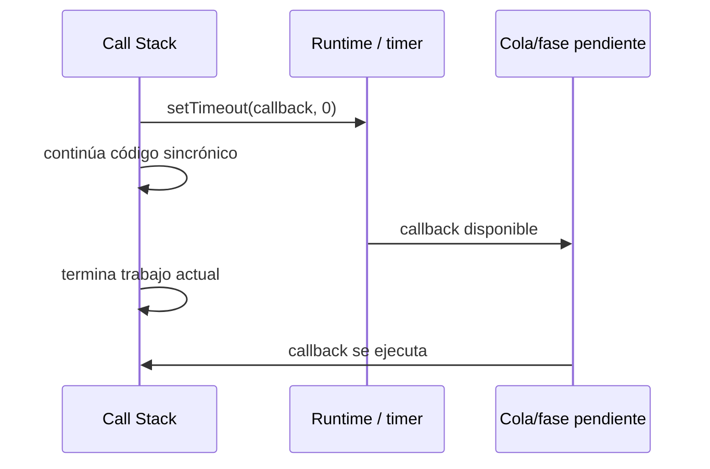

#### 31.1 Motor y host cooperan

JavaScript por sí solo no define cómo leer un archivo del sistema o escuchar un socket.

El host —Node o navegador— implementa mecanismos externos y, cuando el resultado está disponible, programa trabajo JavaScript asociado.

Por eso el modelo completo debe distinguir:

```text
motor JavaScript
+
host/runtime
+
colas/fases de tareas
```

#### 31.2 Una callback pendiente no interrumpe el código actual

JavaScript ejecuta cada trabajo hasta que ese turno termina.

Si una operación asíncrona completa mientras existe una función larga ejecutándose:

```text
la callback queda pendiente
→ no entra a mitad de esa función
→ espera hasta que el runtime pueda darle un turno
```

Esto evita determinadas carreras dentro de un mismo turno de JavaScript, aunque una aplicación asincrónica sí puede sufrir condiciones de carrera **lógicas** entre operaciones que observan/modifican estado en momentos diferentes.

#### 31.3 Promesas agregan otra cola de trabajo

Los handlers de promesas (`then`, `catch`, `finally`) utilizan la cola de *jobs/microtasks* del lenguaje.

Por eso pueden tener prioridad distinta respecto de callbacks de timers.

Ejemplo:

```javascript
setTimeout(() => console.log("timer"), 0);

Promise.resolve().then(() => {
  console.log("promise");
});

console.log("sync");
```

De forma típica:

```text
sync
promise
timer
```

Este detalle explica por qué “todo lo asincrónico va a una sola callback queue FIFO” es un modelo demasiado simple.

### 32. Timers en Node.js

Los timers permiten programar callbacks para un momento posterior.

| Función | Idea principal |
|---|---|
| `setTimeout(callback, delay)` | ejecutar una vez después de un umbral mínimo |
| `setInterval(callback, delay)` | repetir aproximadamente según un intervalo |
| `setImmediate(callback)` | programar para la fase *check* del Event Loop |
| `clearTimeout` / `clearInterval` / `clearImmediate` | cancelar la programación correspondiente |

#### 32.1 El tiempo no es una garantía exacta

```javascript
setTimeout(callback, 1000);
```

no promete:

> “ejecutar exactamente a los 1000 ms”.

Promete que no debería programarse para ejecutarse **antes del umbral correspondiente**, pero puede ejecutarse después si:

```text
el Event Loop está ocupado
hay otros callbacks pendientes
el sistema está bajo carga
```

Por eso los timers no son cronómetros de precisión.

#### 32.2 `setTimeout(..., 0)` y `setImmediate(...)`

No existe una regla universal de una línea que garantice cuál se ejecutará primero en cualquier contexto.

Su orden depende de la fase del Event Loop y del punto desde donde fueron programados.

Esto no convierte a `setImmediate()` en una API “mala” ni explica por sí solo que se use poco. Su semántica es útil precisamente cuando se necesita programar trabajo para una fase posterior concreta del loop.

La conclusión pedagógica correcta es:

> no depender de un orden accidental entre mecanismos cuya prioridad no forma parte del contrato que la aplicación necesita.

#### 32.3 `setInterval` y acumulación de trabajo

```javascript
const id = setInterval(() => {
  // tarea
}, 1000);
```

debe cancelarse cuando deja de ser necesario:

```javascript
clearInterval(id);
```

En servicios de larga duración, dejar timers activos innecesarios puede mantener recursos vivos y generar trabajo periódico sin utilidad.

### 33. Módulo `fs` (*File System*): trabajar con archivos y carpetas

`fs` es un módulo incorporado de Node.js para interactuar con el sistema de archivos: permite leer, crear, modificar, copiar, renombrar y eliminar archivos y directorios, además de consultar metadatos.

Node expone **distintas variantes de API** para muchas operaciones:

- APIs asincrónicas basadas en callbacks, como `fs.readFile(...)`;
- APIs asincrónicas basadas en promesas, disponibles en `node:fs/promises`;
- variantes sincrónicas con sufijo `Sync`, como `fs.readFileSync(...)`.

Por lo tanto, no es correcto pensar que todos los métodos de `fs` sean asincrónicos “por defecto”: el módulo ofrece explícitamente familias asincrónicas y sincrónicas. En servidores, las variantes sincrónicas deben usarse con cuidado porque **bloquean el hilo de JavaScript** hasta terminar la operación de E/S.

```javascript
const fs = require("node:fs");

// Asincrónico con callback y convención "error primero"
fs.readFile("archivo.txt", "utf8", (error, contenido) => {
  if (error) {
    console.error("Hubo un error:", error);
    return;
  }

  console.log(contenido);
});
```

La callback de `fs.readFile` recibe primero un posible **error** (`null` cuando no ocurrió uno) y luego el **contenido** leído. Esta convención de callback *error-first* fue muy utilizada en las APIs tradicionales de Node.

La alternativa moderna basada en promesas se integra naturalmente con `async`/`await`:

```javascript
const fs = require("node:fs/promises");

async function leerArchivo() {
  try {
    const contenido = await fs.readFile("archivo.txt", "utf8");
    console.log(contenido);
  } catch (error) {
    console.error(error);
  }
}
```

**Consultar metadatos con `stat`:**

```javascript
const fs = require("node:fs");
const stats = fs.statSync("./archivo.txt");

console.log(stats.isFile());         // true si es un archivo
console.log(stats.isDirectory());    // true si es un directorio
console.log(stats.isSymbolicLink()); // true si es un enlace simbólico
console.log(stats.size);             // tamaño en bytes
```

El prefijo `node:` hace explícito que se está importando un módulo incorporado de Node y evita confundirlo con un paquete externo del mismo nombre.

### 34. Promesas (*Promises*)

Una **promesa** es un objeto que representa el resultado eventual (todavía desconocido en el momento de crearla) de una operación asincrónica — típicamente algo cuya duración no se puede predecir, como una consulta a una base de datos o una solicitud a un servidor externo.

**Por qué no alcanza con "esperar un rato" y ya está.** Una tentación frecuente, antes de conocer las promesas, es intentar resolver una dependencia entre una operación asincrónica y el código que necesita su resultado agregando un retraso adivinado con `setTimeout` — por ejemplo, "esta consulta tarda más o menos 2 segundos, así que espero 2 segundos antes de usar el resultado". El problema es que **nunca se sabe con certeza cuánto va a tardar** una operación asincrónica real: si se adivina de más, se agrega una demora innecesaria incluso cuando la respuesta ya estaba lista (afectando el rendimiento); si se adivina de menos, el código sigue adelante sin el dato todavía disponible, y falla igual. Las promesas resuelven este problema de raíz: en vez de adivinar un tiempo, el código reacciona recién **cuando la operación efectivamente termina**, sea que haya tardado poco o mucho.

#### 34.1 Los tres estados de una promesa

Una promesa siempre arranca en estado **pendiente** (*pending*), y desde ahí solo puede pasar a uno de estos dos estados — nunca directamente entre ellos, siempre pasando primero por pendiente:

| Estado | Nombre en inglés | Qué significa |
|---|---|---|
| Pendiente | *pending* | Todavía no se sabe el resultado; la operación sigue en curso |
| Cumplida | *fulfilled* (se resuelve con `resolve`) | La operación terminó con éxito |
| Rechazada | *rejected* (se resuelve con `reject`) | La operación falló |

Es equivalente a pedirle a alguien que vaya a comprar algo a un negocio: mientras esa persona está en camino, el pedido queda en un estado pendiente — no se sabe todavía si va a volver con lo pedido (cumplida), si va a volver diciendo que no había (rechazada), ni cuánto va a tardar. Recién cuando esa persona vuelve, el pedido deja de estar pendiente.

#### 34.2 Crear una promesa

Una promesa se crea invocando al constructor de la clase `Promise` con el operador `new` (sección 23.3 repasa esta misma mecánica para arrays). Al constructor se le pasa como argumento una función — llamada **ejecutor** (*executor*) — que a su vez recibe dos parámetros: `resolve` y `reject`, dos funciones que sirven para definir en qué momento la promesa pasa a estar cumplida o rechazada.

```javascript
const miPromesa = new Promise((resolve, reject) => {
  const exito = true;   // acá iría la condición real de la operación asincrónica

  if (exito) {
    resolve("La operación terminó bien");
  } else {
    reject("La operación falló");
  }
});
```

`resolve` y `reject` no las define ni las invoca quien escribe este código: son parámetros del ejecutor, y quien los termina invocando (según corresponda) es el propio motor de JavaScript, al ejecutar el constructor de `Promise`.

#### 34.3 Consumir una promesa: `.then()`, `.catch()` y `.finally()`

El objeto que retorna `new Promise(...)` tiene tres propiedades (métodos) para reaccionar según cómo termine:

| Método | Se ejecuta cuando | Recibe como argumento |
|---|---|---|
| `.then(callback)` | La promesa se cumple (`resolve`) | Una callback que recibe el valor con el que se resolvió |
| `.catch(callback)` | La promesa se rechaza (`reject`) | Una callback que recibe el motivo del error |
| `.finally(callback)` | Siempre, sin importar el resultado | Una callback sin parámetros |

```javascript
miPromesa
  .then((resultado) => {
    console.log("Éxito:", resultado);
  })
  .catch((error) => {
    console.log("Error:", error);
  })
  .finally(() => {
    console.log("Esto se ejecuta siempre, haya salido bien o mal");
  });
```

Cada uno de estos tres métodos recibe, a su vez, **una callback** (siguiendo el mismo concepto ya visto en profundidad en la sección 22): `.then` es quien va a ejecutar la callback que recibió con el valor de `resolve`, y `.catch` la que recibió con el motivo de `reject`.

#### 34.4 Las promesas también son asincrónicas

El código que sigue **después** de crear una promesa no espera a que esa promesa se resuelva — sigue ejecutándose de inmediato, igual que pasaba con `setTimeout` (sección 31). El resultado de la promesa (a través de `.then`/`.catch`/`.finally`) se atiende recién cuando la operación asincrónica que hay dentro termine.

```javascript
console.log("Antes de la promesa");

miPromesa.then(...).catch(...).finally(...);

console.log("Después de la promesa");
```

Si la operación dentro de `miPromesa` tarda, por ejemplo, 4 segundos en resolverse, la salida en consola va a ser: `"Antes de la promesa"`, `"Después de la promesa"`, y recién 4 segundos más tarde lo que corresponda a `.then`/`.catch`/`.finally` — no importa que la promesa se haya declarado en el medio del código, su resolución no bloquea las líneas que siguen.

#### 34.5 `resolve` y `reject` solo trabajan con un único valor

Un error común es intentar pasarle **más de un valor** a `resolve` o a `reject`, como si fueran una función cualquiera que acepta varios argumentos — pero, a diferencia de una función propia, el comportamiento interno de `resolve`/`reject` no se puede alterar: **toman un único valor**. Si se les pasa más de uno, solo el primero llega a `.then`/`.catch`; el resto se pierde en silencio, sin ningún error.

```javascript
const miPromesaSuma = new Promise((resolve, reject) => {
  if (numero1 !== undefined && numero2 !== undefined) {
    resolve(numero1, numero2);   // ❌ el segundo valor (numero2) nunca llega a .then
  } else {
    reject("No pudimos obtener los números");
  }
});

miPromesaSuma.then((resultado) => {
  console.log(resultado);   // solo imprime numero1 — numero2 se perdió en el camino
});
```

La solución es sencilla: si hace falta que `.then` reciba más de un dato, hay que **combinarlos en un único valor** antes de resolver la promesa — por ejemplo, calculando el resultado final dentro del ejecutor y pasando solo ese resultado, o empaquetando varios valores relacionados en un objeto o un array:

```javascript
const miPromesaSuma = new Promise((resolve, reject) => {
  if (numero1 !== undefined && numero2 !== undefined) {
    resolve(numero1 + numero2);   // ✅ un único valor: el resultado ya calculado
  } else {
    reject("No pudimos obtener los números");
  }
});

miPromesaSuma.then((resultado) => {
  console.log(resultado);   // el total, sin ambigüedad
});
```

---

### Ejemplo práctico — Promesa completa: comprar la crema

Ejemplo de una promesa que simula una operación cuyo resultado favorable o desfavorable llega después de un retraso con `setTimeout`:

```javascript
let hayCrema = true;   // simula el resultado, todavía desconocido, de la operación asincrónica

const comprarCrema = new Promise((resolve, reject) => {
  setTimeout(() => {
    if (hayCrema) {
      resolve("Te traje la crema");
    } else {
      reject("No había crema");
    }
  }, 4000);
});

const manejarPromesaCumplida = (valor) => {
  console.log("Entrando al then");
  console.log("Manejar promesa cumplida, el valor recibido es:", valor);
  console.log("Saliendo del then");
};

const manejarPromesaRechazada = (error) => {
  console.log("Entrando al catch");
  console.log("Manejar promesa rechazada, el valor recibido es:", error);
  console.log("Saliendo del catch");
};

console.log("Antes de la promesa");

comprarCrema
  .then(manejarPromesaCumplida)
  .catch(manejarPromesaRechazada)
  .finally(() => {
    console.log("Terminamos con la promesa");
  });

console.log("Después de la promesa");
```

Con `hayCrema` en `true`, la salida (en este orden, y con 4 segundos de por medio) es:

```
Antes de la promesa
Después de la promesa
Entrando al then
Manejar promesa cumplida, el valor recibido es: Te traje la crema
Saliendo del then
Terminamos con la promesa
```

**Puntos clave de este ejemplo:**
- `hayCrema` cumple el rol de la condición real que, en un caso concreto, vendría de una consulta a una base de datos o a un servicio externo (por ejemplo, si una cuenta tiene saldo suficiente para una transferencia) — acá se simula con un valor fijo para poder probar los dos caminos (`true`/`false`).
- `manejarPromesaCumplida` y `manejarPromesaRechazada` son funciones declaradas aparte y **pasadas como valores función** a `.then` y `.catch` (sección 22.2). No se invocan al registrarlas; el mecanismo de promesas las ejecuta posteriormente con el valor correspondiente.
- `"Antes de la promesa"` y `"Después de la promesa"` salen impresos **antes** que cualquier mensaje de `.then`/`.catch`/`.finally`, aunque la promesa se declare en el medio del código — confirma lo visto en 34.4: la promesa no bloquea la ejecución de lo que sigue.
- Cambiar `hayCrema` a `false` cambia el resultado completo: la promesa termina rechazada, y la salida pasa por `manejarPromesaRechazada` en vez de `manejarPromesaCumplida` — pero `.finally` se ejecuta en los dos casos por igual.

---

### Ejemplo práctico — Promesa con dos valores, depurada paso a paso

Ejemplo de una promesa que necesita **dos** números para poder resolverse y de cómo diagnosticar el error de intentar entregar varios argumentos separados a `resolve`.

```javascript
let numero1;   // undefined
let numero2 = 20;

setTimeout(() => {
  numero1 = 5;
}, 2000);

function sumar(numeroA, numeroB) {
  console.log(`Sumando ${numeroA} y ${numeroB}`);
  return numeroA + numeroB;
}

const promesaSuma = new Promise((resolve, reject) => {
  console.log("Tenemos resultado:", numero1 !== undefined && numero2 !== undefined);

  if (numero1 !== undefined && numero2 !== undefined) {
    resolve(numero1, numero2);   // el bug: acá solo va a llegar numero1 a .then
  } else {
    reject("No pudimos obtener los números, por favor intente de nuevo más tarde");
  }
});

promesaSuma
  .then((resultado) => {
    const total = sumar(resultado, numero2);   // resultado ya perdió a numero2 en el camino
    console.log(total);
  })
  .catch((error) => {
    console.log(error);
  });
```

**Cómo se depuró este código (técnica de trazabilidad con `console.log`):** en vez de adivinar dónde está el problema, se van agregando `console.log` estratégicos en los puntos clave del flujo para confirmar, paso por paso, hasta dónde efectivamente llega la ejecución y qué valor tiene cada variable en ese punto:

1. Un `console.log` justo antes del `if`/`else` del ejecutor confirma si la condición dio `true` o `false` — sirve para saber, sin ambigüedad, si el código entró por `resolve` o por `reject`.
2. Si aparece el mensaje del `console.log` que está dentro del `.catch`, ya se sabe que la promesa se rechazó — no hace falta seguir revisando el resto del flujo para eso.
3. Si el problema persiste después de confirmar que se entró al `if` correcto, el siguiente paso es revisar, valor por valor, qué le llega a cada función en el camino — hasta encontrar el punto exacto donde un valor esperado aparece como `undefined`.

Siguiendo ese camino se encuentra el problema real: `numero2` sí tenía un valor en el momento de llamar a `resolve(numero1, numero2)`, pero `resolve` solo toma su primer argumento — `numero2` nunca llegó a la callback de `.then`. La solución (sección 34.5) es resolver la promesa con el resultado ya combinado:

```javascript
const promesaSuma = new Promise((resolve, reject) => {
  if (numero1 !== undefined && numero2 !== undefined) {
    resolve(sumar(numero1, numero2));   // ✅ un único valor: el total, ya calculado
  } else {
    reject("No pudimos obtener los números, por favor intente de nuevo más tarde");
  }
});

promesaSuma
  .then((resultado) => {
    console.log(resultado);   // 25 → directo, sin depender de una variable externa
  })
  .catch((error) => {
    console.log(error);
  });
```

**Puntos clave de este ejemplo:**
- Antes de tener el valor real de `numero1` (mientras el `setTimeout` todavía no se ejecutó), `numero1 !== undefined` da `false` — por eso la condición depende de que haya pasado tiempo suficiente para que la asignación asincrónica ya haya ocurrido.
- Los `console.log` de depuración se agregan de forma temporal, para entender un flujo que no se comporta como se esperaba — no quedan en el código una vez resuelto el problema, salvo que cumplan un propósito propio (como un registro de errores real).
- El mensaje de error que da el editor al pasar el mouse sobre `resolve` (mostrando que solo acepta un parámetro) es, en sí mismo, información útil para depurar — vale la pena prestarle atención antes de seguir adivinando.

### 35. Promesas encadenadas (anidadas)

Las promesas encadenadas son la solución para una necesidad muy común: ejecutar **dos o más operaciones asincrónicas seguidas**, cuando la segunda **depende del resultado** de la primera. Por ejemplo: antes de ejecutar una venta, hay que validar que haya stock del producto — ejecutar la venta depende de una consulta asincrónica (validar el stock) que primero tiene que resolverse con éxito.

#### 35.1 Por qué hace falta encadenar

`validarStock` y `ejecutarVenta` son dos funciones asincrónicas, cada una retornando su propia promesa. Como no se sabe cuánto va a tardar en resolverse la primera, no se puede simplemente escribir una función después de la otra en líneas separadas — hay que **ejecutar la segunda desde adentro del `.then` de la primera**, para asegurarse de que ya haya terminado (y haya sido exitosa) antes de arrancar.

```javascript
function validarStock(producto) {
  return new Promise((resolve, reject) => {
    setTimeout(() => {
      if (producto === "lapicera") {
        resolve("Hay stock del producto lapicera");
      } else {
        reject(`Error: no hay stock del producto ${producto}`);
      }
    }, 2000);
  });
}

function ejecutarVenta(stockValidado) {
  return new Promise((resolve, reject) => {
    console.log("Ejecutando la venta...");
    setTimeout(() => {
      resolve(`Venta ejecutada: ${stockValidado}`);
    }, 2000);
  });
}

validarStock("lapicera")
  .then((respuesta) => {
    return ejecutarVenta(respuesta);   // encadena la segunda promesa
  })
  .then((respuesta) => {
    console.log("Después de ejecutar venta:", respuesta);
  })
  .catch((error) => {
    console.log(error);   // atiende el error de CUALQUIERA de las dos promesas encadenadas
  });
```

#### 35.2 La regla más importante: `return` dentro del `.then`

Dentro del `.then` que encadena la segunda promesa, hace falta **retornar su ejecución** (`return ejecutarVenta(respuesta)`), no simplemente invocarla. Si falta ese `return`, el segundo `.then` de la cadena **nunca llega a capturar** el resultado de la segunda promesa — queda "atrapado" dentro del primer `.then`, y la ejecución sigue de largo sin esperarlo.

```javascript
// ❌ sin return: el segundo .then no espera a ejecutarVenta
.then((respuesta) => {
  ejecutarVenta(respuesta);   // se invoca, pero su resultado se pierde
})
.then((respuesta) => {
  console.log(respuesta);   // undefined: nunca llegó nada acá
})
```

#### 35.3 Un único `.catch` para toda la cadena

Un solo `.catch`, al final de la cadena, es suficiente para capturar el error de **cualquiera** de las promesas encadenadas — no hace falta (ni es la forma habitual) un `.catch` por cada `.then`. Si la primera promesa se rechaza, la ejecución salta directamente a ese `.catch`, sin pasar por ninguno de los `.then` que siguen; si la primera se resuelve pero la segunda se rechaza, pasa exactamente lo mismo.

#### 35.4 Separar operaciones asincrónicas de la función que las coordina

Cuando dos operaciones tienen responsabilidades diferentes, conviene que cada una conserve su propia función y que una tercera función describa **el proceso completo**.

Ejemplo conceptual de inscripción de un alumno:

```javascript
function validarCorrelativas(alumno) {
  return new Promise((resolve, reject) => {
    setTimeout(() => {
      if (!alumno.debeCorrelativa) {
        resolve(alumno);
      } else {
        reject(new Error("El alumno debe una correlativa"));
      }
    }, 2000);
  });
}

function inscribirAlumno(alumno, materia) {
  return new Promise(resolve => {
    setTimeout(() => {
      alumno.inscriptoMaterias.push(materia);
      resolve(alumno);
    }, 5000);
  });
}
```

Las funciones anteriores tienen responsabilidades separadas:

- `validarCorrelativas` decide si el proceso puede continuar;
- `inscribirAlumno` modifica la inscripción;
- ninguna de las dos necesita saber desde qué ruta HTTP se las invoca.

La coordinación se concentra en otra función:

```javascript
function ejecutarInscripcion(alumno, materia) {
  return validarCorrelativas(alumno)
    .then(alumnoValidado => {
      return inscribirAlumno(alumnoValidado, materia);
    });
}
```

El segundo `return` es el puente entre ambas promesas: la inscripción pasa a formar parte de la misma cadena y solo comienza si la validación se resolvió correctamente.

El primer `return` también es importante. Hace que **`ejecutarInscripcion` retorne la cadena completa**, permitiendo que otra capa pueda hacer:

```javascript
ejecutarInscripcion(alumno, materia)
  .then(resultado => {
    // reaccionar al éxito
  })
  .catch(error => {
    // reaccionar a cualquier rechazo de la cadena
  });
```

Esta separación prepara el código para integrarlo con Express: el handler de la ruta puede ocuparse de HTTP, mientras que `ejecutarInscripcion` se ocupa del proceso de negocio.

> 📌 **Para el examen:** recordar la diferencia entre declarar una callback y ejecutarla, parámetro vs. argumento, y especialmente el `return` de la promesa dentro del `.then` cuando la operación siguiente depende de la anterior.

---

### Ejemplo práctico — Promesas encadenadas: validar stock antes de vender

Ejemplo extendido con una tercera promesa (`imprimirFactura`) encadenada después de `ejecutarVenta`:

```javascript
function validarStock(producto) {
  return new Promise((resolve, reject) => {
    setTimeout(() => {
      if (producto === "lapicera") {
        resolve("Hay stock del producto lapicera");
      } else {
        reject(`Error: no hay stock del producto ${producto}`);
      }
    }, 2000);
  });
}

function ejecutarVenta(stockValidado) {
  return new Promise((resolve) => {
    console.log("Ejecutando la venta...");
    setTimeout(() => {
      resolve(true);   // simula que la venta se concretó
    }, 2000);
  });
}

function imprimirFactura(ventaExitosa) {
  return new Promise((resolve, reject) => {
    console.log("Imprimiendo la factura...");
    if (ventaExitosa) {
      resolve("Factura impresa");
    } else {
      reject("Error al imprimir la factura");
    }
  });
}

validarStock("lapicera")
  .then((respuestaStock) => {
    return ejecutarVenta(respuestaStock);
  })
  .then((respuestaVenta) => {
    return imprimirFactura(respuestaVenta);
  })
  .then((respuestaFactura) => {
    console.log(respuestaFactura);
  })
  .catch((error) => {
    console.log("Entrando al catch de procesarVenta:", error);
  });
```

**Puntos clave de este ejemplo:**
- Cada `.then` de la cadena recibe únicamente el resultado de la promesa que se retornó en el `.then` inmediatamente anterior — no tiene acceso directo al resultado de promesas más atrás en la cadena, salvo que se lo pase explícitamente como parámetro (como pasa acá con `respuestaStock` yendo hacia `ejecutarVenta`).
- El único `.catch` al final atiende el error sin importar en qué eslabón de la cadena haya fallado — el mensaje de error no indica por sí solo cuál de las tres promesas fue la que rechazó, así que suele hacer falta un `console.log` dentro de cada función para poder rastrear el origen real del problema.

### 36. `async`/`await`: azúcar sintáctico para trabajar con promesas

Introducidas en 2017, las palabras clave `async` y `await` son ***azúcar sintáctico*** (*syntactic sugar*): una forma de escribir código más amigable para quien lo lee, sin cambiar el comportamiento real de lo que hay por debajo. Estas dos palabras no reemplazan a las promesas — se siguen usando promesas por dentro; lo que cambia es la sintaxis para consumirlas, más parecida a como se escribe código sincrónico. Este mismo concepto de "azúcar sintáctico" no es exclusivo de JavaScript: aparece con otros nombres en varios lenguajes de programación.

#### 36.1 Sintaxis básica

- `async` se escribe antes de la palabra `function` (o antes de una función flecha) para declarar que esa función es asincrónica.
- `await` se usa **solo dentro de una función `async`**, delante de una llamada que retorna una promesa: pausa la ejecución de esa función puntual hasta que la promesa se resuelva (ya sea con éxito o con error), y una vez resuelta, continúa con la línea siguiente.

```javascript
async function realizarPedido() {
  const respuesta = await pedirProducto();
  const respuestaProcesada = await procesarPedido(respuesta);
  console.log(respuestaProcesada);
}
```

Es el equivalente de la cadena de `.then` de la sección 35, escrito de forma más lineal: `await pedirProducto()` frena la ejecución hasta tener el resultado, lo guarda en `respuesta`, y recién ahí sigue con la línea de `procesarPedido`.

#### 36.2 `await` suspende la función async; no bloquea el Event Loop

Un malentendido frecuente es describir `await` como “bloqueante dentro de esa función”.

Es más preciso decir que **suspende la continuación de esa función async** hasta que la promesa se resuelve.

```javascript
async function cargar() {
  const datos = await leerDatos();
  console.log(datos);
}
```

Mientras `cargar()` está suspendida, el Event Loop puede ejecutar otro trabajo JavaScript.

Por eso `await` no convierte una operación asincrónica en una operación bloqueante del hilo. Lo que hace es ofrecer una sintaxis secuencial para expresar dependencias:

```text
necesito el resultado A
→ antes de continuar con B
```

Lo que sí puede bloquear es el trabajo sincrónico costoso que se ejecute **antes o después** del `await`.

#### 36.3 Manejo de errores: `try`/`catch` en vez de `.catch`

Como con `await` no hay ningún `.then` ni `.catch` explícito, el manejo de errores se hace envolviendo el código en un bloque `try`/`catch` (ya visto conceptualmente en materias previas de programación, si las hubiera):

```javascript
async function realizarPedido() {
  try {
    const respuesta = await pedirProducto();
    const respuestaProcesada = await procesarPedido(respuesta);
    console.log(respuestaProcesada);
  } catch (error) {
    console.log("Hubo un error:", error);
  }
}
```

Si cualquiera de las promesas dentro del `try` se rechaza, la ejecución salta directamente al bloque `catch` — el mismo comportamiento del `.catch` compartido de una cadena de promesas (sección 35.3), pero con la sintaxis de `try`/`catch`.

Si un `catch` captura un rechazo y termina normalmente —por ejemplo, solo registrando el error y sin lanzar otro—, esa ejecución de la función `async` continúa como una promesa cumplida con el valor que corresponda (frecuentemente `undefined`). Si se necesita que la capa superior también observe el fallo, el `catch` puede volver a lanzarlo (`throw`) o devolver una promesa rechazada. Un `catch` también podría fallar por otra causa, por lo que no conviene resumirlo como “una función con try/catch siempre resuelve”.

#### 36.4 Tres errores comunes con `async`/`await`

1. **Usar `await` en un contexto donde no está permitido.** Dentro de scripts normales, un `await` fuera de una función `async` produce un `SyntaxError`. Los módulos permiten además *top-level await*; por eso la regla exacta depende del contexto sintáctico, no de que el archivo “compile” o no.
2. **Suponer que toda función `async` necesita obligatoriamente un `try`/`catch` local.** Si una promesa esperada se rechaza y no se captura ahí, la función `async` devuelve una promesa rechazada y el error puede propagarse hacia quien la invocó. `try`/`catch` se usa cuando esa capa puede manejar, traducir o enriquecer el error; si no, propagarlo puede ser el comportamiento correcto.
3. **Encadenar varios `await` de forma innecesariamente secuencial cuando las operaciones no dependen entre sí.** Esperar una tras otra, con un `await` detrás de otro, frena la ejecución de la función más de lo necesario — perdiendo buena parte del beneficio de la programación asincrónica. Si dos operaciones no dependen la una de la otra, conviene dispararlas en simultáneo en vez de esperarlas en fila (mecanismo que se desarrolla en profundidad más adelante).


#### 36.5 Cuando una dependencia se vuelve asincrónica, cambia su contrato

Supóngase que Repository inicialmente trabaja con memoria:

```javascript
function getAll() {
  return datos;
}
```

Su contrato temporal es:

```text
getAll()
→ devuelve datos inmediatamente
```

Si después consulta una base de datos:

```javascript
async function getAll() {
  return await ejecutarConsulta();
}
```

su contrato pasa a ser:

```text
getAll()
→ devuelve Promise
→ esa Promise terminará entregando datos o un rechazo
```

El cambio es importante porque las capas consumidoras ya no reciben directamente:

```javascript
Array
```

sino:

```javascript
Promise<Array>
```

Si Service necesita los datos para operar sobre ellos:

```javascript
async function getLenguajes() {
  const lenguajes = await repository.getAll();

  return lenguajes.filter(/* ... */);
}
```

debe esperar la resolución antes de aplicar `filter`.

Controller, a su vez, puede necesitar esperar al Service:

```javascript
async function getLenguajes(req, res) {
  const resultado = await service.getLenguajes();

  return res.json(resultado);
}
```

Por eso una dependencia asincrónica puede provocar un **efecto de propagación del contrato asincrónico** hacia las capas que necesitan su resultado.

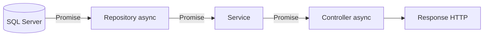

La causa no es que “todas las capas deban ser async por arquitectura”.

La causa es:

> **cada función que necesite esperar un resultado asincrónico antes de continuar debe tratar ese resultado como una promesa.**

#### 36.6 Una función intermedia no siempre necesita `async` + `await`

Si Service solamente reenvía la promesa:

```javascript
function getLenguajes() {
  return repository.getAll();
}
```

esto ya propaga correctamente la Promise.

No es obligatorio escribir:

```javascript
async function getLenguajes() {
  return await repository.getAll();
}
```

Ambas formas entregan una promesa al llamador, aunque existen diferencias sutiles de identidad de promesas y trazas.

`async`/`await` resulta especialmente útil cuando esa capa necesita:

```text
esperar
→ inspeccionar el valor
→ transformarlo
→ validar reglas
→ coordinar varias operaciones
```

Ejemplo:

```javascript
async function getLenguajesPublicables() {
  const lenguajes = await repository.getAll();

  return lenguajes.filter(
    lenguaje => lenguaje.publicable === true
  );
}
```

Aquí `await` sí expresa una dependencia real:

```text
primero necesito los datos
→ después puedo aplicar la regla
```

#### 36.7 Capturar un error y propagar un error son decisiones diferentes

No es correcto establecer como regla universal:

> “siempre que hay `async/await`, debe existir un `try/catch` en esa misma función”.

Una función puede dejar que el rechazo viaje hacia arriba:

```javascript
async function repository() {
  return await consultarDB();
}

async function service() {
  return await repository();
}
```

Si `consultarDB()` rechaza, `service()` también devuelve una promesa rechazada aunque no tenga `try/catch`.

Se agrega `try/catch` cuando esa capa **puede hacer algo útil con el error**:

```text
traducirlo
agregar contexto
liberar recursos
compensar una operación
registrarlo en el nivel adecuado
convertirlo en un error de dominio
generar una respuesta HTTP
```

Un patrón posible:

```javascript
async function repository() {
  try {
    return await consultarDB();
  } catch (error) {
    throw new DatabaseError("No se pudo leer lenguajes", {
      cause: error,
    });
  }
}
```

Service puede no capturarlo si no sabe resolverlo:

```javascript
async function service() {
  return repository();
}
```

y la frontera HTTP puede transformarlo finalmente en una respuesta controlada.

El objetivo es evitar dos extremos:

```text
capturar en todas las capas y repetir logs
```

o:

```text
no tener ningún punto de manejo del error
```

#### 36.8 `catch` vacío: el error silencioso

Este patrón es especialmente peligroso:

```javascript
try {
  await operacion();
} catch (error) {
}
```

La operación falló, pero el programa:

```text
no informa
no transforma
no propaga
no compensa
```

La capa superior puede interpretar que la función terminó normalmente.

En una función `async`, si el `catch` termina sin `throw`, la función suele resolverse con el valor que retorne esa rama —frecuentemente `undefined`.

Por eso “capturar” no equivale a “manejar”.

Manejar implica tomar una decisión explícita.

#### 36.9 `new Error(...)` crea; `throw` interrumpe y propaga

Estas dos expresiones hacen cosas diferentes:

```javascript
new Error("falló");
```

crea un objeto `Error`.

Por sí sola no lanza ninguna excepción.

En cambio:

```javascript
throw new Error("falló");
```

1. crea el objeto `Error`;
2. interrumpe el flujo normal;
3. busca un mecanismo de captura adecuado;
4. si ocurre dentro de una función `async`, provoca que la promesa devuelta quede rechazada.

Ejemplo:

```javascript
async function buscarUsuario(id) {
  const usuario = await repository.findById(id);

  if (!usuario) {
    throw new Error("Usuario no encontrado");
  }

  return usuario;
}
```

La diferencia conceptual:

```text
new Error(...)
→ construir una descripción de error

throw valor
→ lanzar ese valor como excepción
```

JavaScript permite técnicamente lanzar otros valores:

```javascript
throw "falló";
```

pero `Error` aporta información estructurada como mensaje, tipo y stack, por lo que es la opción habitual.

#### 36.10 Express y errores de handlers `async`

En Express 5, un route handler o middleware que devuelve una Promise rechazada —incluidas funciones `async` que hacen `throw`— hace que Express reenvíe automáticamente ese error al mecanismo de error handling.

Por eso:

```javascript
router.get("/", controller.getAll);
```

puede apuntar a:

```javascript
exports.getAll = async (req, res) => {
  const datos = await service.getAll();

  return res.json(datos);
};
```

Si `service.getAll()` rechaza y el handler no lo captura localmente, Express 5 puede continuar hacia el middleware de errores.

Una arquitectura más escalable puede centralizar la traducción final:

```javascript
app.use((err, req, res, next) => {
  // log seguro
  // mapear error → status
  // responder sin filtrar detalles internos
});
```

Esto evita repetir el mismo:

```text
try
catch
res.status(500)
```

en todos los controllers.

> ⚠️ Express 4 no propaga automáticamente de la misma forma los rechazos de handlers `async`; allí se requiere adaptar el error mediante `next(err)` o un wrapper. El comportamiento depende de la versión del framework.

**Referencia técnica:** la documentación de Express 5 indica que los handlers/middlewares que devuelven Promises rechazadas reenvían el error al error handler.

### 37. Eventos y `EventEmitter`

La programación orientada a eventos modela situaciones donde un componente **emite un suceso** y uno o más listeners reaccionan a él.

```text
evento
→ "algo ocurrió"

listener
→ "cuando ocurra, ejecutar esta función"
```

En Node.js, `EventEmitter` implementa un patrón de publicación/escucha dentro del proceso.

```javascript
const { EventEmitter } = require("node:events");

const bus = new EventEmitter();

bus.on("pedidoCreado", pedido => {
  console.log("Nuevo pedido:", pedido.id);
});

bus.emit("pedidoCreado", { id: 42 });
```

#### 37.1 `.on()` registra; `.emit()` dispara

```javascript
bus.on("evento", callback);
```

registra una función asociada a ese nombre.

```javascript
bus.emit("evento", valor);
```

invoca de forma sincrónica los listeners registrados para ese evento, en el orden correspondiente.

Esto es importante: `EventEmitter.emit()` **no convierte automáticamente el listener en trabajo asincrónico**.

El código dentro del listener puede iniciar operaciones asincrónicas, pero el acto de emitir el evento y llamar a listeners no debe confundirse con la cola de timers o con una promesa.

#### 37.2 EventEmitter y Event Loop están relacionados, pero no son lo mismo

Node utiliza una arquitectura orientada a eventos a gran escala, pero:

```text
Event Loop
→ mecanismo de scheduling/ejecución del runtime

EventEmitter
→ abstracción JavaScript para publicar y escuchar eventos
```

Un `EventEmitter` puede utilizarse incluso dentro de código totalmente sincrónico.

#### 37.3 Desacoplar productor y consumidores

Sin eventos:

```javascript
crearPedido();
enviarEmail();
actualizarMetricas();
notificarSistemaExterno();
```

el productor conoce explícitamente a todos los consumidores.

Con un evento:

```javascript
emit("pedidoCreado", pedido);
```

distintos listeners pueden reaccionar sin que la función que crea el pedido conozca cada detalle.

Eso reduce acoplamiento, aunque también introduce costos:

```text
flujo menos visible
orden de listeners
manejo de errores
dificultad de rastreo
posibles listeners olvidados
```

Por eso un evento es útil cuando representa realmente una relación de “algo ocurrió y varios componentes pueden reaccionar”, no como sustituto automático de cualquier llamada de función.

> 📌 **Para el examen:** la cátedra indicó explícitamente que la introducción a eventos no formaba parte del alcance del primer parcial.

### 38. Arquitectura cliente-servidor

La **arquitectura cliente-servidor** es un modelo en el que las responsabilidades se distribuyen entre componentes que solicitan recursos o servicios (**clientes**) y componentes que los proporcionan (**servidores**). El cliente inicia la interacción; el servidor permanece disponible para recibir solicitudes, procesarlas y generar una respuesta.

Un cliente no tiene que ser necesariamente un navegador: puede ser una aplicación móvil, una aplicación de escritorio, otro servidor, un dispositivo IoT o cualquier programa capaz de comunicarse mediante el protocolo acordado. Del mismo modo, un servidor no es únicamente una computadora física: también se denomina servidor al software que escucha solicitudes y presta un servicio sobre determinado hardware.

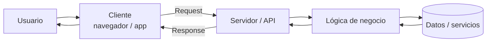

En un backend con Node.js, el programa JavaScript corre dentro del runtime de Node y puede actuar como servidor HTTP. A su vez, durante el procesamiento de una solicitud ese backend puede convertirse en **cliente de otro servicio**: por ejemplo, al consultar una API externa. Los roles cliente y servidor dependen de cada interacción, no de una identidad permanente de la máquina.

#### 38.1 Request/response

En HTTP la interacción básica se modela como un ciclo de **solicitud y respuesta** (*request/response*):

1. el cliente construye y envía una solicitud HTTP;
2. el servidor recibe la solicitud y determina qué operación corresponde;
3. el servidor procesa la operación, posiblemente consultando archivos, bases de datos u otros servicios;
4. genera una respuesta HTTP;
5. el cliente interpreta esa respuesta.

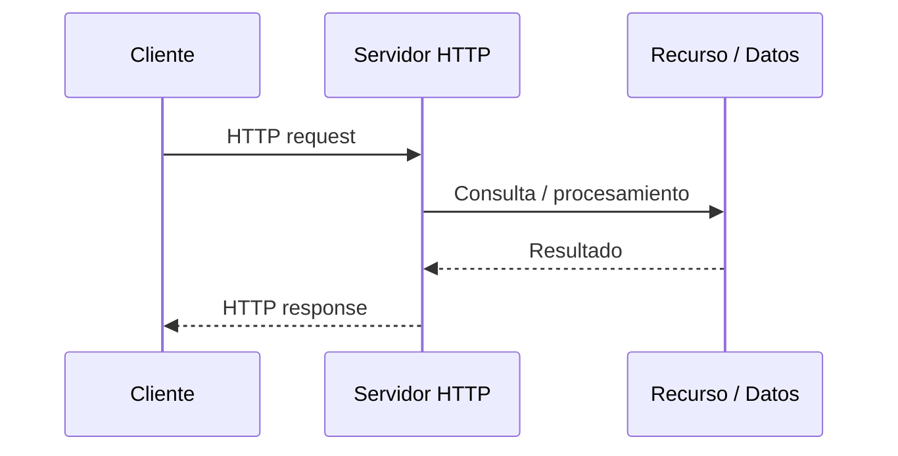

El hecho de que el servidor “intente” responder no implica que toda solicitud termine exitosamente: puede haber errores de red, recursos inexistentes, errores internos, problemas de validación o fallos en servicios dependientes. HTTP dispone de códigos de estado para comunicar el resultado de la operación.

### 39. HTTP y HTTPS

**HTTP** (*Hypertext Transfer Protocol*) es un protocolo de la capa de aplicación utilizado para intercambiar representaciones de recursos en la Web. Define cómo se estructuran las solicitudes y respuestas, incluyendo método, destino, encabezados, cuerpo y código de estado.

Una solicitud y su respuesta pueden pensarse, de forma simplificada, así:

```text
Cliente                                             Servidor
  |                                                    |
  |  GET /api/productos HTTP/...                      |
  |  Host: ejemplo.com                                |
  |--------------------------------------------------->|
  |                                                    |
  |  HTTP/... 200 OK                                  |
  |  Content-Type: application/json                   |
  |  [{"id":1,"nombre":"..."}]                    |
  |<---------------------------------------------------|
```

**HTTPS** no es un protocolo de aplicación distinto en su semántica: es HTTP transportado sobre una conexión protegida con **TLS**. TLS aporta confidencialidad e integridad del tráfico y autentica al servidor mediante certificados. Por eso, que una carga útil sea JSON no la vuelve privada; la protección durante el tránsito depende de HTTPS/TLS.

#### 39.1 Códigos de estado básicos

Los códigos de estado forman parte de la respuesta HTTP e indican el resultado general de la solicitud. Algunos especialmente relevantes para los primeros servidores son:

| Código | Nombre | Uso típico |
|---:|---|---|
| `200` | OK | Solicitud procesada correctamente y, normalmente, con una representación en la respuesta |
| `201` | Created | La solicitud creó exitosamente un recurso; suele aparecer tras un `POST` de creación |
| `204` | No Content | La operación fue exitosa y no hace falta devolver contenido en el body |
| `304` | Not Modified | Respuesta a una solicitud condicional que indica que la representación almacenada por el cliente sigue siendo válida; no equivale simplemente a “el navegador devolvió la caché” |
| `400` | Bad Request | La solicitud no puede procesarse por un problema atribuible a su contenido o forma; no significa “recurso inexistente” |
| `404` | Not Found | No existe un recurso/ruta que coincida con lo solicitado |
| `405` | Method Not Allowed | El recurso existe, pero no admite el método HTTP utilizado |
| `500` | Internal Server Error | Fallo inesperado del lado del servidor |

> ⚠️ El código de estado debe describir el resultado real. Enviar contenido válido y simultáneamente responder `404` produce una respuesta semánticamente contradictoria, aunque técnicamente sea posible.

Una distinción especialmente importante es **`400` vs. `404`**:

```text
400 Bad Request
→ el servidor entiende el endpoint, pero la request tiene un problema de forma,
  validación o datos que impide procesarla correctamente.

404 Not Found
→ el recurso o ruta identificada por la request no existe.
```

Por ejemplo, pedir `/peliculas/9999` cuando no existe esa película normalmente se representa con `404`; enviar a un endpoint un body inválido o un dato obligatorio ausente puede corresponder a `400`, según el contrato de la API.

#### 39.2 Anatomía de una HTTP request

La request no es solamente una URL. Conceptualmente contiene varias piezas que permiten al servidor interpretar qué se solicita y con qué información.

En **HTTP/1.1**, una representación textual simplificada puede verse así:

```http
POST /api/peliculas?notificar=true HTTP/1.1
Host: localhost:3000
Content-Type: application/json
Authorization: Bearer <token>

{"titulo":"Alien","stock":3}
```

Puede separarse en:

```text
HTTP request
├── request line
│   ├── método         → POST
│   ├── request target → /api/peliculas?notificar=true
│   └── versión        → HTTP/1.1
├── headers
├── línea vacía
└── body / content opcional
```

La **request line** indica la operación y el destino. Los **headers** aportan metadatos de la solicitud: tipo de contenido, autorización, datos de caché, preferencias del cliente, cookies, etc. No todos aparecen en todas las requests.

La línea vacía separa encabezados y contenido en la sintaxis de HTTP/1.x. HTTP/2 y HTTP/3 utilizan un framing diferente en la red, pero conservan la misma semántica general de método, destino, headers y contenido.

El **body** no está presente en todas las solicitudes. En particular, el contenido de una request `GET` no tiene semántica general definida por HTTP y normalmente no se utiliza para enviar criterios de consulta. Para `GET`, los datos variables suelen viajar en el path o en la query string:

```http
GET /api/peliculas/42
GET /api/peliculas?genero=ciencia-ficcion
```

En cambio, operaciones como `POST`, `PUT` o `PATCH` suelen transportar datos en el body:

```json
{
  "titulo": "Alien",
  "stock": 3
}
```

Cuando el contenido es JSON, un header típico es:

```http
Content-Type: application/json
```

Ese header describe **cómo interpretar el body**; no cifra la información.

#### 39.3 Anatomía de una HTTP response

La response tiene una estructura paralela. Ejemplo conceptual HTTP/1.1:

```http
HTTP/1.1 200 OK
Content-Type: application/json
Content-Length: ...

{"id":"42","titulo":"Alien"}
```

Sus partes principales son:

```text
HTTP response
├── status line
│   ├── versión HTTP
│   ├── status code
│   └── reason phrase / mensaje de estado
├── headers
├── línea vacía
└── body / content opcional
```

El **status code** comunica el resultado general; los **headers** describen la respuesta y su representación; el **body** contiene los datos cuando corresponde.

En Express, el mismo concepto aparece detrás de:

```javascript
return res
  .status(200)
  .json({ id: "42", titulo: "Alien" });
```

`res.status(200)` configura el estado y `res.json(...)` serializa el valor como JSON y envía la respuesta con un `Content-Type` apropiado.

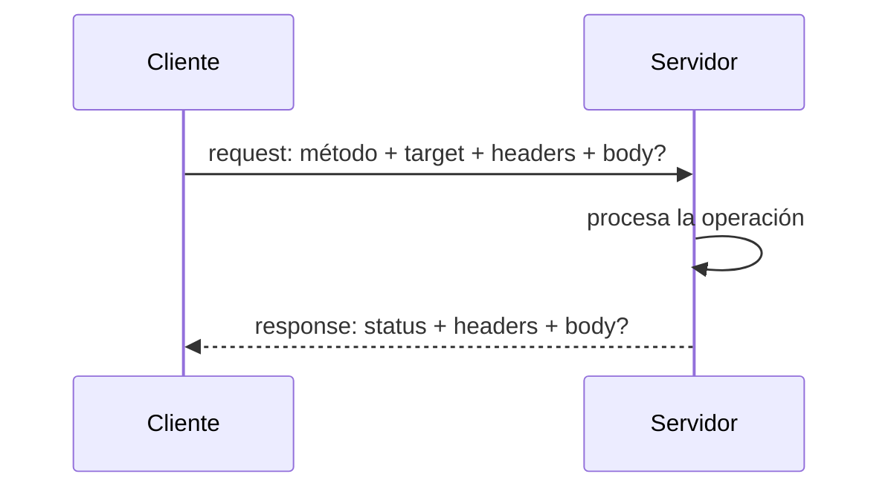

#### 39.4 Métodos HTTP y la operación que representan

El método HTTP expresa **qué semántica solicita el cliente sobre el recurso identificado por la URI**.

| Método | Uso conceptual habitual | ¿Suele llevar body? |
|---|---|---|
| `GET` | obtener una representación del recurso | normalmente no |
| `POST` | enviar datos para un procesamiento específico; frecuentemente crear un recurso subordinado | sí |
| `PUT` | crear o reemplazar completamente la representación del recurso identificado | sí |
| `PATCH` | aplicar una modificación parcial | sí |
| `DELETE` | eliminar la asociación/recurso identificado | normalmente no es necesario |

Un CRUD típico suele mapearse de forma aproximada así:

```text
Create → POST
Read   → GET
Update → PUT / PATCH
Delete → DELETE
```

No debe interpretarse como una equivalencia mecánica: HTTP define semántica de métodos y una API decide cómo modelar sus recursos dentro de esas reglas.

Una consecuencia práctica importante es que **`GET` debe utilizarse para lectura**, no para producir cambios de estado como inscribir un alumno o descontar stock. Esos cambios necesitan un método cuya semántica permita procesamiento/modificación.

También conviene distinguir `PUT` de `PATCH`: `PUT` representa el reemplazo de la representación del recurso objetivo; `PATCH` existe para describir modificaciones parciales. En APIs reales, el contrato debe especificar exactamente qué campos admite cada operación.


##### Identificar el recurso y enviar datos son problemas distintos

Al diseñar un endpoint conviene separar dos preguntas:

1. **¿sobre qué recurso se quiere operar?**
2. **¿qué datos necesita la operación?**

La identificación del recurso suele aparecer en la **URI**, muchas veces mediante un parámetro de ruta:

```http
GET /api/productos/42
PUT /api/productos/42
PATCH /api/productos/42
DELETE /api/productos/42
```

En los cuatro casos, `42` identifica el recurso objetivo. El método HTTP expresa qué tipo de operación se solicita sobre ese recurso.

En cambio, cuando una operación necesita datos adicionales, estos suelen viajar en el **body**:

```http
PUT /api/productos/42
Content-Type: application/json

{
  "nombre": "Teclado mecánico",
  "precio": 85000
}
```

Por lo tanto, un `PUT` o `PATCH` puede combinar:

```text
path parameter
→ identifica el recurso

body
→ describe los datos que se desean aplicar
```

`DELETE` frecuentemente necesita identificar el recurso pero no requiere un body:

```http
DELETE /api/productos/42
```

y un `POST` de creación suele enviarse contra la colección:

```http
POST /api/productos
Content-Type: application/json

{
  "nombre": "Mouse",
  "precio": 30000
}
```

No se trata de una obligación sintáctica universal del protocolo. La API define su contrato. La idea importante es que **ruta, método y body cumplen responsabilidades diferentes** y no deben confundirse.

Esto explica por qué la pregunta “¿`PUT` necesita parámetro y body?” no tiene una respuesta absoluta. En un CRUD habitual es común que el parámetro identifique qué recurso actualizar y que el body contenga el nuevo estado, pero el diseño concreto depende del recurso y del contrato de la API.

### 40. Dirección de un servicio: host, IP y puerto

Para que un cliente pueda conectarse a un servicio de red necesita identificar **dónde** está disponible.

Una forma simplificada de pensarlo:

```text
host
→ qué máquina/interfaz

puerto
→ qué servicio/proceso dentro de esa máquina
```

#### 40.1 IP

Una dirección IP identifica una interfaz de red dentro del alcance correspondiente.

Ejemplo IPv4:

```text
127.0.0.1
```

`127.0.0.1` pertenece al rango de loopback y representa la propia máquina desde el punto de vista del host local.

Por eso:

```text
http://127.0.0.1:3000
```

no apunta a “Internet”: intenta conectarse a un proceso que escucha en la misma computadora.

#### 40.2 Hostname

Un hostname permite utilizar un nombre en lugar de recordar una dirección numérica.

```text
localhost
```

normalmente resuelve hacia loopback.

En Internet:

```text
api.ejemplo.com
```

puede resolverse mediante DNS a una o más direcciones IP.

El nombre y la IP no son lo mismo:

```text
hostname
→ identificador legible/resoluble

IP
→ dirección de red utilizada para alcanzar una interfaz
```

#### 40.3 Puerto

Una misma máquina puede ejecutar muchos servicios de red.

```text
IP 203.0.113.10
├── puerto 22   → SSH
├── puerto 80   → HTTP
├── puerto 443  → HTTPS
└── puerto 3000 → aplicación de desarrollo
```

El puerto permite distinguir qué endpoint de transporte dentro del host debe recibir la conexión.

En desarrollo:

```javascript
app.listen(3000, "127.0.0.1");
```

expresa:

```text
escuchar conexiones
en la interfaz loopback
puerto 3000
```

Un servidor puede enlazarse a otras interfaces —por ejemplo todas las disponibles—, pero eso cambia quién puede alcanzarlo y debe evaluarse con criterios de red y seguridad.

#### 40.4 Escuchar no equivale a tener una ruta

Que el proceso esté escuchando en:

```text
127.0.0.1:3000
```

solo significa que existe un servidor disponible en ese host/puerto.

Todavía puede responder:

```text
404
Cannot GET /algo
```

si la aplicación no tiene una operación configurada para esa ruta.

Esto separa dos niveles de diagnóstico:

```text
conectividad
→ ¿hay proceso escuchando?

routing de aplicación
→ ¿existe handler para método + path?
```

### 41. URL, DNS, rutas y parámetros

Una **URL** (*Uniform Resource Locator*) identifica la ubicación de un recurso y el mecanismo para acceder a él. Una URL HTTP puede contener, entre otras partes, esquema/protocolo, host, puerto, ruta, query string y fragmento.

```text
https://api.ejemplo.com:443/usuarios/42?expand=perfil&idioma=es#datos
\____/  \_____________/ \_/ \_________/ \____________________/ \___/
 esquema       host      port    path             query          fragment
```

El **DNS** (*Domain Name System*) permite resolver nombres de dominio a direcciones utilizadas por la red. Por eso las personas pueden trabajar con nombres como `ejemplo.com` en vez de memorizar direcciones IP. La resolución DNS no “convierte una URL completa en una IP”: resuelve el nombre de host; la ruta, la query y el resto se interpretan en etapas posteriores.

#### 41.1 Parámetros de ruta (*path params*)

Un parámetro de ruta forma parte del patrón de la ruta y representa un segmento variable:

```javascript
app.get("/usuarios/:id", (req, res) => {
  console.log(req.params.id);
});
```

Una solicitud a `/usuarios/42` produce `req.params.id === "42"`.

Los parámetros capturados desde la URL llegan como **texto**. Por eso, si el criterio de búsqueda utiliza identificadores numéricos, debe decidirse explícitamente si conviene convertir el parámetro o comparar contra strings:

```javascript
const id = Number(req.params.id);
```

o mantener ambos lados como texto. Evitar depender de `==` para “resolver” automáticamente la diferencia de tipos hace que el contrato sea más claro.

#### 41.2 Parámetros de consulta (*query params*)

La **query string** aparece después de `?`. Cada par tiene la forma `clave=valor` y varios parámetros se separan con `&`:

```text
/buscar?q=node&pagina=2
```

En Express, esos valores se consultan a través de `req.query`:

```javascript
app.get("/buscar", (req, res) => {
  const { q, pagina } = req.query;
  res.json({ q, pagina });
});
```

**Ruta y query cumplen funciones diferentes.** La query string no forma parte del patrón de ruta que Express utiliza para decidir qué handler ejecutar. Es frecuente usar los parámetros de ruta para identificar un recurso (`/usuarios/42`) y la query para filtros, búsqueda, paginación u opciones (`/usuarios?activo=true&page=2`).

> ⚠️ No existe una regla universal según la cual “path param = obligatorio” y “query param = opcional”. La obligatoriedad real depende del contrato de la aplicación. Un patrón puede contener segmentos opcionales y un endpoint puede exigir determinados query params mediante validación.


##### Query params como modificadores de una consulta

Una forma práctica de pensar la diferencia es separar **identidad** de **opciones de consulta**.

```text
/api/lenguajes/frontend/css
                    └── css identifica qué subconjunto/recurso se solicita

/api/lenguajes/frontend/css?ordenar=desc
                        └──────────── opción que modifica cómo se devuelve el resultado
```

En Express:

```javascript
const lenguaje = req.params.lenguaje;
const ordenar = req.query.ordenar;
```

La query string **no participa del matching del path**. Para Express, estas solicitudes alcanzan el mismo patrón de ruta:

```text
GET /api/lenguajes/frontend/css
GET /api/lenguajes/frontend/css?ordenar=asc
GET /api/lenguajes/frontend/css?ordenar=desc
```

Lo que cambia es el contenido disponible en `req.query`.

También pueden viajar varios parámetros:

```text
/api/lenguajes?turno=noche&ordenar=asc&limite=10
```

```javascript
req.query;
// aproximación conceptual:
// { turno: "noche", ordenar: "asc", limite: "10" }
```

El separador `?` inicia la query string; `&` separa pares adicionales.

##### `req.query` es entrada no confiable

Aunque una query se use solo para ordenar o filtrar, sigue siendo información controlada por el cliente. No conviene asumir que la propiedad existe ni que siempre es un `string`.

Una normalización defensiva puede ser:

```javascript
const ordenarRaw = req.query.ordenar;

const ordenar =
  typeof ordenarRaw === "string"
    ? ordenarRaw.toLocaleLowerCase()
    : null;
```

Si el contrato admite únicamente opciones conocidas, conviene aplicar una **lista permitida** (*allowlist*):

```javascript
const DIRECCIONES_VALIDAS = ["asc", "desc"];

if (ordenar !== null && !DIRECCIONES_VALIDAS.includes(ordenar)) {
  return res.status(400).json({
    error: "El parámetro ordenar debe ser asc o desc",
  });
}
```

La ventaja es que el resto del sistema ya no necesita trabajar con una entrada arbitraria. El controller transforma una entrada HTTP potencialmente inválida en un valor pequeño y explícito del contrato:

```text
entrada HTTP
→ validar
→ normalizar
→ dato de aplicación
```

##### Ordenar el resultado sin mezclar responsabilidades

Si la API permite ordenar por cantidad de alumnos, la query expresa **qué desea el cliente**, pero el algoritmo de ordenamiento no necesita conocer `req` ni `res`.

El controller puede extraer:

```javascript
const lenguaje = req.params.lenguaje;
const orderBy = req.query.ordenar;
```

y entregar al service únicamente esos valores:

```javascript
frontendService.buscarLenguajes(lenguaje, orderBy);
```

Dentro del service:

```javascript
if (orderBy === "asc") {
  resultados.sort(
    (a, b) => a.cantidadAlumnos - b.cantidadAlumnos
  );
}

if (orderBy === "desc") {
  resultados.sort(
    (a, b) => b.cantidadAlumnos - a.cantidadAlumnos
  );
}
```

La función comparadora debe retornar:

```text
valor < 0  → a queda antes que b
valor > 0  → b queda antes que a
valor = 0  → se consideran equivalentes para ese criterio
```

Por eso:

```javascript
(a, b) => a.cantidadAlumnos - b.cantidadAlumnos
```

produce orden numérico ascendente, mientras que invertir la resta produce descendente.

> ⚠️ `Array.prototype.sort()` **muta el array sobre el que se ejecuta**. En el ejemplo de la materia el ordenamiento se aplica después de `filter()`, y `filter()` ya produjo un array nuevo; por eso no se modifica directamente la colección original. Si se ordenara la colección del repository sin copiarla, el orden persistiría en esa estructura en memoria para requests posteriores.

### 42. Servidor HTTP básico con `node:http`

Node incluye el módulo nativo `node:http`, suficiente para crear un servidor HTTP sin instalar Express.

```javascript
const http = require("node:http");

const server = http.createServer((req, res) => {
  res.statusCode = 200;
  res.setHeader("Content-Type", "text/plain; charset=utf-8");
  res.end("Hola");
});

server.listen(3000, "127.0.0.1");
```

#### 42.1 Qué problema resuelve cada parte

```javascript
http.createServer(callback)
```

crea el servidor y registra una función que se ejecutará para las requests recibidas.

La callback recibe:

```text
req
→ información de la solicitud

res
→ interfaz para construir la respuesta
```

```javascript
server.listen(...)
```

abre el punto de escucha de red.

Por eso existen dos momentos distintos:

```text
configurar cómo responder
+
empezar a escuchar conexiones
```

#### 42.2 `req` y `res` son objetos del protocolo

`req` permite consultar información como:

```text
método
URL
headers
stream del body
```

`res` permite configurar:

```text
status
headers
body
fin de la respuesta
```

El ciclo mínimo:

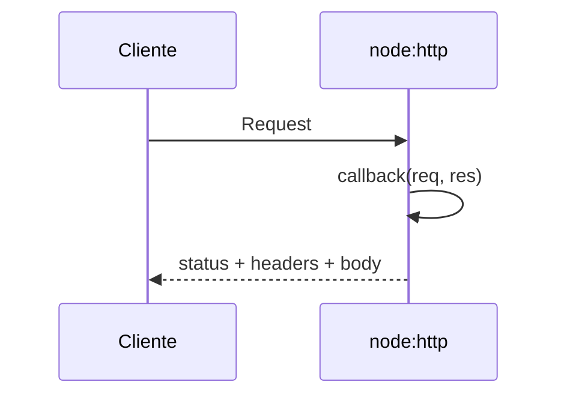

#### 42.3 ¿Por qué aparece Express si Node ya puede hacer esto?

Porque `node:http` ofrece primitivas de bajo nivel.

A medida que una API crece hay que resolver repetidamente:

```text
matching de rutas
path params
query params
parsing de bodies
middleware
serialización JSON
manejo de errores
organización de handlers
```

Todo puede programarse manualmente, pero aparece repetición.

Express abstrae gran parte de ese trabajo:

```text
node:http
→ primitives del servidor HTTP

Express
→ capa de conveniencia y composición sobre esas primitives
```

Esta relación es importante: Express no reemplaza a Node ni crea un protocolo nuevo. Organiza de forma más cómoda un servidor que sigue utilizando las capacidades HTTP/red del runtime.

### 43. Express.js

**Express** es un framework web para Node.js que agrega una capa de abstracción sobre las primitivas HTTP de Node y facilita routing, middleware, manejo de solicitudes y construcción de respuestas. La aplicación se crea invocando la función exportada por el paquete:

```javascript
const express = require("express");
const app = express();
```

`express` referencia la función exportada por el módulo; `express()` la invoca y devuelve la **aplicación Express**. Técnicamente, ese valor es una función callable enriquecida con métodos y propiedades (`get`, `use`, `listen`, etc.), no un objeto ordinario. Sobre `app` se registran rutas/middleware y finalmente se inicia la escucha.

```javascript
const express = require("express");

const app = express();
const HOSTNAME = "127.0.0.1";
const PORT = 3000;

app.get("/", (req, res) => {
  res.status(200).send("<h1>Servidor Express</h1>");
});

app.listen(PORT, HOSTNAME, (error) => {
  if (error) {
    console.error("No se pudo iniciar el servidor:", error);
    return;
  }

  console.log(`Servidor en http://${HOSTNAME}:${PORT}/`);
});
```

En Express 5, la callback de `app.listen` puede recibir un error de inicio, por ejemplo si el puerto ya está ocupado. Express 5 requiere Node.js 18 o superior.

#### 43.1 Routing

El **routing** define qué código se ejecuta cuando una solicitud coincide con un método HTTP y una ruta. La forma general es:

```javascript
app.METHOD(path, handler);
```

Por ejemplo:

```javascript
app.get("/api", (req, res) => {
  console.log("Entrando en /api");
  res.status(200).send("Esta es la ruta /api");
});
```

- `app.get` registra un handler para solicitudes HTTP `GET`;
- `"/api"` es el patrón de ruta;
- `(req, res) => { ... }` es el handler/callback;
- Express invoca el handler cuando método y ruta coinciden.

Si ninguna ruta coincide, Express termina respondiendo con un `404` mediante su comportamiento por defecto, salvo que la aplicación configure un manejo distinto.

#### 43.2 Objetos `req` y `res`

Los parámetros `req` y `res` son los objetos de solicitud y respuesta de Node enriquecidos por Express. La separación conceptual es importante:

- **`req`** se usa para leer lo enviado por el cliente: parámetros, query, encabezados, cuerpo, método, etc.;
- **`res`** se usa para construir y enviar la respuesta.

Métodos frecuentes de `res`:

| Método | Propósito |
|---|---|
| `res.status(codigo)` | Configura el código de estado y devuelve `res`, por lo que puede encadenarse |
| `res.send(valor)` | Envía una respuesta de varios tipos y finaliza el ciclo |
| `res.json(valor)` | Serializa el valor como JSON y envía una respuesta JSON |
| `res.sendFile(ruta)` | Envía un archivo |
| `res.set(...)` | Configura encabezados |

La forma moderna para establecer estado y enviar contenido es:

```javascript
res.status(200).send("OK");
```


#### 43.3 Respuestas JSON con Express

A medida que el backend deja de devolver páginas HTML y empieza a exponer **datos**, aparece un nuevo problema: el cliente necesita saber no solo *qué bytes recibió*, sino **cómo interpretarlos**.

Con una respuesta manual puede hacerse explícitamente:

```javascript
const datos = {
  frontend: [{ id: 1, nombre: "JavaScript" }],
};

const cuerpo = JSON.stringify(datos);

app.get("/api/lenguajes", (req, res) => {
  res.set("Content-Type", "application/json; charset=utf-8");
  res.status(200).send(cuerpo);
});
```

Aquí intervienen tres conceptos distintos:

1. `JSON.stringify(...)` serializa el valor de JavaScript;
2. `Content-Type: application/json` informa al cliente el formato de la representación;
3. `200` comunica que la operación resultó exitosa.

Express encapsula ese trabajo frecuente con `res.json(...)`:

```javascript
app.get("/api/lenguajes", (req, res) => {
  res.status(200).json(datos);
});
```

`res.json(...)` serializa el valor y envía una respuesta JSON con el tipo de contenido adecuado. Por eso suele preferirse cuando el endpoint devuelve datos estructurados.

La diferencia práctica con `res.send(...)` no es que uno "pueda enviar datos" y el otro no: ambos envían una respuesta. La diferencia es la **intención semántica** y el tratamiento que hace Express.

```javascript
res.send("Hola");                // texto
res.send("<h1>Hola</h1>");       // texto/HTML según el contenido y encabezados
res.json({ mensaje: "Hola" });   // respuesta JSON explícita
```

Cuando la API devuelve un objeto o un array que representa datos, `res.json(...)` hace explícito el contrato y evita tener que combinar manualmente `JSON.stringify(...)` con el encabezado correspondiente.

Además, `res.status(...)` no finaliza por sí mismo la respuesta:

```javascript
res.status(404);
```

solo configura el código. Para completar la respuesta todavía debe enviarse un cuerpo o cerrarse la respuesta:

```javascript
return res.status(404).json({
  error: "Recurso no encontrado",
});
```


> **Puente conceptual:** `JSON.stringify` permite entender qué ocurre con la serialización; `res.json` aparece después como una abstracción de Express que evita repetir esa mecánica en cada ruta.


##### No serializar dos veces

Una vez que se elige `res.json(...)`, el valor que se le entrega debería seguir siendo un **valor de JavaScript**, no un string JSON ya serializado.

Correcto:

```javascript
const resultado = [
  { id: 1, nombre: "JavaScript" },
  { id: 2, nombre: "CSS" },
];

return res.status(200).json(resultado);
```

Problemático:

```javascript
const resultado = JSON.stringify([
  { id: 1, nombre: "JavaScript" },
]);

return res.status(200).json(resultado);
```

En el segundo caso, `resultado` ya es un `string`. `res.json` serializa ese string nuevamente y la respuesta representa **un string que contiene texto JSON**, no directamente el array original. Por eso pueden aparecer comillas y caracteres escapados.

La frontera recomendable es:

```text
Repository → datos JavaScript
Service    → datos JavaScript
Controller → res.json(datos)
             └── aquí ocurre la serialización HTTP
```

Esto también mantiene al service independiente de Express y del formato de transporte.

##### Un array también es JSON válido

No hace falta envolver siempre un array dentro de un objeto para que la respuesta sea JSON válida:

```javascript
return res.json([
  { id: 1, nombre: "JavaScript" },
  { id: 2, nombre: "CSS" },
]);
```

es perfectamente válido. JSON admite objetos, arrays y también otros valores compatibles.

Aun así, algunas APIs eligen una envoltura por razones de contrato y extensibilidad:

```javascript
return res.json({
  data: resultados,
  total: resultados.length,
});
```

La diferencia es de **diseño del contrato**, no de validez del formato.

El **código de estado y el contenido deben ser coherentes**. Una respuesta que entrega correctamente los datos pero usa `404`, o una que informa `200` mientras ocurrió un error, transmite información contradictoria al cliente.

Forma habitual:

```javascript
res.status(200).json(resultado);
```

#### 43.4 Rutas parametrizadas y filtrado de datos

Una ruta fija como:

```text
GET /api/lenguajes/frontend
```

puede devolver una colección completa. Pero cuando el cliente necesita pedir **un subconjunto concreto**, conviene incorporar información variable en la solicitud.

Por ejemplo:

```javascript
app.get("/api/lenguajes/frontend/:lenguaje", (req, res) => {
  const lenguajeParam = req.params.lenguaje;

  // ...
});
```

El segmento `:lenguaje` declara un **parámetro de ruta**. Si el cliente solicita:

```text
GET /api/lenguajes/frontend/css
```

Express construye:

```javascript
req.params.lenguaje === "css";
```

Esto conecta routing con los métodos de array vistos previamente: la URL aporta el criterio y el backend usa ese criterio para buscar en los datos.

Supongamos:

```javascript
const frontend = [
  { id: 1, nombre: "JavaScript" },
  { id: 2, nombre: "CSS" },
  { id: 3, nombre: "HTML" },
  { id: 4, nombre: "CSS" },
];
```

Con `filter`:

```javascript
app.get("/api/lenguajes/frontend/:lenguaje", (req, res) => {
  const lenguajeParam = req.params.lenguaje;

  const filtrados = frontend.filter(
    item =>
      item.nombre.toLocaleLowerCase() ===
      lenguajeParam.toLocaleLowerCase()
  );

  if (filtrados.length === 0) {
    return res
      .status(404)
      .send(`No se encontró el lenguaje ${lenguajeParam}`);
  }

  return res.status(200).json(filtrados);
});
```

`filter` devuelve **todas** las coincidencias en un array. Si ninguna coincide, devuelve `[]`, por lo que `filtrados.length === 0` permite detectar el caso "sin resultados".

Si la lógica del recurso garantiza que solo interesa la primera coincidencia, `find` expresa mejor la intención:

```javascript
const encontrado = frontend.find(
  item =>
    item.nombre.toLocaleLowerCase() ===
    lenguajeParam.toLocaleLowerCase()
);

if (!encontrado) {
  return res.status(404).json({
    error: `No se encontró el lenguaje ${lenguajeParam}`,
  });
}

return res.status(200).json(encontrado);
```

La diferencia conceptual es:

| Método | Resultado | Caso típico |
|---|---|---|
| `filter` | array con todas las coincidencias | puede haber múltiples resultados |
| `find` | primer elemento coincidente o `undefined` | se busca un único resultado |

Normalizar ambos textos antes de comparar permite que diferencias de mayúsculas/minúsculas no produzcan un falso "no encontrado":

```javascript
item.nombre.toLocaleLowerCase() === lenguajeParam.toLocaleLowerCase()
```

Esto no modifica el dato original; solo normaliza temporalmente ambos valores para la comparación.

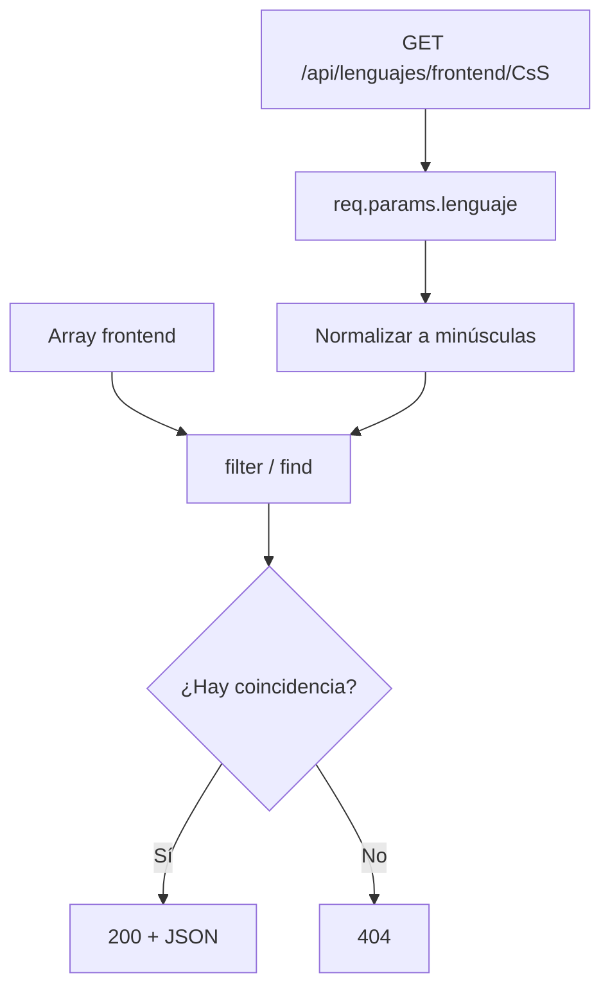

#### 43.5 Cerrar siempre el ciclo request/response

Registrar una ruta no alcanza. Cada solicitud que entra debe terminar en una respuesta o en una transferencia explícita del control hacia otra capa de Express.

Este handler recibe la solicitud pero **no responde**:

```javascript
app.get("/api/prueba", (req, res) => {
  console.log("Solicitud recibida");
});
```

Desde el punto de vista del cliente, la operación queda pendiente porque el servidor no cerró el ciclo.

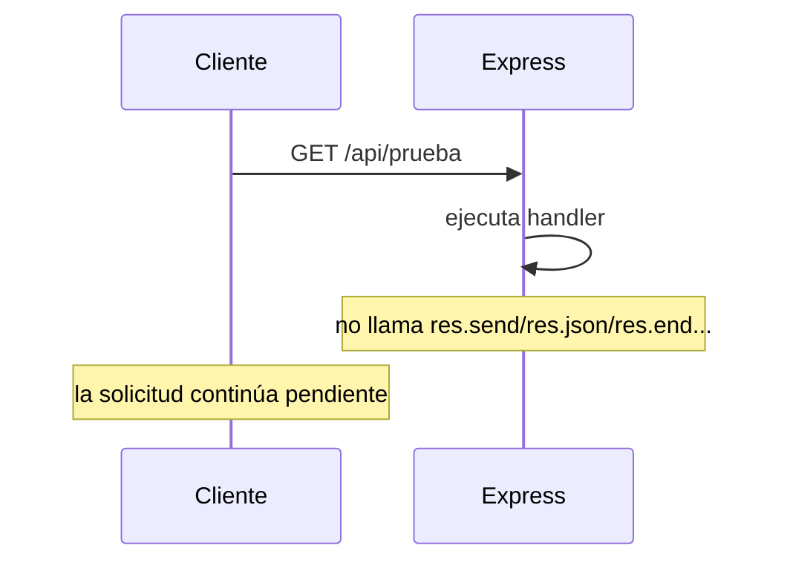

Los métodos de respuesta de Express como `res.send`, `res.json`, `res.end`, `res.redirect` o `res.sendFile` envían/finalizan la respuesta. Si ninguno se ejecuta y tampoco se llama `next(...)` para continuar el procesamiento, el cliente queda esperando hasta que alguna capa externa cierre o venza la conexión.

Por eso es útil pensar cada handler como una función que debe cubrir **todos sus caminos posibles**:

```javascript
app.get("/recurso/:id", (req, res) => {
  const recurso = buscar(req.params.id);

  if (!recurso) {
    return res.status(404).json({ error: "No encontrado" });
  }

  return res.status(200).json(recurso);
});
```

El `return` no es obligatorio para que Express envíe la respuesta, pero resulta útil para impedir que el código continúe ejecutándose después de haber respondido.

#### 43.6 Diagnóstico básico de rutas y errores

Cuando una petición falla, conviene diagnosticar de lo más general a lo más específico:

1. **¿El proceso está ejecutándose?** Revisar la terminal y el mensaje de inicio.
2. **¿Host y puerto son correctos?** Una petición al puerto equivocado nunca llegará a esa instancia.
3. **¿Express responde?** Si aparece una respuesta de Express como `Cannot GET /ruta`, la conexión sí llegó al servidor: el problema está en la coincidencia de método/ruta o en la ausencia de ese endpoint. En cambio, un error de conexión rechazada indica que no se alcanzó ningún proceso escuchando en esa combinación de host y puerto.
4. **¿Coinciden método y path?** `GET /api/lenguajes` no es lo mismo que `GET /api/lenguaje`.
5. **¿El handler lanza una excepción?** Un fallo interno suele terminar en `500`.
6. **¿Se envió una respuesta?** Si queda en estado pendiente, revisar los caminos del handler.

Separar estos niveles evita investigar la lógica de filtrado cuando el problema real era, por ejemplo, un puerto incorrecto o una ruta mal escrita.

También debe diferenciarse entre **registrar un error internamente** y **exponerlo al cliente**. Express posee un manejador de errores predeterminado, pero una aplicación real debe controlar qué información revela. Una traza (*stack trace*), rutas del sistema de archivos u otros detalles internos pueden ayudar durante el desarrollo, pero no deberían formar parte de una respuesta pública de producción.

Una respuesta controlada puede limitarse a:

```javascript
res.status(500).json({
  error: "Error interno del servidor",
});
```

mientras el detalle técnico se registra del lado del servidor.

> ⚠️ No conviene asumir un tiempo de espera universal del cliente. El *timeout* depende del cliente, servidor, proxy y configuración utilizados. El punto importante es que un handler que no finaliza la respuesta deja la solicitud abierta hasta que alguna de esas capas la termine.

##### Asignar sin declarar no crea un `let`

Durante una prueba puede parecer que JavaScript "infiere" automáticamente una variable si se escribe:

```javascript
resultado = obtenerDatos();
```

pero no equivale a:

```javascript
let resultado = obtenerDatos();
```

En código no estricto, una asignación a un identificador no declarado puede terminar creando una propiedad en el objeto global. En modo estricto produce un `ReferenceError`. Es un comportamiento propenso a errores y debe evitarse.

La forma correcta es declarar explícitamente la intención:

```javascript
const resultado = obtenerDatos();
```

o, si el valor debe reasignarse:

```javascript
let resultado = obtenerDatos();
```


#### 43.7 Rutas de colección y rutas de recurso

Al diseñar endpoints conviene reconocer dos necesidades distintas:

- pedir **una colección**;
- pedir **un recurso o subconjunto concreto**.

Ejemplo de colección:

```http
GET /api/lenguajes/frontend
```

Respuesta conceptual:

```json
[
  { "id": 1, "nombre": "JavaScript" },
  { "id": 2, "nombre": "HTML" },
  { "id": 3, "nombre": "CSS" }
]
```

Ejemplo parametrizado:

```http
GET /api/lenguajes/frontend/css
```

La ruta puede declararse:

```javascript
app.get("/api/lenguajes/frontend/:lenguaje", handler);
```

y el valor variable aparece en:

```javascript
req.params.lenguaje;
```

La ruta parametrizada evita crear manualmente una ruta nueva para cada lenguaje:

```javascript
// Escala mal:
app.get("/api/lenguajes/frontend/css", ...);
app.get("/api/lenguajes/frontend/html", ...);
app.get("/api/lenguajes/frontend/javascript", ...);
```

En cambio:

```javascript
app.get("/api/lenguajes/frontend/:lenguaje", ...);
```

define una sola regla capaz de procesar muchos valores.

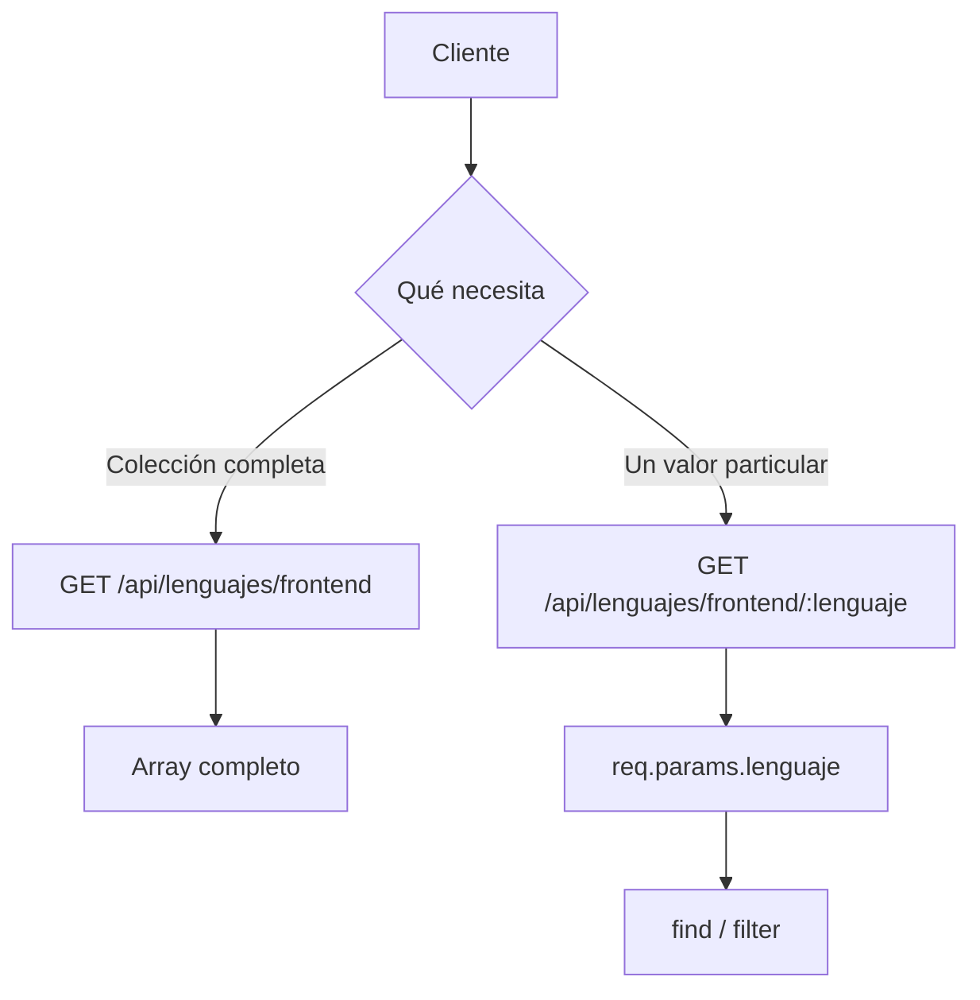

##### Path parameter y criterio de búsqueda no son lo mismo

`req.params.lenguaje` contiene **entrada del cliente**:

```javascript
const lenguajeParam = req.params.lenguaje;
```

Luego el programa decide qué hacer con ella:

```javascript
const resultado = frontend.filter(
  item =>
    item.nombre.toLocaleLowerCase() ===
    lenguajeParam.toLocaleLowerCase()
);
```

Express se encarga de capturar el segmento de URL; `filter` se encarga de aplicar la lógica de búsqueda. Son responsabilidades diferentes conectadas dentro del mismo handler.

Este puente evita una confusión común: una ruta parametrizada **no filtra datos automáticamente**. Solo extrae el valor variable de la URL.

#### 43.8 La respuesta HTTP como contrato

Una respuesta HTTP no está formada únicamente por "los datos". Para que cliente y servidor se entiendan, varias piezas deben ser coherentes entre sí:

```text
HTTP response
├── status code
├── headers
└── body
```

Ejemplo exitoso:

```javascript
return res.status(200).json({
  id: 3,
  nombre: "CSS",
});
```

Conceptualmente:

```text
status: 200 OK
Content-Type: application/json
body: {"id":3,"nombre":"CSS"}
```

Ejemplo de recurso inexistente:

```javascript
return res.status(404).json({
  error: "Lenguaje no encontrado",
});
```

La importancia no está solo en que el navegador "muestre algo". El consumidor puede tomar decisiones programáticas según el contrato:

```javascript
if (response.status === 404) {
  // mostrar "no encontrado"
}
```

Por eso estas respuestas son incoherentes:

```javascript
// ❌ El body informa un error, pero el status informa éxito.
res.status(200).json({
  error: "No encontrado",
});
```

```javascript
// ❌ El recurso existe y se devuelve correctamente,
// pero el status informa que no fue encontrado.
res.status(404).json({
  id: 3,
  nombre: "CSS",
});
```

La coherencia debe existir entre:

| Parte | Pregunta que responde |
|---|---|
| Método de la request | ¿Qué operación solicita el cliente? |
| Ruta | ¿Sobre qué recurso? |
| Status code | ¿Cuál fue el resultado de procesarla? |
| `Content-Type` | ¿Cómo debe interpretarse el body? |
| Body | ¿Qué información concreta se devuelve? |

##### El navegador como cliente de prueba

Durante estas primeras prácticas se utiliza el navegador porque permite enviar fácilmente requests `GET` y observar las respuestas. Las DevTools ayudan a separar:

- lo que se muestra en la página;
- la consola del navegador;
- la pestaña **Network**;
- los headers HTTP;
- el status code;
- el body de la respuesta.

No debe confundirse la consola donde se ejecuta Node con la consola del navegador:

```text
Terminal / Node
→ pertenece al servidor

DevTools / navegador
→ pertenece al cliente
```

Un `console.log(...)` ejecutado dentro del handler aparece en la terminal del servidor, no en la consola JavaScript del cliente.

#### 43.9 Middleware: funciones dentro del ciclo request/response

Una aplicación Express puede pensarse como una **cadena de funciones middleware** que participan del ciclo request/response.

Una función middleware recibe normalmente:

```javascript
(req, res, next) => {
  // ...
}
```

donde:

- `req` representa la request;
- `res` representa la response;
- `next` es una función que transfiere el control al siguiente middleware compatible de la cadena.

Ejemplo:

```javascript
app.use((req, res, next) => {
  console.log(`${req.method} ${req.url}`);
  next();
});
```

Este middleware observa la solicitud y después continúa el flujo. También puede modificar `req` o `res` antes de delegar:

```javascript
app.use((req, res, next) => {
  req.inicioProcesamiento = Date.now();
  next();
});
```

Otra posibilidad es **finalizar** directamente el ciclo:

```javascript
app.use((req, res, next) => {
  if (!req.headers.authorization) {
    return res.status(401).json({
      error: "Falta autorización",
    });
  }

  next();
});
```

La regla central es:

```text
middleware
├── termina la respuesta
└── o llama a next()
```

Si no hace ninguna de las dos cosas, la request queda detenida y el cliente continúa esperando.


No todo elemento que conceptualmente “está en el medio” entre cliente y servidor es automáticamente middleware de Express. En Express, *middleware* tiene un significado técnico concreto: una función incorporada a la cadena de procesamiento de la aplicación/router, con acceso a `req`, `res` y normalmente `next`.

Los middlewares permiten implementar responsabilidades transversales —por ejemplo logging, autenticación, validación o parseo— sin repetir la misma lógica dentro de cada endpoint.


#### 43.10 Parseo del body JSON con `express.json()`

Un cliente puede enviar un body con JSON correcto y el header apropiado:

```http
POST /api/lenguajes/frontend HTTP/1.1
Content-Type: application/json

{
  "id": 5,
  "nombre": "Astro",
  "turno": "noche"
}
```

pero eso no implica que Express convierta automáticamente esos bytes en un objeto JavaScript disponible en `req.body`.

Para eso se registra un **middleware de parsing**:

```javascript
app.use(express.json());
```

O, si se quiere limitar el alcance a un router:

```javascript
router.use(express.json());
```

El flujo es:


Sin un body parser que corresponda al tipo de contenido, `req.body` queda sin poblar. Esto explica un error muy frecuente:

```text
la request llega al router
→ el controller sí se ejecuta
→ req.body es undefined
→ el repository termina recibiendo undefined
```

La solución no está en el repository porque el dato **ya se perdió antes de llegar a esa capa**. El problema pertenece a la frontera HTTP/parsing.

##### El orden de registro importa

El middleware debe ejecutarse **antes** del handler que intenta leer `req.body`:

```javascript
const app = express();

app.use(express.json());

app.post("/api/productos", crearProducto);
```

Si se registra después del handler, no puede retroactivamente parsear una request que ya atravesó esa ruta.

##### `Content-Type` y parser deben coincidir

`express.json()` está pensado para payloads JSON y decide si debe parsearlos según el tipo de contenido de la request. Por eso el cliente debe declarar correctamente:

```http
Content-Type: application/json
```

El header describe el formato del cuerpo enviado; el middleware lo interpreta y construye un valor JavaScript.

##### Parsear no equivale a validar

Después de `express.json()` esto puede ser un objeto JavaScript:

```javascript
req.body;
```

pero sigue siendo **entrada no confiable**.

```javascript
const nuevoLenguaje = req.body;
```

no debería implicar automáticamente:

```javascript
repository.insertar(nuevoLenguaje);
```

Antes deben verificarse, según el contrato:

```text
campos requeridos
+ tipos
+ formato
+ rangos
+ reglas de negocio
+ permisos/autorización cuando corresponda
```

`express.json()` resuelve el problema de **parsing**, no los de validación, seguridad ni autorización.

### 44. Reinicio automático durante el desarrollo: Nodemon y `node --watch`

Al ejecutar un servidor con `node index.js`, Node carga el programa y mantiene el proceso activo escuchando solicitudes. Si el código fuente cambia, ese proceso no vuelve a cargar automáticamente el archivo: debe reiniciarse o ejecutarse en modo de vigilancia.

#### 44.1 Nodemon

**Nodemon** es una herramienta de desarrollo que observa cambios y reinicia el proceso de Node. Como no es necesaria para ejecutar la aplicación en producción, suele instalarse como `devDependency`:

```bash
npm install --save-dev nodemon
```

Ejecución local directa:

```bash
npx nodemon ./index.js
```

En un proyecto real es habitual esconder este comando detrás de un script de `package.json`:

```json
{
  "scripts": {
    "dev": "nodemon index.js",
    "start": "node index.js"
  }
}
```

```bash
npm run dev
```

#### 44.2 `node --watch`

Node incorpora un modo de vigilancia nativo:

```bash
node --watch index.js
```

El modo `--watch` apareció de forma experimental en Node 18.11.0 y fue marcado como **estable desde Node 20.13.0**. Para proyectos modernos puede cubrir el caso básico sin instalar Nodemon. Nodemon sigue siendo útil cuando se necesitan sus opciones y configuración específicas.

### 45. Servir archivos HTML desde Node/Express

La práctica de clase combinó Express con `fs` para leer un archivo HTML y enviarlo al navegador. Conceptualmente, el servidor debe informar al cliente qué representación está enviando mediante el encabezado `Content-Type`.

Una versión equivalente al ejercicio, usando lectura sincrónica para mostrar la mecánica, sería:

```javascript
const fs = require("node:fs");

const home = fs.readFileSync("./vistas/home.html");

app.get("/", (req, res) => {
  res.set("Content-Type", "text/html; charset=utf-8");
  res.status(200).send(home);
});
```

Esto explica por qué enviar bytes de un HTML sin un tipo adecuado puede producir una interpretación distinta por parte del cliente.

Sin embargo, en un servidor real conviene evitar operaciones sincrónicas de E/S dentro del procesamiento de solicitudes: bloquean el hilo de JavaScript. Express dispone de alternativas específicas para servir archivos:

```javascript
const path = require("node:path");

app.get("/", (req, res) => {
  res.sendFile(path.join(__dirname, "vistas", "home.html"));
});
```

Para un directorio completo de recursos estáticos (HTML, CSS, JavaScript, imágenes), Express también ofrece el middleware `express.static(...)`, que se profundiza junto con middleware y estructura de aplicaciones.

### 46. Ejemplo integrado — Primer servidor Express

El siguiente ejemplo reúne el flujo central de esta etapa: crear el proyecto, instalar dependencias, levantar Express, registrar rutas y devolver HTML o JSON.

```bash
npm init -y
npm install express
npm install --save-dev nodemon
```

```javascript
const express = require("express");

const app = express();
const HOSTNAME = "127.0.0.1";
const PORT = 3000;

app.get("/", (req, res) => {
  res.status(200).send("<h1>Home</h1>");
});

app.get("/api", (req, res) => {
  res.status(200).json({
    mensaje: "Esta es la ruta /api",
    estado: "ok",
  });
});

app.get("/usuarios/:id", (req, res) => {
  const { id } = req.params;
  const { detalle } = req.query;

  res.status(200).json({ id, detalle });
});

app.listen(PORT, HOSTNAME, (error) => {
  if (error) {
    console.error(error);
    return;
  }

  console.log(`Servidor en http://${HOSTNAME}:${PORT}/`);
});
```

```mermaid
flowchart TD
    B[Navegador / cliente] -->|GET /| R1[Handler raíz]
    B -->|GET /api| R2[Handler /api]
    B -->|GET /usuarios/42?detalle=full| R3[Handler /usuarios/:id]
    R1 --> S1[HTML]
    R2 --> S2[JSON]
    R3 --> S3[req.params + req.query]
    S1 --> B
    S2 --> B
    S3 --> B
```


#### 46.1 De una ruta fija a una API consultable

El paso siguiente al primer servidor es convertir datos internos en recursos accesibles mediante rutas. El flujo completo reúne temas que antes estaban separados:

```mermaid
flowchart LR
    M[Módulo local<br/>src/lenguajes.js] -->|module.exports| R[require]
    R --> A[Objeto JavaScript]
    C[Cliente] -->|GET /api/lenguajes/frontend/css| E[Express]
    E --> P[req.params]
    A --> F[filter / find]
    P --> F
    F -->|resultado| J[res.status(...).json(...)]
    J -->|HTTP response| C
```

El módulo resuelve **dónde viven los datos**; la ruta define **cómo se solicitan**; `req.params` captura **qué pidió el cliente**; los métodos de array resuelven **cómo buscarlo**; y `res.status(...).json(...)` define **cómo se comunica el resultado**.

Esa conexión es la base de una API, incluso antes de incorporar una base de datos. Más adelante, el origen de los datos puede cambiar de un array en memoria a una consulta persistente sin modificar la idea central del ciclo request/response.


#### 46.2 Estructura mínima del ejemplo de API de lenguajes

Una organización sencilla para separar el servidor de los datos puede ser:

```text
proyecto/
├── index.js
├── package.json
└── src/
    └── lenguajes.js
```

`src/lenguajes.js`:

```javascript
const infoLenguajes = {
  frontend: [
    { id: 1, nombre: "JavaScript", turno: "noche" },
    { id: 2, nombre: "HTML", turno: "noche" },
    { id: 3, nombre: "CSS", turno: "mañana" },
  ],
  backend: [
    { id: 1, nombre: "JavaScript", turno: "noche" },
    { id: 2, nombre: "PHP", turno: "mañana" },
    { id: 3, nombre: "Python", turno: "noche" },
  ],
};

module.exports = { infoLenguajes };
```

`index.js`:

```javascript
const express = require("express");
const { infoLenguajes } = require("./src/lenguajes");

const app = express();
const HOSTNAME = "127.0.0.1";
const PORT = 3000;

app.get("/api/lenguajes", (req, res) => {
  return res.status(200).json(infoLenguajes);
});

app.get("/api/lenguajes/frontend", (req, res) => {
  return res.status(200).json(infoLenguajes.frontend);
});

app.get("/api/lenguajes/backend", (req, res) => {
  return res.status(200).json(infoLenguajes.backend);
});

app.get("/api/lenguajes/frontend/:lenguaje", (req, res) => {
  const lenguajeSolicitado = req.params.lenguaje.toLocaleLowerCase();

  const coincidencias = infoLenguajes.frontend.filter(
    item => item.nombre.toLocaleLowerCase() === lenguajeSolicitado
  );

  if (coincidencias.length === 0) {
    return res.status(404).json({
      error: `No se encontró el lenguaje ${req.params.lenguaje}`,
    });
  }

  return res.status(200).json(coincidencias);
});

app.listen(PORT, HOSTNAME, error => {
  if (error) {
    console.error("No se pudo iniciar el servidor:", error);
    return;
  }

  console.log(`Servidor en http://${HOSTNAME}:${PORT}`);
});
```

Este ejemplo permite estudiar cada responsabilidad por separado:

```text
src/lenguajes.js
→ define y exporta los datos

require(...)
→ incorpora esos datos al servidor

app.get(...)
→ define cuándo se ejecuta una lógica

req.params
→ recibe la parte variable de la solicitud

filter(...)
→ consulta la colección en memoria

res.status(...)
→ comunica el resultado HTTP

res.json(...)
→ serializa y envía la representación JSON
```

#### 46.3 Recorrido completo de una petición

Para:

```http
GET /api/lenguajes/frontend/CSS
```

el flujo puede descomponerse así:

```mermaid
sequenceDiagram
    participant C as Cliente
    participant E as Express
    participant H as Handler
    participant D as Datos en memoria

    C->>E: GET /api/lenguajes/frontend/CSS
    E->>H: coincide /api/lenguajes/frontend/:lenguaje
    H->>H: req.params.lenguaje = "CSS"
    H->>D: filter(nombre normalizado === "css")
    D-->>H: [{ id: 3, nombre: "CSS", ... }]
    H-->>C: 200 + application/json + resultado
```

Para:

```http
GET /api/lenguajes/frontend/COBOL
```

el comienzo es igual, pero la búsqueda produce un array vacío:

```text
[]
```

La lógica detecta:

```javascript
coincidencias.length === 0;
```

y responde:

```text
404 Not Found
```

Este ejemplo une temas vistos en momentos diferentes de la materia:

```mermaid
flowchart LR
    O[Objetos] --> DATA[Estructura de datos]
    A[Arrays] --> DATA
    MOD[Módulos] --> DATA
    DATA --> API[Express]
    CALLBACK[Callbacks] --> API
    HTTP[HTTP] --> API
    API --> PARAM[req.params]
    PARAM --> FIL[filter / find]
    FIL --> JSON[JSON]
    JSON --> RESP[Status + headers + body]
```

La utilidad pedagógica de este recorrido es mostrar que Express no reemplaza los conceptos anteriores: **los coordina**. El handler de una ruta sigue siendo una callback; los datos siguen siendo objetos y arrays; la búsqueda sigue usando métodos de array; JSON sigue siendo la representación de intercambio; HTTP sigue definiendo la request y la response.

#### 46.4 Secuencia segura para armar y comprobar un servidor desde cero

Cuando se construye un servidor bajo presión conviene validar el proyecto por etapas, en vez de escribir toda la lógica y recién probar al final.

```text
1. npm init / npm init -y
2. instalar dependencias
3. verificar package.json
4. require("express")
5. const app = express()
6. definir host y puerto
7. app.listen(...)
8. ejecutar y comprobar que el proceso escucha
9. recién después agregar rutas y lógica de negocio
```

Código mínimo:

```javascript
const express = require("express");

const app = express();
const HOSTNAME = "127.0.0.1";
const PORT = 3000;

app.listen(PORT, HOSTNAME, () => {
  console.log(`Servidor en http://${HOSTNAME}:${PORT}`);
});
```

Si al visitar una ruta todavía no registrada Express responde con un `Cannot GET /...`, esa respuesta es útil: demuestra que el cliente **sí alcanzó a Express**. Todavía falta implementar la ruta, pero host, puerto y proceso ya quedaron verificados.

A partir de ahí se agregan los endpoints:

```javascript
app.get("/", (req, res) => {
  return res.status(200).send("Servidor funcionando");
});
```

Esta estrategia reduce el espacio de búsqueda de errores: primero se valida infraestructura básica; después routing; después datos y lógica.

> 📌 **Para el examen:** el flujo mínimo es `require("express")` → `express()` → `app.listen(...)`. Cuando se proporciona `hostname`, el orden relevante es **puerto, host, callback**.

### 47. Integración — De un parámetro de ruta a una operación asincrónica

Las rutas parametrizadas dejan de ser un tema aislado cuando el valor capturado se utiliza para localizar un objeto y, a partir de ese objeto, iniciar un proceso asincrónico.

Supóngase un módulo de alumnos con esta forma:

```javascript
const alumnos = [
  {
    nombre: "Pepe",
    edad: 23,
    inscriptoMaterias: ["Backend"],
    debeCorrelativa: false,
  },
  // ...
];

module.exports = { alumnos };
```

y un módulo de inscripción que exporta:

```javascript
module.exports = { ejecutarInscripcion };
```

La importación con destructuring deja disponibles exactamente las piezas que necesita el servidor:

```javascript
const { alumnos } = require("./src/instituto");
const { ejecutarInscripcion } = require("./src/inscripcion");
```

#### 47.1 El parámetro de ruta es entrada, no lógica de búsqueda

Una ruta como:

```javascript
app.get("/alumnos/:nombre", handler);
```

captura el segmento variable en:

```javascript
req.params.nombre;
```

Ese valor es solamente **entrada proveniente de la request**. Express no busca automáticamente un alumno en el array.

El programa debe decidir qué criterio aplicar:

```javascript
const nombreBuscado = req.params.nombre.toLocaleLowerCase();

const alumnoEncontrado = alumnos.find(
  alumno => alumno.nombre.toLocaleLowerCase() === nombreBuscado
);
```

`find` es apropiado cuando interesa un único alumno: retorna el primer elemento coincidente o `undefined`.

#### 47.2 Validar la existencia antes de ejecutar la operación dependiente

No debe invocarse la inscripción con un alumno inexistente:

```javascript
if (!alumnoEncontrado) {
  return res.status(404).json({
    error: "Alumno no encontrado",
  });
}
```

Solo después se inicia la operación asincrónica:

```javascript
ejecutarInscripcion(alumnoEncontrado, "Ingeniería de Software");
```

La secuencia conceptual queda:

```text
req.params.nombre
→ buscar en el array
→ ¿existe?
   ├─ no → 404
   └─ sí → ejecutar inscripción
```

#### 47.3 Conectar la promesa con la respuesta HTTP

Si `ejecutarInscripcion(...)` retorna la cadena de promesas, el handler puede esperar su resultado y traducirlo a una respuesta HTTP:

```javascript
app.get("/alumnos/:nombre", (req, res) => {
  const nombreBuscado = req.params.nombre.toLocaleLowerCase();

  const alumnoEncontrado = alumnos.find(
    alumno => alumno.nombre.toLocaleLowerCase() === nombreBuscado
  );

  if (!alumnoEncontrado) {
    return res.status(404).json({
      error: "Alumno no encontrado",
    });
  }

  return ejecutarInscripcion(
    alumnoEncontrado,
    "Ingeniería de Software"
  )
    .then(alumnoActualizado => {
      return res.status(200).json(alumnoActualizado);
    })
    .catch(error => {
      return res.status(400).json({
        error: error.message,
      });
    });
});
```

El ejemplo usa `400` para representar pedagógicamente una falla de la regla de negocio; en una API real el código exacto forma parte del contrato y debe elegirse según la semántica del caso.

Además, la práctica utiliza `GET` para ejercitar parámetros de ruta. En una API real, una operación que **modifica estado** —como inscribir una materia— no debería modelarse como `GET`: corresponde utilizar un método apropiado para la operación, por ejemplo `POST`, según el contrato diseñado.

#### 47.4 Puente conceptual completo

Esta práctica conecta conceptos vistos en momentos distintos:

```mermaid
flowchart LR
    O[Objeto con arrays] --> M[module.exports]
    M --> R[require + destructuring]
    C[Cliente] --> E[Ruta Express]
    E --> P[req.params]
    R --> F[Array.find]
    P --> F
    F --> Q{¿Alumno existe?}
    Q -- No --> NF[404]
    Q -- Sí --> COORD[ejecutarInscripcion]
    COORD --> PR[Cadena de promesas]
    PR --> RESP[res.status().json()]
    RESP --> C
```

La ruta administra el intercambio HTTP; `find` resuelve la búsqueda en memoria; la función coordinadora expresa el proceso asincrónico; y la respuesta HTTP comunica el resultado al cliente. Separar esas responsabilidades es el primer paso hacia una arquitectura con capas más definidas.

### 48. APIs: interfaz entre sistemas

Una **API** (*Application Programming Interface*, interfaz de programación de aplicaciones) define una forma controlada para que un software utilice datos o funcionalidades expuestos por otro software.

La idea central no es que ambos sistemas conozcan su implementación interna, sino que compartan un **contrato de interacción**:

```text
Sistema consumidor
        │
        │ solicitud según contrato
        ▼
       API
        │
        │ coordina/accede al sistema interno
        ▼
Sistema proveedor
```

El consumidor necesita conocer **qué operaciones están disponibles, cómo solicitarlas y qué respuesta esperar**. No necesita conocer cómo el proveedor organiza su base de datos, sus clases internas o sus procesos.

Esto permite reutilización y desacoplamiento. Por ejemplo, una misma API meteorológica podría ser consumida por una aplicación móvil, una página web, otro backend o una herramienta de análisis, aunque todos estén implementados con tecnologías distintas.

#### 48.1 Endpoint, recurso y contrato

En una API HTTP, un **endpoint** surge de combinar al menos un método HTTP con una ruta:

```text
GET /api/peliculas
GET /api/peliculas/:id
POST /api/peliculas
```

Estas operaciones no son equivalentes aunque compartan parte del path. El método aporta la semántica de la operación y la ruta identifica el recurso o colección sobre la que se trabaja.

Un contrato de API normalmente define, entre otras cosas:

```text
método
+ path
+ parámetros
+ headers relevantes
+ body esperado
+ status codes posibles
+ forma de la respuesta
```

La API actúa entonces como una **frontera estable** entre sistemas.

#### 48.2 Clasificación por exposición

Una clasificación práctica utilizada en la materia distingue:

| Tipo | Idea central |
|---|---|
| **Privada / interna** | se utiliza dentro de una organización y no se ofrece a consumidores externos |
| **Pública / abierta a desarrolladores** | puede ser consumida por terceros bajo las condiciones publicadas |
| **De socios (*partner*)** | se ofrece únicamente a organizaciones o integraciones autorizadas |
| **Compuesta** | combina resultados u operaciones de múltiples APIs/servicios |

Que una API sea pública **no implica que sea gratuita ni anónima**. Puede exigir registro, token, límites de uso o pago y seguir siendo públicamente accesible para desarrolladores que cumplan esas condiciones.

Del mismo modo, usar autenticación no convierte automáticamente una API en “privada”: una API pública puede requerir credenciales para identificar al consumidor.

#### 48.3 REST: estilo arquitectónico, no protocolo

En documentación informal puede aparecer REST listado junto a “protocolos de API”, pero conviene separar niveles:

- **HTTP** es un protocolo;
- **REST** (*Representational State Transfer*) es un **estilo arquitectónico**;
- una API **RESTful** intenta respetar las restricciones y principios de REST al modelar recursos e interacciones.

REST aprovecha la interfaz uniforme de HTTP: recursos identificados mediante URI, operaciones expresadas mediante métodos HTTP y representaciones intercambiadas entre cliente y servidor.

Ejemplo:

```http
GET /api/peliculas/42
```

no significa “ejecutar una función llamada `getPelicula42`” desde el punto de vista del protocolo. Expresa que el cliente solicita una representación actual del recurso identificado por esa URI.

Una API puede usar HTTP sin ser necesariamente RESTful. “API HTTP” y “API REST” no son sinónimos perfectos.

#### 48.4 Otros estilos y tecnologías de API

REST no es la única forma de integrar sistemas. Entre las alternativas mencionadas aparecen:

- **SOAP**, basado en mensajes y contratos formales, históricamente asociado a XML;
- **GraphQL**, donde el cliente expresa una consulta sobre los datos que necesita;
- **RPC** (*Remote Procedure Call*), orientado a invocar operaciones/procedimientos remotos.

No hace falta tratarlos como intercambiables. Cada enfoque define una forma distinta de estructurar el contrato y la comunicación.

#### 48.5 Clientes HTTP para probar una API

Mientras el navegador resulta cómodo para probar `GET`, una API necesita ejercitar también métodos, headers y bodies que no son cómodos de construir escribiendo una URL.

Un **cliente HTTP** permite especificar explícitamente:

```text
método
URL
query params
headers
authorization
body
```

Herramientas gráficas como Postman cumplen este rol. También existen extensiones de editor, como REST Client para VS Code, que permiten guardar solicitudes en archivos de texto y ejecutarlas desde el proyecto.

Ejemplo conceptual de una solicitud guardada:

```http
POST http://127.0.0.1:3000/api/peliculas
Content-Type: application/json

{
  "titulo": "Alien",
  "stock": 3
}
```

Conservar estas requests junto al código ayuda a repetir pruebas y, pedagógicamente, obliga a ver la anatomía HTTP de forma explícita en vez de ocultarla detrás de una interfaz.

### 49. De un servidor monolítico a una arquitectura por capas

En los primeros ejemplos resulta razonable concentrar todo en `index.js`:

```text
ruta
→ leer parámetros
→ buscar datos
→ aplicar reglas
→ construir response
```

Ese enfoque permite aprender el flujo completo, pero a medida que el sistema crece mezcla demasiadas responsabilidades. El problema ya no es “cómo hacer un `app.get`”, sino **cómo organizar decenas de endpoints, reglas y fuentes de datos sin que cada archivo conozca todo**.

La respuesta arquitectónica es introducir límites explícitos entre responsabilidades.

#### 49.1 Patrón de diseño vs. patrón de arquitectura

Ambos conceptos reutilizan soluciones conocidas, pero trabajan en escalas diferentes:

| Concepto | Alcance | Ejemplos |
|---|---|---|
| **Patrón de diseño** | resuelve un problema recurrente dentro del diseño de componentes/objetos | Factory, Singleton, Adapter, Builder |
| **Patrón de arquitectura** | organiza la estructura global de una aplicación y las relaciones/restricciones entre grandes componentes | MVC, MVVM, arquitecturas por capas |

Un proyecto puede utilizar **varios patrones de diseño simultáneamente**. La arquitectura, en cambio, establece reglas estructurales más amplias sobre qué responsabilidades existen y cómo pueden comunicarse.

Los patrones no son fragmentos de código para copiar ciegamente: son vocabulario y soluciones generales que deben adaptarse al problema concreto.

#### 49.2 MVC: Model — View — Controller

**MVC** separa una aplicación en tres responsabilidades principales:

- **Model:** datos y lógica asociada al dominio; interactúa con la fuente de datos según la variante arquitectónica utilizada;
- **View:** representación/interfaz con la que interactúa el usuario;
- **Controller:** recibe/interpreta la interacción y coordina la operación entre vista y modelo.

Una representación pedagógica del flujo es:

```mermaid
flowchart LR
    U[Usuario] --> V[View]
    V --> C[Controller]
    C --> M[Model]
    M --> D[(Fuente de datos)]
    D --> M
    M --> C
    C --> V
    V --> U
```

El valor de la separación aparece cuando cambia una pieza. Si la lógica de acceso a datos está encapsulada, reemplazar una fuente de datos no debería obligar a reescribir la interfaz completa.

En una API backend pura, la “vista” tradicional no vive necesariamente dentro del mismo proyecto: puede ser un frontend web, una app móvil o incluso un cliente HTTP de pruebas. Por eso la arquitectura utilizada en el curso separa más explícitamente las responsabilidades del lado servidor.

#### 49.3 Arquitectura utilizada en el backend: Router → Controller → Service → Repository

La organización utilizada en el curso divide el backend en cuatro responsabilidades principales:

```mermaid
flowchart LR
    CLIENT[Cliente] --> ROUTER[Router]
    ROUTER --> CTRL[Controller]
    CTRL --> SERVICE[Service]
    SERVICE --> REPO[Repository]
    REPO --> DATA[(Fuente de datos)]

    DATA --> REPO
    REPO --> SERVICE
    SERVICE --> CTRL
    CTRL --> CLIENT
```

A primera vista puede parecer innecesario. Si el objetivo inmediato fuera solamente agregar un objeto a un array, técnicamente podría escribirse:

```javascript
router.post("/", (req, res) => {
  infoLenguajes.frontend.push(req.body);
  return res.status(201).json(req.body);
});
```

Ese código **funciona**.

La arquitectura por capas no nace porque JavaScript o Express sean incapaces de hacer lo anterior. Nace porque, a medida que el sistema crece, esa función empieza a acumular decisiones de naturalezas distintas:

```text
¿qué URL atiende?
¿qué método HTTP corresponde?
¿cómo leo el body?
¿el body tiene los campos correctos?
¿el usuario puede realizar esta operación?
¿el ID ya existe?
¿hay que normalizar algún valor?
¿cómo se guarda?
¿se guarda en un array, SQL o MongoDB?
¿qué ocurre si falla la persistencia?
¿qué status HTTP corresponde?
¿qué representación se devuelve?
```

Todas esas preguntas pueden vivir en una sola función, pero entonces **cualquier cambio obliga a entrar al mismo lugar**.

La separación por capas intenta que las razones de cambio queden agrupadas:

```text
cambia la URL o el endpoint
→ Router

cambia el contrato HTTP
→ Controller

cambia una regla del negocio
→ Service

cambia cómo se consulta o persiste la información
→ Repository
```

Ese es el motivo real de crear carpetas y módulos separados. No es “porque una arquitectura profesional tiene cuatro carpetas”, sino porque se busca que cada parte del sistema tenga una **responsabilidad reconocible y una razón de cambio limitada**.

##### Router: decidir qué operación recibe la request

El Router representa el **mapa de entrada HTTP** de un conjunto de funcionalidades.

```javascript
router.get("/", frontendController.readAll);
router.get("/:id", frontendController.readOne);
router.post("/", frontendController.create);
router.put("/:id", frontendController.update);
router.delete("/:id", frontendController.remove);
```

Su pregunta principal es:

> **¿Qué función debe ejecutarse para esta combinación de método HTTP y path?**

El Router conoce:

```text
métodos HTTP
paths
parámetros declarados en la ruta
middleware de routing
Controller al que delegar
```

No necesita conocer:

```text
cómo se calcula un descuento
cómo se valida una correlativa
cómo se arma una consulta SQL
cómo se accede a MongoDB
cómo está estructurado el array interno
```

En Express es técnicamente válido responder directamente desde un handler del router. Por lo tanto:

```javascript
router.get("/", (req, res) => {
  res.json(datos);
});
```

no es “ilegal”.

La arquitectura del curso establece otra convención:

```text
Router
→ reconoce la operación
→ delega al Controller
```

porque se quiere concentrar la frontera HTTP en una capa específica.

##### Controller: traducir HTTP hacia la aplicación y viceversa

El Controller está en el límite entre:

```text
mundo HTTP
↕
lógica de la aplicación
```

Por eso suele conocer `req` y `res`.

En la entrada traduce:

```javascript
req.params.id
req.query.ordenar
req.body
req.headers
```

a valores más específicos:

```javascript
const id = Number(req.params.id);
const orderBy = req.query.ordenar;
const nuevoLenguaje = req.body;
```

Luego invoca al Service:

```javascript
const resultado = frontendService.update(id, nuevoLenguaje);
```

En la vuelta traduce el resultado de aplicación a HTTP:

```javascript
if (!resultado) {
  return res.status(404).json({
    error: "Recurso no encontrado",
  });
}

return res.status(200).json(resultado);
```

Su pregunta principal es:

> **¿Cómo se convierte una request HTTP en una operación de aplicación y cómo se expresa el resultado como response HTTP?**

Por eso tiene sentido que aquí aparezcan decisiones como:

```text
400 Bad Request
404 Not Found
201 Created
204 No Content
Content-Type
headers
body de respuesta
```

El Controller no debería necesitar saber si la información salió de:

```text
un array
un archivo
SQL Server
MongoDB
otra API
```

Si sabe demasiado de eso, queda acoplado a infraestructura.

##### Service: aplicar las reglas que hacen que el sistema sea ese sistema

El Service representa la parte donde se expresa el **comportamiento del dominio o caso de uso**.

Ejemplos:

```text
si compra más de 10 unidades, aplicar descuento
si la receta venció, rechazar la venta
si no aprobó la correlativa, impedir la inscripción
si el saldo es insuficiente, rechazar la transferencia
normalizar un dato antes de compararlo
coordinar dos repositories para completar una operación
```

Su pregunta principal es:

> **¿Qué debe ocurrir según las reglas de esta aplicación?**

Un Service no tiene por qué contener siempre código complejo.

Durante las primeras etapas puede verse así:

```javascript
exports.deleteFrontendLanguage = id => {
  return frontendRepository.deleteFrontendLanguage(id);
};
```

Eso parece un “pasamanos”, y en ese momento efectivamente lo es.

La razón para mantener la frontera no es inventar complejidad, sino disponer de un lugar estable para cuando aparezcan reglas:

```javascript
exports.deleteFrontendLanguage = id => {
  const lenguaje = frontendRepository.findById(id);

  if (!lenguaje) {
    return null;
  }

  if (lenguaje.esObligatorio) {
    throw new Error("El lenguaje obligatorio no puede eliminarse");
  }

  return frontendRepository.deleteById(id);
};
```

El Router y el Repository no tuvieron que cambiar porque apareció una regla del negocio.

##### Repository: aislar el mecanismo de acceso a datos

El Repository encapsula la interacción con la **fuente de datos**.

En la etapa actual:

```javascript
exports.create = lenguaje => {
  infoLenguajes.frontend.push(lenguaje);
  return lenguaje;
};
```

La misma interfaz puede implementarse sobre SQL:

```javascript
exports.create = async lenguaje => {
  return sql.query(/* ... */);
};
```

o:

```javascript
exports.create = async lenguaje => {
  return LenguajeModel.create(lenguaje);
};
```

La pregunta principal del Repository es:

> **¿Cómo obtengo, creo, actualizo o elimino estos datos en la fuente que utiliza actualmente el sistema?**

El Repository sí necesita conocer detalles como:

```text
array
archivo
driver SQL
colección MongoDB
consulta
documento
fila
transacción
```

pero las capas superiores deberían depender del **resultado de la operación**, no del mecanismo particular utilizado para conseguirlo.

##### Las carpetas son una consecuencia, no el objetivo

Una estructura típica:

```text
routers/
controllers/
services/
repositories/
```

es solo una representación física de una separación conceptual.

Crear cuatro carpetas y después mezclar responsabilidades dentro de ellas no produce una buena arquitectura.

Por ejemplo:

```javascript
// services/frontendService.js

exports.create = (req, res) => {
  infoLenguajes.frontend.push(req.body);
  res.status(201).json(req.body);
};
```

está ubicado dentro de `services/`, pero sigue mezclando:

```text
HTTP
datos
persistencia
reglas
```

Por el contrario, lo importante es poder responder:

```text
¿quién conoce HTTP?
¿quién conoce las reglas del dominio?
¿quién conoce la fuente de datos?
¿quién decide el endpoint?
```

La carpeta ayuda a que esa decisión sea visible, pero no la reemplaza.

##### El flujo de ida no es el mismo que el flujo de dependencias

La request viaja conceptualmente:

```text
Cliente
→ Router
→ Controller
→ Service
→ Repository
→ Datos
```

y el resultado vuelve:

```text
Datos
→ Repository
→ Service
→ Controller
→ Cliente
```

Esto no significa que cada capa “mande un paquete” físicamente a otra. Son llamadas de funciones/métodos entre módulos.

Ejemplo:

```javascript
// Controller
const resultado = frontendService.remove(id);
```

```javascript
// Service
return frontendRepository.remove(id);
```

```javascript
// Repository
return borrarDelArray(id);
```

La pila de llamadas baja hasta la operación de datos y luego los `return` hacen subir el resultado.

Entender esto evita imaginar las capas como servidores independientes. En este proyecto siguen siendo módulos JavaScript ejecutándose dentro del mismo proceso Node.js.


#### 49.4 La regla de dependencias: no saltear capas

La arquitectura impone una restricción deliberada:

```text
Router     → Controller
Controller → Service
Service    → Repository
Repository → Fuente de datos
```

Evitar:

```text
Router     ───────────────→ Repository
Controller ───────────────→ Base de datos
Service   ────────────────→ Base de datos
```

Aunque un acceso directo pueda “funcionar”, rompe el desacoplamiento. El problema aparece más adelante: la lógica de negocio queda mezclada con detalles de infraestructura y cambiar una tecnología obliga a modificar capas que no deberían depender de ella.

Puede pensarse como una cadena de conocimiento:

```mermaid
flowchart TD
    R[Router] --> C[Controller]
    C --> S[Service]
    S --> P[Repository]
    P --> D[(Datos)]

    R -. no salta .-> P
    C -. no salta .-> D
    S -. no salta .-> D
```

La restricción no existe para complicar artificialmente el código. Hace explícito **quién es responsable de qué**.

#### 49.5 Por qué separar el Repository de la lógica de negocio

Supóngase que el primer prototipo obtiene alumnos desde un JSON:

```text
Service
→ Repository JSON
→ alumnos.json
```

Después el proyecto migra a SQL:

```text
Service
→ Repository SQL
→ base SQL
```

y más adelante a MongoDB:

```text
Service
→ Repository Mongo
→ MongoDB
```

Si el service depende de una **interfaz conceptual de acceso a datos** en vez de conocer directamente la tecnología, sus reglas de negocio pueden permanecer prácticamente iguales.

Ese es el puente con todo lo construido antes:

```text
Servidor Express inicial
ruta + datos + reglas + response en un mismo archivo
                         │
                         ▼
crece la cantidad de responsabilidades
                         │
                         ▼
separar HTTP, negocio y persistencia
                         │
                         ▼
Router → Controller → Service → Repository
```

El objetivo no es generar carpetas por estética. Es reducir **acoplamiento**, mejorar mantenibilidad, facilitar pruebas y permitir reemplazar piezas con impacto localizado.

> **Idea central de esta etapa:** una ruta ya no debe pensarse como “el lugar donde hago todo”. La ruta identifica la operación; el controller gestiona HTTP; el service decide según las reglas de negocio; el repository obtiene o persiste los datos.


#### 49.6 Lógica de negocio, validación de entrada y frontera HTTP

Una de las dificultades al empezar a trabajar por capas es decidir **qué significa realmente “lógica de negocio”**. No equivale a “todo el código que hace cálculos” ni a “todas las funciones de JavaScript”.

La lógica de negocio está formada por reglas que existen porque **el dominio concreto de la aplicación funciona de determinada manera**.

Ejemplos:

```text
Farmacia
→ una receta puede tener una vigencia determinada

Sistema académico
→ una materia puede exigir correlativas aprobadas

Comercio
→ comprar cierta cantidad puede habilitar un descuento

Sistema bancario
→ una transferencia debe cumplir reglas particulares del producto/cuenta
```

Estas reglas seguirían siendo necesarias aunque la aplicación cambiara Express por otro framework o SQL por otra base de datos. Por eso pertenecen al dominio y encajan naturalmente en el **Service**.

```javascript
function puedeInscribirse(alumno, materia) {
  // regla propia del sistema académico
}
```

En cambio, existen comprobaciones que pertenecen a la **frontera HTTP**:

```text
¿vino el parámetro requerido?
¿el body tiene la forma esperada?
¿el identificador puede interpretarse correctamente?
¿la request contiene información básica suficiente para continuar?
```

Estas validaciones pueden realizarse en el controller para rechazar temprano una request que ya se sabe inválida:

```javascript
function crearProducto(req, res) {
  if (!req.body?.nombre) {
    return res.status(400).json({
      error: "El nombre es obligatorio",
    });
  }

  // luego se delega al service
}
```

La separación útil no es:

```text
Controller = sin lógica
Service    = toda la lógica
```

sino:

```text
Controller
→ decisiones relacionadas con HTTP y con la entrada/salida de la operación

Service
→ decisiones relacionadas con las reglas del dominio
```

Algunas validaciones pueden necesitar criterio arquitectónico. Por ejemplo, verificar que un campo obligatorio esté presente puede resolverse en la frontera HTTP; determinar si un alumno puede cursar una materia por su régimen de correlativas es una regla del dominio y debe permanecer en el service.

Esta distinción evita dos extremos:

- un controller gigantesco que termina implementando el negocio;
- un controller completamente pasivo que envía cualquier request inválida hacia capas más profundas sin necesidad.

Puede pensarse como un filtro progresivo:

```mermaid
flowchart LR
    R[Request] --> C[Controller]
    C --> V{¿Entrada HTTP válida?}
    V -- No --> E[Respuesta 4xx]
    V -- Sí --> S[Service]
    S --> B{¿Cumple reglas de negocio?}
    B -- No --> D[Error de dominio]
    B -- Sí --> P[Repository]
```

La frontera exacta puede variar entre proyectos. Lo importante es que cada decisión tenga una **responsabilidad identificable** y no se coloque en una capa solo porque “hay que ponerla en algún lado”.


#### 49.7 La request no tiene que viajar completa por todas las capas

La arquitectura puede representarse como una cadena, pero eso no significa que cada capa deba recibir los objetos HTTP completos.

Una request entra por Express y el controller puede extraer de ella lo necesario:

```javascript
const lenguaje = req.params.lenguaje;
const orderBy = req.query.ordenar;
```

Después, el service puede trabajar con esos valores:

```javascript
frontendService.buscar(lenguaje, orderBy);
```

en vez de recibir:

```javascript
frontendService.buscar(req, res); // acopla el service a HTTP/Express
```

El mismo principio se aplica al repository. Una función de acceso a datos debería recibir criterios o entidades, no objetos HTTP:

```javascript
frontendRepository.obtenerTodos();
frontendRepository.crear(nuevoLenguaje);
```

La idea es ir **traduciendo entre niveles**:

```mermaid
flowchart LR
    HTTP[req / res] --> C[Controller]
    C -->|valores de aplicación| S[Service]
    S -->|criterios / entidades| R[Repository]
    R --> D[(Datos)]
    D -->|datos| R
    R -->|resultado| S
    S -->|resultado de negocio| C
    C -->|status + JSON| CLIENT[Cliente]
```

En la ida:

```text
HTTP request
→ datos de entrada
→ reglas de negocio
→ operación de datos
```

En la vuelta:

```text
resultado de datos
→ resultado de negocio
→ respuesta HTTP
```

Este detalle tiene una consecuencia práctica importante: `Service` y `Repository` pueden probarse sin levantar un servidor Express, porque no dependen directamente de `req` y `res`.

#### 49.8 Dependencia entre capas y conocimiento mínimo

Una forma concreta de comprobar si se está respetando la separación es mirar los `require(...)` de cada módulo.

En la arquitectura de la materia:

```text
Router
└── importa Controller

Controller
└── importa Service

Service
└── importa Repository

Repository
└── importa/accede a la fuente de datos
```

Un router que importa directamente `src/lenguajes.js` está revelando que conoce un detalle que no le corresponde.

El objetivo es que cada capa conozca **la siguiente abstracción necesaria**, no toda la aplicación.

Esto explica por qué, después de refactorizar correctamente, el router deja de necesitar:

```javascript
const { infoLenguajes } = require("../src/lenguajes");
```

y solo conserva algo del estilo:

```javascript
const frontendController = require("../controllers/frontendController");
```

La reducción de imports no es un objetivo estético: es una señal de **menor acoplamiento**.


#### 49.9 ¿Por qué no hacer directamente el `push()` cuando llega la request?

La pregunta es válida porque para una aplicación pequeña la solución directa es atractiva:

```javascript
router.post("/", (req, res) => {
  datos.push(req.body);

  return res.status(201).json(req.body);
});
```

Tiene ventajas reales:

```text
pocas líneas
fácil de escribir
fácil de seguir en un ejemplo corto
menos archivos
menos imports
```

Por eso una arquitectura por capas tiene un **costo**. Agrega:

```text
módulos
nombres
contratos entre funciones
imports
navegación entre archivos
decisiones sobre dónde ubicar cada cosa
```

No debe ocultarse ese costo.

El problema aparece cuando se agregan requisitos.

Supóngase que después se pide:

```text
1. validar que el ID no exista
2. normalizar el nombre
3. impedir altas si se superó un límite
4. persistir en SQL
5. registrar auditoría
6. devolver errores HTTP distintos
```

En el handler directo puede terminar apareciendo:

```javascript
router.post("/", async (req, res) => {
  // parsear entrada HTTP

  // validar estructura

  // validar reglas de negocio

  // comprobar duplicados

  // normalizar

  // construir SQL

  // abrir conexión

  // persistir

  // manejar error de DB

  // decidir status HTTP

  // serializar respuesta
});
```

La función dejó de representar una sola idea.

La versión por capas distribuye las razones de cambio:

```text
Router
POST /
    ↓
Controller
leer body + decidir HTTP
    ↓
Service
validar reglas + normalizar + coordinar
    ↓
Repository
insertar en la fuente de datos
```

La ventaja no es que el código total sea necesariamente menor. Muchas veces será **más largo**.

La ventaja es que cada fragmento puede comprenderse, modificarse y probarse con menos conocimiento del resto.

##### Ejemplo de cambio: array → SQL

Con acceso directo:

```javascript
router.post("/", (req, res) => {
  infoLenguajes.frontend.push(req.body);
  return res.status(201).json(req.body);
});
```

si la fuente cambia a SQL hay que modificar el propio handler HTTP.

Con Repository:

```javascript
// Controller
const creado = frontendService.create(req.body);
```

```javascript
// Service
return frontendRepository.create(nuevoLenguaje);
```

```javascript
// Repository actual
infoLenguajes.frontend.push(nuevoLenguaje);
```

la migración se concentra principalmente en:

```text
Repository actual
→ Repository SQL
```

La URL, el Controller y buena parte del Service pueden conservar su contrato.

##### Ejemplo de cambio: aparece una regla de negocio

Supóngase:

> No pueden existir dos lenguajes con el mismo nombre y turno.

Esa regla no pertenece a HTTP ni a SQL.

Puede implementarse en Service:

```javascript
exports.create = nuevoLenguaje => {
  const existente = frontendRepository.findByNameAndTurn(
    nuevoLenguaje.nombre,
    nuevoLenguaje.turno
  );

  if (existente) {
    throw new Error("El lenguaje ya existe para ese turno");
  }

  return frontendRepository.create(nuevoLenguaje);
};
```

El Router sigue resolviendo la misma ruta.

El Controller sigue recibiendo el mismo body.

El Repository sigue concentrándose en consultar/persistir.

La regla apareció en el lugar que representa al negocio.

##### Ejemplo de cambio: aparece otro cliente

En la implementación HTTP actual, la operación llega así:

```text
cliente web → Controller → Service
```

Mañana la misma regla podría necesitarse desde:

```text
job programado
script interno
cola de mensajes
test automatizado
```

Si la lógica vive dentro de:

```javascript
(req, res) => { ... }
```

reutilizarla obliga a simular HTTP.

Si vive en:

```javascript
frontendService.create(nuevoLenguaje)
```

puede invocarse desde distintos adaptadores.

Ese desacoplamiento es una de las razones más importantes para no colocar toda la lógica dentro del endpoint.

#### 49.10 Cuándo una arquitectura por capas puede ser excesiva

Separar responsabilidades no significa que **todo programa necesite cuatro capas**.

Para:

```text
un script de 30 líneas
un prototipo descartable
un ejercicio extremadamente acotado
una automatización de una sola operación
```

la estructura completa puede aportar más ceremonia que beneficio.

La decisión depende de:

```text
tamaño esperado
vida útil
cantidad de desarrolladores
cantidad de reglas
cantidad de fuentes de datos
necesidad de pruebas
frecuencia de cambios
```

En esta materia se adopta deliberadamente una arquitectura por capas porque el objetivo no es optimizar un script mínimo, sino aprender a construir una API que va a:

```text
tener CRUD completo
crecer en endpoints
incorporar base de datos
ser desarrollada en grupo
ser revisada y evaluada
seguir cambiando durante el proyecto
```

Por eso la aparente sobreingeniería inicial funciona también como **preparación estructural para la complejidad que todavía no apareció**.

#### 49.11 Cortes horizontales y funcionalidades verticales

Las carpetas están organizadas horizontalmente:

```text
routers/
controllers/
services/
repositories/
```

pero una funcionalidad real atraviesa todas ellas.

Por ejemplo, eliminar un lenguaje:

```mermaid
flowchart LR
    R["DELETE /lenguajes/:id"] --> C[Controller.remove]
    C --> S[Service.remove]
    S --> P[Repository.remove]
    P --> D[(Datos)]
```

Ese recorrido completo es una **funcionalidad vertical** o *vertical slice* conceptual.

Esto explica por qué, en un equipo, separar personas exclusivamente así:

```text
persona A → solo routers
persona B → solo controllers
persona C → solo services
persona D → solo repositories
```

puede hacer que cada integrante entienda solo una fracción del comportamiento.

Trabajar una operación “de punta a punta” obliga a comprender:

```text
entrada HTTP
→ contrato
→ regla
→ persistencia
→ respuesta
```

La organización del código puede ser horizontal y, al mismo tiempo, el trabajo sobre una feature puede ser vertical.


### 50. Routing modular con `express.Router`

Cuando un servidor tiene pocas rutas, escribir todo directamente sobre `app` resulta comprensible:

```javascript
app.get("/api/lenguajes/frontend", handlerFrontend);
app.get("/api/lenguajes/frontend/:lenguaje", handlerFrontendPorLenguaje);

app.get("/api/lenguajes/backend", handlerBackend);
app.get("/api/lenguajes/backend/:lenguaje", handlerBackendPorLenguaje);
```

El problema aparece cuando aumenta la cantidad de endpoints. El archivo principal empieza a acumular:

```text
configuración del servidor
+ imports de datos
+ rutas
+ handlers
+ reglas
+ respuestas
```

La arquitectura por capas introducida anteriormente plantea una primera extracción: **sacar del archivo principal la responsabilidad de routing**.

Express proporciona `express.Router()` precisamente para construir grupos de rutas modulares.

#### 50.1 Un `Router` es un componente de routing montable

Una instancia de router posee métodos equivalentes a los utilizados sobre `app`:

```javascript
const express = require("express");

const router = express.Router();

router.get("/", handler);
router.get("/:id", handlerPorId);
router.post("/", handlerCrear);
```

Conceptualmente:

```text
app
→ representa la aplicación Express principal

router
→ representa un subsistema de rutas que puede montarse dentro de la aplicación
```

El router no necesita abrir un puerto ni crear otro servidor. No reemplaza a `app`.

```javascript
const app = express();       // aplicación principal
const router = express.Router(); // router modular
```

Son objetos con responsabilidades distintas.

La aplicación principal conserva, entre otras cosas, la composición general del servidor:

```text
crear aplicación
→ registrar middleware global
→ montar routers
→ iniciar listen
```

Cada router concentra las rutas de un área determinada:

```text
router de frontend
router de backend
router de usuarios
router de productos
...
```

Por eso el archivo principal puede pasar de contener decenas de handlers a expresar principalmente **cómo está compuesta la aplicación**.

#### 50.2 `app.use(prefijo, router)`: montar un router

El vínculo entre la aplicación y un router se realiza con `app.use`:

```javascript
app.use("/api/lenguajes/frontend", frontendRouter);
```

Esto significa que las rutas registradas dentro de `frontendRouter` quedan montadas debajo de ese prefijo.

Si el router contiene:

```javascript
frontendRouter.get("/", handlerTodos);
frontendRouter.get("/:lenguaje", handlerPorLenguaje);
```

las rutas efectivas son:

```text
prefijo de montaje                  ruta local del router
/api/lenguajes/frontend      +      /
/api/lenguajes/frontend      +      /:lenguaje
```

Resultado:

```text
GET /api/lenguajes/frontend
GET /api/lenguajes/frontend/:lenguaje
```

Esta composición es una de las ideas más importantes de `Router`.

No debe pensarse que `express.Router()` “recuerda” por sí mismo `/api/lenguajes/frontend`. El router se crea sin ese prefijo:

```javascript
const frontendRouter = express.Router();
```

y el prefijo aparece cuando la aplicación lo **monta**:

```javascript
app.use("/api/lenguajes/frontend", frontendRouter);
```

Por eso dentro del módulo se escriben rutas **relativas al punto de montaje**.

#### 50.3 La ruta efectiva se compone por prefijo + ruta local

Supóngase:

```javascript
app.use("/api/lenguajes/frontend", frontendRouter);
```

y dentro del router:

```javascript
frontendRouter.get("/", ...);
frontendRouter.get("/:lenguaje", ...);
frontendRouter.get("/despedida", ...);
```

La tabla resultante es:

| Ruta local | Ruta HTTP efectiva |
|---|---|
| `/` | `/api/lenguajes/frontend` |
| `/:lenguaje` | `/api/lenguajes/frontend/:lenguaje` |
| `/despedida` | `/api/lenguajes/frontend/despedida` |

Un error frecuente durante una refactorización es repetir dentro del router el prefijo que ya está en `app.use`:

```javascript
app.use("/api/lenguajes/frontend", frontendRouter);

// ❌ repite el prefijo
frontendRouter.get("/api/lenguajes/frontend/:lenguaje", handler);
```

Eso no crea la ruta esperada. Conceptualmente termina componiendo:

```text
/api/lenguajes/frontend
+
/api/lenguajes/frontend/:lenguaje
```

Es decir, una ruta redundante.

La versión correcta es:

```javascript
frontendRouter.get("/:lenguaje", handler);
```

La regla mental puede resumirse como:

```text
URL pública
=
mount path de app.use(...)
+
path declarado dentro del router
```

#### 50.4 La `/` de un router es la raíz de ese router, no necesariamente la del servidor

En:

```javascript
app.use("/api", apiRouter);
```

esta ruta:

```javascript
apiRouter.get("/", handler);
```

corresponde a:

```text
GET /api
```

no a:

```text
GET /
```

La `/` es relativa al lugar donde fue montado el router.

Lo mismo ocurre si se monta:

```javascript
app.use("/api/lenguajes/backend", backendRouter);
```

Entonces:

```javascript
backendRouter.get("/", handler);
```

atiende la raíz **de ese router**:

```text
GET /api/lenguajes/backend
```

Este cambio de perspectiva permite leer un archivo de router sin repetir constantemente toda la URL pública.

#### 50.5 `app.use` y `router.get` cumplen funciones diferentes

No son variantes intercambiables.

```javascript
app.use("/api/lenguajes/frontend", frontendRouter);
```

monta un middleware/router bajo un prefijo.

En cambio:

```javascript
frontendRouter.get("/:lenguaje", handler);
```

registra una operación específicamente para el método HTTP `GET` y para ese path local.

El flujo queda:

```mermaid
flowchart LR
    C[Cliente] --> A[Aplicación Express]
    A --> U["app.use('/api/lenguajes/frontend', frontendRouter)"]
    U --> R[frontendRouter]
    R --> G["router.get('/:lenguaje', handler)"]
    G --> H[Handler]
```

`app.use` decide **qué subsistema recibe una familia de requests**. Los métodos `get`, `post`, `put`, `patch`, `delete`, etc. deciden **qué handler atiende cada operación concreta dentro de ese subsistema**.

#### 50.6 El servidor principal se convierte en punto de composición

Antes de modularizar:

```javascript
const app = express();

app.get("/api/lenguajes/frontend", ...);
app.get("/api/lenguajes/frontend/:lenguaje", ...);
app.get("/api/lenguajes/backend", ...);
app.get("/api/lenguajes/backend/:lenguaje", ...);

app.listen(PORT, HOST);
```

Después:

```javascript
const express = require("express");
const frontendRouter = require("./routers/frontendRouter");
const backendRouter = require("./routers/backendRouter");

const app = express();

app.use("/api/lenguajes/frontend", frontendRouter);
app.use("/api/lenguajes/backend", backendRouter);

app.listen(PORT, HOST);
```

El segundo archivo no tiene menos funcionalidad. Tiene **menos responsabilidades**.

La lógica de routing específica vive en sus módulos y el archivo principal se concentra en ensamblar la aplicación.

Una estructura posible:

```text
proyecto/
├── index.js
├── routers/
│   ├── frontendRouter.js
│   ├── backendRouter.js
│   └── principalRouter.js
├── controllers/
│   ├── frontendController.js
│   └── backendController.js
└── src/
    └── lenguajes.js
```

En esta etapa del desarrollo ya se implementó concretamente la **capa Router**. La existencia de la carpeta `controllers/` prepara el paso siguiente, pero crear la carpeta por sí solo todavía no separa la lógica del controller.

#### 50.7 Un módulo de router no necesita crear otra aplicación Express

Dentro de un router es necesario acceder a Express para crear el objeto:

```javascript
const express = require("express");
const frontendRouter = express.Router();
```

pero no hace falta:

```javascript
const app = express();
```

El `app` principal ya existe en el archivo de arranque.

Crear otra aplicación dentro de cada router confundiría dos responsabilidades:

```text
aplicación principal
vs.
módulo de routing
```

El router solo necesita:

```text
Express
→ crear Router
→ registrar rutas
→ exportar Router
```

#### 50.8 Exportar e importar routers con CommonJS

Un router es otro valor JavaScript y puede modularizarse con el mismo mecanismo ya estudiado.

Archivo `frontendRouter.js`:

```javascript
const express = require("express");

const frontendRouter = express.Router();

frontendRouter.get("/", (req, res) => {
  return res.status(200).json({
    mensaje: "Frontend",
  });
});

module.exports = frontendRouter;
```

Archivo principal:

```javascript
const frontendRouter = require("./routers/frontendRouter");
```

La forma de importar depende, nuevamente, de la **forma del export**.

Export directo:

```javascript
module.exports = frontendRouter;
```

Import:

```javascript
const frontendRouter = require("./routers/frontendRouter");
```

Export dentro de un objeto:

```javascript
module.exports = { frontendRouter };
```

Import con destructuring:

```javascript
const { frontendRouter } = require("./routers/frontendRouter");
```

No es una regla especial de Express. Es exactamente la semántica CommonJS desarrollada en la sección 28 aplicada ahora a componentes arquitectónicos.

#### 50.9 Refactorizar no significa cambiar el contrato externo

Una refactorización busca modificar la organización interna sin cambiar innecesariamente el comportamiento observable.

Antes:

```javascript
app.get("/api/lenguajes/frontend/:lenguaje", handler);
```

Después:

```javascript
app.use("/api/lenguajes/frontend", frontendRouter);

// frontendRouter.js
frontendRouter.get("/:lenguaje", handler);
```

Para el cliente, la URL puede seguir siendo:

```http
GET /api/lenguajes/frontend/javascript
```

El cambio está adentro:

```text
antes
request → app.get → handler

después
request → app.use → Router → router.get → handler
```

Esta es una razón importante para modularizar gradualmente y probar después de cada movimiento: si el endpoint público deja de responder, el problema está en la reorganización y no necesariamente en la lógica original.

#### 50.10 Mover código cambia las rutas relativas de `require`

Los paths relativos de CommonJS se resuelven desde el archivo que realiza el `require`.

Supóngase:

```text
proyecto/
├── index.js
├── routers/
│   └── principalRouter.js
└── src/
    └── lenguajes.js
```

Desde `index.js`:

```javascript
require("./src/lenguajes");
```

Desde `routers/principalRouter.js`, la misma ruta no funciona porque `src` ya no está dentro de `routers`.

Hay que subir un nivel:

```javascript
require("../src/lenguajes");
```

Puede visualizarse:

```text
routers/principalRouter.js
       │
       ├─ ..        → volver a proyecto/
       │
       └─ src/      → entrar a src/
```

Por eso mover un archivo entre carpetas puede romper imports aunque el módulo de destino no haya cambiado.

El error típico:

```text
Cannot find module ...
```

no significa necesariamente que el paquete o archivo no exista. Puede significar que el **path relativo dejó de ser correcto desde la nueva ubicación**.

#### 50.11 El orden de las rutas importa cuando varias pueden coincidir

Considérese este router:

```javascript
router.get("/:lenguaje", handlerLenguaje);

router.get("/despedida", (req, res) => {
  return res.status(200).send("Buenas noches");
});
```

Una request:

```http
GET /despedida
```

también coincide con:

```text
/:lenguaje
```

porque `despedida` puede ser capturado como el valor del parámetro `lenguaje`.

Si la ruta parametrizada fue registrada primero y su handler termina la respuesta, la ruta literal posterior no llega a ejecutarse.

Por eso conviene registrar primero las rutas **más específicas**:

```javascript
router.get("/despedida", handlerDespedida);
router.get("/:lenguaje", handlerLenguaje);
```

Regla práctica:

```text
rutas literales/específicas
antes que
rutas dinámicas/genéricas
```

Ejemplo:

```text
✅ /despedida
✅ /estadisticas
✅ /populares
↓
✅ /:lenguaje
```

Esto no sucede porque JavaScript sea interpretado. La causa relevante es que **Express procesa los handlers/rutas registrados en orden y una ruta parametrizada puede coincidir con muchos valores distintos**.

La frase “la primera ruta gana” también necesita precisión: un handler puede ceder el control mediante `next()` o `next("route")` según el caso. Lo que vuelve inaccesible a una ruta posterior es que una coincidencia anterior procese la request y termine el ciclo sin continuar.

#### 50.12 Rutas duplicadas y ambigüedad

Registrar dos handlers con el mismo método y el mismo path crea una configuración difícil de razonar:

```javascript
router.get("/home", handlerA);
router.get("/home", handlerB);
```

Si `handlerA` responde y no continúa, `handlerB` no será alcanzado.

Aunque sea técnicamente posible construir cadenas de handlers deliberadamente, dos endpoints “distintos” no deberían depender accidentalmente del mismo método + path.

Un contrato de API necesita que cada endpoint tenga una intención clara:

```text
GET /api
GET /api/home
GET /api/lenguajes
```

La unicidad conceptual del endpoint reduce errores de mantenimiento y hace más evidente qué operación está atendiendo cada handler.

#### 50.13 Elegir agrupaciones de routers por cohesión, no solo por texto repetido

Durante una primera refactorización, detectar prefijos repetidos es una buena pista:

```text
/api/lenguajes/frontend
/api/lenguajes/frontend/:lenguaje

/api/lenguajes/backend
/api/lenguajes/backend/:lenguaje
```

Esto sugiere:

```text
frontendRouter
backendRouter
```

Pero “buscar texto repetido en la URL” es una heurística inicial, no la definición completa de un router.

A medida que el proyecto crece, el criterio más importante es la **cohesión funcional**:

```text
un router
→ agrupa endpoints pertenecientes a una misma responsabilidad/recurso
```

Por ejemplo:

```text
/users
/products
/orders
```

suele resultar más mantenible que dividir routers únicamente porque dos paths comparten accidentalmente una palabra.

La URL y la arquitectura se relacionan, pero no son exactamente lo mismo.

#### 50.14 Del Router al Controller: el siguiente límite arquitectónico

Al terminar esta refactorización, todavía puede quedar código como:

```javascript
frontendRouter.get("/:lenguaje", (req, res) => {
  const lenguaje = req.params.lenguaje;

  const resultado = infoLenguajes.frontend.filter(/* ... */);

  if (!resultado.length) {
    return res.status(404).json({ error: "No encontrado" });
  }

  return res.status(200).json(resultado);
});
```

La ruta ya está en su archivo correcto, pero sigue haciendo varias cosas:

```text
routing
+ leer request
+ buscar datos
+ decidir respuesta
```

El siguiente paso arquitectónico consiste en separar el **handler HTTP** en un controller:

```javascript
router.get("/:lenguaje", frontendController.buscarPorLenguaje);
```

y hacer que el router se limite a la asociación:

```text
método + path
→ función del controller
```

Ese cambio completa el puente conceptual:

```mermaid
flowchart LR
    MONO[index.js monolítico] --> R[Router extraído]
    R --> C[Controller]
    C --> S[Service]
    S --> P[Repository]
```

La clase actual implementa el primer movimiento real de esa transición: **el routing deja de pertenecer al archivo principal y se convierte en una capa modular**.

#### 50.15 Diagnóstico práctico después de modularizar

Después de mover rutas entre archivos, conviene comprobar el sistema de afuera hacia adentro:

```text
1. ¿el proceso del servidor está corriendo?
2. ¿host y puerto son los correctos?
3. ¿el router está importado?
4. ¿app.use monta el router en el prefijo correcto?
5. ¿la ruta local del router está escrita respecto de ese prefijo?
6. ¿el método HTTP coincide?
7. ¿una ruta anterior está capturando la request?
8. ¿los require relativos siguen apuntando al archivo correcto?
9. ¿el handler termina con una respuesta?
```

Un `Cannot GET /...` sigue siendo información diagnóstica: Express fue alcanzado, pero no encontró una ruta `GET` que terminara atendiendo esa URL.

Un error:

```text
Cannot find module ...
```

apunta en cambio a resolución de módulos/imports y debe investigarse desde la ubicación del archivo que ejecuta `require`.

Separar mentalmente estos niveles evita mezclar:

```text
problema de servidor
problema de routing
problema de módulos
problema de datos
problema de lógica
```

#### 50.16 `node_modules` es reconstruible: el manifiesto es la fuente

Durante la práctica se eliminó `node_modules` pero se conservó `package.json`. No hace falta reinstalar cada paquete manualmente.

```bash
npm install
```

lee las dependencias declaradas y reconstruye el árbol instalado localmente.

Este caso muestra en la práctica por qué:

```text
package.json
→ describe las dependencias requeridas

package-lock.json
→ fija con mayor precisión el árbol/versiones resueltas

node_modules/
→ materialización local regenerable de esas dependencias
```

Por eso `node_modules` normalmente no se versiona en Git, mientras que `package.json` y `package-lock.json` sí forman parte del proyecto.

### 51. Ejemplo integrado — Servidor modularizado por routers

Una versión simplificada de la estructura alcanzada puede representarse así:

```text
proyecto/
├── index.js
├── routers/
│   ├── principalRouter.js
│   ├── frontendRouter.js
│   └── backendRouter.js
└── src/
    └── lenguajes.js
```

`index.js`:

```javascript
const express = require("express");

const principalRouter = require("./routers/principalRouter");
const frontendRouter = require("./routers/frontendRouter");
const backendRouter = require("./routers/backendRouter");

const app = express();

app.use("/api", principalRouter);
app.use("/api/lenguajes/frontend", frontendRouter);
app.use("/api/lenguajes/backend", backendRouter);

app.listen(3000, "127.0.0.1", () => {
  console.log("Servidor iniciado");
});
```

`routers/frontendRouter.js`:

```javascript
const express = require("express");
const { infoLenguajes } = require("../src/lenguajes");

const frontendRouter = express.Router();

frontendRouter.get("/", (req, res) => {
  return res.status(200).json(infoLenguajes.frontend);
});

frontendRouter.get("/despedida", (req, res) => {
  return res.status(200).send("Buenas noches");
});

frontendRouter.get("/:lenguaje", (req, res) => {
  const lenguajeBuscado = req.params.lenguaje.toLocaleLowerCase();

  const resultados = infoLenguajes.frontend.filter(
    lenguaje =>
      lenguaje.nombre.toLocaleLowerCase() === lenguajeBuscado
  );

  if (!resultados.length) {
    return res.status(404).json({
      error: "Lenguaje no encontrado",
    });
  }

  return res.status(200).json(resultados);
});

module.exports = frontendRouter;
```

La ruta estática `/despedida` aparece antes de `/:lenguaje` para que no sea absorbida por el parámetro dinámico.

El recorrido de una request:

```http
GET /api/lenguajes/frontend/javascript
```

queda:

```mermaid
sequenceDiagram
    participant C as Cliente
    participant A as app / index.js
    participant R as frontendRouter
    participant H as handler
    participant D as infoLenguajes

    C->>A: GET /api/lenguajes/frontend/javascript
    A->>R: coincide app.use("/api/lenguajes/frontend", ...)
    R->>H: coincide GET "/:lenguaje"
    H->>D: filtrar "javascript"
    D-->>H: coincidencias
    H-->>C: HTTP 200 + JSON
```

La ganancia pedagógica de este ejemplo no es simplemente “tener más archivos”. Permite ver cómo conceptos aprendidos por separado empiezan a formar un sistema:

```text
CommonJS
+ rutas relativas
+ objetos y arrays
+ filter
+ request/response
+ path params
+ routing
+ HTTP
+ separación de responsabilidades
=
primer backend modular
```

El paso posterior será retirar del router la lógica que todavía no le corresponde y delegarla al **Controller**, avanzando gradualmente hacia la arquitectura `Router → Controller → Service → Repository`.

### 52. CRUD: operaciones de datos y su relación con HTTP

**CRUD** resume cuatro operaciones fundamentales sobre datos:

```text
C → Create → crear
R → Read   → leer
U → Update → actualizar
D → Delete → eliminar
```

La sigla describe operaciones de aplicación/datos; **no es un protocolo**.

En una API HTTP suele existir una correlación habitual:

| CRUD | Método HTTP habitual | Ejemplo |
|---|---|---|
| Create | `POST` | `POST /api/lenguajes` |
| Read | `GET` | `GET /api/lenguajes` |
| Update | `PUT` o `PATCH` | `PATCH /api/lenguajes/5` |
| Delete | `DELETE` | `DELETE /api/lenguajes/5` |

Esta tabla es una guía de diseño, no una equivalencia matemática. HTTP aporta semántica propia: `PUT` y `PATCH`, por ejemplo, no significan exactamente lo mismo aunque ambos puedan participar de un “Update”.

#### 52.1 CRUD, ABM y operaciones reales

En sistemas administrativos también aparece la sigla **ABM**:

```text
Alta
Baja
Modificación
```

CRUD incorpora explícitamente la lectura (`Read`) y resulta especialmente útil al hablar de APIs y repositorios.

Una aplicación real puede exponer permisos diferentes para cada operación:

```text
usuario lector
→ Read

editor
→ Read + Update

administrador
→ Create + Read + Update + Delete
```

La existencia de CRUD no obliga a que **todo usuario** tenga acceso a las cuatro operaciones. Autenticación y autorización definen quién puede ejecutar cada una.

#### 52.2 Persistencia: CRUD no implica automáticamente guardar para siempre

**Persistir** significa que el estado sobreviva al proceso que lo creó y pueda recuperarse después.

Una colección en memoria:

```javascript
const lenguajes = [];

lenguajes.push({ id: 1, nombre: "JavaScript" });
```

permite hacer operaciones parecidas a CRUD mientras el proceso está vivo, pero **no ofrece persistencia duradera**. Si el proceso de Node se reinicia, esa modificación se pierde.

```text
array en memoria
→ estado temporal del proceso

archivo / base de datos
→ almacenamiento persistente
```

Por eso, en esta etapa el array cumple el papel de **fuente de datos pedagógica**, no todavía de base de datos persistente.

Este puente es importante para las próximas clases: cuando aparezcan SQL o MongoDB, la arquitectura no cambia conceptualmente. Cambia la implementación del Repository.

```text
hoy:
Repository → array en memoria

más adelante:
Repository → SQL
         o → MongoDB
```

#### 52.3 La creación y el status HTTP

En la práctica inicial puede utilizarse `200 OK` para comprobar que el flujo funciona. En un contrato HTTP orientado a creación de recursos, una respuesta exitosa a un `POST` que realmente creó un recurso suele expresarse con:

```http
201 Created
```

Por ejemplo:

```javascript
return res.status(201).json(nuevoLenguaje);
```

La API también puede devolver una representación del recurso creado y, cuando corresponde, un header `Location` con su URI.

El status no debe memorizarse como decoración: comunica al cliente **qué ocurrió**.

### 53. Implementación de la arquitectura completa: Router → Controller → Service → Repository

Una vez separado el Router, el paso siguiente consiste en materializar el resto de la arquitectura por capas.

Una operación de lectura puede dividirse así:

```text
GET /api/lenguajes/frontend
        │
        ▼
Router
→ reconoce método + path
        │
        ▼
Controller
→ recibe req/res y coordina la frontera HTTP
        │
        ▼
Service
→ aplica reglas / transformación de negocio
        │
        ▼
Repository
→ accede a la fuente de datos
        │
        ▼
Array / DB
```

El resultado vuelve por el mismo camino lógico hasta que el controller construye la response.

#### 53.1 Repository: encapsular la fuente de datos

Ejemplo simplificado:

```javascript
// repositories/frontendRepository.js
const { infoLenguajes } = require("../src/lenguajes");

exports.getAllFrontendLanguages = () => {
  return infoLenguajes.frontend;
};
```

Esta capa conoce que, en la implementación actual, los datos viven en:

```javascript
infoLenguajes.frontend
```

Las capas superiores no necesitan conocer ese detalle.

Al migrar la persistencia a una base de datos:

```javascript
exports.getAllFrontendLanguages = async () => {
  return db.query(/* ... */);
};
```

el contrato conceptual puede mantenerse aunque cambie por completo la implementación.

#### 53.2 Service: trabajar con datos y reglas, no con HTTP

```javascript
// services/frontendService.js
const frontendRepository = require("../repositories/frontendRepository");

exports.getAllFrontendLanguages = () => {
  return frontendRepository.getAllFrontendLanguages();
};
```

En este ejemplo el service parece un pasamanos. Eso es esperable cuando todavía no hay reglas complejas.

Su valor arquitectónico aparece al agregar operaciones como:

```text
filtrar
ordenar
normalizar
validar reglas del dominio
coordinar varios repositories
```

Por ejemplo:

```javascript
exports.getFrontendLanguages = (nombre, orderBy) => {
  const resultados = frontendRepository
    .getAllFrontendLanguages()
    .filter(item =>
      item.nombre.toLocaleLowerCase() === nombre.toLocaleLowerCase()
    );

  if (orderBy === "desc") {
    resultados.sort(
      (a, b) => b.cantidadAlumnos - a.cantidadAlumnos
    );
  }

  return resultados;
};
```

El service no debería hacer:

```javascript
res.status(200).json(...);
```

porque eso lo acoplaría a Express y mezclaría reglas del negocio con transporte HTTP.

#### 53.3 Controller: traducir HTTP ↔ aplicación

El controller conoce `req` y `res`:

```javascript
// controllers/frontendController.js
const frontendService = require("../services/frontendService");

exports.readFrontendLanguages = (req, res) => {
  const datos = frontendService.getAllFrontendLanguages();

  return res.status(200).json(datos);
};
```

Para una búsqueda:

```javascript
exports.readFrontendLanguage = (req, res) => {
  const lenguaje = req.params.lenguaje;
  const orderBy = req.query.ordenar;

  const resultados = frontendService.getFrontendLanguages(
    lenguaje,
    orderBy
  );

  if (resultados.length === 0) {
    return res.status(404).json({
      error: `No se encontró ${lenguaje}`,
    });
  }

  return res.status(200).json(resultados);
};
```

La decisión de responder `404` pertenece a la frontera HTTP: el service devuelve un resultado de aplicación y el controller decide cómo representarlo en el protocolo.

#### 53.4 Router: método + path → controller

```javascript
// routers/frontendRouter.js
const express = require("express");
const frontendController = require("../controllers/frontendController");

const router = express.Router();

router.get("/", frontendController.readFrontendLanguages);
router.get("/:lenguaje", frontendController.readFrontendLanguage);

module.exports = router;
```

Si no hace falta adaptar argumentos ni ejecutar lógica adicional, Express puede recibir **directamente la referencia a la función del controller**.

Estas dos formas son equivalentes para un handler simple:

```javascript
router.get("/", (req, res) => {
  return frontendController.readFrontendLanguages(req, res);
});
```

```javascript
router.get("/", frontendController.readFrontendLanguages);
```

La segunda evita una callback de pasamanos innecesaria. La primera puede resultar pedagógicamente útil mientras se está visualizando el flujo o cuando hace falta agregar lógica específica en ese nivel.

#### 53.5 `exports.nombre = función`: módulos con varias operaciones

Una capa suele exponer varias operaciones:

```javascript
exports.readFrontendLanguages = (req, res) => { /* ... */ };
exports.readFrontendLanguage = (req, res) => { /* ... */ };
exports.createFrontendLanguage = (req, res) => { /* ... */ };
```

Esto aprovecha la semántica CommonJS ya estudiada: `exports` referencia inicialmente a `module.exports` y cada asignación agrega una propiedad al objeto exportado.

Luego:

```javascript
const frontendController = require("../controllers/frontendController");
```

produce conceptualmente:

```javascript
{
  readFrontendLanguages: [Function],
  readFrontendLanguage: [Function],
  createFrontendLanguage: [Function]
}
```

La arquitectura reutiliza así conocimientos anteriores de objetos, propiedades, funciones, CommonJS y callbacks.

#### 53.6 El beneficio aparece cuando cambian requisitos

Supóngase que una respuesta textual cambia:

```text
"Este es un nuevo método"
```

por:

```text
"Felicitaciones, adivinaste el texto secreto"
```

Si la respuesta pertenece al controller, el cambio queda localizado allí.

Si después el “texto secreto” deja de estar hardcodeado y debe salir de una base de datos:

```text
Controller
→ pide al Service
→ Service aplica normalización/regla
→ Repository consulta la fuente
```

El Router no necesita conocer el cambio.

Eso es **localidad del cambio**: modificar una decisión debería afectar principalmente a la capa responsable de esa decisión.


#### 53.7 Cómo decidir en qué capa colocar una línea de código

Cuando aparece una nueva instrucción, una forma útil de decidir su ubicación es preguntar **qué conocimiento necesita**.

| Pregunta | Capa más probable |
|---|---|
| ¿Qué método/path activa esta operación? | Router |
| ¿De dónde saco el `id`: params, query o body? | Controller |
| ¿Qué status HTTP corresponde? | Controller |
| ¿Qué regla decide si la operación está permitida? | Service |
| ¿Cómo se normalizan/transforman datos por una regla del dominio? | Service |
| ¿Cómo busco/guardo el dato en la fuente actual? | Repository |
| ¿Qué tabla/colección/archivo/array contiene el dato? | Repository |

No es una tabla matemática. Existen decisiones discutibles y arquitecturas alternativas.

El objetivo es evitar dos señales de alerta:

```text
una capa necesita conocer detalles de todas las demás
```

o:

```text
para cambiar una regla simple hay que modificar muchos niveles
```

#### 53.8 El Controller no es “el lugar de todos los `if`”

Como conoce la request, es tentador colocar cada validación en el Controller.

No toda validación pertenece allí.

Ejemplo de validación de frontera:

```javascript
const id = Number(req.params.id);

if (!Number.isInteger(id)) {
  return res.status(400).json({
    error: "El ID debe ser entero",
  });
}
```

La pregunta es:

```text
¿la entrada puede convertirse en un valor válido para la aplicación?
```

Ejemplo de regla del dominio:

```javascript
if (alumno.correlativasPendientes.length > 0) {
  // no puede inscribirse
}
```

La pregunta es:

```text
¿el negocio permite realizar la operación?
```

La primera está fuertemente ligada al contrato HTTP.

La segunda debe poder existir incluso si mañana la operación se invoca sin HTTP.

#### 53.9 El Service no es “una carpeta para funciones”

Una función no pertenece al Service simplemente porque:

```text
hace cálculos
tiene varios if
es larga
```

Pertenece allí si representa:

```text
reglas
decisiones
coordinación
transformaciones propias del caso de uso
```

Por ejemplo:

```javascript
const ordenarPorCantidad = datos => {
  return datos.sort((a, b) => a.cantidad - b.cantidad);
};
```

podría ser una utilidad genérica.

En cambio:

```javascript
const calcularPrecioFinal = pedido => {
  if (pedido.cantidad >= 10) {
    return pedido.precio * 0.9;
  }

  return pedido.precio;
};
```

si el descuento por cantidad es una regla comercial, pertenece claramente al dominio/Service.

La ubicación se decide por **responsabilidad**, no por la forma sintáctica de la función.

#### 53.10 El Repository no es la base de datos

El Repository es código de la aplicación.

La base de datos es una dependencia externa o mecanismo de almacenamiento.

```text
Service
→ Repository
→ driver/cliente de datos
→ Base de datos
```

En la práctica actual:

```text
Repository
→ array en memoria
```

Más adelante:

```text
Repository
→ driver SQL
→ SQL Server
```

o:

```text
Repository
→ driver/ODM
→ MongoDB
```

El Repository traduce operaciones de la aplicación a operaciones de persistencia.

Por ejemplo:

```javascript
frontendRepository.findById(id)
```

puede internamente significar:

```text
findIndex sobre un array
```

en memoria, y más adelante puede significar:

```sql
SELECT ...
WHERE id = ?
```

mañana.

Para la capa superior, la intención sigue siendo:

```text
buscar por ID
```

#### 53.11 Los nombres de las funciones forman contratos entre capas

Cuando Controller invoca:

```javascript
frontendService.deleteById(id);
```

se establece un contrato:

```text
entrada
→ id

salida
→ resultado de eliminación / ausencia / error
```

La capa superior no debería necesitar conocer la implementación interna.

Eso permite cambiar:

```javascript
findIndex + splice
```

por:

```sql
DELETE FROM ...
```

sin cambiar la forma conceptual en que el Controller solicita la operación.

Este principio es más importante que el nombre exacto de las carpetas.

#### 53.12 Una capa pasamanos puede ser válida, pero debe tener una razón

Ejemplo:

```javascript
exports.delete = id => {
  return frontendRepository.delete(id);
};
```

En la implementación actual no agrega comportamiento adicional.

Hay tres posibilidades:

1. **Se mantiene deliberadamente** porque la arquitectura establece que Controller nunca depende de Repository y se espera agregar reglas.
2. **Se elimina** en una arquitectura más simple donde esa frontera no aporta valor.
3. **Se convierte en un caso de uso** más rico cuando aparecen reglas.

No existe una ley universal que obligue a crear un Service vacío.

En el contexto del curso se conserva porque:

```text
se quiere practicar la separación completa
se incorporará persistencia real
aparecerán reglas/validaciones
el proyecto crecerá
cada endpoint debe recorrer la arquitectura
```

La explicación correcta no es:

> “Siempre hay que tener Service.”

sino:

> “En esta arquitectura se usa Service para mantener separada la lógica de aplicación de HTTP y persistencia.”


#### 53.13 Fuente de datos no significa solamente base de datos

Repository se entiende mejor si se piensa como una frontera hacia **fuentes de datos**, no únicamente hacia SQL.

Una operación puede obtener información desde:

```text
SQL Server
MongoDB
archivo
memoria
cache
API externa
servicio interno
```

Incluso puede combinar varias fuentes.

Ejemplo conceptual:

```javascript
async function getCotizacion() {
  const cacheada = await cache.get("usd");

  if (cacheada && !estaVencida(cacheada)) {
    return cacheada.valor;
  }

  const actual = await apiExterna.getCotizacion();

  await cache.set("usd", actual);

  return actual;
}
```

La decisión:

```text
¿consulto cache?
¿consulto fuente remota?
¿cómo obtengo técnicamente el dato?
```

pertenece a infraestructura/acceso a datos.

En cambio:

```text
si el dólar supera X, bloquear una operación comercial
```

es una regla del negocio y pertenece al Service.

La palabra “Repository” no obliga a que exista una tabla SQL detrás.

#### 53.14 Cachear datos introduce una política de frescura

Una cache acelera acceso porque evita repetir operaciones costosas.

```text
sin cache
request
→ API externa
→ red
→ respuesta

con cache
request
→ memoria/local
→ respuesta
```

Pero aparece una nueva pregunta:

> **¿cuánto tiempo puede considerarse válido el dato almacenado?**

Ejemplo:

```text
TTL = 1 hora
```

permite:

```text
si todavía no venció
→ usar cache

si venció
→ consultar fuente original
→ refrescar cache
```

El beneficio:

```text
menos latencia
menos tráfico
menos carga sobre la fuente
```

El costo:

```text
posible dato desactualizado
invalidación
consistencia
memoria/almacenamiento adicional
```

Por eso cachear no significa solamente “guardar una copia”.

Es una decisión sobre **consistencia vs. rendimiento**.

#### 53.15 Dos repositories son intercambiables solo si respetan el mismo contrato

Supóngase:

```javascript
const memoryRepository =
  require("./frontendMemoryRepository");
```

y:

```javascript
const sqlRepository =
  require("./frontendSqlRepository");
```

Para poder sustituir uno por otro sin modificar Service, ambos deben ofrecer operaciones compatibles.

```text
getAll()
findById(id)
create(data)
update(id, data)
remove(id)
```

y, además, deben ser compatibles en cuestiones como:

```text
forma de los resultados
semántica de "no encontrado"
tipos de datos
errores
sincronía/asincronía
```

No alcanza con que exista una función llamada igual.

Ejemplo de incompatibilidad:

```text
memoryRepository.findById(id)
→ retorna null si no existe

sqlRepository.findById(id)
→ lanza error si no existe
```

Aunque compartan nombre, Service debería conocer dos comportamientos distintos.

Un contrato consistente reduce ese acoplamiento.

#### 53.16 Cambiar implementación demuestra el valor de la separación

Si Service depende de:

```javascript
frontendRepository.getAll();
```

y el repository en memoria implementa esa operación:

```javascript
return infoLenguajes.frontend;
```

mientras el repository SQL implementa:

```javascript
return result.recordset;
```

la capa superior puede conservar su lógica si ambos entregan el mismo concepto:

```text
colección de lenguajes
```

La ganancia arquitectónica aparece al cambiar:

```text
fuente = array
```

por:

```text
fuente = SQL Server
```

sin rediseñar:

```text
Router
Controller
reglas de Service
contrato HTTP
```

La separación no elimina todos los cambios. Si la nueva fuente modifica el contrato, aparecen nuevos tipos de error, transacciones o capacidades diferentes, otras capas pueden requerir ajustes.

El objetivo real es **localizar el impacto**, no prometer que toda sustitución será gratuita.

### 54. Crear recursos con `POST`: del body al Repository

La operación Create agrega un nuevo tipo de entrada: el **body**.

Una request conceptual:

```http
POST /api/lenguajes/frontend HTTP/1.1
Content-Type: application/json

{
  "id": 5,
  "nombre": "Astro",
  "turno": "noche",
  "comision": "C",
  "cantidadAlumnos": 19
}
```

#### 54.1 Una misma URI puede atender métodos distintos

Estas dos operaciones comparten path, pero no endpoint semántico:

```text
GET  /api/lenguajes/frontend
POST /api/lenguajes/frontend
```

Express puede registrarlas por separado:

```javascript
router.get("/", frontendController.readFrontendLanguages);
router.post("/", frontendController.createFrontendLanguage);
```

El par **método + path** determina qué handler corresponde.

#### 54.2 El Controller extrae el body

```javascript
exports.createFrontendLanguage = (req, res) => {
  const nuevoLenguaje = req.body;

  const creado = frontendService.createFrontendLanguage(
    nuevoLenguaje
  );

  return res.status(201).json(creado);
};
```

El controller conoce el formato HTTP de entrada y salida.

Antes de delegar puede validar requisitos de transporte/contrato:

```javascript
if (!nuevoLenguaje || typeof nuevoLenguaje !== "object") {
  return res.status(400).json({
    error: "Body inválido",
  });
}
```

La validación real debería ser más específica: tipos, campos obligatorios y límites del dominio.

#### 54.3 El Service recibe datos, no `req.body`

```javascript
exports.createFrontendLanguage = nuevoLenguaje => {
  // validar reglas de negocio / normalizar
  return frontendRepository.createFrontendLanguage(
    nuevoLenguaje
  );
};
```

Aunque el objeto provenga originalmente del body, el service no necesita saberlo. Podría recibir el mismo valor desde un test, un job interno u otra interfaz.

#### 54.4 El Repository modifica la fuente de datos actual

Con la fuente pedagógica en memoria:

```javascript
exports.createFrontendLanguage = nuevoLenguaje => {
  infoLenguajes.frontend.push(nuevoLenguaje);
  return nuevoLenguaje;
};
```

`push(...)` **no devuelve el elemento agregado**: devuelve la **nueva longitud del array**. Por eso, si el contrato del repository quiere retornar el recurso creado, debe devolverlo explícitamente.

Otra posibilidad pedagógica es devolver la colección actualizada:

```javascript
exports.createFrontendLanguage = nuevoLenguaje => {
  infoLenguajes.frontend.push(nuevoLenguaje);
  return infoLenguajes.frontend;
};
```

En APIs reales suele ser más conveniente retornar el recurso creado o un resultado de persistencia, no toda la colección, pero eso forma parte del diseño del contrato.

#### 54.5 Por qué el primer `POST` puede terminar insertando `undefined`

El flujo de error puede ser:

```text
cliente envía JSON
→ Router recibe POST
→ Controller lee req.body
→ req.body === undefined
→ Service recibe undefined
→ Repository hace push(undefined)
```

Si se inspecciona recién el repository, parece que el error está en `push`. Pero el primer valor incorrecto ya existía en el controller.

Al habilitar:

```javascript
router.use(express.json());
```

o globalmente:

```javascript
app.use(express.json());
```

antes de las rutas, Express puede parsear bodies `application/json` y poblar `req.body`.

El puente conceptual completo:

```mermaid
sequenceDiagram
    participant C as Cliente HTTP
    participant M as express.json
    participant R as Router
    participant CT as Controller
    participant S as Service
    participant P as Repository
    participant D as Datos en memoria

    C->>M: POST + JSON body
    M->>R: req.body parseado
    R->>CT: delega request
    CT->>S: nuevoLenguaje
    S->>P: crear(nuevoLenguaje)
    P->>D: push / persistir
    D-->>P: resultado
    P-->>S: creado
    S-->>CT: creado
    CT-->>C: 201 + JSON
```

#### 54.6 No confiar en el frontend

Que un frontend valide un formulario mejora la experiencia del usuario, pero **no protege al backend**.

Un cliente puede:

```text
modificar la request
usar otro cliente HTTP
llamar la API directamente
enviar tipos inesperados
omitir campos
agregar campos no previstos
```

Por eso el backend valida nuevamente los datos que cruzan su frontera.

La regla útil es:

```text
todo dato externo
→ no confiable hasta ser validado
```

Esta validación debe distinguirse de la protección específica contra inyección SQL. Cuando se utilice SQL, la defensa principal para valores consiste en **consultas parametrizadas/prepared statements**; validar entradas es una capa adicional, pero no vuelve segura una query construida concatenando strings.

### 55. Depuración por capas: localizar dónde se rompe el contrato

La arquitectura agrega archivos, pero también crea **puntos de observación** mucho más claros.

Cuando un dato llega como `undefined`, no conviene revisar todas las capas a la vez. Se rastrea el valor en orden.

#### 55.1 Diagnóstico desde la frontera hacia adentro

Para un `POST`:

```text
1. ¿la request llegó al Router?
2. ¿el método y path coinciden?
3. ¿el middleware de parsing se ejecutó?
4. ¿qué valor tiene req.body en el Controller?
5. ¿qué argumento recibió el Service?
6. ¿qué argumento recibió el Repository?
7. ¿qué devolvió la fuente de datos?
8. ¿qué respuesta construyó el Controller?
```

Logs temporales pueden demostrar el recorrido:

```text
[router] entrando POST /api/lenguajes/frontend
[controller] body = {...}
[service] creando lenguaje
[repository] insertando {...}
[repository] creación terminada
[controller] enviando 201
```

El objetivo no es llenar el proyecto de `console.log`, sino usarlos para responder una pregunta concreta: **¿en qué frontera cambia el valor esperado por uno incorrecto?**

#### 55.2 Si ya está roto arriba, no investigar abajo

Supóngase:

```javascript
// controller
console.log(req.body); // undefined
```

En ese punto ya se sabe que:

```text
Service
Repository
Base de datos
```

no pueden ser la causa original de que `req.body` esté vacío. Solo recibirán el valor incorrecto que les llegue.

Esto reduce drásticamente el espacio de búsqueda.

#### 55.3 Error de routing vs. request sin respuesta

Dos síntomas distintos:

```text
404 / Cannot POST ...
→ normalmente la combinación método + ruta no tiene un handler coincidente

request cargando indefinidamente
→ algún handler recibió la request pero no terminó la response ni continuó correctamente
```

Por ejemplo, registrar:

```javascript
router.post("/", (req, res) => {
  console.log("entró");
});
```

hace match, pero no envía respuesta. El cliente queda esperando.

Al separar Router y Controller, una causa típica es olvidar delegar:

```javascript
router.post("/", frontendController.createFrontendLanguage);
```

#### 55.4 Los archivos `.http` convierten requests en casos reproducibles

Un navegador es suficiente para muchos `GET`, pero no resulta cómodo para construir bodies y métodos distintos.

Un archivo de prueba puede mantener solicitudes reproducibles junto al proyecto:

```http
### Obtener lenguajes frontend
GET http://127.0.0.1:3000/api/lenguajes/frontend

### Crear lenguaje frontend
POST http://127.0.0.1:3000/api/lenguajes/frontend
Content-Type: application/json

{
  "id": 5,
  "nombre": "Astro",
  "turno": "noche",
  "comision": "C",
  "cantidadAlumnos": 19
}
```

Esto transforma una prueba manual en un pequeño documento ejecutable del contrato:

```text
método
+ URL
+ headers
+ body
```

Cuando algo falla, se puede repetir exactamente la misma request después de cada cambio.

#### 55.5 Código comentado no es control de versiones

Durante una refactorización es tentador conservar la implementación vieja comentándola:

```javascript
// app.get(... implementación anterior ...)
```

Si el código dejó de formar parte del sistema, mantener bloques grandes comentados añade ruido y crea dudas sobre cuál versión es válida.

La versión anterior ya debería estar preservada por Git:

```text
código actual
→ solo lo que realmente ejecuta/describe la aplicación

historial de Git
→ versiones anteriores recuperables
```

Los comentarios son útiles para explicar **por qué** existe una decisión no obvia; no deberían utilizarse como depósito de código muerto.


### 56. Completar CRUD: `DELETE` y `PUT`

Con `Create` y `Read` ya implementados, las operaciones restantes permiten observar la arquitectura completa sobre acciones que **modifican** el estado.

```text
Create → POST
Read   → GET
Update → PUT / PATCH
Delete → DELETE
```

La correspondencia es útil como mapa mental, pero CRUD y HTTP no son conceptos idénticos.

HTTP define semántica de métodos sobre recursos; CRUD describe operaciones generales sobre datos.

#### 56.1 Identificar un recurso para eliminarlo

Para eliminar un elemento específico hace falta identificarlo.

Un contrato habitual:

```http
DELETE /api/lenguajes/frontend/3
```

El `3` forma parte del path.

En Express:

```javascript
router.delete("/:id", frontendController.deleteFrontendLanguage);
```

El Controller puede leer:

```javascript
req.params.id
```

La razón para utilizar un path param no es simplemente que los query params sean “opcionales”.

La diferencia más precisa es:

```text
path parameter
→ forma parte de la identidad/estructura de la URI que matchea esa ruta

query parameter
→ expresa parámetros adicionales sobre la operación/recurso
```

Si la ruta declarada es:

```text
/:id
```

una URL sin ese segmento no matchea esa ruta.

Una API podría diseñar contratos diferentes, pero para una operación sobre un recurso individual:

```text
DELETE /recursos/:id
```

es una convención natural.

#### 56.2 Los parámetros de ruta llegan como strings

Aunque la URL sea:

```text
/lenguajes/3
```

Express entrega conceptualmente:

```javascript
req.params.id === "3";
```

Si los IDs de la fuente son números:

```javascript
lenguaje.id === 3;
```

entonces:

```javascript
lenguaje.id === req.params.id;
```

es:

```javascript
3 === "3" // false
```

La solución no debería ser debilitar la comparación:

```javascript
lenguaje.id == id;
```

solo para “hacerlo andar”.

Conviene normalizar en la frontera:

```javascript
const id = Number(req.params.id);

if (!Number.isInteger(id)) {
  return res.status(400).json({
    error: "ID inválido",
  });
}
```

Después el resto del sistema trabaja con un tipo consistente:

```javascript
lenguaje.id === id;
```

La regla general:

```text
dato externo
→ parsear/normalizar una vez
→ trabajar internamente con tipos previsibles
```

Esto evita distribuir conversiones por Repository, Service y Controller.

#### 56.3 Encontrar la posición: `findIndex()`

Para eliminar un elemento de un array mediante `splice`, interesa conocer su **índice**.

```javascript
const index = frontend.findIndex(
  lenguaje => lenguaje.id === id
);
```

`findIndex()` devuelve:

```text
0, 1, 2, ... → índice del primer elemento coincidente
-1           → no encontró coincidencia
```

Por eso la condición correcta es:

```javascript
if (index >= 0) {
  // encontrado
}
```

No:

```javascript
if (index > 0) {
```

porque el índice `0` también es válido.

Comparación conceptual:

| Método | Resultado |
|---|---|
| `find(...)` | el primer elemento coincidente o `undefined` |
| `findIndex(...)` | el índice del primer coincidente o `-1` |
| `filter(...)` | un array con todas las coincidencias |

Se elige según qué necesita la siguiente operación.

Para leer un elemento:

```text
find
```

puede ser suficiente.

Para modificar físicamente una posición de un array:

```text
findIndex
```

resulta especialmente útil.

#### 56.4 Eliminar con `splice()`

Con el índice:

```javascript
frontend.splice(index, 1);
```

significa:

```text
comenzar en index
eliminar 1 elemento
```

`splice()` **muta el array original**.

Además devuelve un array con los elementos eliminados:

```javascript
const eliminados = frontend.splice(index, 1);
```

Si `index` vale `2`:

```text
antes
[A, B, C, D]

splice(2, 1)

después
[A, B, D]

retorno
[C]
```

También puede insertar/reemplazar:

```javascript
array.splice(index, 1, nuevoValor);
```

Esto elimina un elemento y coloca otro en esa posición.

Por eso `splice` puede utilizarse tanto para delete como para determinadas formas de reemplazo, aunque en la práctica de la clase el Update se implementa mediante asignación directa.

#### 56.5 Repository de eliminación: operar sobre la fuente, no decidir HTTP

Una versión pedagógica:

```javascript
exports.deleteFrontendLanguage = id => {
  const index = frontend.findIndex(
    lenguaje => lenguaje.id === id
  );

  if (index < 0) {
    return null;
  }

  const [eliminado] = frontend.splice(index, 1);

  return eliminado;
};
```

Otra decisión de contrato podría retornar la colección actualizada.

Lo importante es que Repository no haga:

```javascript
res.status(404)
```

porque no conoce HTTP.

Su responsabilidad termina en expresar un resultado de datos:

```text
eliminado
no encontrado
error de persistencia
```

El Controller decide cómo traducirlo.

#### 56.6 `DELETE` exitoso: el body de respuesta es una decisión de contrato

Después de eliminar se puede responder de distintas maneras.

Por ejemplo:

```http
204 No Content
```

si no hace falta enviar representación.

O:

```http
200 OK
Content-Type: application/json

{
  "id": 3,
  "nombre": "CSS"
}
```

si se quiere devolver el recurso eliminado.

También podría devolverse una representación actualizada de la colección, aunque suele ser más costoso y acopla al cliente a una respuesta más grande.

No existe una regla que obligue a “devolver todo el array” para demostrar que se borró.

El status y la representación deben formar parte del contrato de la API.

### 57. Actualización de recursos: reemplazo, modificación parcial y estado

La operación Update introduce una distinción que suele confundirse al comienzo: **PUT y PATCH no significan simplemente dos formas equivalentes de “editar”**.

#### 57.1 `PUT`: reemplazar la representación del recurso

Semánticamente, `PUT` representa el reemplazo del estado del recurso objetivo por la representación enviada.

Ejemplo:

```http
PUT /api/lenguajes/frontend/2
Content-Type: application/json

{
  "id": 2,
  "nombre": "JavaScript",
  "turno": "noche",
  "comision": "B",
  "cantidadAlumnos": 51
}
```

Si la implementación pedagógica hace:

```javascript
frontend[index] = lenguajeActualizado;
```

está modelando precisamente un reemplazo.

Esto explica el riesgo observado en clase:

```javascript
frontend[index] = {
  id: 51
};
```

produce un objeto que solo tiene:

```javascript
{ id: 51 }
```

Las propiedades omitidas no se “conservan mágicamente”.

La API debe decidir si exige una representación completa y validarla antes de reemplazar.

#### 57.2 `PATCH`: aplicar una modificación parcial

`PATCH` expresa una modificación parcial.

Ejemplo conceptual:

```http
PATCH /api/lenguajes/frontend/2
Content-Type: application/json

{
  "cantidadAlumnos": 51
}
```

El objetivo no es sustituir todo el recurso, sino aplicar un conjunto de cambios.

Una implementación simple sobre objetos podría usar:

```javascript
frontend[index] = {
  ...frontend[index],
  ...cambios
};
```

pero una API real debe validar qué propiedades pueden modificarse y cómo interpretar cada operación.

La diferencia **no** es:

```text
PUT = cambio permanente
PATCH = cambio temporal
```

Ambos pueden modificar persistentemente un recurso.

La diferencia está en la semántica de **reemplazo completo vs. modificación parcial**.

#### 57.3 `PUT` es idempotente

Una propiedad importante de `PUT` es la idempotencia.

Si se envía repetidamente el mismo:

```http
PUT /recursos/2
```

con la misma representación, el estado final esperado sigue siendo el mismo.

Esto es diferente de una operación como:

```http
POST /pedidos
```

que podría crear un nuevo pedido cada vez.

La idempotencia describe el **efecto final de repetir la misma operación**, no significa que el servidor ejecute una sola vez ni que la respuesta sea idéntica en todos sus metadatos.

#### 57.4 Update por capas

El recorrido:

```mermaid
flowchart LR
    R["PUT /:id"] --> C[Controller]
    C --> S[Service]
    S --> P[Repository]
    P --> D[(Datos)]
```

Controller:

```javascript
exports.updateFrontendLanguage = (req, res) => {
  const id = Number(req.params.id);
  const actualizado = req.body;

  if (!Number.isInteger(id)) {
    return res.status(400).json({
      error: "ID inválido",
    });
  }

  const resultado = frontendService.updateFrontendLanguage(
    id,
    actualizado
  );

  if (!resultado) {
    return res.status(404).json({
      error: `No se encontró el lenguaje con ID ${id}`,
    });
  }

  return res.status(200).json(resultado);
};
```

Service:

```javascript
exports.updateFrontendLanguage = (id, actualizado) => {
  // reglas de negocio, normalización, validaciones de dominio
  return frontendRepository.updateFrontendLanguage(
    id,
    actualizado
  );
};
```

Repository:

```javascript
exports.updateFrontendLanguage = (id, actualizado) => {
  const index = frontend.findIndex(
    lenguaje => lenguaje.id === id
  );

  if (index < 0) {
    return null;
  }

  frontend[index] = actualizado;
  return frontend[index];
};
```

Cada capa responde una pregunta diferente:

```text
Router
→ ¿qué operación HTTP?

Controller
→ ¿qué llegó y qué respuesta HTTP corresponde?

Service
→ ¿la actualización cumple las reglas?

Repository
→ ¿cómo modifico el dato en la fuente actual?
```

### 58. Handlers de Express como callbacks

Una simplificación que aparece al final de la clase conecta routing con conceptos de funciones vistos mucho antes.

Estas dos formas:

```javascript
router.delete("/:id", (req, res) => {
  return frontendController.deleteFrontendLanguage(req, res);
});
```

y:

```javascript
router.delete(
  "/:id",
  frontendController.deleteFrontendLanguage
);
```

pueden ser equivalentes cuando la función del Controller ya tiene la firma adecuada.

#### 58.1 No se invoca la función al registrarla

En:

```javascript
router.delete(
  "/:id",
  frontendController.deleteFrontendLanguage
);
```

no aparecen paréntesis:

```javascript
deleteFrontendLanguage
```

porque se está pasando la **referencia a la función**.

Express la guarda como handler y la ejecutará cuando una request coincida con el método y la ruta.

Esto vuelve a conectar:

```text
función de orden superior
callback
routing
```

La función `router.delete(...)` recibe otra función como argumento.

#### 58.2 Express proporciona `req`, `res` y `next`

Un route handler convencional:

```javascript
function handler(req, res, next) {
  // ...
}
```

no necesita que el código de registro construya esos objetos.

Express ejecuta el handler durante el ciclo request-response y le proporciona los argumentos correspondientes.

Por eso:

```javascript
router.get("/", controller.readAll);
```

funciona sin:

```javascript
router.get("/", (req, res) => {
  controller.readAll(req, res);
});
```

La segunda forma agrega una función de pasamanos que, si no hace nada más, es redundante.

#### 58.3 Cuándo el wrapper sí puede tener sentido

Puede utilizarse si realmente adapta la llamada:

```javascript
router.get("/", (req, res, next) => {
  console.log("métrica específica de esta ruta");
  return controller.readAll(req, res, next);
});
```

Aunque muchas preocupaciones transversales se resuelven mejor mediante middleware.

La regla útil:

```text
si la callback solo recibe y reenvía los mismos argumentos
→ probablemente puede pasarse la referencia directamente
```

### 59. Seguridad del transporte: HTTP, HTTPS y ubicación de datos sensibles

Durante una práctica local se ven requests como texto porque el cliente HTTP permite inspeccionarlas.

Eso no significa que una API real deba concluir:

```text
"nunca enviar una contraseña en body"
"nunca enviar un token en headers"
```

La cuestión central es el **canal de transporte** y el manejo posterior.

#### 59.1 HTTP sin TLS no ofrece confidencialidad

Con HTTP sin cifrado, un atacante con capacidad de observar el tráfico puede leer el contenido transmitido.

Eso incluye:

```text
headers
body
paths
query strings
```

Por eso una API que maneja autenticación o información sensible debe utilizar **HTTPS/TLS**.

TLS proporciona, entre otras propiedades:

```text
confidencialidad
integridad
autenticación del servidor
```

#### 59.2 Con HTTPS, headers y body se protegen en tránsito

Sobre HTTPS, los headers HTTP y el body viajan dentro del canal TLS protegido.

Por eso es normal que:

```text
credenciales de login
→ body de POST

token de acceso
→ Authorization header
```

No deben registrarse indiscriminadamente en logs ni almacenarse de forma insegura, pero su presencia en body/header no es en sí el error.

#### 59.3 Evitar secretos en la URL

Una recomendación distinta aplica a:

```text
path
query string
```

Ejemplo a evitar:

```text
GET /login?password=1234
```

o:

```text
/api?token=secreto
```

Las URLs pueden quedar expuestas en:

```text
historial del navegador
logs de servidores/proxies
herramientas de observabilidad
analytics
copias/pegados
referencias
```

Para información sensible, body o headers sobre HTTPS son ubicaciones más apropiadas según el tipo de dato.

#### 59.4 JWT: firmado no significa cifrado

Un JWT común contiene partes codificadas con Base64URL.

Eso permite leer su payload sin poseer la clave de firma.

La firma sirve principalmente para verificar:

```text
integridad
autenticidad del token
```

no para ocultar automáticamente su contenido.

Por eso no deben colocarse secretos innecesarios dentro del payload de un JWT.

Además, el token mismo puede otorgar acceso aunque su contenido no sea secreto, por lo que debe protegerse contra robo.

### 60. `localStorage`, persistencia del navegador y datos sensibles

`localStorage` no es simplemente “una caché”.

Es parte de Web Storage y permite almacenar pares clave/valor asociados a un origen.

Su característica principal:

```text
localStorage
→ persiste entre cierres/reaperturas del navegador

sessionStorage
→ dura aproximadamente la sesión de la pestaña
```

Esto lo hace útil para preferencias o estado cliente que pueda reconstruirse.

Ejemplos razonables:

```text
tema oscuro/claro
preferencias visuales
filtros seleccionados
borradores no sensibles
cierto estado de interfaz
```

No debe confundirse con la persistencia de negocio del backend.

Guardar el carrito en `localStorage`:

```text
persiste estado en ese navegador
```

Guardar un pedido en una base de datos:

```text
persiste el estado autoritativo del sistema
```

No son equivalentes.

#### 60.1 El riesgo de secretos en Web Storage

El contenido de Web Storage es accesible desde JavaScript ejecutándose en el mismo origen.

Por eso una vulnerabilidad XSS puede exfiltrar esos valores.

Como regla de seguridad, no debería usarse `localStorage` como almacén confiable de:

```text
contraseñas
session IDs
refresh tokens
secretos
datos que dependan de confidencialidad local
```

La estrategia concreta para sesiones/autenticación depende de la arquitectura, pero el criterio importante es no asumir que “persistente en el navegador” significa “seguro”.

### 61. Archivos `.http`: reproducibilidad de pruebas y manejo de secretos

Un archivo `.http` permite conservar requests de prueba como texto:

```http
POST http://127.0.0.1:3000/api/lenguajes/frontend HTTP/1.1
Content-Type: application/json

{
  "id": 5,
  "nombre": "Astro"
}
```

Tiene valor porque transforma una prueba manual en un artefacto reproducible.

Puede documentar:

```text
método
URL
headers
query params
body
casos exitosos
casos de error
```

#### 61.1 La línea en blanco separa headers y body

En HTTP/1.x, después de los headers existe una separación antes del contenido.

Por eso:

```http
Content-Type: application/json
{ "id": 5 }
```

no representa correctamente la estructura esperada por muchos clientes `.http`.

Debe existir la separación:

```http
Content-Type: application/json

{ "id": 5 }
```

#### 61.2 El archivo no es secreto por contener rutas

La estructura de endpoints no debería considerarse una medida de seguridad.

Una API debe seguir siendo segura incluso si un atacante conoce:

```text
métodos
paths
formatos generales
```

La seguridad debe depender de:

```text
autenticación
autorización
validación
TLS
controles de acceso
protección de datos
```

No de ocultar la URL.

Sin embargo, un `.http` sí puede convertirse en información sensible si contiene:

```text
tokens reales
API keys
cookies de sesión
contraseñas
datos privados
hosts internos
```

En esos casos se usan:

```text
variables de entorno
archivos locales ignorados
valores ficticios
gestión de secretos
```

y no se versionan credenciales reales.

### 62. Código de diagnóstico y logging

Los `console.log` utilizados durante el aprendizaje cumplen una función concreta:

```text
ver por qué capa pasó la request
inspeccionar valores
localizar dónde aparece undefined
confirmar el retorno de una operación
```

Eso es distinto del logging de producción.

#### 62.1 No imprimir indiscriminadamente objetos completos

Un log como:

```javascript
console.log(req);
```

puede contener una enorme cantidad de información.

Y un log como:

```javascript
console.log(req.headers);
console.log(req.body);
```

puede terminar registrando:

```text
tokens
cookies
credenciales
datos personales
```

Los logs también son datos y requieren diseño.

#### 62.2 Logging estructurado

En una aplicación real interesa registrar eventos útiles:

```text
timestamp
nivel
operación
request/correlation id
resultado
duración
error controlado
```

evitando secretos.

Ejemplo conceptual:

```javascript
logger.info({
  operation: "deleteLanguage",
  languageId: id,
  result: "success",
});
```

Esto permite observabilidad sin convertir la consola en un volcado indiscriminado del estado interno.

### 63. CRUD completo sobre memoria: qué se aprendió y qué falta

Al finalizar esta etapa existe conceptualmente:

```text
POST   → Create
GET    → Read
PUT    → Update
DELETE → Delete
```

y cada operación puede recorrer:

```text
Router
→ Controller
→ Service
→ Repository
→ array en memoria
```

Eso ya permite estudiar:

```text
routing
contrato HTTP
entrada desde params/query/body
lógica de aplicación
acceso a datos
status codes
serialización
depuración
separación de responsabilidades
```

Pero sigue faltando una propiedad fundamental:

```text
persistencia real
```

El array vive en la memoria del proceso.

```text
POST
→ modifica RAM

reiniciar Node
→ se vuelve a ejecutar el módulo
→ se reconstruye el array original
→ se pierden los cambios de ejecución
```

El paso natural consiste en sustituir:

```text
Repository
→ array
```

por una fuente persistente:

```text
Repository
→ SQL
```

o, según el diseño:

```text
Repository
→ MongoDB
```

La sección siguiente realiza precisamente esa transición con SQL Server. La arquitectura cobra especial sentido allí: **las capas superiores no deberían necesitar ser rediseñadas solamente porque cambió el mecanismo de persistencia**.


### 64. De memoria a SQL Server: persistencia real

El cambio desde un array en memoria hacia SQL Server modifica una pieza fundamental:

```text
antes
Repository → memoria del proceso

ahora
Repository → cliente SQL → SQL Server
```

El objetivo no es solamente “aprender a conectarse a una base”.

Esta transición permite comprobar una hipótesis arquitectónica:

> si las responsabilidades están bien separadas y el contrato del Repository se conserva, el resto de la aplicación puede seguir trabajando sin conocer cómo se persisten los datos.

#### 64.1 Persistencia cambia la duración y autoridad del estado

Con memoria:

```text
proceso Node vivo
→ datos disponibles

reinicio del proceso
→ datos modificados durante ejecución desaparecen
```

Con una base persistente:

```text
proceso Node termina
→ SQL Server conserva sus datos

nuevo proceso Node
→ vuelve a consultar el mismo estado persistido
```

La base se convierte en la **fuente autoritativa** del estado que debe sobrevivir a reinicios.

Esto no significa que toda información de una aplicación deba persistirse.

También existen datos:

```text
temporales
cacheados
derivados
de sesión
```

La pregunta de diseño es:

> ¿qué estado necesita sobrevivir y ser compartido de forma consistente?

#### 64.2 Un esquema relacional distribuye la información entre tablas

En el ejemplo se utilizan tablas relacionadas para representar conceptos como:

```text
lenguajes
materias
turnos
comisiones
```

Un registro de `lenguajes` puede almacenar identificadores:

```text
idMateria
idTurno
idComision
```

en lugar de repetir textos completos.

Después una consulta con `JOIN` reconstruye una vista más útil:

```sql
SELECT
  l.nombre,
  m.nombre AS materia,
  t.nombre AS turno,
  c.nombre AS comision,
  l.cantidadAlumnos
FROM lenguajes AS l
JOIN materias AS m
  ON m.id = l.idMateria
JOIN turnos AS t
  ON t.id = l.idTurno
JOIN comisiones AS c
  ON c.id = l.idComision;
```

La API no tiene obligación de exponer exactamente las columnas de una tabla.

Repository obtiene datos; Service puede aplicar reglas/transformaciones; Controller define la representación HTTP.

#### 64.3 SQL Server es otro proceso con su propio endpoint de red

Cuando Node se conecta a SQL Server existen **dos servidores diferentes**:

```text
Cliente HTTP
     │
     │ http://127.0.0.1:3000
     ▼
Servidor Express / Node
     │
     │ TCP hacia SQL Server
     ▼
SQL Server
```

El puerto de Express y el puerto de SQL Server cumplen responsabilidades distintas.

Ejemplo del entorno de práctica:

```text
API Express
→ 3000

SQL Server
→ puerto TCP configurado para la instancia
```

Por eso cambiar el puerto de SQL Server no modifica la URL HTTP que consume el frontend.

El cliente web nunca necesita conectarse directamente al motor SQL:

```text
frontend
→ API
→ Repository
→ DB
```

Esta separación también es una frontera de seguridad: la base no debería exponerse innecesariamente al cliente final.

#### 64.4 Instancia, protocolo, host y puerto

Para que un cliente TCP alcance SQL Server necesita información equivalente a:

```text
host
puerto
instancia/configuración
credenciales
base de datos
```

SQL Server puede utilizar:

```text
TCP/IP
Shared Memory
Named Pipes
```

según entorno/configuración.

El paquete `mssql` con su driver habitual utiliza TCP/IP, por lo que una instalación local puede requerir habilitar TCP/IP en SQL Server Configuration Manager.

Después de cambiar la configuración de protocolos suele ser necesario reiniciar el servicio de SQL Server para que tome los cambios.

El puerto `1433` es el puerto convencional de la instancia predeterminada, pero una instancia puede utilizar:

```text
otro puerto fijo
puertos dinámicos
una instancia nombrada
```

Por eso el valor configurado en la práctica no debe memorizarse como “el puerto universal de SQL Server”.

#### 64.5 Firewall, red local e Internet son fronteras diferentes

Habilitar TCP/IP en SQL Server no implica que deba publicarse el motor hacia Internet.

Hay varias fronteras posibles:

```text
aplicación y DB en la misma máquina
aplicación y DB en máquinas de la misma red
aplicación y DB en una red privada cloud
DB expuesta públicamente
```

Cada escenario requiere reglas distintas.

Abrir un puerto de base de datos en:

```text
Firewall de Windows
router doméstico
security group cloud
```

no son operaciones equivalentes.

Como principio:

> **la base debe ser alcanzable únicamente desde los sistemas que necesitan conectarse a ella.**

No conviene realizar *port forwarding* del motor SQL hacia Internet solo para “hacerlo funcionar”.

### 65. Conectar Node.js a SQL Server con `mssql`

El paquete `mssql` ofrece un cliente para Microsoft SQL Server desde Node.js.

```bash
npm install mssql
```

Su responsabilidad incluye:

```text
crear conexiones/pools
ejecutar queries
manejar parámetros
transacciones
prepared statements
convertir resultados SQL a estructuras JavaScript
```

#### 65.1 `mssql` no es un ORM

Un **ORM** intenta mapear entidades/objetos del dominio hacia estructuras relacionales mediante una capa de abstracción superior.

Ejemplos de conceptos típicos de un ORM:

```text
modelo Usuario
relación hasMany / belongsTo
migraciones
persistencia mediante métodos del modelo
query builder / abstracción de SQL
```

`mssql` es principalmente un **cliente/driver de acceso a SQL Server** con utilidades de pooling, requests, parámetros y transacciones.

Este código sigue escribiendo SQL explícitamente:

```javascript
const result = await pool
  .request()
  .query("SELECT * FROM lenguajes");
```

Que el resultado llegue como objetos JavaScript no convierte automáticamente a la librería en un ORM.

#### 65.2 Dependencia de producción

Si la aplicación necesita `mssql` para funcionar en ejecución:

```bash
npm install mssql
```

debe quedar como dependencia de runtime.

La misma lógica aplica a `dotenv` si el proceso depende de ese paquete para cargar configuración desde `.env`:

```bash
npm install dotenv
```

Una dependencia de desarrollo es aquella necesaria para construir, probar o desarrollar, pero no para la ejecución normal del programa desplegado.

#### 65.3 Separar conexión, configuración y consultas

Una organización posible:

```text
database/
├── config.js
├── connection.js
└── queries.js
```

Responsabilidades:

```text
config.js
→ construir configuración desde el entorno

connection.js
→ crear/obtener pool de conexiones

queries.js
→ centralizar sentencias cuando ese diseño aporte valor
```

y:

```text
repositories/
└── frontendSqlRepository.js
→ utilizar la conexión para obtener/persistir datos
```

Separar archivos no tiene valor por sí mismo.

La utilidad aparece cuando cada archivo responde a una razón de cambio distinta:

```text
cambia una credencial/config
→ config

cambia la estrategia de conexión
→ connection

cambia la consulta de lenguajes
→ repository/query
```

### 66. Variables de entorno y configuración

Las credenciales de infraestructura no deberían quedar hardcodeadas:

```javascript
const password = "123456";
```

Una alternativa es recibirlas desde el entorno del proceso.

```text
DB_USER
DB_PASSWORD
DB_SERVER
DB_NAME
DB_PORT
```

#### 66.1 `.env` es un mecanismo de desarrollo, no la definición de variable de entorno

Una variable de entorno pertenece al **entorno del proceso**.

`dotenv` agrega una comodidad:

```text
archivo .env
→ dotenv.config()
→ process.env
```

Ejemplo:

```env
DB_USER=app_user
DB_PASSWORD=una_clave_local
DB_SERVER=localhost
DB_NAME=ifts_11_alumnos
DB_PORT=51123
```

Carga:

```javascript
require("dotenv").config();
```

Uso:

```javascript
const configDB = {
  user: process.env.DB_USER,
  password: process.env.DB_PASSWORD,
  server: process.env.DB_SERVER,
  database: process.env.DB_NAME,
  port: Number(process.env.DB_PORT),
};
```

En producción, el entorno puede proveerse mediante:

```text
secret manager
variables del servicio cloud
contenedores
CI/CD
orquestador
sistema operativo
```

sin que exista necesariamente un archivo `.env` en el servidor.

#### 66.2 `process.env` entrega strings

Aunque el archivo contenga:

```env
DB_PORT=51123
```

el valor recibido es textual:

```javascript
typeof process.env.DB_PORT;
// "string"
```

Si una librería espera un número:

```javascript
const port = Number(process.env.DB_PORT);
```

o:

```javascript
const port = Number.parseInt(
  process.env.DB_PORT,
  10
);
```

Además de convertir conviene validar:

```javascript
if (!Number.isInteger(port)) {
  throw new Error("DB_PORT inválido");
}
```

Este patrón generaliza:

```text
entrada externa
→ convertir
→ validar
→ recién después usar
```

#### 66.3 Fallar temprano ante configuración ausente

Un error de configuración detectado al iniciar suele ser más fácil de diagnosticar que un fallo ambiguo durante la primera request.

```javascript
const required = [
  "DB_USER",
  "DB_PASSWORD",
  "DB_SERVER",
  "DB_NAME",
  "DB_PORT",
];

for (const name of required) {
  if (!process.env[name]) {
    throw new Error(
      `Falta la variable ${name}`
    );
  }
}
```

La configuración puede tratarse como otro contrato:

```text
la aplicación necesita ciertos valores
→ si no están, no puede iniciar correctamente
```

#### 66.4 `.env` no debe versionar secretos reales

```gitignore
.env
.env.*
!.env.example
```

Una estrategia habitual es compartir un archivo sin secretos:

```env
# .env.example
DB_USER=
DB_PASSWORD=
DB_SERVER=
DB_NAME=
DB_PORT=
```

El repositorio comunica **qué configuración necesita**, pero no publica las credenciales.

Si una credencial ya fue commiteada:

```text
agregar .env al .gitignore
```

no la elimina del historial.

Debe considerarse comprometida y rotarse cuando corresponda.

#### 66.5 No imprimir objetos de configuración completos

Un pool o una configuración pueden contener:

```text
usuario
password
host
puerto
opciones TLS
```

Por eso:

```javascript
console.log(pool);
```

puede filtrar secretos en logs.

Para diagnóstico conviene registrar información segura:

```javascript
console.log({
  server: configDB.server,
  database: configDB.database,
  connected: pool.connected,
});
```

sin incluir credenciales.

#### 66.6 Usuario administrador vs. usuario de aplicación

En una práctica local puede utilizarse una cuenta administrativa para simplificar la configuración.

En una aplicación real no conviene ejecutar la API con una cuenta `sysadmin` como `sa`.

Principio:

```text
aplicación
→ solo permisos que necesita
```

Por ejemplo, si una API únicamente necesita CRUD sobre ciertas tablas, su usuario no necesita administrar toda la instancia SQL Server.

Esto aplica **least privilege**:

```text
si una credencial se compromete
→ limitar el alcance de lo que puede hacer
```

Microsoft recomienda privilegiar cuentas con permisos mínimos y desaconseja usar/habilitar `sa` salvo que exista una necesidad concreta.

### 67. Connection Pool: reutilizar conexiones

Abrir una conexión TCP y autenticar contra la base para cada request tiene costo.

```text
request HTTP
→ abrir conexión DB
→ autenticar
→ ejecutar SQL
→ cerrar conexión

request HTTP
→ repetir todo
```

Un **connection pool** mantiene varias conexiones reutilizables.

```mermaid
flowchart LR
    R1[Request A] --> P[Connection Pool]
    R2[Request B] --> P
    R3[Request C] --> P

    P --> C1[Conexión 1]
    P --> C2[Conexión 2]
    P --> C3[Conexión 3]

    C1 --> DB[(SQL Server)]
    C2 --> DB
    C3 --> DB
```

#### 67.1 Adquirir, usar y devolver

Conceptualmente:

```text
pool.request()
→ adquiere una conexión disponible
→ ejecuta la operación
→ la conexión vuelve al pool
```

La aplicación no necesita decidir manualmente qué socket concreto corresponde a cada request.

Esto permite atender varias operaciones concurrentes sin crear una conexión nueva desde cero cada vez.

#### 67.2 Pool no significa una única conexión global

Un pool representa un **conjunto administrado de conexiones**.

Por eso es incorrecto imaginar:

```text
"me conecté una vez y toda la app usa el mismo socket"
```

Puede haber varias conexiones abiertas y el pool decide cuál reservar para cada Request/Transaction/PreparedStatement.

#### 67.3 Reutilizar el pool

Una función de conexión puede devolver el pool ya conectado:

```javascript
const sql = require("mssql");
const { configDB } = require("./config");

let poolPromise;

function getSqlConnection() {
  if (!poolPromise) {
    poolPromise = sql.connect(configDB);
  }

  return poolPromise;
}

module.exports = {
  getSqlConnection,
};
```

El código exacto puede variar según la estrategia elegida y si se utiliza el pool global o instancias propias.

La idea estable es:

> no abrir una conexión completamente nueva para cada endpoint si la librería ya ofrece pooling.

La documentación de `mssql` destaca precisamente la reutilización del pool como mecanismo para evitar ese costo.

### 68. Ejecutar una consulta y entender el resultado de `mssql`

Una consulta básica:

```javascript
const pool = await getSqlConnection();

const result = await pool
  .request()
  .query(`
    SELECT *
    FROM lenguajes
  `);
```

`result` no es directamente el array de filas.

Contiene información adicional.

Entre las propiedades relevantes:

```text
recordset
→ primer conjunto de filas devuelto

recordsets
→ colección de conjuntos de filas

rowsAffected
→ cantidad de filas afectadas por cada sentencia aplicable

output
→ parámetros de salida
```

#### 68.1 `recordset` como colección de objetos JavaScript

Para:

```sql
SELECT id, nombre
FROM lenguajes;
```

un `recordset` puede verse conceptualmente así:

```javascript
[
  {
    id: 1,
    nombre: "JavaScript",
  },
  {
    id: 2,
    nombre: "HTML",
  },
];
```

Cada objeto representa una fila y cada propiedad una columna seleccionada.

Esto explica por qué Repository puede devolver:

```javascript
return result.recordset;
```

y conservar hacia Service un contrato semejante al del repository en memoria:

```text
Array de objetos de lenguaje
```

#### 68.2 `console.table()` como herramienta de inspección

Para resultados tabulares:

```javascript
console.table(result.recordset);
```

puede ser más legible que imprimir un objeto completo.

Debe seguirse el mismo criterio de seguridad:

```text
inspeccionar datos de prueba
≠ loguear indiscriminadamente datos sensibles en producción
```

### 69. Primer Repository SQL: lectura completa

Una implementación pedagógica:

```javascript
const { getSqlConnection } =
  require("../database/connection");

exports.getAllFrontendLanguages =
  async () => {
    const pool =
      await getSqlConnection();

    const result =
      await pool
        .request()
        .query(`
          SELECT *
          FROM lenguajes
        `);

    return result.recordset;
  };
```

El contrato hacia Service:

```text
getAllFrontendLanguages()
→ Promise<Array<Lenguaje>>
```

El detalle interno:

```text
pool
request
SQL
recordset
```

queda encapsulado en Repository.

#### 69.1 El Service no debería saber qué query se ejecutó

Service puede hacer:

```javascript
const lenguajes =
  await frontendRepository
    .getAllFrontendLanguages();
```

y aplicar una regla:

```javascript
return lenguajes.filter(/* ... */);
```

sin conocer:

```text
nombre de la tabla
JOIN utilizado
driver
puerto
credenciales
ConnectionPool
```

Ese desconocimiento deliberado es una forma de desacoplamiento.

#### 69.2 No hace falta `USE` si la conexión ya selecciona la base

Si el objeto de configuración especifica:

```javascript
database: "ifts_11_alumnos"
```

las queries de esa conexión ya se ejecutan contra esa base salvo que se cambie explícitamente el contexto.

Por eso:

```sql
USE ifts_11_alumnos;
SELECT * FROM lenguajes;
```

puede ser redundante en un repository cuya conexión ya está configurada para esa DB.

Mantener la base como parte de la configuración facilita cambiar entorno:

```text
desarrollo
testing
producción
```

sin hardcodear el nombre dentro de cada query.

### 70. Repository intercambiable: la arquitectura puesta a prueba

Considérese dos implementaciones.

Repository en memoria:

```javascript
exports.getAllFrontendLanguages =
  async () => {
    return infoLenguajes.frontend;
  };
```

Repository SQL:

```javascript
exports.getAllFrontendLanguages =
  async () => {
    const pool =
      await getSqlConnection();

    const result =
      await pool.request().query(
        "SELECT * FROM lenguajes"
      );

    return result.recordset;
  };
```

Service puede depender de una sola interfaz conceptual:

```javascript
frontendRepository
  .getAllFrontendLanguages();
```

Si se cambia:

```javascript
const frontendRepository =
  require("../repositories/frontendMemoryRepository");
```

por:

```javascript
const frontendRepository =
  require("../repositories/frontendSqlRepository");
```

Router y Controller pueden permanecer iguales.

#### 70.1 Qué demuestra realmente este cambio

No demuestra que:

> “las capas hacen que nunca haya que modificar código”.

Demuestra algo más preciso:

> **el detalle que cambió —la fuente de datos— quedó concentrado detrás de la frontera que había sido diseñada para cambiar por ese motivo.**

Eso es localidad del cambio.

#### 70.2 Contrato estable, implementación variable

El cambio funciona mientras ambos repositories entreguen algo compatible:

```text
nombre de método
entradas
salidas
semántica
errores
asincronía
```

Si el repository SQL devolviera:

```javascript
{
  rows: [...],
  metadata: ...,
}
```

mientras el repository en memoria devuelve directamente:

```javascript
[...]
```

Service quedaría obligado a conocer qué implementación está activa.

Una adaptación correcta puede normalizar dentro del Repository:

```javascript
return result.recordset;
```

y mantener estable el contrato.

#### 70.3 Esto se aproxima a depender de una abstracción

En el código actual, Service todavía importa un archivo concreto:

```javascript
require("../repositories/frontendSqlRepository");
```

Por lo tanto, existe acoplamiento a una implementación específica en el punto de composición.

Un paso más avanzado sería inyectar la dependencia:

```javascript
function createFrontendService(repository) {
  return {
    async getAll() {
      return repository.getAll();
    },
  };
}
```

Entonces:

```javascript
const service =
  createFrontendService(
    frontendSqlRepository
  );
```

o:

```javascript
const service =
  createFrontendService(
    frontendMemoryRepository
  );
```

Service depende del **contrato esperado**, no de la ruta física de un archivo concreto.

No hace falta aplicar este patrón en todos los proyectos, pero ayuda a comprender hacia dónde apunta el desacoplamiento.

### 71. Queries dinámicas y SQL injection

Una consulta estática:

```javascript
await pool.request().query(
  "SELECT * FROM lenguajes"
);
```

no incorpora entrada del usuario.

El problema aparece al construir SQL concatenando valores externos:

```javascript
const id = req.params.id;

const query =
  `SELECT * FROM lenguajes
   WHERE id = ${id}`;
```

Con strings, el riesgo es todavía más evidente:

```javascript
const nombre = req.query.nombre;

const query =
  `SELECT * FROM lenguajes
   WHERE nombre = '${nombre}'`;
```

No debe confiarse en que:

```text
el frontend valida
el usuario "no va a mandar eso"
se reemplazaron algunos caracteres
```

La defensa principal para valores es usar parámetros.

Con `mssql`:

```javascript
const result = await pool
  .request()
  .input(
    "id",
    sql.Int,
    id
  )
  .query(`
    SELECT *
    FROM lenguajes
    WHERE id = @id
  `);
```

Esto separa:

```text
estructura SQL
≠
valor aportado por el usuario
```

La librería también ofrece *tagged templates* parametrizados.

Los identificadores dinámicos —por ejemplo nombres de columnas o tablas— requieren estrategias diferentes; no deben tratarse como si fueran parámetros de valor comunes.

### 72. Depurar una conexión SQL por capas

Los errores de conexión suelen aportar pistas distintas.

#### 72.1 Error de tipo en configuración

Ejemplo conceptual:

```text
port must be of type number
```

indica:

```text
la variable existe
pero tiene forma/tipo incorrecto
```

Revisar:

```text
process.env
conversión Number(...)
validación
```

#### 72.2 Login failed

```text
login failed for user ...
```

sugiere que ya se llegó al servidor, pero falló la autenticación.

Revisar:

```text
usuario
password
modo de autenticación
estado del login
permisos
```

#### 72.3 Fallo de conexión host/puerto

```text
failed to connect ...
```

puede orientar hacia:

```text
host
puerto
servicio apagado
TCP/IP deshabilitado
firewall
DNS/red
```

La depuración sigue la misma idea de las capas:

```text
¿la API recibe la request?
↓
¿Controller llega a Service?
↓
¿Service llega al Repository?
↓
¿Repository obtiene pool?
↓
¿pool alcanza SQL Server?
↓
¿la query devuelve filas?
```

No conviene revisar simultáneamente Router, SQL, firewall y lógica de negocio si todavía no se sabe en qué frontera desaparece el dato.

### 73. Ejemplo integrado — `GET` desde HTTP hasta SQL Server

Request:

```http
GET /api/lenguajes/frontend
```

Flujo:

```mermaid
sequenceDiagram
    participant CL as Cliente
    participant R as Router
    participant C as Controller
    participant S as Service
    participant RP as SQL Repository
    participant P as Connection Pool
    participant DB as SQL Server

    CL->>R: GET /api/lenguajes/frontend
    R->>C: handler(req, res)
    C->>S: await getAll()
    S->>RP: await getAll()
    RP->>P: getSqlConnection()
    P->>DB: SELECT ...
    DB-->>P: filas
    P-->>RP: result.recordset
    RP-->>S: Array de objetos
    S-->>C: resultado de aplicación
    C-->>CL: 200 + JSON
```

El recorrido permite conectar temas que antes aparecían separados:

```text
HTTP
+ Router
+ callbacks
+ Controller
+ Service
+ Repository
+ Promises
+ async/await
+ variables de entorno
+ networking
+ SQL
+ Connection Pool
+ JSON
```

La arquitectura se vuelve especialmente valiosa porque el cliente continúa viendo el mismo contrato HTTP aunque el mecanismo interno haya cambiado radicalmente.

La próxima extensión natural consiste en implementar también:

```text
INSERT
UPDATE
DELETE
```

sobre SQL, manteniendo el mismo principio:

> **el Repository cambia la tecnología de persistencia; las capas superiores conservan su responsabilidad.**

## Referencias técnicas

Las clases determinan el alcance temático. Para detalles normativos, semántica actual y correcciones técnicas se priorizan fuentes oficiales o primarias.

### Git y GitHub

- [Git — `gitignore` Documentation](https://git-scm.com/docs/gitignore)
- [GitHub Docs — About SSH](https://docs.github.com/en/authentication/connecting-to-github-with-ssh/about-ssh)
- [GitHub Docs — Generating a new SSH key](https://docs.github.com/en/authentication/connecting-to-github-with-ssh/generating-a-new-ssh-key-and-adding-it-to-the-ssh-agent)

### JavaScript y TypeScript

- [MDN — JavaScript execution model](https://developer.mozilla.org/en-US/docs/Web/JavaScript/Reference/Execution_model)
- [MDN — JavaScript data types and data structures](https://developer.mozilla.org/en-US/docs/Web/JavaScript/Guide/Data_structures)
- [MDN — Equality comparisons and sameness](https://developer.mozilla.org/en-US/docs/Web/JavaScript/Guide/Equality_comparisons_and_sameness)
- [MDN — Functions / passing arguments](https://developer.mozilla.org/en-US/docs/Web/JavaScript/Reference/Functions)
- [TypeScript Handbook](https://www.typescriptlang.org/docs/handbook/intro)

### Node.js y módulos

- [Node.js — Introduction to Node.js](https://nodejs.org/en/learn/getting-started/introduction-to-nodejs)
- [Node.js — Don't Block the Event Loop](https://nodejs.org/en/learn/asynchronous-work/dont-block-the-event-loop)
- [Node.js — ECMAScript modules](https://nodejs.org/api/esm.html)
- [Node.js — Packages / determining module system](https://nodejs.org/api/packages.html)
- [Node.js — TypeScript](https://nodejs.org/api/typescript.html)


### SQL Server, `mssql` y configuración

- [Microsoft Learn — SQL Server Configuration Manager](https://learn.microsoft.com/sql/relational-databases/sql-server-configuration-manager)
- [Microsoft Learn — Enable TCP/IP connections](https://learn.microsoft.com/sql/relational-databases/lesson-2-connecting-from-another-computer)
- [Microsoft Learn — SQL Server security best practices](https://learn.microsoft.com/sql/relational-databases/security/sql-server-security-best-practices)
- [`mssql` — documentación oficial del proyecto](https://github.com/tediousjs/node-mssql)
- [`dotenv` — documentación del paquete](https://www.npmjs.com/package/dotenv)

### HTTP, Express y seguridad

- [Express — Routing](https://expressjs.com/en/guide/routing.html)
- [Express — Error handling](https://expressjs.com/en/guide/error-handling.html)
- [Express — API Reference](https://expressjs.com/en/api.html)
- [RFC 9110 — HTTP Semantics](https://www.rfc-editor.org/rfc/rfc9110)
- [RFC 8259 — JSON](https://www.rfc-editor.org/rfc/rfc8259)
- [OWASP Cheat Sheet Series](https://cheatsheetseries.owasp.org/)

